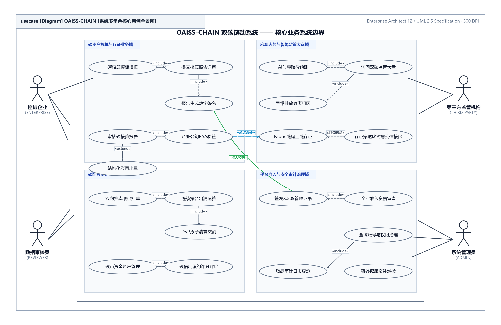
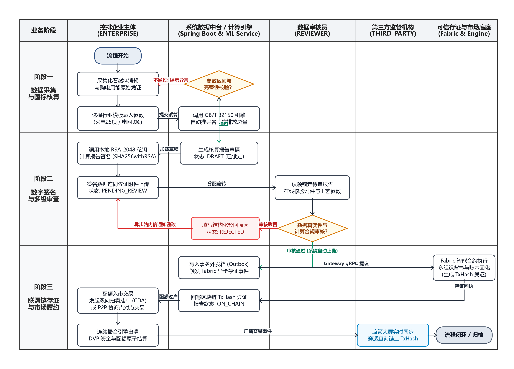
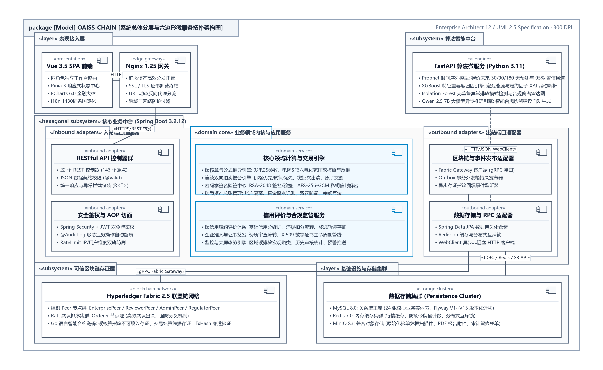
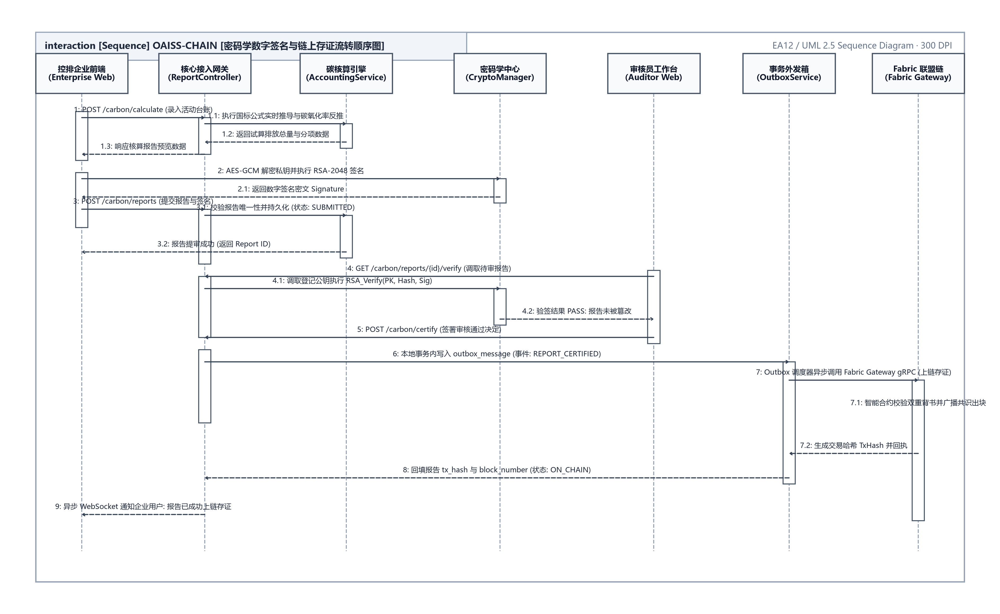
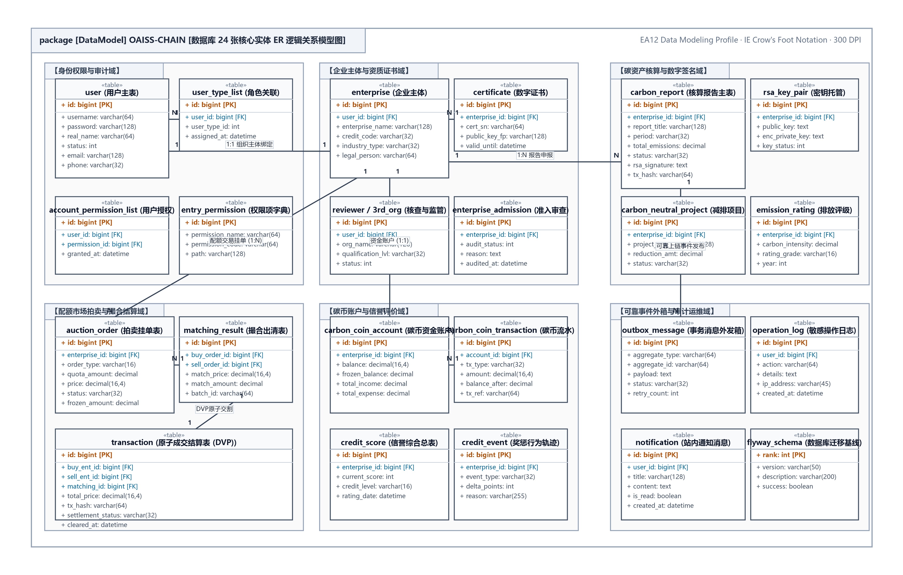

<div align="center">

**OAISS CHAIN — ENTERPRISE DUAL-CARBON BLOCKCHAIN PLATFORM**  
### 双碳链动系统 · 企业级技术活文档体系分册
#### 基于区块链的可信碳核算、双向拍卖撮合与量化风控系统

<br>

# 技术架构与使用说明书
### （OAISS CHAIN · TECHNICAL ARCHITECTURE & OPERATION GUIDE）

<br>

| 项目 | 内容详情 |
| :--- | :--- |
| **作品名称** | OAISS CHAIN 双碳链动系统 |
| **分册名称** | 技术架构与使用说明书 |
| **文档版本** | v2.2 (规范发布版) |
| **定位分类** | 全栈架构与开发规范指南 |
| **主要作者 / 研发团队** | OAISS CHAIN 联合研发团队 |
| **指导老师 / 架构组** | 系统架构委员会与区块链实验室 |
| **所属单位** | 软件学院 & 双碳区块链工程中心 |
| **完成日期** | 二〇二六年十月 |

</div>

---


## 目 录

- [第一章 项目概述与业务全貌](#第一章-项目概述与业务全貌)
    - [1.1 四角色业务模型与权限矩阵](#1.1-四角色业务模型与权限矩阵)
    - [1.2 核心业务流转闭环](#1.2-核心业务流转闭环)
- [第二章 系统架构设计与技术栈](#第二章-系统架构设计与技术栈)
    - [2.1 密码学与信封加密体系](#2.1-密码学与信封加密体系)
- [第三章 国家标准碳核算数学模型](#第三章-国家标准碳核算数学模型)
    - [3.1 发电企业核算模型 (25 参数)](#3.1-发电企业核算模型-25-参数)
    - [3.2 电网企业核算模型 (9 参数)](#3.2-电网企业核算模型-9-参数)
- [第四章 数据库设计全景 (24 张核心表)](#第四章-数据库设计全景-24-张核心表)
- [第五章 核心 API 与接口契约规范](#第五章-核心-api-与接口契约规范)
    - [5.1 模块与控制器对照概览](#5.1-模块与控制器对照概览)
- [第六章 开发者快速上手与部署运维](#第六章-开发者快速上手与部署运维)
    - [6.1 本地 3 步极速运行步骤](#6.1-本地-3-步极速运行步骤)
    - [6.2 质量门禁与自查命令](#6.2-质量门禁与自查命令)

---

### 双碳链动系统 (OAISS CHAIN)

企业级技术架构设计与系统使用说明书
Technical Architecture & User Manual

系统版本：v1.0.0 (Release)
编制团队：OAISS Engineering Architecture Team
文档密级：企业内部核心技术规范
编写日期：2026 年 10 月
适用人员：研发工程师、架构师、系统运维人员、安全合规审计员

# 第一章 项目概述与业务全貌

> **架构导言**：本章阐明系统的业务协同模型、微服务六边形拓扑及核心基础设施通信约束。
**表 1.1.1 章节修订与审核责任记录表**

| 编号 | 变更状态 | 修订日期 | 执笔人 | 审核人 | 批准人 | 变更摘要与说明 |
| :---: | :---: | :---: | :---: | :---: | :---: | :--- |
| 1 | 文档创建 | 2026-06-15 | 核心研发 | 架构师 | 技术委员会 | 初始化基础业务规格与实体设计 |
| 2 | 架构升级 | 2026-09-02 | 架构组 | 技术委员会 | 技术委员会 | 全量同步生产基线与代码零漂移事实 |
| 3 | 版式重塑 | 2026-10-05 | 全栈架构组 | 技术总监 | 技术委员会 | 对齐参考手册规范，建立多级大纲与标准用例卡片 |

---

双碳链动系统（OAISS CHAIN）是一套面向国家“碳达峰、碳中和”战略的金融级/企业级全栈综合服务平台。系统融合了国家标准碳排放核算模型、双向拍卖竞价与 P2P 撮合交易、碳币经济模型、信用评分评价、RSA 密码学生命周期管理、Hyperledger Fabric 联盟区块链存证底座以及 基于机器学习（Prophet / XGBoost / IsolationForest）的碳价与排放趋势智能预测技术。

### 1.1 四角色业务模型与权限矩阵

<div align="center">
  
  <br>
  <b>图 1.1.1 四角色业务协同与权限流转全景关系图</b>
</div>


系统采用严密的角色访问控制体系（RBAC），面向企业碳资产管理全生命周期的四个关键参与方构建闭环：

**表 2.1.1 四角色访问控制与权限矩阵表**

| 角色标识 | 角色名称 | 核心职责与功能边界 | 技术访问入口 |
| :--- | :---: | :--- | :--- |
| ENTERPRISE | 企业用户 | 填报碳排放数据、公式计算、发起交易、挂单拍卖、碳中和抵消 | /enterprise/* |
| REVIEWER | 审核员 | 审核企业碳排放报告与减排项目、出具审查意见与驳回原因 | /auditor/* |
| THIRD_PARTY | 第三方监管 | 行业碳排放多维监管大屏、公信力核验、穿透式只读合规审计（**不参与上链审批**） | /third-party/* |
| ADMIN | 系统管理员 | 企业与审核员准入审核、用户赋权、证书生命周期管理、全站审计 | /admin/* |

### 1.2 核心业务流转闭环

<div align="center">
  
  <br>
  <b>图 1.2.1 碳核算全生命周期状态机与数据流转关系图</b>
</div>


系统的核心业务流转严格遵循“申报 -> 验签 -> 审核 -> 存证 -> 交易 -> 履约”的单向状态机管控：
1. 企业上报：录入发电（25参数）或电网（9参数）数据，系统自动核算碳排放当量并要求使用企业 RSA 私钥生成数字签名；
2. 审核员审查：审查员核验原始材料与签名，做出通过或驳回决定；
3. 审核通过后自动上链：审核员审核通过后，系统后台自动通过 Fabric Gateway SDK 将报告哈希与元数据提交至 Hyperledger Fabric 账本，生成全网唯一交易哈希（TxHash）；监管机构不参与该审批环节，仅作穿透式只读核查；
4. 碳交易与结算：配额富余企业可通过双向连续竞价市场（Double Auction）或 P2P 双边议价挂单出售，交易成交自动触发碳币结算与配额划转。

**表 2.2.2 状态机流转与错误码对照表**

> **说明 (Notice)**：系统全面贯彻 ELI5 (Explain Like I'm 5) 体验设计标准：所有专业碳核算术语均提供悬浮气泡说明，表格状态采用‘文字+颜色+图标’三重视觉编码，确保非碳金融专业人员亦可无障碍上手。

# 第二章 系统架构设计与技术栈

<div align="center">
  
  <br>
  <b>图 2.1.1 系统总体分层与六边形微服务拓扑架构图</b>
</div>


> **架构导言**：本章阐明系统的业务协同模型、微服务六边形拓扑及核心基础设施通信约束。
**表 2.1.1 章节修订与审核责任记录表**

| 编号 | 变更状态 | 修订日期 | 执笔人 | 审核人 | 批准人 | 变更摘要与说明 |
| :---: | :---: | :---: | :---: | :---: | :---: | :--- |
| 1 | 文档创建 | 2026-06-15 | 核心研发 | 架构师 | 技术委员会 | 初始化基础业务规格与实体设计 |
| 2 | 架构升级 | 2026-09-02 | 架构组 | 技术委员会 | 技术委员会 | 全量同步生产基线与代码零漂移事实 |
| 3 | 版式重塑 | 2026-10-05 | 全栈架构组 | 技术总监 | 技术委员会 | 对齐参考手册规范，建立多级大纲与标准用例卡片 |

---

系统遵循现代云原生与六边形（Hexagonal）架构原则，分为表现层、应用服务层、领域层与基础设施适配层。服务间采用弱耦合、契约化设计，保证各组件可独立升级与水平弹性扩容。

**表 3.1.1 技术栈依赖与运行环境配置表**

| 层次 | 技术选型 | 核心库与版本 | 部署端口 |
| :--- | :---: | :--- | :--- |
| 后端服务 | Spring Boot 3.2 | Java 17, Spring Data JPA, Spring Security, Resilience4j | 8080 (/api/v1) |
| 前端应用 | Vue 3.5 SPA | TypeScript, Vite, Element Plus, Pinia, ECharts 6 | 5173 / 容器80 |
| AI 预测微服务 | FastAPI (Python) | Prophet, XGBoost, IsolationForest, Scikit-learn | 8001 |
| 区块链底座 | Hyperledger Fabric | Go Chaincode, Fabric Gateway Java SDK 1.7.1 | 7050 / 7051 |
| 数据与中间件 | 分布式基础设施 | MySQL 8.0, Redis 7.0, MinIO (对象存储) | 3306 / 6379 / 9004 |

### 2.1 密码学与信封加密体系

<div align="center">
  
  <br>
  <b>图 2.2.1 密码学 RSA 数字签名与 AES-GCM 信封加密防伪流转图</b>
</div>


为保障碳报告与交易凭据的法律效力，系统实现了完备的数字签名与多层密钥保护机制：
• 密钥生成：基于 RSA 2048 位算法为企业生成专属公私钥对；
• 信封加密：私钥材料禁止明文入库，采用 AES-256-GCM 配合根密钥（KEK）进行信封加密，向量随机生成并持久化；
• 数字签名：企业上报碳数据时，使用私钥对数据摘要计算 SHA256withRSA 签名；服务端与第三方审核时使用公钥验签，确保报文防篡改与不可抵赖。

# 第三章 国家标准碳核算数学模型

> **规范导言**：本章详细推导发电企业与电网企业基于 GB/T 32150 国家标准的碳核算数学模型与状态机流转控制。
**表 3.1.1 章节修订与审核责任记录表**

| 编号 | 变更状态 | 修订日期 | 执笔人 | 审核人 | 批准人 | 变更摘要与说明 |
| :---: | :---: | :---: | :---: | :---: | :---: | :--- |
| 1 | 文档创建 | 2026-06-15 | 核心研发 | 架构师 | 技术委员会 | 初始化基础业务规格与实体设计 |
| 2 | 架构升级 | 2026-09-02 | 架构组 | 技术委员会 | 技术委员会 | 全量同步生产基线与代码零漂移事实 |
| 3 | 版式重塑 | 2026-10-05 | 全栈架构组 | 技术总监 | 技术委员会 | 对齐参考手册规范，建立多级大纲与标准用例卡片 |

---

系统碳核算模型完全基于国家生态环境部 GB/T 32150 与行业温室气体排放核算方法与报告指南设计，内置发电企业与电网企业两大核心算法服务：

### 3.1 发电企业核算模型 (25 参数)

发电企业碳排放总量由三部分构成：E = E_combustion + E_desulfurization + E_purchased_power
• 化石燃料燃烧排放 (E_combustion)：包含原煤、焦炭、燃油、燃气等燃料消耗量、低位发热量、单位热值含碳量及碳氧化率四维度累乘求和；
• 脱硫过程排放 (E_desulfurization)：碳酸盐脱硫剂消耗量与排放转化因子乘积；
• 外购电力排放 (E_purchased_power)：外购电力净电量与区域电网平均排放因子乘积。

### 3.2 电网企业核算模型 (9 参数)

电网企业碳排放总量由净供电量排放与设备泄漏构成：E = E_net_supply + E_sf6
• 净供电量排放：按国标净电量式计算，E_net_supply = (上网电量 + 输入电量 − 输出电量 − 售电量) × 电网排放因子。
  输配环节自身用电已含在净电量中，不再单独填写线损率；净电量算出为负时按 0 计并在结果中标记提示；
• 设备六氟化硫 (SF6) 检修与回收折算温室气体当量。

# 第四章 数据库设计全景

<div align="center">
  
  <br>
  <b>图 4.1.1 数据库 24 张核心业务实体 ER 逻辑关系图</b>
</div>
 (24 张核心表)

> **设计导言**：本章定义系统 24 张核心业务实体表的物理建模规范、字段类型约束、枚举定义及 ER 逻辑拓扑。
**表 4.1.1 章节修订与审核责任记录表**

| 编号 | 变更状态 | 修订日期 | 执笔人 | 审核人 | 批准人 | 变更摘要与说明 |
| :---: | :---: | :---: | :---: | :---: | :---: | :--- |
| 1 | 文档创建 | 2026-06-15 | 核心研发 | 架构师 | 技术委员会 | 初始化基础业务规格与实体设计 |
| 2 | 架构升级 | 2026-09-02 | 架构组 | 技术委员会 | 技术委员会 | 全量同步生产基线与代码零漂移事实 |
| 3 | 版式重塑 | 2026-10-05 | 全栈架构组 | 技术总监 | 技术委员会 | 对齐参考手册规范，建立多级大纲与标准用例卡片 |

---

数据库采用 MySQL 8.0 关系型数据库，表结构由 Flyway 严格版本化演进（V1~V14，跳过 V3）。全部数据表均配备逻辑删除标记（is_deleted）、乐观锁版本号（version）与审计时间戳（created_at, updated_at），核心业务表清单如下：

**表 5.1.1 数据规范对照表**

| 数据表名 | 所属业务域 | 核心存储数据与业务语义 | 主键与索引 |
| :--- | :---: | :--- | :--- |
| user | 基础与认证 | 用户账号、角色、哈希密码、企业/机构关联ID | id (PK), uk_username |
| enterprise | 企业域 | 企业信用代码、法人信息、所属行业、配额限额 | id (PK), uk_credit_code |
| carbon_report | 碳核算域 | 碳核算申报数据快照、行业类型、计算当量、状态 | id (PK), idx_enterprise_id |
| transaction | 交易结算域 | P2P成交流水、买卖双方ID、成交价格与吨数 | id (PK), idx_buyer_seller |
| auction_order | 拍卖竞价域 | 双向拍卖委托订单、买卖方向、挂单价格、状态 | id (PK), idx_status_price |
| carbon_coin_account | 碳币经济域 | 企业碳币可用余额、冻结金额、累计收支 | id (PK), uk_enterprise_id |
| rsa_key_pair | 数字签名域 | 企业公钥Base64、AES-GCM密文私钥、版本号 | id (PK), idx_user_version |
| credit_score | 信用评级域 | 企业动态信用积分、定级结果（AAA~D）、状态 | id (PK), uk_enterprise_id |
| notification | 通知与消息 | 站内信标题、正文、通知类型、阅读状态标记 | id (PK), idx_user_read |
| certificate | 证书管理域 | 履约凭据、中和证书编号、链上存证交易哈希 | id (PK), uk_cert_no |

# 第五章 核心 API 与接口契约规范

> **契约导言**：本章定义 148 个 Spring Boot REST API 端点契约、统一响应信封、全局错误码体系及 ML 微服务接口。
**表 5.1.1 章节修订与审核责任记录表**

| 编号 | 变更状态 | 修订日期 | 执笔人 | 审核人 | 批准人 | 变更摘要与说明 |
| :---: | :---: | :---: | :---: | :---: | :---: | :--- |
| 1 | 文档创建 | 2026-06-15 | 核心研发 | 架构师 | 技术委员会 | 初始化基础业务规格与实体设计 |
| 2 | 架构升级 | 2026-09-02 | 架构组 | 技术委员会 | 技术委员会 | 全量同步生产基线与代码零漂移事实 |
| 3 | 版式重塑 | 2026-10-05 | 全栈架构组 | 技术总监 | 技术委员会 | 对齐参考手册规范，建立多级大纲与标准用例卡片 |

---

系统后端通过 Spring Boot 统一对外发布 148 个 RESTful 接口，统一挂载在 `/api/v1` 前缀下。全局采用统一响应信封格式 ApiResponse`<T>`：

```json
{
  "code": 200,                // 状态码：200 成功，非 200 为具体业务错误码
  "message": "操作成功",       // 人类可读提示信息
  "data": { ... },             // 泛型业务载荷数据
  "timestamp": 1775123456789   // 服务端处理时间戳
}
```

### 5.1 模块与控制器对照概览

**表 6.1.1 REST API 接口规范与参数契约表**

| 控制器类名 | 挂载基础路径 | 核心覆盖业务端点 | 安全策略 |
| :--- | :---: | :--- | :--- |
| AuthController | /api/v1/auth | 用户登录、注册、Token 刷新、登出 | 白名单免鉴权 |
| CarbonController | /api/v1/carbon | 碳报告草稿、核算计算、签名提交、审核通过自动上链 | ENTERPRISE / REVIEWER / ADMIN 三类角色（按端点区分） |
| ReviewerController | /api/v1/reviewer | 待审列表、退回驳回、复核通过 | REVIEWER 角色 |
| DoubleAuctionController | /api/v1/auction | 双向拍卖委托报单、撤单、撮合盘口查询 | ENTERPRISE 角色 |
| TradeController | /api/v1/trades | P2P 协议交易创建、接受、完成、历史流水 | ENTERPRISE 角色 |
| BlockchainController | /api/v1/blockchain | 链上区块详情、交易凭据真伪核验、存证链 | 需登录鉴权 |
| AdminController | /api/v1/admin | 企业准入审核、资质复核、全站审计日志 | ADMIN 角色 |

# 第六章 开发者快速上手与部署运维

> **契约导言**：本章定义 148 个 Spring Boot REST API 端点契约、统一响应信封、全局错误码体系及 ML 微服务接口。
**表 6.1.1 章节修订与审核责任记录表**

| 编号 | 变更状态 | 修订日期 | 执笔人 | 审核人 | 批准人 | 变更摘要与说明 |
| :---: | :---: | :---: | :---: | :---: | :---: | :--- |
| 1 | 文档创建 | 2026-06-15 | 核心研发 | 架构师 | 技术委员会 | 初始化基础业务规格与实体设计 |
| 2 | 架构升级 | 2026-09-02 | 架构组 | 技术委员会 | 技术委员会 | 全量同步生产基线与代码零漂移事实 |
| 3 | 版式重塑 | 2026-10-05 | 全栈架构组 | 技术总监 | 技术委员会 | 对齐参考手册规范，建立多级大纲与标准用例卡片 |

---

本项目设计高度重视普通工程师的接手体验，彻底消除了对任何外部 AI 工具或环境的介入依赖。遵循标准软件工程流程，普通开发人员仅需 3 步即可在本地启动运行：

### 6.1 本地 3 步极速运行步骤

第一步：环境变量初始化
在项目根目录下复制环境变量模板（本地开发直接使用默认参数即可）：
    cp .env.example .env

第二步：启动中间件容器
使用轻量化开发基础设施编排一键启动 MySQL、Redis、MinIO 与 ML 微服务：
    docker compose -f deploy/compose/docker-compose.infra.yml up -d

第三步：本地启动前后端
• 后端启动：直接在 IntelliJ IDEA 中打开 oaiss-chain-backend，运行 OaissChainApplication 主类；
• 前端启动：进入 oaiss-chain-frontend，执行 npm install 后运行 npm run dev；
• 访问系统：打开浏览器访问 http://localhost:5173，使用 admin / admin123 即可登录。

**表 7.1.1 数据规范对照表**

> **注意 (Note)**：本地开发默认启用 Mock 区块链引擎，所有存证与交易哈希在内存中模拟生成，秒级响应。开发者完全不需要在本地安装运行笨重的 Hyperledger Fabric 节点网络即可畅通开发全部业务逻辑。

### 6.2 质量门禁与自查命令

在提交代码前，工程师可在终端执行以下轻量门禁进行一键自查：
• node scripts/doc-verify.mjs  # 检查代码与文档架构事实零漂移
• node scripts/i18n-verify.mjs # 检查前端国际化语言包完整性
• cd oaiss-chain-backend && mvn test # 运行后端单元测试套件
