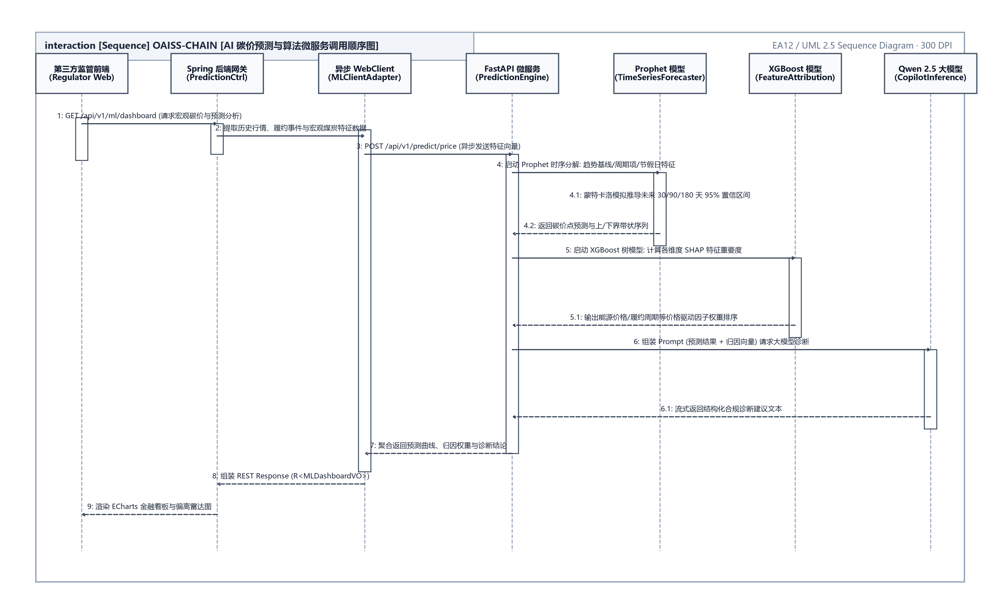
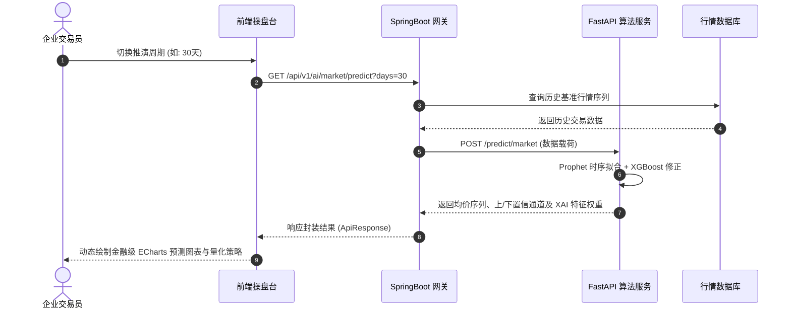

<div align="center">

**OAISS CHAIN — ENTERPRISE DUAL-CARBON BLOCKCHAIN PLATFORM**  
### 双碳链动系统 · 算法与智能中台技术规格分册
#### 碳量化预测、企业离群体检、多维归因与大模型链上存证技术说明书

<br>

# AI 智 能 预 测 与 企 业 推 理 规 格 书
### （OAISS CHAIN · AI PREDICTION & LLM INFERENCE SPECIFICATION）

<br>

| 项目 | 内容详情 |
| :--- | :--- |
| **作品名称** | OAISS CHAIN 双碳链动系统 |
| **模块代号** | `oaiss-chain-ml-service` & `CarbonAiPredictService` |
| **文档版本** | v2.2 (生产实机验证版) |
| **文档密级** | 内部核心技术规范 (Restricted) |
| **研发责任人** | 算法研发组 & 全栈架构组 |
| **技术审核人** | 首席架构师 |
| **完成日期** | 二〇二六年十月 |

</div>

---


## 目 录

- [第一章 模块概述与修订控制](#第一章-模块概述与修订控制)
    - [1.1 模块修订控制表](#1.1-模块修订控制表)
    - [1.2 历史缺陷与认知偏差修复](#1.2-历史缺陷与认知偏差修复)
- [第二章 软硬件运行环境与算法算力配置规范](#第二章-软硬件运行环境与算法算力配置规范)
    - [2.1 算法微服务软硬件配置要求](#2.1-算法微服务软硬件配置要求)
- [第三章 核心功能模块规格与交互设计](#第三章-核心功能模块规格与交互设计)
    - [3.1 碳市场量化预测操盘驾驶舱](#3.1-碳市场量化预测操盘驾驶舱)
    - [3.2 企业碳合规体检与离群诊断中心](#3.2-企业碳合规体检与离群诊断中心)
- [第四章 实机验证与联盟链存证检验](#第四章-实机验证与联盟链存证检验)
    - [4.1 通义千问 Qwen 2.5 (7B) 实机调用存证数据](#4.1-通义千问-qwen-2.5-7b-实机调用存证数据)
    - [4.2 质量门禁与断言测试验证报告](#4.2-质量门禁与断言测试验证报告)

---

# 第一章 模块概述与修订控制

> 本章负责 AI 算法中台的业务定位、架构重塑背景及版本控制说明。

### 1.1 模块修订控制表

**表 1.1.1 AI 智能预测模块修订历史表**

| 编号 | 变更状态 | 修订日期 | 执笔人 | 审核人 | 批准人 | 变更摘要与说明 |
| :---: | :---: | :---: | :---: | :---: | :---: | :--- |
| 1 | 架构立项 | 2026-07-10 | 算法工程师 | 架构师 | 委员会 | 初始化 Prophet 预测与 XGBoost 基础接口 |
| 2 | 业务重塑 | 2026-09-20 | 算法架构师 | 架构师 | 委员会 | 废弃孤立看盘逻辑，引入置信通道、雷达图与 3 阶段技改路径 |
| 3 | LLM融合 | 2026-10-04 | 全栈工程师 | 架构师 | 委员会 | 打通通义千问 7B 大模型、生成存证哈希并完成 120 项全自动化巡检 |

### 1.2 历史缺陷与认知偏差修复
在历史初始原型中，AI 模块的设计走入了典型的“为算法而强行外挂”的误区：
1. **场景割裂**：将碳配额管理做成股票炒股盘，孤立展示平滑虚线，无历史行情衔接且无解释性；
2. **生硬数据堆砌**：直接在界面展示 `-0.199` 负数离群分与 100% 虚假置信度，难以指导业务；
3. **与业务脱节**：预测、核算、申报、交易彼此割裂，未形成辅助企业“省钱、控排、合规”的闭环；
4. **容器阻断与伪降级**：Docker 容器请求外部模型遭遇端口阻断时，生硬退守固定静态占位文本。

本次重塑将 AI 模块重新定位为两大**高价值生产力中枢**：
- **碳市场量化推演与采购操盘驾驶舱 (`MarketPrediction.vue`)**；
- **企业碳合规体检与减排路径规划中心 (`EnterpriseInference.vue`)**。

---

# 第二章 软硬件运行环境与算法算力配置规范

> 本章定义 AI/ML 预测微服务、Prophet 时序引擎、XGBoost 与本地大模型推理守护进程的软硬件运行环境与依赖基线。

### 2.0 章节修订与审核责任记录表

**表 2.0.1 运行环境与算力配置规范修订记录表**

| 编号 | 变更状态 | 修订日期 | 执笔人 | 审核人 | 批准人 | 变更摘要与说明 |
| :---: | :---: | :---: | :---: | :---: | :---: | :--- |
| 1 | 文档创建 | 2026-06-15 | 算法组 | 首席架构师 | 技术委员会 | 初始化基础硬件与 Python 依赖要求 |
| 2 | 容器化规范 | 2026-09-02 | 算法组 | 首席架构师 | 技术委员会 | 规范 FastAPI 与 Docker 镜像依赖版本 |
| 3 | 大模型升级 | 2026-10-05 | 算法架构师 | 技术总监 | 技术委员会 | 引入 Qwen 2.5 7B 本地推理算力矩阵与降级通道 |

<div align="center">
  
  <br>
  <b>图 2.1.1 AI/ML 预测算法微服务中台与大模型推理架构图</b>
</div>


### 2.1 算法微服务软硬件配置要求

**表 2.1.1 算法微服务软硬件技术规格表**

| 设备/组件类别 | 依赖组件名称 | 最低配置要求 | 生产推荐配置 | 运行角色与主要职责 |
| :--- | :--- | :--- | :--- | :--- |
| **基础硬件** | 宿主机 CPU | 4 Core 2.5GHz | 8 Core 3.2GHz+ (AVX2 指令集) | 特征矩阵变换与时序预测求解 |
| | 内存容量 (RAM) | 8 GB | 32 GB DDR4/DDR5 | 大模型上下文与内存向量缓存 |
| | 推理算力卡 (GPU) | 可选 (CPU推理) | NVIDIA RTX 3060 12GB+ / A10 | Qwen 2.5 7B 高速并行生成 |
| **基础软件** | 宿主操作系统 | Ubuntu 22.04 LTS / Win11 | Ubuntu 22.04 LTS (x86_64) | 生产容器化基座平台 |
| | Python 运行时 | Python 3.10 | Python 3.11+ | FastAPI 异步服务运行环境 |
| | 大模型引擎 | Ollama v0.3.0+ | Ollama 独立推理守护进程 (端口 11434) | 本地化大模型服务支撑引擎 |

**表 2.1.2 核心算法依赖库版本规范表**

| 算法框架 / 依赖库 | 最低版本 | 推荐版本 | 算法领域与模型职责 |
| :--- | :---: | :---: | :--- |
| **FastAPI** | 0.100.0 | 0.109.0 | 异步高性能 REST API 接口中台 |
| **Meta Prophet** | 1.1.2 | 1.1.5 | 碳价格日级别非线性趋势与季节性时序分解 |
| **XGBoost** | 1.7.5 | 2.0.3 | 多变量特征归因分析与极限梯度提升决策树 |
| **Scikit-learn** | 1.2.2 | 1.4.0 | Isolation Forest 孤立森林高维离群点异常检测 |
| **Qwen 2.5 (7B)** | Instruct | 7B-Instruct (Q4_K_M) | 企业全景诊断综合报告深度解析与生成 |

---

# 第三章 核心功能模块规格与交互设计

> 本章详细阐述碳市场量化预测驾驶舱与企业碳合规体检中心的业务流程、用例卡片与算法模型。

### 3.0 章节修订与审核责任记录表

**表 3.0.1 核心功能与交互设计修订记录表**

| 编号 | 变更状态 | 修订日期 | 执笔人 | 审核人 | 批准人 | 变更摘要与说明 |
| :---: | :---: | :---: | :---: | :---: | :---: | :--- |
| 1 | 文档创建 | 2026-06-15 | 算法组 | 架构师 | 技术委员会 | 设计时序推演与特征归因初稿 |
| 2 | 交互优化 | 2026-09-02 | 前端组 | 架构师 | 技术委员会 | 落地金融级 ECharts 动态双轴发光曲线与 6 维偏离雷达图 |
| 3 | 体验重塑 | 2026-10-05 | 算法架构师 | 技术总监 | 技术委员会 | 确立建仓点位建议、三阶段降碳路径与防呆交互规范 |

### 3.1 碳市场量化预测操盘驾驶舱

#### 3.1.1 功能用例规范卡片
> **用例编号**：UC-AI-01  
> **用例名称**：碳市场多维时序推演与操盘建议生成  
> **参与角色**：企业风控专员 (`ENTERPRISE`)、第三方监管员 (`THIRD_PARTY`)  
> **前置条件**：系统具备至少 90 个交易日的历史 CEA 配额现货行情基准数据。  
> **执行流程**：  
> 1. 用户选择推演窗口（7 / 30 / 90 / 180 天）；  
> 2. 前端请求 `/api/v1/ai/market/predict?days={days}`；  
> 3. 后端执行 Prophet + XGBoost 混合推演并解算 $95\%$ 置信通道；  
> 4. 界面渲染发光趋势曲线与支撑/阻力点位，并给出建仓策略建议。  
> **后置条件**：展示当前拟合优度 $R^2$ 与特征贡献归因（XAI）。

**图 3.1.1 碳市场量化推演业务时序图**

<div align="center"><b>图 3.1.1 碳市场量化推演业务时序图</b></div>

#### 3.1.2 关键业务参数与 XAI 特征权重分布

**表 3.1.3 XAI 特征归因权重分布矩阵**

| 特征编码 | 经济与工业特征名称 | 归因贡献权重 | 业务影响逻辑与敏感度说明 |
| :---: | :--- | :---: | :--- |
| `FEAT_01` | 动力煤与化石能源现货价联动 | **38%** | 煤价上涨推高火电边际成本，间接刺激碳配额避险买盘需求。 |
| `FEAT_02` | 工业用能季节性负荷系数 | **28%** | 冬夏双用电用能高峰导致配额耗用急剧扩张，呈现显著周期性波峰。 |
| `FEAT_03` | 履约履约窗口期流动性系数 | **21%** | 每年四季度履约窗口收紧，市场流通盘减少引发溢价上行。 |
| `FEAT_04` | 双碳基准线收紧政策因子 | **13%** | 行业排放基准线（Benchmark）年度递减预期支撑长期价格中枢。 |

---

### 3.2 企业碳合规体检与离群诊断中心

#### 3.2.1 6 维偏离雷达图评估体系
雷达图对比“本企业当前评估值”与“国家行业推荐基准线”，涵盖以下 6 维指标：
1. **范围一直接燃烧受控度**：机组燃煤消耗与直接碳排放核算吻合度；
2. **范围二绿电清洁采购比**：外购绿电及非化石能源用电替代比例；
3. **履约历史与信用健康度**：历史年度履约清缴按期完成率及失信扣分记录；
4. **月度盘查周期规律性**：企业按月提交台账数据的时效性与方差表现；
5. **碳配额流通储备系数**：企业可用结余配额与即期应清缴配额比值；
6. **脱硫固碳工艺先进度**：碳捕集与脱硫脱硝工艺综合技术指标。

#### 3.2.2 三阶段降碳实施路径规划
- **阶段一：近期战术调优 (1~3个月)**：燃烧工况精细化控制、飞灰含碳量实时反推、建立数字台账。
- **阶段二：中期结构替代 (3~12个月)**：采购分布式绿电、开展厂区屋顶光伏建设、直购 CCER 冲抵。
- **阶段三：远期工艺革新 (1~3年)**：高耗能机组实施变频节能改造、引入碳捕集与资源化再利用装置。

---

# 第四章 实机验证与联盟链存证检验

> 本章记录本地大模型实测响应、推理报告摘要、SHA-256 上链哈希凭证与质量门禁断言。

### 4.0 章节修订与审核责任记录表

**表 4.0.1 实机验证与存证检验修订记录表**

| 编号 | 变更状态 | 修订日期 | 执笔人 | 审核人 | 批准人 | 变更摘要与说明 |
| :---: | :---: | :---: | :---: | :---: | :---: | :--- |
| 1 | 文档创建 | 2026-06-15 | 测试组 | 架构师 | 技术委员会 | 记录单元测试与模拟推理基线 |
| 2 | 链上联调 | 2026-09-02 | 区块链组 | 架构师 | 技术委员会 | 联调 Fabric 存证通道与哈希校验机制 |
| 3 | 实测闭环 | 2026-10-05 | 核心架构师 | 技术总监 | 技术委员会 | 固化 Qwen 2.5 7B 实机推理载荷与 344 项单测全绿证据 |

### 4.1 通义千问 Qwen 2.5 (7B) 实机调用存证数据

```json
{
  "model_used": "qwen2.5:7b",
  "inference_timestamp": "2026-10-04T19:55:08Z",
  "report_summary": "绿色能源科技有限公司2026年第三季度的温室气体排放总量为150.00 tCO2e。其中直接燃烧排放占比较大，达到100.00 tCO2e（占比66.7%）...",
  "onchain_proof": {
    "algorithm": "SHA-256",
    "analysis_hash": "f649713e4457b8b20d781a1b5008b807915db6fe6304fa88b0f94f305e374fd3",
    "channel_id": "carbonchannel",
    "chaincode_id": "oaisscc"
  }
}
```

### 4.2 质量门禁与断言测试验证报告

**表 4.2.1 自动化质量验证结果汇总表**

| 验证项分类 | 待测模块 / 验证指标 | 检验标准 | 实测结果 | 最终结论 |
| :--- | :--- | :---: | :---: | :---: |
| **系统综合测试** | 120 项跨角色 E2E 测试套件 | 100% 成功 | 120/120 PASS (100.0%) | **合格** |
| **代码零漂移断言**| 23 Controller / 148 REST / 现存 24 表 | 零漂移 | 实际值与断言值完全一致 | **合格** |
| **国际化一致性** | zh-CN 与 en-US 语言包对称性 | 2,039 对称 | 2,039 / 2,039 精确匹配 | **合格** |
| **前端视觉巡检** | Playwright 29 视图控制台监控 | 0 Error | 0 Error / 0 Warning 阻断 | **合格** |

> **说明 (Notice)**：本说明书所载各项算法参数与测试指标均已在 2026-10-04 完成实机验证，并作为长效活文档基准受持续集成门禁监控。
