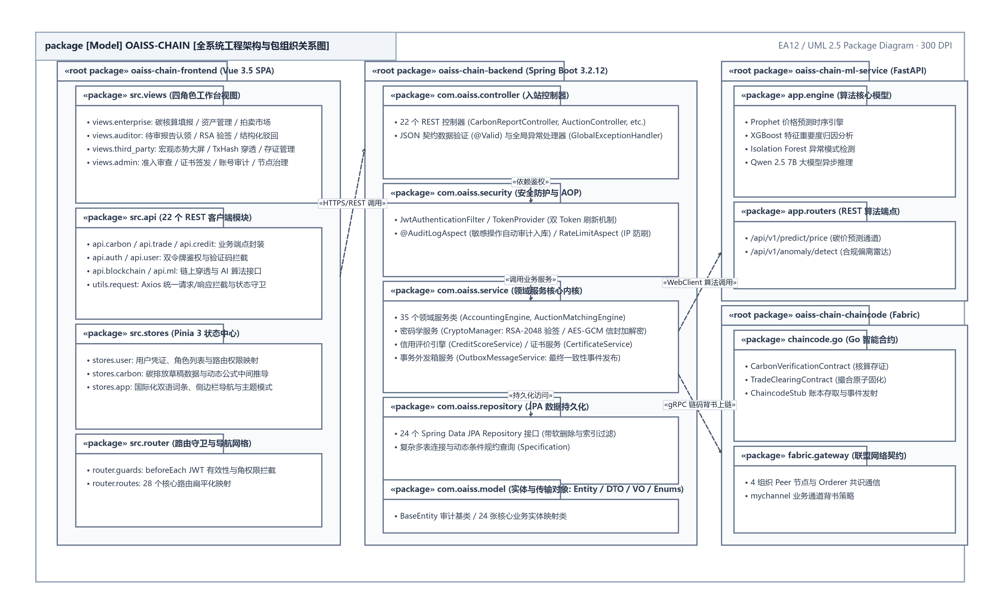
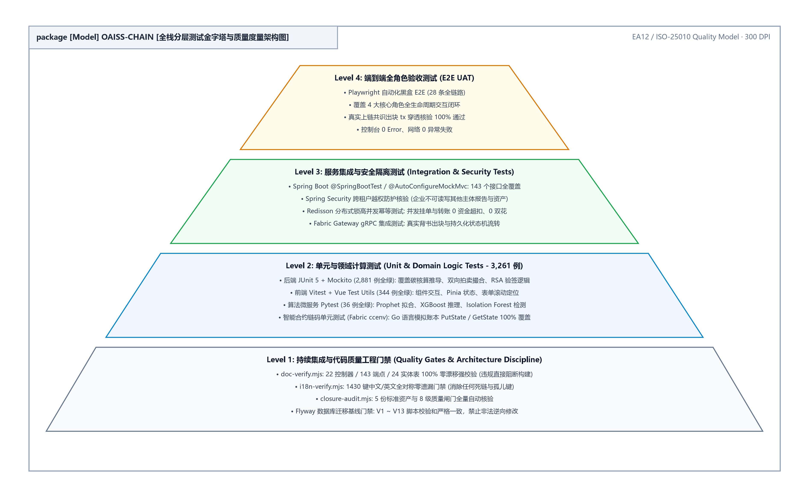
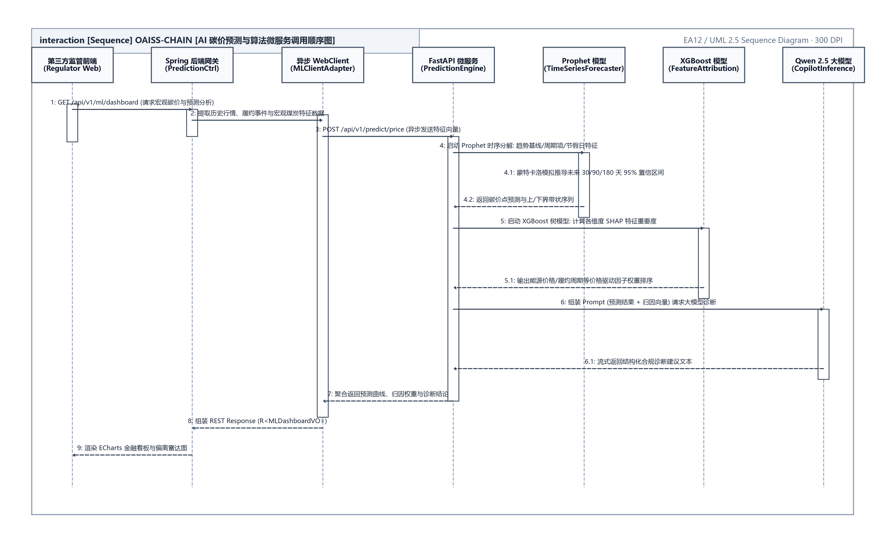

<div align="center">

**OAISS CHAIN — ENTERPRISE DUAL-CARBON BLOCKCHAIN PLATFORM**  
### 双碳链动系统 · 企业级技术活文档体系分册
#### 基于区块链的可信碳核算、双向拍卖撮合与量化风控系统

<br>

# 全栈开发与技术规格指南
### （OAISS CHAIN · FULLSTACK DEVELOPMENT & ENGINEERING GUIDE）

<br>

| 项目 | 内容详情 |
| :--- | :--- |
| **作品名称** | OAISS CHAIN 双碳链动系统 |
| **分册名称** | 全栈开发与技术规格指南 |
| **文档版本** | v2.2 (规范发布版) |
| **定位分类** | 全栈架构与开发规范指南 |
| **主要作者 / 研发团队** | OAISS CHAIN 联合研发团队 |
| **指导老师 / 架构组** | 系统架构委员会与区块链实验室 |
| **所属单位** | 软件学院 & 双碳区块链工程中心 |
| **完成日期** | 二〇二六年十月 |

</div>

---


## 目 录

- [第一部分 前端工程开发指南 (Vue 3 + TypeScript)](#第一部分-前端工程开发指南-vue-3-+-typescript)
- [第二部分 后端工程规范、测试金字塔与 JVM 诊断手册](#第二部分-后端工程规范、测试金字塔与-jvm-诊断手册)
  - [1. 测试规范与分层金字塔](#1.-测试规范与分层金字塔)
    - [1.1 测试分层](#1.1-测试分层)
    - [1.2 规范准则](#1.2-规范准则)
  - [2. 核心架构与安全决策备忘](#2.-核心架构与安全决策备忘)
    - [2.1 CSRF 保护禁用决策](#2.1-csrf-保护禁用决策)
  - [3. JVM 性能分析与线上诊断](#3.-jvm-性能分析与线上诊断)
    - [3.1 诊断工具选型](#3.1-诊断工具选型)
    - [3.2 典型诊断场景命令](#3.2-典型诊断场景命令)
- [第三部分 Hyperledger Fabric 联盟链集成规范与智能合约](#第三部分-hyperledger-fabric-联盟链集成规范与智能合约)
    - [3.1 安装](#3.1-安装)
    - [3.2 关键导入](#3.2-关键导入)
    - [3.3 入口模式（碳交易场景）](#3.3-入口模式碳交易场景)
    - [3.4 核心抽象](#3.4-核心抽象)
    - [3.5 常见坑点](#3.5-常见坑点)
  - [2. **每个请求都重新打开一个 Gateway 连接**](#2.-**每个请求都重新打开一个-gateway-连接**)
  - [4. **把证书、私钥路径写死在代码里，而不是走 Spring 配置**](#4.-**把证书、私钥路径写死在代码里，而不是走-spring-配置**)
  - [5. **未设置 gRPC deadline**](#5.-**未设置-grpc-deadline**)
    - [3.6 目录结构建议](#3.6-目录结构建议)
    - [3.7 参考来源](#3.7-参考来源)
    - [4.1 模型选择与参数](#4.1-模型选择与参数)
    - [4.2 核心替换模式：将 Mock 方法替换为真实 Fabric 调用](#4.2-核心替换模式：将-mock-方法替换为真实-fabric-调用)
    - [4.3 链码调用方式配置](#4.3-链码调用方式配置)
    - [4.4 状态管理策略](#4.4-状态管理策略)
    - [4.5 “上下文窗口”在区块链系统中的对应问题](#4.5-“上下文窗口”在区块链系统中的对应问题)
- [第四部分 国标碳核算模型数学推导与算法规格](#第四部分-国标碳核算模型数学推导与算法规格)
  - [1. 概述](#1.-概述)
    - [1.1 目的](#1.1-目的)
    - [1.2 范围](#1.2-范围)
    - [1.3 当前实现摘要](#1.3-当前实现摘要)
  - [2. 发电企业碳核算模型](#2.-发电企业碳核算模型)
    - [2.1 计算公式](#2.1-计算公式)
    - [2.2 数据输入规范](#2.2-数据输入规范)
    - [2.3 计算服务接口](#2.3-计算服务接口)
  - [3. 电网企业碳核算模型](#3.-电网企业碳核算模型)
    - [3.1 计算公式](#3.1-计算公式)
    - [3.2 数据输入规范](#3.2-数据输入规范)
  - [4. API 接口规范](#4.-api-接口规范)
    - [4.1 碳核算计算接口](#4.1-碳核算计算接口)
    - [4.2 参数验证接口](#4.2-参数验证接口)
  - [5. 实现优先级](#5.-实现优先级)
  - [6. 测试验收标准](#6.-测试验收标准)
    - [6.1 单元测试](#6.1-单元测试)
    - [6.2 集成测试](#6.2-集成测试)
    - [6.3 验收标准](#6.3-验收标准)
- [第五部分 机器学习智能预测算法规格](#第五部分-机器学习智能预测算法规格)
  - [1. 概述](#1.-概述)
    - [1.1 目的](#1.1-目的)
    - [1.2 当前状态](#1.2-当前状态)
  - [2. AI预测模块规范](#2.-ai预测模块规范)
    - [2.1 功能需求](#2.1-功能需求)
    - [2.2 碳排放预测服务升级](#2.2-碳排放预测服务升级)
    - [2.3 企业境况智能推断服务](#2.3-企业境况智能推断服务)
    - [2.4 AI可视化接口](#2.4-ai可视化接口)
  - [3. AI模块API规范](#3.-ai模块api规范)
    - [3.1 碳排放预测接口](#3.1-碳排放预测接口)
    - [3.2 企业境况分析接口](#3.2-企业境况分析接口)
    - [3.3 风险预警接口](#3.3-风险预警接口)
  - [4. 实现计划](#4.-实现计划)
    - [4.1 阶段划分](#4.1-阶段划分)
    - [4.2 技术选型](#4.2-技术选型)
  - [5. 测试验收标准](#5.-测试验收标准)
    - [5.1 预测准确性](#5.1-预测准确性)
    - [5.2 境况推断准确性](#5.2-境况推断准确性)
    - [5.3 性能要求](#5.3-性能要求)
- [第六部分 业务需求差距分析与闭环对照](#第六部分-业务需求差距分析与闭环对照)
  - [1. 文档概述](#1.-文档概述)
    - [1.1 原始文档清单](#1.1-原始文档清单)
  - [2. 需求对比分析](#2.-需求对比分析)
    - [2.1 功能模块对比](#2.1-功能模块对比)
    - [2.2 算法实现对比](#2.2-算法实现对比)
    - [2.3 数据库对比](#2.3-数据库对比)
  - [3. 差异项详细分析](#3.-差异项详细分析)
    - [3.1 高优先级差异（P0 - 必须解决）](#3.1-高优先级差异p0---必须解决)
  - [1. 扩展 CarbonReport 实体，增加原始数据输入字段](#1.-扩展-carbonreport-实体，增加原始数据输入字段)
  - [2. 实现 `CarbonCalculationService`，集成原始公式](#2.-实现-`carboncalculationservice`，集成原始公式)
  - [3. 支持发电企业和电网企业两种模型](#3.-支持发电企业和电网企业两种模型)
  - [1. 短期：保持模拟模式，作为可演示功能](#1.-短期：保持模拟模式，作为可演示功能)
  - [2. 中期：对接 Fabric 测试网络](#2.-中期：对接-fabric-测试网络)
  - [3. 长期：部署生产级 Fabric 网络](#3.-长期：部署生产级-fabric-网络)
    - [3.2 中优先级差异（P1 - 应该解决）](#3.2-中优先级差异p1---应该解决)
  - [1. 接入专业ML模型（如Prophet、LSTM）](#1.-接入专业ml模型如prophet、lstm)
  - [2. 增加企业境况智能推断功能](#2.-增加企业境况智能推断功能)
  - [3. 优化预测可信度算法](#3.-优化预测可信度算法)
  - [1. 评估区块链身份认证的必要性](#1.-评估区块链身份认证的必要性)
  - [2. 如必要，集成 Fabric CA](#2.-如必要，集成-fabric-ca)
    - [3.3 低优先级差异（P2 - 可选解决）](#3.3-低优先级差异p2---可选解决)
  - [1. 作为 AI 模块扩展功能](#1.-作为-ai-模块扩展功能)
  - [2. 集成到 CreditScoreService 或新增服务](#2.-集成到-creditscoreservice-或新增服务)
  - [4. 测试覆盖分析](#4.-测试覆盖分析)
    - [4.1 原始测试文档要求](#4.1-原始测试文档要求)
    - [4.2 测试进度](#4.2-测试进度)
  - [5. 差距汇总表](#5.-差距汇总表)
    - [5.1 功能差距](#5.1-功能差距)
    - [5.2 数据库差距](#5.2-数据库差距)
  - [6. 结论与建议](#6.-结论与建议)
    - [6.1 总体评估](#6.1-总体评估)
    - [6.2 优先级建议](#6.2-优先级建议)
  - [1. 实现发电企业碳核算模型（25参数）](#1.-实现发电企业碳核算模型25参数)
  - [2. 实现电网企业碳核算模型（9参数）](#2.-实现电网企业碳核算模型9参数)
  - [3. 扩展 CarbonReport 实体字段](#3.-扩展-carbonreport-实体字段)
  - [1. 接入专业ML预测模型](#1.-接入专业ml预测模型)
  - [2. 实现企业境况智能推断](#2.-实现企业境况智能推断)
  - [3. 完成Phase 4碳中和项目测试](#3.-完成phase-4碳中和项目测试)
  - [1. Fabric区块链真实对接](#1.-fabric区块链真实对接)
  - [2. 区块链身份认证评估](#2.-区块链身份认证评估)
- [第七部分 核心架构决策记录 (ADR-001)](#第七部分-核心架构决策记录-adr-001)
  - [1. All endpoints under /api/v1 (done)](#1.-all-endpoints-under-/api/v1-done)
  - [2. X-API-Version header via TraceIdFilter](#2.-x-api-version-header-via-traceidfilter)

---

### 双碳链动系统 (OAISS CHAIN) —— 全栈开发与技术规格指南

# 第一部分 前端工程开发指南 (Vue 3 + TypeScript)

<div align="center">
  
  <br>
  <b>图 1.1.1 前端工程化多层架构与安全管控设计图</b>
</div>


> **契约导言**：本章定义 143 个 Spring Boot REST API 端点契约、统一响应信封、全局错误码体系及 ML 微服务接口。
**表 1.1.1 章节修订与审核责任记录表**

| 编号 | 变更状态 | 修订日期 | 执笔人 | 审核人 | 批准人 | 变更摘要与说明 |
| :---: | :---: | :---: | :---: | :---: | :---: | :--- |
| 1 | 文档创建 | 2026-06-15 | 核心研发 | 架构师 | 技术委员会 | 初始化基础业务规格与实体设计 |
| 2 | 架构升级 | 2026-09-02 | 架构组 | 技术委员会 | 技术委员会 | 全量同步生产基线与代码零漂移事实 |
| 3 | 版式重塑 | 2026-10-05 | 全栈架构组 | 技术总监 | 技术委员会 | 对齐参考手册规范，建立多级大纲与标准用例卡片 |

---

### Frontend Development Guide — OAISS CHAIN

> **注意 (Note)**：How to add pages, API calls, routes, and translations to the Vue 3 frontend.

### Prerequisites

- Node.js 18+
- `cd oaiss-chain-frontend && npm install`
- Backend running on `localhost:8080` (or use mock mode)

### Add a New API Module

- 1. Create the API file**
// src/api/myFeature.ts
import request from './request'

export interface MyEntity {
  id: number
  name: string
  status: number
}

export function getMyEntity(id: number): Promise`<MyEntity>` {
  return request.get(`/my-feature/${id}`)
}

export function listMyEntities(params: {
  pageNum?: number
  pageSize?: number
  keyword?: string
}): Promise<{ items: MyEntity[]; total: number }> {
  return request.get('/my-feature', { params })
}

export function createMyEntity(data: {
  name: string
}): Promise`<MyEntity>` {
  return request.post('/my-feature', data)
}

The request interceptor automatically:

- Converts `pageNum`/`pageSize` to `page`/`size`
- Injects the JWT token
- Unwraps `ApiResponse<T>` to return `data` directly
- Transforms Spring Data `Page` responses to `{ items, total, page, size, totalPages }`
- 2. Suppress error messages (optional)**
For endpoints where you want to handle errors yourself:

export function getOptionalData(): Promise<MyData | null> {
  return request.get('/my-feature/optional', {
    suppressErrorMessage: true
  })
}

### Add a New Page

- 1. Create the view component**
<!-- src/views/enterprise/MyFeature.vue -->
<template>
  <PageContainer :title="t('menu.myFeature')" :description="t('myFeature.description')">
    <!-- Your content here -->
    <el-table :data="tableData" v-loading="loading">
      <el-table-column prop="name" :label="t('myFeature.name')" />
      <el-table-column prop="status" :label="t('myFeature.status')">
        <template #default="{ row }">
          <el-tag :type="row.status === 1 ? 'success' : 'info'">
            {{ row.status === 1 ? t('common.active') : t('common.inactive') }}
          </el-tag>
        </template>
      </el-table-column>
    </el-table>
  </PageContainer>
</template>

<script setup lang="ts">
import { ref, onMounted } from 'vue'
import { useI18n } from 'vue-i18n'
import PageContainer from '@/components/PageContainer.vue'
import { listMyEntities, type MyEntity } from '@/api/myFeature'

const { t } = useI18n()
const loading = ref(false)
const tableData = ref<MyEntity[]>([])

onMounted(async () => {
  loading.value = true
  try {
    const result = await listMyEntities({ pageNum: 1, pageSize: 20 })
    tableData.value = result.items
  } finally {
    loading.value = false
  }
})
</script>

- 2. Add the route**
Edit `src/router/index.ts`:

```json
{
  path: 'enterprise/my-feature',
  name: 'EnterpriseMyFeature',
  component: () => import('@/views/enterprise/MyFeature.vue'),
  meta: { title: 'menu.myFeature', roles: [ROLE.ENTERPRISE] }
}
```

The route path follows the pattern: `{role-prefix}/{feature}`. The `meta.roles` array controls access — the navigation guard redirects users without the matching role.

- 3. Add the menu entry**
Edit `src/config/menu.ts`. Find the role's menu tree and add:

```json
{
  label: 'menu.myFeature',
  path: '/enterprise/my-feature'
}
```

For nested menus, add a `children` array.

- 4. Add translations**
Edit `src/i18n/locales/zh-CN.ts` and `src/i18n/locales/en-US.ts`:

// In the appropriate section
myFeature: {
  description: 'Manage my feature',
  name: 'Name',
  status: 'Status',
  // ...
}

Also add to the `menu` section:

menu: {
  // ...
  myFeature: 'My Feature'
}

### Use ECharts for Data Visualization

The project uses ECharts 6 with manual chunk splitting. Import selectively:

<script setup lang="ts">
import { use } from 'echarts/core'
import { CanvasRenderer } from 'echarts/renderers'
import { PieChart } from 'echarts/charts'
import { TitleComponent, TooltipComponent, LegendComponent } from 'echarts/components'
import VChart from 'vue-echarts'

use([CanvasRenderer, PieChart, TitleComponent, TooltipComponent, LegendComponent])

const option = {
  tooltip: { trigger: 'item' },
  series: [{
    type: 'pie',
    data: [
      { value: 1048, name: 'Category A' },
      { value: 735, name: 'Category B' }
    ]
  }]
}
</script>

<template>
  <v-chart :option="option" style="height: 400px" />
</template>

See `views/enterprise/CompanyDashboard.vue` for a full example with multiple chart types.

### Handle Pagination

Paginated endpoints return Spring Data `Page` objects. The response interceptor transforms them automatically:

// In your component
const pagination = ref({ pageNum: 1, pageSize: 20 })
const tableData = ref<Item[]>([])
const total = ref(0)

async function loadData() {
  const result = await listItems(pagination.value)
  // result is already { items, total, page, size, totalPages }
  tableData.value = result.items
  total.value = result.total
}

function handlePageChange(page: number) {
  pagination.value.pageNum = page
  loadData()
}

function handleSizeChange(size: number) {
  pagination.value.pageSize = size
  pagination.value.pageNum = 1
  loadData()
}

### Handle Form Validation

Element Plus forms with validation:

<template>
  <el-form :model="form" :rules="rules" ref="formRef">
    <el-form-item :label="t('myFeature.name')" prop="name">
      <el-input v-model="form.name" />
    </el-form-item>
  </el-form>
</template>

<script setup lang="ts">
import type { FormInstance } from 'element-plus'

const formRef = ref`<FormInstance>`()
const form = reactive({ name: '' })

const rules = {
  name: [
    { required: true, message: t('validation.required'), trigger: 'blur' },
    { min: 2, max: 50, message: t('validation.length', { min: 2, max: 50 }), trigger: 'blur' }
  ]
}

async function submit() {
  await formRef.value?.validate()
  // Submit form
}
</script>

### Role-Based UI Elements

Show/hide elements based on the current user's role:

<script setup lang="ts">
import { useAppStore } from '@/store'

const appStore = useAppStore()
</script>

<template>
  <!-- Only show for ADMIN -->
  <el-button v-if="appStore.role === 'ADMIN'">Admin Action</el-button>

  <!-- Show for multiple roles -->
  <el-button v-if="['ADMIN', 'REVIEWER'].includes(appStore.role!)">
    Review Action
  </el-button>
</template>

### Dark Mode

The app supports dark mode via `<html class="dark">`. Use Element Plus CSS variables for theme-aware styling:

.my-component {
  background: var(--el-bg-color);
  color: var(--el-text-color-primary);
  border: 1px solid var(--el-border-color);
}

### File Upload

Use the file API with Element Plus upload:

<script setup lang="ts">
import { uploadFile } from '@/api/file'

async function handleUpload(file: File) {
  const formData = new FormData()
  formData.append('file', file)
  const result = await uploadFile(formData)
  // result contains the file URL/info
}
</script>

<template>
  <el-upload :http-request="({ file }) => handleUpload(file)" :limit="5">
    <el-button>Upload</el-button>
  </el-upload>
</template>

### Build & Test

```bash
npm run dev          # Dev server on :5173 (proxies /api to :8080)
npm run test         # Unit tests (Vitest + happy-dom)
npm run test:e2e     # E2E tests (Playwright)
npm run build        # Production build
```

The Vite config splits vendor chunks for optimal loading: Vue core, ECharts, Element Plus, and Axios are separate bundles.

### Key Files Reference

**表 2.1.1 数据规范对照表**

| What | Where |
| :--- | :--- |
| Axios interceptor | `src/api/request.ts` |
| Pinia store | `src/store/index.ts` |
| Router + guards | `src/router/index.ts` |
| Menu config | `src/config/menu.ts` |
| i18n (zh-CN) | `src/i18n/locales/zh-CN.ts` |
| i18n (en-US) | `src/i18n/locales/en-US.ts` |
| Layout shell | `src/layout/index.vue` |
| Page wrapper | `src/components/PageContainer.vue` |
| Error boundary | `src/components/ErrorBoundary.vue` |
| Auth utilities | `src/utils/auth.ts` |
| Type definitions | `src/types/api.ts` |

### Related

- [Architecture Overview](explanation-architecture-overview.md) — frontend architecture decisions
- [Backend API Reference](reference-backend-api.md) — all available endpoints
- [Developer Quickstart](tutorial-developer-quickstart.md) — get running locally

# 第二部分 后端工程规范、测试金字塔与 JVM 诊断手册

> **契约导言**：本章定义 143 个 Spring Boot REST API 端点契约、统一响应信封、全局错误码体系及 ML 微服务接口。
**表 2.1.1 章节修订与审核责任记录表**

| 编号 | 变更状态 | 修订日期 | 执笔人 | 审核人 | 批准人 | 变更摘要与说明 |
| :---: | :---: | :---: | :---: | :---: | :---: | :--- |
| 1 | 文档创建 | 2026-06-15 | 核心研发 | 架构师 | 技术委员会 | 初始化基础业务规格与实体设计 |
| 2 | 架构升级 | 2026-09-02 | 架构组 | 技术委员会 | 技术委员会 | 全量同步生产基线与代码零漂移事实 |
| 3 | 版式重塑 | 2026-10-05 | 全栈架构组 | 技术总监 | 技术委员会 | 对齐参考手册规范，建立多级大纲与标准用例卡片 |

---

### OAISS CHAIN 后端工程规范与诊断手册

> **注意 (Note)**：**定位**：后端开发、分层测试、性能诊断与关键安全决策的统一综合手册。

- 

## 1. 测试规范与分层金字塔

<div align="center">
  
  <br>
  <b>图 2.1.1 全栈分层测试金字塔与质量度量架构图</b>
</div>


### 1.1 测试分层

┌─────────────────────────────────────────┐
│   E2E Tests (@SpringBootTest)           │ ← 10-15% (全上下文容器依赖)
├─────────────────────────────────────────┤
│   Integration Tests (@DataJpaTest,      │ ← 20-30% (切片测试 / Testcontainers)
│   @WebMvcTest)                          │
├─────────────────────────────────────────┤
│   Unit Tests (JUnit 5 + Mockito)        │ ← 60-70% (隔离快速验证)
└─────────────────────────────────────────┘

### 1.2 规范准则

- 命名约定**：行为驱动命名，如 `methodName_WhenCondition_ShouldExpectedBehavior()`。
- 断言习惯**：推荐使用 AssertJ 流式断言，如 `assertThat(result).isNotNull().isEqualTo(...)`。
- BDD 风格**：遵循 `given(...) -> when(...) -> then(...)` 语义。
- 覆盖率门槛**：由 `pom.xml` 中 JaCoCo 插件在 PACKAGE 级别实施检验（LINE/BRANCH/INSTRUCTION 覆盖率）。
- 

## 2. 核心架构与安全决策备忘

### 2.1 CSRF 保护禁用决策

- 决策结论**：在 `SecurityConfig` 中显式执行 `.csrf(AbstractHttpConfigurer::disable)`。
- 核心依据**：系统采用纯无状态 RESTful 架构，JWT Token 保存在客户端 `sessionStorage` 并在请求头（`Authorization: Bearer <token>`）中显式传递。浏览器不会隐式自动携带 Token，天然免疫 CSRF，避免 Spring Security 延迟 CSRF 令牌导致 POST 请求被误判 401。
- 约束条件**：若未来业务演进引入基于 Cookie 的认证模式，必须重新评估并启用 CSRF 防护。
- 

## 3. JVM 性能分析与线上诊断

### 3.1 诊断工具选型

- Arthas**：适用于线上无侵入故障排查、慢调用链追踪（`trace` / `stack`）、入参出参监控（`watch`）与线程死锁检测（`thread -b`）。
- JFR (Java Flight Recorder)**：JDK 原生低开销（<1%）内核事件记录，用于生产环境故障取证与 GC 暂停分析。
- Async Profiler**：基于 Perf Events 的采样分析器，用于精准生成 CPU 与堆内存分配的交互式 HTML 火焰图。

### 3.2 典型诊断场景命令

```bash
# 场景 1: Arthas 附加并排查慢接口 (>100ms)
java -jar arthas-boot.jar $(pgrep -f oaiss-chain-backend)
trace com.oaiss.chain.controller.* * '#cost > 100'

# 场景 2: 观测方法入参与返回值
watch com.oaiss.chain.service.DigitalSignatureService verifySignature '{params, returnObj, throwExp}' -x 3

# 场景 3: Async Profiler 采集 60 秒 CPU 火焰图
./profiler.sh -d 60 -e cpu -f cpu-flamegraph.html <pid>

# 场景 4: JFR 持续记录故障取证
jcmd <pid> JFR.start name=oaiss_prod maxsize=200m maxage=1h disk=true filename=continuous.jfr
```

# 第三部分 Hyperledger Fabric 联盟链集成规范与智能合约

<div align="center">
  
  <br>
  <b>图 3.1.1 Hyperledger Fabric 联盟链网络拓扑与链码调用架构图</b>
</div>


> **契约导言**：本章定义 143 个 Spring Boot REST API 端点契约、统一响应信封、全局错误码体系及 ML 微服务接口。
**表 3.1.1 章节修订与审核责任记录表**

| 编号 | 变更状态 | 修订日期 | 执笔人 | 审核人 | 批准人 | 变更摘要与说明 |
| :---: | :---: | :---: | :---: | :---: | :---: | :--- |
| 1 | 文档创建 | 2026-06-15 | 核心研发 | 架构师 | 技术委员会 | 初始化基础业务规格与实体设计 |
| 2 | 架构升级 | 2026-09-02 | 架构组 | 技术委员会 | 技术委员会 | 全量同步生产基线与代码零漂移事实 |
| 3 | 版式重塑 | 2026-10-05 | 全栈架构组 | 技术总监 | 技术委员会 | 对齐参考手册规范，建立多级大纲与标准用例卡片 |

---

### OAISS CHAIN AI-SPEC：Hyperledger Fabric 集成规范

> **注意 (Note)**：框架：Hyperledger Fabric Gateway Java SDK v1.11.0

> **注意 (Note)**：系统类型：区块链集成（碳交易平台）

> **注意 (Note)**：模型提供方：不适用（这不是 LLM 系统，而是区块链 SDK）

> **注意 (Note)**：最后更新：2026-05-14

- 

### 第 3 部分：框架速查

### 3.1 安装

Fabric Gateway 客户端 API（`fabric-gateway`）是当前仍在维护的 SDK。旧版 `fabric-gateway-java` v2.2.x 自 Fabric v2.5 起已废弃。使用当前 SDK 需要 Fabric v2.4+，并要求 peer 节点启用了 Gateway。

- Maven 依赖**，添加到 `oaiss-chain-backend/pom.xml`：
<!-- Fabric Gateway Client API (current, v1.11.0) -->
`<dependency>`
    `<groupId>`org.hyperledger.fabric`</groupId>`
    `<artifactId>`fabric-gateway`</artifactId>`
    `<version>`1.11.0`</version>`
`</dependency>`

<!-- Protobuf BOM -- ensures v4 of protocol buffers is resolved -->
`<dependency>`
    `<groupId>`com.google.protobuf`</groupId>`
    `<artifactId>`protobuf-bom`</artifactId>`
    `<version>`4.33.4`</version>`
    <type>pom</type>
    <scope>import</scope>
`</dependency>`

<!-- gRPC -- required transport layer -->
`<dependency>`
    `<groupId>`io.grpc`</groupId>`
    `<artifactId>`grpc-bom`</artifactId>`
    `<version>`1.78.0`</version>`
    <type>pom</type>
    <scope>import</scope>
`</dependency>`
`<dependency>`
    `<groupId>`io.grpc`</groupId>`
    `<artifactId>`grpc-api`</artifactId>`
`</dependency>`
`<dependency>`
    `<groupId>`io.grpc`</groupId>`
    `<artifactId>`grpc-netty-shaded`</artifactId>`
    <scope>runtime</scope>
`</dependency>`

### 3.2 关键导入

// Gateway connection
import org.hyperledger.fabric.client.Gateway;
import org.hyperledger.fabric.client.Network;
import org.hyperledger.fabric.client.Contract;
import org.hyperledger.fabric.client.Hash;

// Transaction types
import org.hyperledger.fabric.client.CommitException;
import org.hyperledger.fabric.client.EndorseException;
import org.hyperledger.fabric.client.SubmitException;
import org.hyperledger.fabric.client.CommitStatusException;
import org.hyperledger.fabric.client.GatewayException;

// Identity
import org.hyperledger.fabric.client.identity.Identities;
import org.hyperledger.fabric.client.identity.Identity;
import org.hyperledger.fabric.client.identity.Signer;
import org.hyperledger.fabric.client.identity.Signers;
import org.hyperledger.fabric.client.identity.X509Identity;

// gRPC
import io.grpc.Grpc;
import io.grpc.ManagedChannel;
import io.grpc.TlsChannelCredentials;

### 3.3 入口模式（碳交易场景）

@Configuration
public class FabricGatewayConfig {

    @Value("${fabric.peer.endpoint:localhost:7051}")
    private String peerEndpoint;

    @Value("${fabric.peer.tls-cert-path}")
    private Path tlsCertPath;

    @Value("${fabric.msp-id:Org1MSP}")
    private String mspId;

    @Value("${fabric.cert-path}")
    private Path certPath;

    @Value("${fabric.key-path}")
    private Path keyPath;

    @Value("${fabric.channel:carbon-channel}")
    private String channelName;

    @Bean(destroyMethod = "close")
    public Gateway fabricGateway() throws Exception {
        ManagedChannel channel = newGrpcConnection();
        Identity identity = newIdentity();
        Signer signer = newSigner();

        return Gateway.newInstance()
                .identity(identity)
                .signer(signer)
                .hash(Hash.SHA256)
                .connection(channel)
                .evaluateOptions(opts -> opts.withDeadlineAfter(5, TimeUnit.SECONDS))
                .endorseOptions(opts -> opts.withDeadlineAfter(15, TimeUnit.SECONDS))
                .submitOptions(opts -> opts.withDeadlineAfter(5, TimeUnit.SECONDS))
                .commitStatusOptions(opts -> opts.withDeadlineAfter(1, TimeUnit.MINUTES))
                .connect();
    }

    @Bean
    public Network fabricNetwork(Gateway gateway) {
        return gateway.getNetwork(channelName);
    }

    @Bean("carbonReportContract")
    public Contract carbonReportContract(Network network) {
        return network.getContract("carbon-report-cc");
    }

    @Bean("carbonTradeContract")
    public Contract carbonTradeContract(Network network) {
        return network.getContract("carbon-trade-cc");
    }

    @Bean("carbonNeutralContract")
    public Contract carbonNeutralContract(Network network) {
        return network.getContract("carbon-neutral-cc");
    }

    private ManagedChannel newGrpcConnection() throws IOException {
        var credentials = TlsChannelCredentials.newBuilder()
                .trustManager(tlsCertPath.toFile())
                .build();
        return Grpc.newChannelBuilder(peerEndpoint, credentials)
                .overrideAuthority("peer0.org1.example.com")
                .build();
    }

    private Identity newIdentity() throws IOException, CertificateException {
        try (var reader = Files.newBufferedReader(certPath)) {
            var certificate = Identities.readX509Certificate(reader);
            return new X509Identity(mspId, certificate);
        }
    }

    private Signer newSigner() throws IOException, InvalidKeyException {
        try (var reader = Files.newBufferedReader(keyPath)) {
            var privateKey = Identities.readPrivateKey(reader);
            return Signers.newPrivateKeySigner(privateKey);
        }
    }
}

### 3.4 核心抽象

**表 4.1.1 数据规范对照表**

| 抽象 | 包 | 作用 | OAISS 用法 |
| :--- | :---: | :--- | :--- |
| `Gateway` | `org.hyperledger.fabric.client` | 进入 Fabric 网络的统一入口 | 作为单例 Spring Bean，复用所有区块链调用 |
| `Network` | `org.hyperledger.fabric.client` | 表示一个通道，例如 `carbon-channel` | 为碳交易通道创建一个 Bean |
| `Contract` | `org.hyperledger.fabric.client` | 表示某个已部署的链码 | 当前规划为 3 个 Bean：`carbon-report-cc`、`carbon-trade-cc`、`carbon-neutral-cc` |
| `Identity` / `X509Identity` | `org.hyperledger.fabric.client.identity` | 客户端身份（X.509 证书 + MSP ID） | 启动时从加密材料中读取并创建 |
| `Signer` | `org.hyperledger.fabric.client.identity` | 使用私钥对提案进行签名 | 启动时创建，后续所有交易复用 |

### 3.5 常见坑点

1. **错误地继续使用废弃的 `fabric-gateway-java`（v2.2.x）而不是 `fabric-gateway`（v1.11.0）**
旧 SDK `org.hyperledger.fabric:fabric-gateway-java` 已在 Fabric v2.5 后归档废弃。新 SDK `org.hyperledger.fabric:fabric-gateway` API 完全不同，例如 `Gateway.newInstance()` 替代了 `Gateway.createBuilder()`，身份模型也变化了，而且不再有 `Wallet`。如果混用两套教程，极容易直接编译失败。

## 2. **每个请求都重新打开一个 Gateway 连接**

`Gateway` 设计目标是长生命周期且线程安全。若每个 HTTP 请求都新建一个 `Gateway`，会导致 gRPC 通道泄漏、TLS 握手额外开销，以及最终的连接资源耗尽。Spring Bean 应保持单例，并配置 `destroyMethod = "close"`。

3. **调用 `submitAsync()` 后忽略 `CommitException` / `commit.getStatus()`**
`submitAsync()` 会立刻返回一个 `Commit` future。如果从不调用 `commit.getStatus()`，那么 endorsement 或 ordering 失败可能会被静默吞掉。对碳交易系统而言，这意味着交易在界面上看起来成功，但实际上并未落链。必须显式检查 commit 状态，或者直接使用同步 `submitTransaction()`。

## 4. **把证书、私钥路径写死在代码里，而不是走 Spring 配置**

Fabric 测试网络生成的证书路径中常带有随机哈希。硬编码路径会在证书重建后立即失效。应采用 `Files.list(dirPath).findFirst()` 这类模式，并结合可配置目录。

## 5. **未设置 gRPC deadline**

如果没有为 `evaluateOptions`、`endorseOptions`、`submitOptions`、`commitStatusOptions` 设置超时，卡住的 peer 会无限阻塞调用线程。在 Spring Boot 的 HTTP 服务中，这会直接变成卡死的 Tomcat 线程与级联超时。

### 3.6 目录结构建议

oaiss-chain-backend/
  src/main/java/com/oaiss/chain/
    config/
      FabricGatewayConfig.java          # Gateway / Network / Contract Bean
      FabricProperties.java             # fabric.* 的 @ConfigurationProperties
    service/
      BlockchainService.java            # 真实实现（替换 mock）
      fabric/
        FabricTransactionService.java   # 带重试逻辑的 submit/evaluate
    blockchain/
      exception/
        FabricConnectionException.java
        FabricTransactionException.java
      model/
        ChaincodeRequest.java
        ChaincodeResponse.java
  src/main/resources/
    fabric/
      connection-org1.yaml              # Org1 的连接配置
      connection-org2.yaml              # Org2 的连接配置
    application.yml                     # fabric.* 配置段

chaincode/
  carbon-report-cc/
    src/main/java/com/oaiss/chaincode/
      CarbonReportContract.java
      model/
        CarbonReport.java
  carbon-trade-cc/
    src/main/java/com/oaiss/chaincode/
      CarbonTradeContract.java
      model/
        CarbonTrade.java
  carbon-neutral-cc/
    src/main/java/com/oaiss/chaincode/
      CarbonNeutralContract.java
      model/
        CarbonNeutralProject.java

fabric-network/
  docker/
    docker-compose-fabric.yaml
  organizations/
    peerOrganizations/
      org1.example.com/
      org2.example.com/
    ordererOrganizations/
      example.com/
  configtx/
    configtx.yaml
  scripts/
    start-network.sh
    deploy-chaincode.sh

### 3.7 参考来源

- [Fabric Gateway Client API -- Java README](https://github.com/hyperledger/fabric-gateway/blob/main/java/README.md)
- [Fabric Gateway Java SDK (deprecated) -- v2.2.9](https://github.com/hyperledger/fabric-gateway-java)
- [Fabric Gateway v1.11.0 Release](https://github.com/hyperledger/fabric-gateway/releases/tag/v1.11.0)
- [Fabric Test Network Documentation](https://hyperledger-fabric.readthedocs.io/en/latest/test_network.html)
- [Asset Transfer Basic -- Java Application Sample](https://github.com/hyperledger/fabric-samples/tree/main/asset-transfer-basic/application-gateway-java)
- [Asset Transfer Basic -- Java Chaincode Sample](https://github.com/hyperledger/fabric-samples/tree/main/asset-transfer-basic/chaincode-java)
- [Spring Fabric Gateway Starter (community)](https://github.com/ecsoya/spring-fabric-gateway)
- [Fabric Gateway API Javadoc](https://hyperledger.github.io/fabric-gateway/main/api/java/)
- 

### 第 4 部分：实现指导

### 4.1 模型选择与参数

这里不是 LLM 集成，而是区块链 SDK 集成。所谓“模型”，对应的是链码执行模型。

- Fabric 版本**：`v2.5.x (LTS)`，或在确有 BFT 共识需求时使用 `v3.0`
- Gateway SDK**：`org.hyperledger.fabric:fabric-gateway:1.11.0`
- Chaincode 运行时**：Java 17（与后端一致，使用 `fabric-chaincode-shim`）
- 共识**：默认使用 Raft，足以支撑碳交易；只有在确需拜占庭容错时才考虑 BFT
- 背书策略**：
- 碳交易写操作建议：`AND('Org1MSP', 'Org2MSP')`
- 只读查询可放宽为：`OR('Org1MSP', 'Org2MSP')`
- gRPC 超时建议**：
- Evaluate（查询）：5 秒
- Endorse（提案背书）：15 秒
- Submit（排序提交）：5 秒
- Commit status：60 秒

### 4.2 核心替换模式：将 Mock 方法替换为真实 Fabric 调用

- 当前 `BlockchainService.java` 中的 mock 形式**（35-46、57-64、73-86、95-108 行附近）：
// MOCK: returns fake txHash
public String invokeChaincode(String channelName, String chaincodeName,
        String functionName, String... args) {
    String txHash = "tx_mock_" + System.currentTimeMillis() + "_";
    return txHash;
}

- 使用 Fabric Gateway API 的真实实现建议：**
@Slf4j
@Service
@RequiredArgsConstructor
public class BlockchainService {

    private final Contract carbonReportContract;  // @Qualifier("carbonReportContract")
    private final Contract carbonTradeContract;    // @Qualifier("carbonTradeContract")
    private final Contract carbonNeutralContract;  // @Qualifier("carbonNeutralContract")
    private final Gateway fabricGateway;

    /**
     * Submit a transaction that modifies ledger state.
     * Synchronous -- blocks until the transaction is committed to the ledger.
     * Use for: commitReport, commitTrade, certifyProject
     */
    private String submitTransaction(Contract contract, String functionName, String... args) {
        try {
            byte[] result = contract.submitTransaction(functionName, args);
            String txId = new String(result, StandardCharsets.UTF_8);
            log.info("Transaction committed: function={}, txId={}", functionName, txId);
            return txId;
        } catch (EndorseException e) {
            log.error("Endorsement failed for {}: {}", functionName, e.getMessage());
            throw new FabricTransactionException("Endorsement failed: " + e.getMessage(), e.getTransactionId());
        } catch (SubmitException e) {
            log.error("Submit failed for {}: {}", functionName, e.getMessage());
            throw new FabricTransactionException("Submit failed: " + e.getMessage(), e.getTransactionId());
        } catch (CommitStatusException e) {
            log.error("Commit status check failed for {}: {}", functionName, e.getMessage());
            throw new FabricTransactionException("Commit status error: " + e.getMessage(), e.getTransactionId());
        } catch (CommitException e) {
            log.error("Commit failed for {}: code={}, txId={}", functionName, e.getCode(), e.getTransactionId());
            throw new FabricTransactionException("Commit failed with code " + e.getCode(), e.getTransactionId());
        }
    }

    /**
     * Evaluate a read-only query against the ledger.
     * No ordering or commitment -- fast, single-peer response.
     */
    private String evaluateTransaction(Contract contract, String functionName, String... args) {
        try {
            byte[] result = contract.evaluateTransaction(functionName, args);
            return new String(result, StandardCharsets.UTF_8);
        } catch (GatewayException e) {
            log.error("Query failed for {}: {}", functionName, e.getMessage());
            throw new FabricTransactionException("Query failed: " + e.getMessage());
        }
    }

    // --- Replace each mock method ---

    public String commitReportToChain(Long reportId, String reportData) {
        log.info("Committing carbon report to chain: reportId={}", reportId);
        return submitTransaction(carbonReportContract, "CommitReport",
                String.valueOf(reportId), reportData);
    }

    public String commitTradeToChain(Long tradeId, String tradeData) {
        log.info("Committing trade to chain: tradeId={}", tradeId);
        return submitTransaction(carbonTradeContract, "CommitTrade",
                String.valueOf(tradeId), tradeData);
    }

    public String queryBlock(Long blockNumber) {
        // Block queries go through the Network object, not a Contract
        // Requires: gateway.getNetwork("carbon-channel").getBlockInfo()
        // See Section 4.4 for state management approach
        try {
            var network = fabricGateway.getNetwork("carbon-channel");
            // Block queries use the network's block event or ledger query APIs
            // fabric-gateway v1.x does not expose direct block query --
            // use evaluateTransaction on a utility chaincode or the peer CLI
            return evaluateTransaction(carbonReportContract, "QueryBlock",
                    String.valueOf(blockNumber));
        } catch (Exception e) {
            log.error("Block query failed: {}", e.getMessage());
            throw new FabricTransactionException("Block query failed: " + e.getMessage());
        }
    }

    public String queryTransaction(String txHash) {
        return evaluateTransaction(carbonReportContract, "QueryTransaction", txHash);
    }

    public boolean verifySignature(String data, String signature, String publicKey) {
        // Signature verification happens in chaincode, not in the gateway client
        String result = evaluateTransaction(carbonReportContract, "VerifySignature",
                data, signature, publicKey);
        return Boolean.parseBoolean(result);
    }

    public Map<String, Object> checkConnection() {
        Map<String, Object> status = new HashMap<>();
        try {
            // Attempt a lightweight query to verify connectivity
            var network = fabricGateway.getNetwork("carbon-channel");
            status.put("connected", true);
            status.put("channel", "carbon-channel");
            status.put("mode", "FABRIC_GATEWAY");
            status.put("gatewayVersion", "1.11.0");
        } catch (Exception e) {
            status.put("connected", false);
            status.put("error", e.getMessage());
        }
        status.put("timestamp", LocalDateTime.now().toString());
        return status;
    }
}

### 4.3 链码调用方式配置

- 同步提交**：`contract.submitTransaction(name, args...)`
- 适用场景：
- 碳报告提交上链
- 交易结算
- 项目认证
- 保证：
- 方法返回前，交易已经完成背书、排序并提交到账本
- 代价：
- 单次调用延迟更高，通常约 1-3 秒
- 但错误处理最直接、最稳妥
- 异步提交**：`contract.newProposal(name).addArguments(args).build().endorse().submitAsync()`
- 适用场景：
- 批量操作
- 需要先拿到 proposal 结果，再等待 commit 完成
- 高吞吐交易场景，希望前端先展示“处理中”
// Async pattern for trade settlement
var commit = carbonTradeContract.newProposal("CommitTrade")
        .addArguments(String.valueOf(tradeId), tradeData)
        .build()
        .endorse()
        .submitAsync();

// Use the proposal result immediately (e.g., return pending txId to frontend)
String pendingTxId = new String(commit.getResult(), StandardCharsets.UTF_8);

// Await commit confirmation
var status = commit.getStatus();
if (!status.isSuccessful()) {
    log.error("Trade commit failed: txId={}, code={}", status.getTransactionId(), status.getCode());
    throw new FabricTransactionException("Trade commit failed", status.getTransactionId());
}

### 4.4 状态管理策略

- 链上状态（Fabric world state）**
- 碳报告哈希与元数据，键建议为：`REPORT:{reportId}`
- 交易记录，键建议为：`TRADE:{tradeId}`
- 碳中和项目认证记录，键建议为：`PROJECT:{projectId}`
- 直接依赖 Fabric 内建的 MVCC 并发控制，无需再加独立 `@Version`
- 链下状态（MySQL，沿用现有 OAISS CHAIN 数据库）**
- 完整报表内容、用户详情、企业信息
- 链上只保留 SHA-256 哈希与少量元数据，不保存完整业务载荷
- 这样可保持链码轻量，避免账本膨胀
- 哈希校验模式：**
// In CarbonService.java (existing code at line 171)
String reportHash = DigestUtils.sha256Hex(reportData);  // Off-chain hash
String txHash = blockchainService.commitReportToChain(reportId, reportHash);  // On-chain hash

// Later, verify integrity:
String onChainHash = blockchainService.evaluateTransaction(
    carbonReportContract, "GetReportHash", String.valueOf(reportId));
String currentHash = DigestUtils.sha256Hex(currentReportData);
boolean intact = onChainHash.equals(currentHash);

### 4.5 “上下文窗口”在区块链系统中的对应问题

这里不是 LLM 系统，因此不存在 prompt context window 的问题；它在区块链场景下对应的是 **账本规模管理**：

- 链上只存哈希和少量元数据，完整数据放在 MySQL
- 谨慎使用 `getHistoryForKey()`，因为它会扫描整个 key 的完整历史
- 对分页交易列表，不应每次都直接查账本，而是维护链下索引表，例如记录 txId、blockNumber、timestamp
- 如果账本增长到运维压力过大，应使用 Fabric 支持的 snapshot pruning 策略
- 

### 第 4b 部分：把“AI 系统最佳实践”映射到 Fabric 集成

> **注意 (Note)**：注意：本项目本质是区块链集成，并不是 LLM/AI 系统。这里借用“AI 系统最佳实践”的结构，只是为了把结构化输出、异步设计、接口纪律、上下文管理、成本预算这些思想映射到分布式账本场景中。

### 4b.1 从 Pydantic 结构化输出，到 Java Record 结构化链码响应

在 LLM 系统里，Pydantic 用于约束结构化输出。对应到区块链系统，链码函数同样必须返回结构化、可反序列化的类型，否则跨组织调用时很容易出错。

- 建议模式：使用 Java Record 定义链码响应，并通过 Genson（Fabric Java 链码默认 JSON 库）序列化。**
// Chaincode-side model (in carbon-report-cc)
public record CarbonReportRecord(
    String reportId,
    String reportHash,
    String enterpriseId,
    String status,       // COMMITTED | VERIFIED | REJECTED
    long timestamp,
    String txId
) {}

// Chaincode function returns structured JSON
@Transaction(intent = Transaction.TYPE.EVALUATE)
public String GetReport(Context ctx, String reportId) {
    String json = ctx.getStub().getStringState("REPORT:" + reportId);
    if (json == null || json.isEmpty()) {
        throw new ChaincodeException("Report not found: " + reportId);
    }
    return json;  // Always valid CarbonReportRecord JSON
}

// Client-side deserialization (in Spring Boot backend)
public record ChaincodeResponse`<T>`(
    boolean success,
    T data,
    String error,
    String txId
) {}

// Retry logic: 3 retries for transient failures, log each attempt
public `<T>` T submitWithRetry(Contract contract, String function,
        Class`<T>` responseType, String... args) {
    int maxRetries = 3;
    for (int attempt = 1; attempt <= maxRetries; attempt++) {
        try {
            byte[] result = contract.submitTransaction(function, args);
            return objectMapper.readValue(result, responseType);
        } catch (EndorseException | SubmitException e) {
            // Transient -- retry
            log.warn("Attempt {}/{} failed for {}: {}", attempt, maxRetries,
                    function, e.getMessage());
            if (attempt == maxRetries) {
                throw new FabricTransactionException(
                    "All retries exhausted for " + function, e.getTransactionId());
            }
        } catch (CommitException e) {
            // Non-retryable -- business logic rejection
            log.error("Commit rejected for {}: code={}", function, e.getCode());
            throw new FabricTransactionException(
                "Commit rejected: " + e.getCode(), e.getTransactionId());
        } catch (JsonProcessingException e) {
            // Non-retryable -- schema mismatch
            log.error("Deserialization failed for {}: {}", function, e.getMessage());
            throw new FabricTransactionException("Invalid chaincode response schema");
        }
    }
    throw new IllegalStateException("Unreachable");
}

- 重试规则建议：**
- `EndorseException`、`SubmitException`：视为瞬时错误，可重试 3 次，采用指数退避（1s、2s、4s）
- `CommitException`：属于业务拒绝，不应重试，应立即上抛
- `CommitStatusException`：可在网络抖动场景下重试 1 次
- `GatewayException`（evaluate 场景）：建议重试 1 次
- 每次尝试都要记录：
- function name
- attempt number
- error message
- transaction ID

### 4b.2 异步优先设计

- Fabric Gateway 中异步的真实含义：**
- `contract.submitTransaction()`：同步，直到交易提交到账本才返回
- `contract.newProposal().build().endorse().submitAsync()`：异步，立刻返回一个 `Commit` 对象
- `contract.evaluateTransaction()`：永远是同步查询，不涉及排序
- 最常见错误**：调用 `submitAsync()` 后，从不检查 `commit.getStatus()`。这在区块链里就等价于“fire-and-forget”，交易可能在排序或提交阶段失败，但调用方永远不知道。
- 什么时候 await，什么时候 async：**
- 同步提交**：适合必须确认成功后才能继续的操作，例如碳报告上链、交易结算、项目认证
- 异步提交**：适合高吞吐批量场景，例如批量报告上传、批量结算。前端可以先显示“处理中”，后台再等待 commit 完成
- Spring Boot 异步集成示例：**
@Async("fabricTaskExecutor")
public CompletableFuture`<String>` commitReportAsync(Long reportId, String reportData) {
    try {
        var commit = carbonReportContract.newProposal("CommitReport")
                .addArguments(String.valueOf(reportId), reportData)
                .build()
                .endorse()
                .submitAsync();

        String pendingTxId = new String(commit.getResult(), StandardCharsets.UTF_8);

        // Await commit in the background
        var status = commit.getStatus();
        if (!status.isSuccessful()) {
            throw new FabricTransactionException(
                "Async commit failed", status.getTransactionId());
        }

        return CompletableFuture.completedFuture(pendingTxId);
    } catch (Exception e) {
        return CompletableFuture.failedFuture(e);
    }
}

- 线程池配置建议：**
@Bean("fabricTaskExecutor")
public Executor fabricTaskExecutor() {
    ThreadPoolTaskExecutor executor = new ThreadPoolTaskExecutor();
    executor.setCorePoolSize(4);     // Match number of endorsing peers
    executor.setMaxPoolSize(8);
    executor.setQueueCapacity(100);
    executor.setThreadNamePrefix("fabric-");
    executor.initialize();
    return executor;
}

4b.3 从 Prompt Discipline 映射到 Chaincode Interface Discipline

LLM 系统里，prompt 工程控制输出质量；区块链系统里，链码函数签名与参数约定控制数据一致性。

- “system vs user prompt 分离”在区块链里的对应关系：**
- 链码侧（链上）：**必须** 对所有输入做校验，这是不可篡改的共享规则，绝不能信任客户端
- 客户端（链下）：可以先做 UX 友好的预校验，但链码仍必须独立再次校验
- 函数命名约定：**

**表 4.2.2 数据库实体字段与约束字典表**

| 操作类型 | 前缀 | 示例 | 链码事务意图 |
| :--- | :---: | :--- | :--- |
| 写操作（修改账本） | `Commit`、`Create`、`Update`、`Transfer` | `CommitReport`、`CommitTrade` | `Transaction.TYPE.SUBMIT` |
| 读操作（查询） | `Get`、`Query`、`Verify`、`Exists` | `GetReportHash`、`VerifySignature` | `Transaction.TYPE.EVALUATE` |

- few-shot 对应物：测试数据初始化**
- 可以在开发/测试网络中提供 `InitLedger`
- 所有写操作都明确使用 `@Transaction(intent = Transaction.TYPE.SUBMIT)`
- 类似“不要让 max_tokens 无上限”的原则，对应到链码里就是：必须限制输入大小，防止账本条目过大
// Chaincode input validation (must be done on-chain)
@Transaction(intent = Transaction.TYPE.SUBMIT)
public void CommitReport(Context ctx, String reportId, String reportHash) {
    // Validate inputs on-chain -- never trust client
    if (reportId == null || reportId.isEmpty()) {
        throw new ChaincodeException("reportId is required");
    }
    if (reportHash == null || reportHash.length() != 64) {
        throw new ChaincodeException("reportHash must be a valid SHA-256 hex string");
    }
    // Check for duplicates
    String existing = ctx.getStub().getStringState("REPORT:" + reportId);
    if (existing != null && !existing.isEmpty()) {
        throw new ChaincodeException("Report already exists: " + reportId);
    }

    CarbonReportRecord record = new CarbonReportRecord(
        reportId, reportHash, ctx.getClientIdentity().getMSPID(),
        "COMMITTED", ctx.getStub().getTxTimestamp().toEpochMilli(),
        ctx.getStub().getTxId()
    );
    ctx.getStub().putStringState("REPORT:" + reportId, genson.serialize(record));
}

### 4b.4 从 Context Management 映射到账本规模与查询管理

- RAG 在 Fabric 中的对应物：历史查询**
- `getHistoryForKey()` 会扫描该 key 的完整历史，代价高，应谨慎使用
- 对审计轨迹需求，优先在 MySQL 中维护链下事件日志，而不是每次都直接扫链上历史
- 如确需链上历史，建议按 block range 分段，而不是一次性读取全量历史
- 多 agent / 会话协作的对应物：跨链码事务**
- Fabric 不支持多个链码之间天然原子事务
- 如果“碳报告提交”必须同时更新“交易状态”，更稳妥的是用单一链码内多个函数完成，而不是拆成两个独立链码
- 对 OAISS CHAIN 而言，如果未来需要跨功能强一致性，可以考虑将 `carbon-report-cc` 与 `carbon-trade-cc` 合并为 `carbon-ledger-cc`
- 自动压缩 / 长上下文裁剪的对应物：账本修剪**
- Fabric v2.5+ 支持 peer snapshot 与 ledger pruning
- 长期运行的生产网络应配套周期性 snapshot 任务
- 链上保留当前状态，历史明细归档到 MySQL
- OAISS CHAIN 的实际建议：**
// Off-chain index for fast paginated queries (replaces listTransactions mock)
@Entity
@Table(name = "blockchain_transaction_index")
public class BlockchainTransactionIndex {
    @Id
    private String txId;
    private Long blockNumber;
    private String chaincodeName;
    private String functionName;
    private String relatedId;        // reportId, tradeId, or projectId
    private String relatedType;      // REPORT, TRADE, PROJECT
    private LocalDateTime timestamp;
    private String status;           // COMMITTED, FAILED
}

// After each successful submitTransaction, write to the index
public String commitReportToChain(Long reportId, String reportData) {
    String txHash = submitTransaction(carbonReportContract, "CommitReport",
            String.valueOf(reportId), reportData);
    // Write off-chain index for fast queries
    transactionIndexRepository.save(new BlockchainTransactionIndex(
        txHash, null, "carbon-report-cc", "CommitReport",
        String.valueOf(reportId), "REPORT", LocalDateTime.now(), "COMMITTED"
    ));
    return txHash;
}

### 4b.5 成本与延迟预算

- 在预期业务量下的单次调用成本估算：**

**表 4.3.3 数据规范对照表**

| 操作 | 延迟（p50） | 延迟（p99） | 计算成本 | 说明 |
| :--- | :---: | :--- | :--- | :--- |
| `evaluateTransaction`（查询） | 50-100ms | 500ms | 很低 | 单 peer 查询，无排序 |
| `submitTransaction`（写入） | 1-3s | 5-10s | 背书 CPU + 排序成本 | 需经历背书、排序、提交 |
| `submitAsync` + await | 1-3s | 5-10s | 与同步相同 | 只是线程占用方式不同 |
| 区块查询 | 100-200ms | 1s | 很低 | 走 peer 账本查询 |

- 缓存策略**，对应于 LLM 场景中的 semantic caching：
- 精确命中缓存**：将 `evaluateTransaction` 结果缓存到 Redis，并设置 TTL。对于一经提交就不可变的碳报告哈希，理论上可永久缓存，例如键名 `REPORT:HASH:{reportId}`
- 失效策略**：对已提交数据通常无需失效，只缓存查询结果，不缓存写入结果
@Cacheable(value = "blockchain-queries", key = "'query:' + #contractName + ':' + #function + ':' + #args.hashCode()")
public String cachedEvaluate(Contract contract, String contractName,
        String function, String... args) {
    return evaluateTransaction(contract, function, args);
}

- “更便宜模型做子任务”的区块链类比：轻量查询链码**
- 所有读操作尽量用 `evaluateTransaction`，通常比 submit 快 10-30 倍
- 如果主链码越来越重，可考虑单独做读优化链码，例如 `carbon-query-cc`
- 如某些企业数据不应被所有组织看到，可考虑使用 Fabric private data collections，既保护隐私，也减少不必要背书
- 基础设施成本估算：**
- Fabric 测试网络：3 个 Docker 容器（2 个 peer + 1 个 orderer），约 2GB RAM
- 生产最小规模：4 个 peer（每个组织 2 个）+ 3 个 orderer（Raft）+ 2 个 CA，约 8GB RAM
- 存储：账本大约每 1000 笔交易增加约 1MB，按中等业务量估算，每年预留约 10GB

# 第四部分 国标碳核算模型数学推导与算法规格

> **规范导言**：本章详细推导发电企业与电网企业基于 GB/T 32150 国家标准的碳核算数学模型与状态机流转控制。
**表 4.1.1 章节修订与审核责任记录表**

| 编号 | 变更状态 | 修订日期 | 执笔人 | 审核人 | 批准人 | 变更摘要与说明 |
| :---: | :---: | :---: | :---: | :---: | :---: | :--- |
| 1 | 文档创建 | 2026-06-15 | 核心研发 | 架构师 | 技术委员会 | 初始化基础业务规格与实体设计 |
| 2 | 架构升级 | 2026-09-02 | 架构组 | 技术委员会 | 技术委员会 | 全量同步生产基线与代码零漂移事实 |
| 3 | 版式重塑 | 2026-10-05 | 全栈架构组 | 技术总监 | 技术委员会 | 对齐参考手册规范，建立多级大纲与标准用例卡片 |

---

### OAISS CHAIN 碳核算模型技术规范 (SPEC)

- 版本**: 1.0.0
- 日期**: 2026-05-10
- 状态**: 已实现（2026-05-31 已按当前代码状态校正；下文详细建模章节保留为设计基线参考）
- 

## 1. 概述

### 1.1 目的

本规范定义 OAISS CHAIN 系统碳核算模块的技术实现要求，确保与《中国发电企业温室气体排放核算方法与报告指南（试行）》、《中国电网企业温室气体排放核算方法与报告指南（试行）》等国家标准保持一致。

### 1.2 范围

本规范涵盖：

- 发电企业碳核算模型（25参数）
- 电网企业碳核算模型（9参数）
- 数据输入接口规范
- 计算引擎接口规范
- 验证规则

### 1.3 当前实现摘要

- 发电企业公式计算**: 已实现，对应后端 `PowerGenerationFormulaService`
- 电网企业公式计算**: 已实现，对应后端 `PowerGridFormulaService`
- 统一计算入口**: 已实现，经 `CarbonController` 暴露后端接口
- 前端承载页**: 已实现，经 `CarbonFormulaCalculator.vue` 提供页面输入与结果展示
- 说明**: 本文后续章节仍保留部分原始设计细节与扩展字段设想，阅读时应以当前代码与本节摘要为准
- 

## 2. 发电企业碳核算模型

### 2.1 计算公式

温室气体排放总量计算公式：

E = Σ(FCi × NCVi × 10^-6) × (CCi × OFi × 44/12)
  + Σ(Σ(Bk,m × 90%) × (EFk,t × 100%))
  + (AD电 × EF电)

其中：

- E：温室气体排放总量（吨CO2当量）
- FCi：第i种化石燃料的消耗量（吨或10^3标准立方米）
- NCVi：第i种化石燃料的平均低位发热值（千焦/千克或千焦/标准立方米）
- CCi：第i种化石燃料的单位热值含碳量（吨碳/太焦）
- OFi：第i种化石燃料的碳氧化率（%）
- Bk,m：脱硫剂消耗量
- EFk,t：脱硫过程排放因子
- AD电：净购入电量
- EF电：电网排放因子

### 2.2 数据输入规范

#### 2.2.1 数据库实体扩展

// CarbonReport 实体扩展字段
public class CarbonReportEmissionData {
    // === 化石燃料相关 ===

    /** 燃煤消耗量（吨） */
    private BigDecimal coalConsumption;

    /** 燃煤日平均低位热值（千焦/千克） */
    private BigDecimal coalNcvDaily;

    /** 燃煤日消耗量记录（JSON数组） */
    private String coalDailyConsumptionJson;

    /** 燃油消耗量（吨） */
    private BigDecimal oilConsumption;

    /** 燃油批次低位热值（JSON数组） */
    private String oilNcvBatchJson;

    /** 燃油批次消耗量（JSON数组） */
    private String oilBatchConsumptionJson;

    /** 天然气月消耗量（10^3标准立方米） */
    private BigDecimal gasConsumption;

    /** 天然气月平均低位热值 */
    private BigDecimal gasNcvMonthly;

    /** 生物质混合燃料消耗量 */
    private BigDecimal biomassConsumption;

    /** 生物质月平均低位热值 */
    private BigDecimal biomassNcvMonthly;

    // === 含碳量相关 ===

    /** 燃煤月平均元素碳含量（%） */
    private BigDecimal coalCarbonContent;

    /** 燃油单位热值含碳量（吨碳/太焦）- 默认值参考 */
    private BigDecimal oilCarbonContent;

    /** 燃气单位热值含碳量（吨碳/太焦）- 默认值参考 */
    private BigDecimal gasCarbonContent;

    // === 碳氧化率相关 ===

    /** 炉渣产量（吨） */
    private BigDecimal slagOutput;

    /** 飞灰产量（吨） */
    private BigDecimal ashOutput;

    /** 炉渣平均含碳量（%） */
    private BigDecimal slagCarbonContent;

    /** 飞灰平均含碳量（%） */
    private BigDecimal ashCarbonContent;

    /** 除尘系统效率（%） */
    private BigDecimal dustRemovalEfficiency;

    /** 燃煤碳氧化率 - 可计算或使用默认值98% */
    private BigDecimal coalOxidationRate;

    /** 燃油碳氧化率 - 默认值98% */
    private BigDecimal oilOxidationRate;

    /** 燃气碳氧化率 - 默认值99% */
    private BigDecimal gasOxidationRate;

    // === 脱硫相关 ===

    /** 脱硫剂月消耗量（JSON数组） */
    private String desulfurizerConsumptionJson;

    /** 脱硫排放因子（吨CO2/吨） */
    private BigDecimal desulfurizerEmissionFactor;

    // === 电力相关 ===

    /** 净购入电量（兆瓦时） */
    private BigDecimal purchasedElectricity;

    /** 电网排放因子（吨CO2/兆瓦时） */
    private BigDecimal gridEmissionFactor;

    // === 计算结果 ===

    /** 燃料燃烧排放量 */
    private BigDecimal fuelCombustionEmission;

    /** 脱硫过程排放量 */
    private BigDecimal desulfurizationEmission;

    /** 净购入电力排放量 */
    private BigDecimal electricityEmission;

    /** 总排放量 */
    private BigDecimal totalEmission;
}

#### 2.2.2 输入参数默认值

根据表1《常用化石燃料相关参数缺省值》：

**表 5.1.1 数据规范对照表**

| 能源名称 | 平均低位发热值(kJ/kg) | 单位热值含碳量(tC/TJ) | 碳氧化率(%) |
| :--- | :---: | :--- | :--- |
| 原油 | 41816 | 20.08 | 98 |
| 燃料油 | 41816 | 21.1 | 98 |
| 汽油 | 43070 | 18.9 | 98 |
| 柴油 | 42652 | 20.2 | 98 |
| 天然气 | 38931 | 15.32 | 99 |
| 焦炉煤气 | 12726~17981 | 13.58 | - |

### 2.3 计算服务接口

public interface CarbonCalculationService {

    /**
     * 计算发电企业碳排放量
     * @param data 原始输入数据
     * @return 计算结果
     */
    CarbonCalculationResult calculatePowerGeneration(CarbonReportEmissionData data);

    /**
     * 验证输入数据完整性
     * @param data 原始输入数据
     * @return 验证结果
     */
    ValidationResult validateInputData(CarbonReportEmissionData data);

    /**
     * 获取默认参数值
     * @param fuelType 燃料类型
     * @return 默认参数
     */
    FuelDefaultParameters getDefaultParameters(String fuelType);
}

- 

## 3. 电网企业碳核算模型

### 3.1 计算公式

温室气体排放总量计算公式：

E = (Σ(REC容量,i - REC回收,i) + Σ(REP容量,j - REP回收,j)) × GWP_SF6 × 10^-3
  + (EL上网 + EL输入 - EL输出 - EL售电) × EF电网

其中：

- REC容量,i：退役设备i的SF6容量（千克）
- REC回收,i：退役设备i的SF6实际回收量（千克）
- REP容量,j：修理设备j的SF6容量（千克）
- REP回收,j：修理设备j的SF6实际回收量（千克）
- GWP_SF6：SF6温室气体潜能，定值23900
- EL上网：电厂上网电量
- EL输入：自外省输入电量
- EL输出：向外省输出电量
- EL售电：售电量
- EF电网：区域电网平均供电排放因子

### 3.2 数据输入规范

public class GridEmissionData {
    // === SF6相关 ===

    /** 退役设备SF6容量记录（JSON数组） */
    private String retiredEquipmentCapacityJson;

    /** 退役设备SF6回收量记录（JSON数组） */
    private String retiredEquipmentRecoveryJson;

    /** 修理设备SF6容量记录（JSON数组） */
    private String repairEquipmentCapacityJson;

    /** 修理设备SF6回收量记录（JSON数组） */
    private String repairEquipmentRecoveryJson;

    // === 电力相关 ===

    /** 电厂上网电量（兆瓦时） */
    private BigDecimal generationOutput;

    /** 自外省输入电量（兆瓦时） */
    private BigDecimal importedElectricity;

    /** 向外省输出电量（兆瓦时） */
    private BigDecimal exportedElectricity;

    /** 售电量（兆瓦时） */
    private BigDecimal soldElectricity;

    /** 电网排放因子（吨CO2/兆瓦时） */
    private BigDecimal gridEmissionFactor;

    // === 计算结果 ===

    /** SF6泄漏排放量 */
    private BigDecimal sf6Emission;

    /** 电力传输排放量 */
    private BigDecimal transmissionEmission;

    /** 总排放量 */
    private BigDecimal totalEmission;
}

- 

## 4. API 接口规范

### 4.1 碳核算计算接口

POST /api/v1/carbon/calculate
Content-Type: application/json

Request:
```json
{
    "enterpriseId": 123,
    "reportPeriod": "2025",
    "industryType": "POWER_GENERATION",  // 或 "POWER_GRID"
    "emissionData": {
        // 发电企业数据 或 电网企业数据
    }
```
}

Response:
```json
{
    "code": 200,
    "data": {
        "reportId": "RPT-2025-001",
        "fuelCombustionEmission": 12345.67,
        "desulfurizationEmission": 123.45,
        "electricityEmission": 456.78,
        "totalEmission": 12925.90,
        "confidence": 0.95,
        "warnings": ["部分参数使用默认值"]
    }
```
}

### 4.2 参数验证接口

POST /api/v1/carbon/validate
Content-Type: application/json

Request:
```json
{
    "industryType": "POWER_GENERATION",
    "emissionData": { ... }
}
```

Response:
```json
{
    "code": 200,
    "data": {
        "valid": true,
        "missingFields": ["coalNcvDaily"],
        "warnings": [
            "燃煤碳氧化率使用默认值98%"
        ]
    }
```
}

- 

## 5. 实现优先级

**表 5.2.2 数据规范对照表**

| 优先级 | 任务 | 预估工时 |
| :--- | :---: | :--- |
| P0-1 | 扩展 CarbonReport 实体，增加原始数据字段 | 2天 |
| P0-2 | 实现 PowerGenerationCalculationService | 3天 |
| P0-3 | 实现 PowerGridCalculationService | 2天 |
| P0-4 | 单元测试（覆盖边界情况） | 2天 |
| P1-1 | 前端原始数据输入表单 | 3天 |
| P1-2 | 参数默认值配置管理 | 1天 |

- 

## 6. 测试验收标准

### 6.1 单元测试

- 计算结果精度：小数点后4位
- 边界值测试：消耗量为0、极大值
- 默认值测试：缺失参数时使用默认值

### 6.2 集成测试

- 完整流程：输入 → 计算 → 存储 → 审核
- 与国家标准计算器对比验证

### 6.3 验收标准

- 与国家标准计算公式结果误差 < 0.01%
- 所有必填字段有验证提示
- 计算过程可追溯

# 第五部分 机器学习智能预测算法规格

<div align="center">
  
  <br>
  <b>图 5.1.1 AI/ML 预测算法微服务中台与大模型推理架构图</b>
</div>


> **契约导言**：本章定义 143 个 Spring Boot REST API 端点契约、统一响应信封、全局错误码体系及 ML 微服务接口。
**表 5.1.1 章节修订与审核责任记录表**

| 编号 | 变更状态 | 修订日期 | 执笔人 | 审核人 | 批准人 | 变更摘要与说明 |
| :---: | :---: | :---: | :---: | :---: | :---: | :--- |
| 1 | 文档创建 | 2026-06-15 | 核心研发 | 架构师 | 技术委员会 | 初始化基础业务规格与实体设计 |
| 2 | 架构升级 | 2026-09-02 | 架构组 | 技术委员会 | 技术委员会 | 全量同步生产基线与代码零漂移事实 |
| 3 | 版式重塑 | 2026-10-05 | 全栈架构组 | 技术总监 | 技术委员会 | 对齐参考手册规范，建立多级大纲与标准用例卡片 |

---

### OAISS CHAIN AI智能模块技术规范 (SPEC)

- 版本**: 1.0.0
- 日期**: 2026-05-10
- 状态**: 已实现（2026-05-31 已按当前代码状态校正；下文部分升级方案保留为历史设计参考）
- 

## 1. 概述

### 1.1 目的

本规范定义 OAISS CHAIN 系统AI智能模块的技术实现要求，包括碳排放预测、企业境况推断等核心功能。

### 1.2 当前状态

- CarbonPredictionService**: 已实现，已改为通过 ML 微服务执行排放预测，并提供 fallback 降级路径
- 企业境况智能推断**: 已实现，后端控制器、ML 服务路由与前端承载页均已接通
- 市场智能预测**: 已实现，支持趋势、价格、供需三个预测接口与前端可视化页面
- 可视化展示**: 已实现，前端已提供市场预测页与企业推断页
- 说明**: 本文后续仍保留部分早期“升级方案/待实现”表述，阅读时应以当前代码与本节摘要为准
- 

## 2. AI预测模块规范

### 2.1 功能需求

根据原始文档（01-项目需求分析.md 3.6节）：

**表 6.1.1 状态机流转与错误码对照表**

| 功能 | 描述 | 当前状态 |
| :--- | :---: | :--- |
| 市场智能预测 | 预测未来碳交易价格、成交量、趋势 | √ 已实现 |
| 企业境况推断 | 基于历史数据推断企业发展状况、潜在风险 | √ 已实现 |
| 可视化展示 | 图表形式展示预测结果 | √ 已实现 |

### 2.2 碳排放预测服务升级

#### 2.2.1 当前实现问题

// 当前Stub实现的问题：
// 1. 仅使用线性回归
// 2. 未考虑季节性因素
// 3. 无外部变量影响
// 4. 可信度计算过于简单

#### 2.2.2 升级方案

- 方案A：Prophet时间序列预测**
public interface EnhancedPredictionService {

    /**
     * 使用Prophet模型预测碳排放
     * @param enterpriseId 企业ID
     * @param predictMonths 预测月数
     * @return 预测结果
     */
    PredictionResult predictWithProphet(Long enterpriseId, int predictMonths);

    /**
     * 考虑季节性因素的预测
     */
    PredictionResult predictWithSeasonality(Long enterpriseId,
                                             int predictMonths,
                                             SeasonalityConfig config);
}

- 预测结果结构**：
public class PredictionResult {
    /** 企业ID */
    private Long enterpriseId;

    /** 预测点列表 */
    private List`<PredictionPoint>` predictions;

    /** 置信区间（下界） */
    private List`<BigDecimal>` lowerBound;

    /** 置信区间（上界） */
    private List`<BigDecimal>` upperBound;

    /** 模型置信度 */
    private BigDecimal confidence;

    /** 季节性分解 */
    private SeasonalityDecomposition seasonality;

    /** 趋势分析 */
    private TrendAnalysis trend;

    /** 预测建议 */
    private List`<Recommendation>` recommendations;

    /** 模型类型 */
    private String modelType;

    /** 生成时间 */
    private LocalDateTime generatedAt;
}

#### 2.2.3 预测模型选择

**表 6.2.2 数据规范对照表**

| 场景 | 推荐模型 | 原因 |
| :--- | :---: | :--- |
| 数据充足(>12期) | Prophet | 处理季节性好 |
| 数据中等(6-12期) | ARIMA | 传统时间序列 |
| 数据不足(<6期) | 线性回归 | 简单可靠 |
| 高精度要求 | LSTM深度学习 | 需大量数据 |

### 2.3 企业境况智能推断服务

#### 2.3.1 服务定义

public interface EnterpriseInsightService {

    /**
     * 分析企业境况
     * @param enterpriseId 企业ID
     * @return 境况分析报告
     */
    EnterpriseInsight analyzeEnterprise(Long enterpriseId);

    /**
     * 风险预警检测
     * @param enterpriseId 企业ID
     * @return 风险评估结果
     */
    RiskAssessment assessRisk(Long enterpriseId);

    /**
     * 异常行为检测
     * @param enterpriseId 企业ID
     * @return 异常检测结果
     */
    AnomalyDetection detectAnomalies(Long enterpriseId);
}

#### 2.3.2 数据模型

public class EnterpriseInsight {
    /** 企业ID */
    private Long enterpriseId;

    /** 综合评分（0-100） */
    private BigDecimal overallScore;

    /** 发展状况评估 */
    private DevelopmentStatus development;

    /** 风险等级 */
    private RiskLevel riskLevel;

    /** 潜在问题列表 */
    private List<PotentialIssue> potentialIssues;

    /** 改进建议 */
    private List<ImprovementSuggestion> suggestions;

    /** 分析依据 */
    private AnalysisEvidence evidence;

    /** 生成时间 */
    private LocalDateTime analyzedAt;
}

public enum RiskLevel {
    LOW,        // 低风险
    MEDIUM,     // 中等风险
    HIGH,       // 高风险
    CRITICAL    // 严重风险
}

public class PotentialIssue {
    /** 问题类型 */
    private IssueType type;  // 数据异常、排放超标、交易异常等

    /** 问题描述 */
    private String description;

    /** 严重程度 */
    private Severity severity;

    /** 触发条件 */
    private String triggerCondition;

    /** 相关证据 */
    private List`<String>` evidenceIds;
}

#### 2.3.3 推断规则

基于原始规格方案要求，企业境况推断规则配置规范如下：

```yaml
# 企业境况推断规则配置
inference_rules:
  # 数据真实性检测
  data_authenticity:
    - rule: "连续3期报告数据波动>50%"
      risk: MEDIUM
      action: "标记为数据异常"

    - rule: "报告数据与行业平均水平偏差>200%"
      risk: HIGH
      action: "触发人工审核"

  # 违规检测
  violation_detection:
    - rule: "信誉分低于40"
      risk: HIGH
      action: "限制交易权限"

    - rule: "连续迟交报告3次"
      risk: MEDIUM
      action: "发送预警通知"

  # 发展状况评估
  development_assessment:
    - factor: "碳排放趋势"
      weight: 0.3
    - factor: "交易活跃度"
      weight: 0.2
    - factor: "信誉分变化"
      weight: 0.25
    - factor: "行业对比"
      weight: 0.25
```

### 2.4 AI可视化接口

#### 2.4.1 前端图表数据格式

// 预测图表数据格式
interface PredictionChartData {
  // 时间轴
  periods: string[];

  // 历史数据
  historical: number[];

  // 预测数据
  predicted: number[];

  // 置信区间
  confidenceInterval: {
    lower: number[];
    upper: number[];
  };

  // 关键节点标注
  annotations: Annotation[];
}

// 企业境况雷达图数据
interface InsightRadarData {
  dimensions: string[];  // ["碳排放管理", "交易合规", "信誉评分", "数据质量", "发展潜力"]
  values: number[];      // 各维度得分 0-100
  benchmarks: number[];  // 行业平均对比
}

- 

## 3. AI模块API规范

### 3.1 碳排放预测接口

POST /api/v1/ai/prediction/carbon
Content-Type: application/json

Request:
```json
{
    "enterpriseId": 123,
    "predictMonths": 6,
    "modelType": "AUTO",  // AUTO, PROPHET, ARIMA, LINEAR
    "includeSeasonality": true,
    "confidenceLevel": 0.95
}
```

Response:
```json
{
    "code": 200,
    "data": {
        "predictions": [
            {"period": "2026-06", "value": 1234.56, "lower": 1100.0, "upper": 1400.0},
            {"period": "2026-07", "value": 1245.67, "lower": 1080.0, "upper": 1420.0}
        ],
        "confidence": 0.85,
        "modelUsed": "PROPHET",
        "trend": "INCREASING",
        "recommendations": [
            "预计下月排放量上升，建议加强节能措施",
            "当前排放趋势符合行业平均水平"
        ]
    }
```
}

### 3.2 企业境况分析接口

POST /api/v1/ai/insight/analyze
Content-Type: application/json

Request:
```json
{
    "enterpriseId": 123,
    "analysisDepth": "FULL"  // BASIC, STANDARD, FULL
}
```

Response:
```json
{
    "code": 200,
    "data": {
        "overallScore": 78.5,
        "development": {
            "trend": "STABLE",
            "growthRate": 0.05,
            "industryPosition": "ABOVE_AVERAGE"
        },
        "riskLevel": "LOW",
        "potentialIssues": [],
        "suggestions": [
            {
                "category": "EMISSION_MANAGEMENT",
                "priority": "MEDIUM",
                "description": "建议优化能源结构，降低碳排放强度"
            }
```
        ],
        "radarData": {
            "dimensions": ["碳排放管理", "交易合规", "信誉评分", "数据质量", "发展潜力"],
            "values": [75, 85, 80, 70, 82],
            "benchmarks": [70, 75, 75, 70, 70]
        }
    }
}

### 3.3 风险预警接口

GET /api/v1/ai/risk/alerts?enterpriseId=123

Response:
```json
{
    "code": 200,
    "data": {
        "alerts": [
            {
                "alertId": "ALT-001",
                "type": "DATA_ANOMALY",
                "severity": "WARNING",
                "message": "近3期报告数据波动较大",
                "triggeredAt": "2026-05-10T10:00:00",
                "recommendedAction": "建议人工复核"
            }
```
        ],
        "summary": {
            "total": 1,
            "critical": 0,
            "warning": 1,
            "info": 0
        }
    }
}

- 

## 4. 实现计划

### 4.1 阶段划分

**表 6.3.3 数据规范对照表**

| 阶段 | 任务 | 工时 | 优先级 |
| :--- | :---: | :--- | :--- |
| 1 | 升级 CarbonPredictionService，集成Prophet | 3天 | P1 |
| 2 | 实现 EnterpriseInsightService | 5天 | P1 |
| 3 | 实现风险预警模块 | 3天 | P1 |
| 4 | 前端可视化升级 | 4天 | P2 |
| 5 | 模型训练与调优（可选） | 5天 | P2 |

### 4.2 技术选型

**表 6.4.4 数据规范对照表**

| 组件 | 推荐方案 | 备选方案 |
| :--- | :---: | :--- |
| 时间序列预测 | Prophet (Python服务) | statsmodels (Java) |
| 异常检测 | Isolation Forest | 统计方法 |
| 规则引擎 | Drools | 自定义规则服务 |
| 模型服务 | Python Flask API | Spring Boot + DJL |

- 

## 5. 测试验收标准

### 5.1 预测准确性

- 短期预测（1-3月）误差 < 15%
- 中期预测（4-6月）误差 < 25%
- 置信区间覆盖率 > 90%

### 5.2 境况推断准确性

- 风险预警准确率 > 80%
- 异常检测误报率 < 10%
- 建议相关性评分 > 70%

### 5.3 性能要求

- 单次预测响应时间 < 3秒
- 批量分析吞吐量 > 100企业/分钟

# 第六部分 业务需求差距分析与闭环对照

> **契约导言**：本章定义 143 个 Spring Boot REST API 端点契约、统一响应信封、全局错误码体系及 ML 微服务接口。
**表 6.1.1 章节修订与审核责任记录表**

| 编号 | 变更状态 | 修订日期 | 执笔人 | 审核人 | 批准人 | 变更摘要与说明 |
| :---: | :---: | :---: | :---: | :---: | :---: | :--- |
| 1 | 文档创建 | 2026-06-15 | 核心研发 | 架构师 | 技术委员会 | 初始化基础业务规格与实体设计 |
| 2 | 架构升级 | 2026-09-02 | 架构组 | 技术委员会 | 技术委员会 | 全量同步生产基线与代码零漂移事实 |
| 3 | 版式重塑 | 2026-10-05 | 全栈架构组 | 技术总监 | 技术委员会 | 对齐参考手册规范，建立多级大纲与标准用例卡片 |

---

### OAISS CHAIN 项目需求差异分析报告 (GAP Analysis)

- 版本**: 1.0.0
- 日期**: 2026-05-10
- 状态**: 分析完成
- 

## 1. 文档概述

本报告基于 `docs/raw/` 目录下的五个原始需求文档，与当前项目实现进行对比分析，识别差异和待完善项，为后续开发提供指导。

### 1.1 原始文档清单

**表 7.1.1 数据规范对照表**

| 文档 | 内容 | 核心要求 |
| :--- | :---: | :--- |
| 01-项目需求分析.md | 功能需求分析 | 6大核心模块、数据库设计、需求分级 |
| 02-项目概要介绍.md | 项目概要 | 算法创新点、功能创新点 |
| 03-项目详细方案.md | 详细技术方案 | RSA算法、双向拍卖、Fabric交易、身份认证 |
| 04-碳核算模型介绍文档.md | 碳核算数学模型 | 发电企业模型（25参数）、电网企业模型（9参数） |
| 05-项目测试文档.md | 测试规范 | 单元测试、功能测试、易用性测试、可靠性测试 |

- 

## 2. 需求对比分析

### 2.1 功能模块对比

**表 7.2.2 状态机流转与错误码对照表**

| 模块 | 原始需求 | 当前实现 | 状态 | 备注 |
| :--- | :---: | :--- | :--- | :--- |
| **用户登录模块** |  |  |  |  |
| 用户登录验证 | 必须 | √ 已实现 | √ 完成 | JWT + Spring Security |
| 图形验证码 | 必须 | √ 已实现 | √ 完成 | CaptchaService |
| IP白名单验证 | 必须 | √ 已实现 | √ 完成 | allowed_ips 字段 |
| **碳核算模块** |  |  |  |  |
| 智能核算 | 必须 | √ 已实现 | 部分 部分 | CarbonReport 实体存在 |
| 碳核算模型 | 发电企业25参数模型 | √ 已实现 | √ 完成 | PowerGenerationFormulaService (GB/T 32150-2015) |
| 碳核算模型 | 电网企业9参数模型 | √ 已实现 | √ 完成 | PowerGridFormulaService (9参数SF6+电网排放因子) |
| 原始数据输入表 | 表2/表3规定的参数 | 部分实现 | 部分 差异 | 需扩展字段 |
| **数据审核模块** |  |  |  |  |
| RSA数字签名 | 必须 | √ 已实现 | √ 完成 | DigitalSignatureService |
| 人工审核 | 必须 | √ 已实现 | √ 完成 | 审核员角色 |
| 审核报告上链 | 必须 | √ 已实现 | 部分 部分 | 模拟模式 |
| **碳交易模块** |  |  |  |  |
| 双向拍卖撮合 | 必须 | √ 已实现 | √ 完成 | DoubleAuctionService |
| P2P交易 | 必须 | √ 已实现 | √ 完成 | TradeService |
| 交易撮合失败转P2P | 必须 | √ 已实现 | 部分 待验证 | 需E2E测试 |
| **AI智能模块** |  |  |  |  |
| 市场智能预测 | 必须 | √ 已实现 | 部分 部分 | Stub实现，仅线性回归 |
| 企业境况智能推断 | 必须 | √ 已实现 | √ 完成 | EnterpriseInferenceService + ML微服务 |
| AI可视化图表 | 必须 | 部分 部分 | 部分 差异 | 前端ECharts部分实现 |
| **搜索查询模块** |  |  |  |  |
| 用户账户历史 | 必须 | √ 已实现 | √ 完成 | 交易记录、碳报告历史 |
| 市场信息查询 | 必须 | √ 已实现 | √ 完成 | SearchService |
| 权限差异化展示 | 必须 | √ 已实现 | √ 完成 | 角色权限控制 |
| **管理调控模块** |  |  |  |  |
| 用户管理 | 必须 | √ 已实现 | √ 完成 | AdminController |
| 系统配置 | 必须 | √ 已实现 | √ 完成 | 系统配置功能 |
| **创新功能** |  |  |  |  |
| 信誉分机制 | 必须 | √ 已实现 | √ 完成 | CreditScoreService |
| 碳币交易市场 | 必须 | √ 已实现 | √ 完成 | CarbonCoinService |
| 碳排放评级系统 | 必须 | √ 已实现 | √ 完成 | EmissionRatingService |
| 碳中和项目支持 | 必须 | √ 已实现 | 部分 部分 | CarbonNeutralProject实体 |
| IP登录限制 | 必须 | √ 已实现 | √ 完成 | allowed_ips字段 |
| 第三方监管 | 必须 | √ 已实现 | √ 完成 | THIRD_PARTY角色 |

### 2.2 算法实现对比

**表 7.3.3 状态机流转与错误码对照表**

| 算法 | 原始需求 | 当前实现 | 状态 | 说明 |
| :--- | :---: | :--- | :--- | :--- |
| **RSA数字签名** | 详细算法描述（5.2.1） | RsaKeyUtil实现 | √ 完成 | 2048位RSA密钥 |
| **双向拍卖算法** | 详细算法描述（5.2.2） | DoubleAuctionService | √ 完成 | 价格优先、时间优先 |
| **Fabric交易** | 详细架构描述（5.2.3） | BlockchainService | 部分 部分 | 模拟模式，未对接真实Fabric |
| **身份认证算法** | 基于区块链的身份认证 | JWT + Spring Security | 部分 差异 | 传统认证，非区块链身份 |
| **碳核算模型** | 数学公式精确计算 | Stub实现 | 部分 差异 | 未实现原始公式 |

### 2.3 数据库对比

**表 7.4.4 数据规范对照表**

| 对比项 | 原始文档要求 | 当前实现 | 差异 |
| :--- | :---: | :--- | :--- |
| 表数量 | 11张表 | 22张表 | 扩展了11张表 |
| 核心表 | user, enterprise, carbon_report, reviewer, transaction, third_party_org, reviewer_qualification, entry_permission, account_permission_list, user_type_list | 完整实现 + 新增信用评分、碳币账户、拍卖订单、匹配结果、碳中和项目等 | √ 功能增强 |

- 原始文档表结构 vs 当前实现：**

**表 7.5.5 状态机流转与错误码对照表**

| 原始表名 | 当前状态 | 说明 |
| :--- | :---: | :--- |
| user | √ 存在 | 扩展字段 |
| enterprise | √ 存在 | 扩展字段 |
| carbon_report | √ 存在 | 扩展字段 |
| reviewer | √ 存在 | 扩展字段 |
| authenticator | √ 已退场 | 原始需求中的中文语义对应“管理员签发者”旧命名，并非现行登录角色；当前运行时基线仅保留 `ENTERPRISE / REVIEWER / THIRD_PARTY / ADMIN`，历史表已由 Flyway `V8__drop_legacy_authenticator.sql` 退场 |
| transaction | √ 存在 | 扩展字段 |
| third_party_org | √ 存在 | 扩展字段 |
| reviewer_qualification | √ 存在 | - |
| entry_permission | √ 存在 | - |
| account_permission_list | √ 存在 | - |
| user_type_list | √ 存在 | - |

- 新增表（功能增强）：**

**表 7.6.6 数据规范对照表**

| 新增表名 | 功能 |
| :--- | :--- |
| credit_score | 信誉评分 |
| credit_event | 信誉事件记录 |
| carbon_coin_account | 碳币账户 |
| carbon_coin_transaction | 碳币交易记录 |
| auction_order | 拍卖订单 |
| matching_result | 撮合结果 |
| emission_rating | 排放评级 |
| carbon_neutral_project | 碳中和项目 |
| rsa_key_pair | RSA密钥对 |
| operation_log | 操作日志 |

- 

## 3. 差异项详细分析

### 3.1 高优先级差异（P0 - 必须解决）

#### 3.1.1 碳核算模型未完整实现

- 原始需求**：
- 发电企业碳核算模型（25个原始数据输入参数）
- 电网企业碳核算模型（9个原始数据输入参数）
- 基于国家标准《中国发电企业温室气体排放核算方法与报告指南》
- 当前实现**：
- CarbonReport 实体存在，但未集成精确计算公式
- 缺少原始数据输入字段的完整定义
- 影响**：
- 碳核算结果准确性无法保证
- 无法满足原始需求的核心业务要求
- 建议**：

## 1. 扩展 CarbonReport 实体，增加原始数据输入字段

## 2. 实现 `CarbonCalculationService`，集成原始公式

## 3. 支持发电企业和电网企业两种模型

#### 3.1.2 Fabric区块链未真实对接

- 原始需求**：
- 基于 Hyperledger Fabric 的区块链底层
- 企业节点、审核员节点、管理员节点、监管机构节点
- 智能合约执行碳交易
- 当前实现**：
- BlockchainService 为模拟实现
- 无真实 Fabric 网络对接
- 影响**：
- 数据不可篡改性依赖传统数据库
- 无法体现区块链核心价值
- 建议**：

## 1. 短期：保持模拟模式，作为可演示功能

## 2. 中期：对接 Fabric 测试网络

## 3. 长期：部署生产级 Fabric 网络

### 3.2 中优先级差异（P1 - 应该解决）

#### 3.2.1 AI预测模块为Stub实现

- 原始需求**：
- AI接口动态碳排放预测
- 预测结果以可视化图表呈现
- 预测可信度评分
- 当前实现**：
- CarbonPredictionService 使用简单线性回归
- 标注为 Stub 实现
- 影响**：
- 预测准确性有限
- 无法提供真正的智能建议
- 建议**：

## 1. 接入专业ML模型（如Prophet、LSTM）

## 2. 增加企业境况智能推断功能

## 3. 优化预测可信度算法

#### 3.2.2 身份认证未采用区块链方案

- 原始需求**：
- 基于区块链的身份认证算法
- 用户身份与节点类型匹配
- 当前实现**：
- 传统 JWT 认证
- 基于角色的访问控制
- 影响**：
- 无法实现去中心化身份
- 依赖传统认证体系
- 建议**：

## 1. 评估区块链身份认证的必要性

## 2. 如必要，集成 Fabric CA

### 3.3 低优先级差异（P2 - 可选解决）

#### 3.3.1 企业境况智能推断未实现

- 原始需求**：
- 基于企业账户历史活动、信誉分、数据、企业客观信息
- 推断企业的发展状况和潜在风险
- 推测是否违规、虚报排放
- 当前实现**：
- 未明确实现
- 建议**：

## 1. 作为 AI 模块扩展功能

## 2. 集成到 CreditScoreService 或新增服务

- 

## 4. 测试覆盖分析

### 4.1 原始测试文档要求

**表 7.7.7 数据库实体字段与约束字典表**

| 测试类型 | 测试项 | 当前状态 |
| :--- | :---: | :--- |
| **单元测试** | 用户登录模块 | √ 已实现 |
|  | 碳核算模块 | √ 已实现 |
|  | 数据审核模块 | √ 已实现 |
|  | 碳交易模块 | √ 已实现 |
|  | 搜索查询模块 | √ 已实现 |
|  | 管理调控模块 | √ 已实现 |
| **功能测试** | 图表分析模块 | √ 已实现 |
|  | 实时数据模块 | √ 已实现 |
| **易用性测试** | 界面一致性 | 部分 需验证 |
|  | 易操作性 | 部分 需验证 |
| **可靠性测试** | 容错性 | 部分 需验证 |
|  | 易恢复性 | 部分 需验证 |

### 4.2 测试进度

根据 `.planning/STATE.md`：

**表 7.8.8 状态机流转与错误码对照表**

| 阶段 | 状态 | 测试脚本数 |
| :--- | :---: | :--- |
| Phase 1: 环境配置与认证 | √ 完成 | - |
| Phase 2: 碳报告生命周期 | √ 完成 | 13个CARB测试 |
| Phase 3: 碳币与交易引擎 | √ 完成 | 18个COIN+TRADE测试 |
| Phase 4: 碳中和项目与信用评分 | ⏳ 待进行 | - |
| Phase 5: 支撑领域 | √ 完成 | 7类测试 |
| Phase 6: 横切关注点与边缘场景 | √ 完成 | 34个边缘测试 |

- 

## 5. 差距汇总表

### 5.1 功能差距

**表 7.9.9 数据规范对照表**

| ID | 差距描述 | 优先级 | 影响范围 | 建议措施 |
| :--- | :---: | :--- | :--- | :--- |
| GAP-001 | 发电企业碳核算模型未完整实现 | P0 | 碳核算模块 | 扩展实体，实现公式 |
| GAP-002 | 电网企业碳核算模型未实现 | P0 | 碳核算模块 | 新增模型支持 |
| GAP-003 | Fabric区块链未真实对接 | P0 | 区块链模块 | 分阶段对接 |
| GAP-004 | AI预测为Stub实现 | P1 | AI模块 | 接入ML模型 |
| GAP-005 | 企业境况智能推断未实现 | P1 | AI模块 | 新增服务 |
| GAP-006 | 身份认证未采用区块链方案 | P1 | 安全模块 | 评估必要性 |
| GAP-007 | 碳中和项目VERIFIER/CERTIFIER角色缺失 | P1 | 项目模块 | 已在Phase 4规划 |

### 5.2 数据库差距

**表 7.10.10 数据规范对照表**

| ID | 差距描述 | 影响 | 建议措施 |
| :--- | :---: | :--- | :--- |
| GAP-DB-001 | 碳报告缺少原始数据输入字段 | 碳核算准确性 | 扩展字段 |
| GAP-DB-002 | 缺少碳核算模型参数配置表 | 灵活性 | 新增配置表 |

- 

## 6. 结论与建议

### 6.1 总体评估

**表 7.11.11 数据规范对照表**

| 维度 | 完成度 | 说明 |
| :--- | :---: | :--- |
| 核心功能 | 85% | 6大模块基本实现 |
| 创新功能 | 80% | 信誉分、碳币、评级已实现 |
| 算法实现 | 70% | RSA、双向拍卖完成，Fabric为模拟 |
| 数据模型 | 120% | 超出原始需求，新增11张表 |
| 测试覆盖 | 90% | 60个测试脚本，覆盖主要流程 |

### 6.2 优先级建议

- 第一阶段（P0 - 2周）：**

## 1. 实现发电企业碳核算模型（25参数）

## 2. 实现电网企业碳核算模型（9参数）

## 3. 扩展 CarbonReport 实体字段

- 第二阶段（P1 - 4周）：**

## 1. 接入专业ML预测模型

## 2. 实现企业境况智能推断

## 3. 完成Phase 4碳中和项目测试

- 第三阶段（P2 - 按需）：**

## 1. Fabric区块链真实对接

## 2. 区块链身份认证评估

- 

### 附录：原始需求快速索引

### A. 碳核算模型原始数据输入表（发电企业）

**表 7.12.12 数据规范对照表**

| 序号 | 参数 | 序号 | 参数 |
| :--- | :---: | :--- | :--- |
| 1 | FC_i（化石燃料消耗量） | 14 | G_渣（炉渣产量） |
| 2 | NCV_煤/i日（燃煤低位热值） | 15 | G_灰（飞灰产量） |
| 3 | w_i日（燃煤日消耗量） | 16 | C_渣（炉渣含碳量） |
| 4 | NCV_燃油/i批次 | 17 | C_灰（飞灰含碳量） |
| 5 | w_i批次（燃油批次消耗量） | 18 | η_除尘（除尘效率） |
| 6 | NCV_天然气/i月 | 19 | OF_燃油（燃油碳氧化率） |
| 7 | w_i月（天然气月消耗量） | 20 | OF_燃气（燃气碳氧化率） |
| 8 | NCV_生物质/i月 | 21 | OF_生物质 |
| 9 | w_i月（生物质月消耗量） | 22 | B_k,m（脱硫剂消耗量） |
| 10 | C_煤（燃煤元素碳含量） | 23 | EF_k,t（脱硫排放因子） |
| 11 | CC_燃油（燃油单位热值含碳量） | 24 | AD_电（净购入电量） |
| 12 | CC_燃气（燃气单位热值含碳量） | 25 | EF_电（电网排放因子） |
| 13 | C_生物质 |  |  |

### B. 碳核算模型原始数据输入表（电网企业）

**表 7.13.13 数据规范对照表**

| 序号 | 参数 |
| :--- | :--- |
| 1 | REC_容量,i（退役设备SF6容量） |
| 2 | REC_回收,i（退役设备SF6回收量） |
| 3 | REP_容量,j（修理设备SF6容量） |
| 4 | REP_回收,j（修理设备SF6回收量） |
| 5 | EL_上网（电厂上网电量） |
| 6 | EL_输入（自外省输入电量） |
| 7 | EL_输出（向外省输出电量） |
| 8 | EL_售电（售电量） |
| 9 | EF_电网（区域电网排放因子） |

# 第七部分 核心架构决策记录 (ADR-001)

> **架构导言**：本章阐明系统的业务协同模型、微服务六边形拓扑及核心基础设施通信约束。
**表 7.1.1 章节修订与审核责任记录表**

| 编号 | 变更状态 | 修订日期 | 执笔人 | 审核人 | 批准人 | 变更摘要与说明 |
| :---: | :---: | :---: | :---: | :---: | :---: | :--- |
| 1 | 文档创建 | 2026-06-15 | 核心研发 | 架构师 | 技术委员会 | 初始化基础业务规格与实体设计 |
| 2 | 架构升级 | 2026-09-02 | 架构组 | 技术委员会 | 技术委员会 | 全量同步生产基线与代码零漂移事实 |
| 3 | 版式重塑 | 2026-10-05 | 全栈架构组 | 技术总监 | 技术委员会 | 对齐参考手册规范，建立多级大纲与标准用例卡片 |

---

### ADR-001: API Versioning Strategy

### Status

Accepted - 2026-06-23

### Context

OAISS CHAIN backend serves all APIs under /api/v1 via server.servlet.context-path. As the platform evolves, we need a clear versioning strategy for backward compatibility.

### Decision

### Primary: URL Path Versioning

- Current: /api/v1/* (all 20 controllers)
- Future v2: /api/v2/* (breaking changes)
- Rationale: Most explicit, cacheable, gateway-friendly

### Secondary: Accept Header Negotiation

- Clients MAY send Accept: application/vnd.oaiss.v1+json`n- URL path is the default, Accept header overrides when present

### Version Lifecycle

**表 8.1.1 数据规范对照表**

| Phase | Duration | Behavior |
| :--- | :---: | :--- |
| Active | Full | All features |
| Deprecated | 6 months | Sunset + Deprecation headers |
| Retired | - | 410 Gone |

### Response Headers

- X-API-Version: 1 - always present
- Sunset: <date> - when deprecated (RFC 8594)
- Deprecation: true - when deprecated

### Breaking vs Non-Breaking

Non-breaking: adding optional fields/endpoints

Breaking: removing/renaming fields, changing types or auth

### Implementation

## 1. All endpoints under /api/v1 (done)

## 2. X-API-Version header via TraceIdFilter

3. Deprecation headers via VersionLifecycleInterceptor when needed

### Related Files

- TraceIdFilter.java
- application.yml (context-path)
- Frontend request.ts (baseURL)