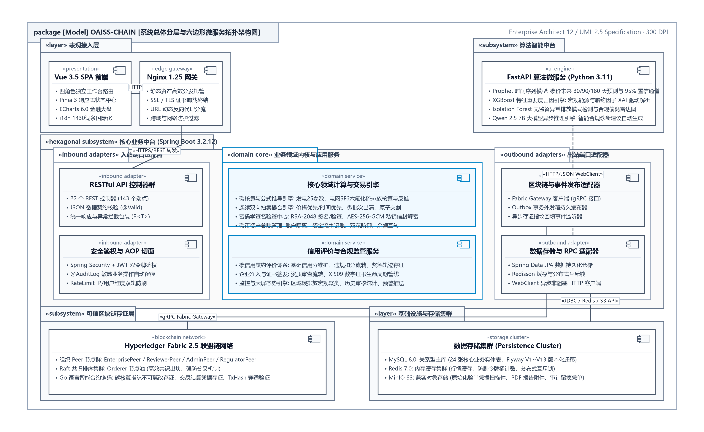
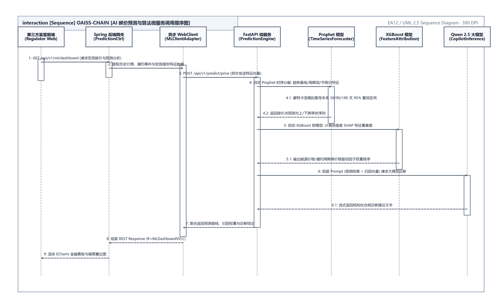

<div align="center">

**OAISS CHAIN — ENTERPRISE DUAL-CARBON BLOCKCHAIN PLATFORM**  
### 双碳链动系统 · 企业级技术活文档体系分册
#### 基于区块链的可信碳核算、双向拍卖撮合与量化风控系统

<br>

# 系统API接口参考规范
### （OAISS CHAIN · SYSTEM RESTFUL API REFERENCE SPECIFICATION）

<br>

| 项目 | 内容详情 |
| :--- | :--- |
| **作品名称** | OAISS CHAIN 双碳链动系统 |
| **分册名称** | 系统API接口参考规范 |
| **文档版本** | v2.2 (规范发布版) |
| **定位分类** | 全栈架构与开发规范指南 |
| **主要作者 / 研发团队** | OAISS CHAIN 联合研发团队 |
| **指导老师 / 架构组** | 系统架构委员会与区块链实验室 |
| **所属单位** | 软件学院 & 双碳区块链工程中心 |
| **完成日期** | 二〇二六年十月 |

</div>

---


## 目 录

- [第一部分 后端 REST API 接口完整清单 (148 端点)](#第一部分-后端-rest-api-接口完整清单-148-端点)
- [第二部分 Python ML 预测微服务算法接口](#第二部分-python-ml-预测微服务算法接口)

---

### 双碳链动系统 (OAISS CHAIN) —— 系统 API 接口参考规范

# 第一部分 后端 REST API 接口完整清单 (148 端点)

<div align="center">
  
  <br>
  <b>图 1.0.1 系统 API 接口网关与六边形微服务交互拓扑图</b>
</div>


> **契约导言**：本章定义 148 个 Spring Boot REST API 端点契约、统一响应信封、全局错误码体系及 ML 微服务接口。
**表 1.1.1 章节修订与审核责任记录表**

| 编号 | 变更状态 | 修订日期 | 执笔人 | 审核人 | 批准人 | 变更摘要与说明 |
| :---: | :---: | :---: | :---: | :---: | :---: | :--- |
| 1 | 文档创建 | 2026-06-15 | 核心研发 | 架构师 | 技术委员会 | 初始化基础业务规格与实体设计 |
| 2 | 架构升级 | 2026-09-02 | 架构组 | 技术委员会 | 技术委员会 | 全量同步生产基线与代码零漂移事实 |
| 3 | 版式重塑 | 2026-10-05 | 全栈架构组 | 技术总监 | 技术委员会 | 对齐参考手册规范，建立多级大纲与标准用例卡片 |

---

### Backend API Reference — OAISS CHAIN

> **注意 (Note)**：Complete REST API surface. Base path: `/api/v1`. All responses use the `ApiResponse<T>` envelope.

### Conventions

### Response Envelope

Every endpoint returns:

```json
{
  "code": 200,
  "message": "success",
  "data": { ... },
  "meta": {
    "requestId": "req_1717612345_42",
    "timestamp": "2026-06-07T12:00:00",
    "pagination": { "page": 0, "size": 20, "total": 100, "totalPages": 5 }
  }
```
}

- `code`: `200` for success, error codes from `ErrorCode` enum for failures
- `data`: the payload (null on error)
- `meta.pagination`: only present on paginated endpoints

### Pagination

Paginated endpoints accept `page` (0-based) and `size` query parameters. The frontend sends `pageNum` (1-based) which is automatically converted by the Axios interceptor.

Response shape (Spring Data Page):

```json
{
  "content": [ ... ],
  "totalElements": 100,
  "totalPages": 5,
  "size": 20,
  "number": 0,
  "first": true,
  "last": false,
  "empty": false
}
```

### Authentication

All endpoints except those marked **Public** require a JWT Bearer token:

Authorization: Bearer <access_token>

### Role Types

**表 2.1.1 数据规范对照表**

| Value | Role | Description |
| :--- | :---: | :--- |
| 1 | ENTERPRISE | Carbon-emitting enterprise |
| 2 | REVIEWER | Auditor/reviewer |
| 3 | THIRD_PARTY | Regulatory observer |
| 4 | ADMIN | Platform administrator |

### Error Codes

**表 2.2.2 数据规范对照表**

| Range | Category | Examples |
| :--- | :---: | :--- |
| 1xxx | Common | 1000 SYSTEM_ERROR, 1001 PARAM_ERROR, 1002 RESOURCE_NOT_FOUND |
| 2xxx | Auth | 2000 USER_NOT_LOGIN, 2001 LOGIN_FAILED, 2002 TOKEN_INVALID |
| 3xxx | Carbon | 3000 CARBON_REPORT_NOT_FOUND, 3006 REPORT_ALREADY_SUBMITTED |
| 4xxx | Trade | 4000 TRADE_NOT_FOUND, 4001 INSUFFICIENT_BALANCE |
| 5xxx | Blockchain | 5000 BLOCKCHAIN_CONNECTION_FAILED |
| 6xxx | AI/ML | 6000 ML_SERVICE_UNAVAILABLE, 6003 INSUFFICIENT_DATA |

- 

### Auth (`/auth`)

### POST `/auth/login`

Authenticate a user and receive JWT tokens.

- Public** | Rate limit: 5 req/60s per IP+user
- Request:**
```json
{
  "username": "string",
  "password": "string",
  "captcha": "string",
  "captchaKey": "string"
}
```

- Response:**
```json
{
  "accessToken": "eyJ...",
  "refreshToken": "eyJ...",
  "tokenType": "Bearer",
  "expiresIn": 86400,
  "userId": 1,
  "username": "enterprise1",
  "userType": 1,
  "realName": "Enterprise One"
}
```

### POST `/auth/register`

Register a new user account.

- Public** | Rate limit: 3 req/300s per IP
- Request:**
```json
{
  "username": "string",
  "password": "string",
  "phone": "string",
  "email": "string",
  "userType": 1,
  "realName": "string",
  "captcha": "string",
  "captchaKey": "string"
}
```

### POST `/auth/refresh`

Refresh an expired access token.

- Public** | Rate limit: 10 req/60s per IP+user
- Request header:** `Refresh-Token: <refresh_token>`
- Response:** Same as login response.

### POST `/auth/logout`

Invalidate the current token (adds to Redis blacklist).

- Authenticated**

### GET `/auth/me`

Get current user info from the JWT.

- Authenticated**

### PUT `/auth/password`

Change password.

- Authenticated**
- Request:**
```json
{
  "oldPassword": "string",
  "newPassword": "string"
}
```

### GET `/auth/check-ip`

Check if the client IP is allowed for the current user.

- Public** | Rate limit: 30 req/60s per IP
- 

### Captcha (`/captcha`)

### GET `/captcha/generate`

Generate a CAPTCHA image.

- Public**
- Response:**
```json
{
  "captchaKey": "uuid-string",
  "captchaImage": "data:image/png;base64,..."
}
```

### POST `/captcha/verify`

Verify a CAPTCHA answer.

- Public**

### POST `/captcha/sms/send`

Send SMS verification code.

- Public**

### POST `/captcha/email/send`

Send email verification code.

- Public**
- 

### User (`/user`)

### GET `/user/profile`

Get current user's profile.

- Authenticated**
- Response:** `UserInfoResponse` with username, phone, email, userType, realName, avatar, company, address.

### GET `/user/{userId}`

Get a user by ID.

- Authenticated**

### PUT `/user/profile`

Update current user's profile.

- Authenticated**

### PUT `/user/password`

Change password (alias of `/auth/password`).

- Authenticated**

### GET `/user/check-username`

Check if a username is available.

- Public** — Query param: `username`

### GET `/user/check-email`

Check if an email is available.

- Public** — Query param: `email`

### POST `/user/stay-time`

Record / report user online stay duration increment (in seconds).

- Authenticated** — Query param: `seconds`

### GET `/user/stay-time`

Get current user online stay duration statistics.

- Authenticated**
- 

### Enterprise (`/enterprise`)

### GET `/enterprise/info`

Get current enterprise's info.

- ENTERPRISE**

### GET `/enterprise/admission/my`

Get current enterprise's admission certificate.

- ENTERPRISE**

### GET `/enterprise/quota`

Get current enterprise's carbon quota info.

- ENTERPRISE**

### PUT `/enterprise/contact`

Update enterprise contact info.

- ENTERPRISE**

### GET `/enterprise/{enterpriseId}`

Get enterprise info by ID.

- Authenticated**
- 

### Carbon Reports (`/carbon`)

### POST `/carbon/reports`

Create a new carbon report.

- ENTERPRISE** | `@AuditLog`
- Request:** `CarbonReportRequest` with title, reportType (1=quarterly/2=annual), accountingPeriod, emissionData (JSON), totalEmission, scope1/2/3Emission.

### POST `/carbon/reports/{reportId}/submit`

Submit a draft report for review.

- ENTERPRISE**
> **注意 (Note)**：**可信签名链**：提交时若企业已有有效 RSA 密钥对，系统自动用其私钥对

> **注意 (Note)**：emissionData 签名并写入 `signatureData`；无密钥则跳过签名并放行

> **注意 (Note)**：（引导企业到个人中心生成密钥对）。响应含 `signatureData`（签名或空）。

### GET `/carbon/reports/{reportId}`

Get a single report by ID.

- Authenticated**
> **注意 (Note)**：响应含 `signatureData`（企业签名，若有）与 `signatureValid`

> **注意 (Note)**：（true=验签通过 / false=验签失败可能被篡改 / null=无签名或未验证）。

### GET `/carbon/reports`

List reports with filters.

- ENTERPRISE, REVIEWER, THIRD_PARTY, ADMIN** | Paginated
Query params: `page`, `size`, `status`, `enterpriseId`, `keyword`, `startTime`, `endTime`

### GET `/carbon/my-reports`

List current enterprise's reports.

- ENTERPRISE** | Paginated

### DELETE `/carbon/reports/{reportId}`

Delete a draft report.

- ENTERPRISE**

### POST `/carbon/review`

Review a carbon report (approve/reject).

- REVIEWER**
- Request:**
```json
{
  "reportId": 1,
  "approved": true,
  "comment": "Looks good"
}
```

> **注意 (Note)**：**可信签名链**：审核时若报告含 `signatureData`，系统自动用提交企业公钥验签，

> **注意 (Note)**：响应含 `signatureValid`：true=签名有效（数据真实未篡改）/ false=验签失败

> **注意 (Note)**：（数据可能被篡改）/ null=无签名（存量或企业无密钥）。验签结果不影响审核

> **注意 (Note)**：结论（警告放行语义），仅作可信提示。

### POST `/carbon/certify`

Certify an approved report and push to blockchain.

- ADMIN**

### POST `/carbon/certify/batch`

Batch certify approved reports and push to blockchain.

- ADMIN** | `@AuditLog`
- Request:** `BatchCertifyRequest` with `reportIds` (List`<Long>`), `reviewResult` (5=approve, 4=reject), `reviewComment`.

### POST `/carbon/calculate/power-grid`

Calculate emissions using GB/T 32150-2015 power grid formula.

- ENTERPRISE** | `@AuditLog`

### POST `/carbon/calculate/power-generation`

Calculate emissions using GB/T 32150-2015 power generation formula.

- ENTERPRISE** | `@AuditLog`
POST `/carbon/calculate/power-generation/oxidation-rate`

Calculate coal carbon oxidation rate (OF) based on slag and fly ash measurement (GB/T 32150-2015).

- ENTERPRISE** | `@AuditLog`
- 

### Trading (`/trade`)

### POST `/trade/p2p`

Create a P2P trade request.

- ENTERPRISE**

### POST `/trade/auction`

Create an auction-based trade.

- ENTERPRISE**

### POST `/trade/{tradeId}/confirm`

Confirm a matched trade.

- ENTERPRISE, ADMIN**

### POST `/trade/{tradeId}/cancel`

Cancel a trade.

- ENTERPRISE**

### GET `/trade/{tradeId}`

Get trade details.

- Authenticated**

### GET `/trade/list`

List all trades (admin/monitoring view).

- ADMIN, REVIEWER, THIRD_PARTY** | Paginated

### GET `/trade/my-trades`

List current enterprise's trades.

- ENTERPRISE** | Paginated
- 

### Double Auction (`/auction`)

### POST `/auction/buy`

Submit a buy order.

- ENTERPRISE**
- Request:**
```json
{
  "quantity": 100.0,
  "price": 50.0
}
```

### POST `/auction/sell`

Submit a sell order.

- ENTERPRISE**

### POST `/auction/match`

Manually execute one round of order matching (price-time priority).

The platform runs matching **automatically every 30 seconds** (`AuctionMatchingScheduler`); this endpoint is the admin's "don't wait for the next tick" manual trigger. It shares the same Redis distributed lock (`auction:matching`) as the scheduler, so concurrent rounds cannot double-settle.

- ADMIN**
- `409` when another matching round is already running

### GET `/auction/matching-status`

Query the auto-matching runtime state: enabled flag, interval, pending buy/sell order counts, and last settlement time.

- ADMIN**

### GET `/auction/all-results`

List **platform-wide** matching results (not scoped to the caller). The enterprise-facing `GET /auction/results` returns only the caller's own deals, so counterparties are not exposed.

- ADMIN** | Paginated

### GET `/auction/orders`

List all auction orders.

- ADMIN, ENTERPRISE, REVIEWER, THIRD_PARTY** | Paginated

### GET `/auction/my-orders`

List current user's orders.

- Authenticated** | Paginated

### GET `/auction/results`

List matching results.

- Authenticated** | Paginated
- 

### Carbon Coin (`/carbon-coin`)

### GET `/carbon-coin/account`

Get current user's carbon coin account.

- Authenticated**
- Response:**
```json
{
  "balance": 10000.00,
  "totalRecharged": 50000.00,
  "totalSpent": 40000.00,
  "status": 1
}
```

### POST `/carbon-coin/recharge`

Recharge carbon coins for a user.

- ADMIN**

### POST `/carbon-coin/transfer`

Transfer carbon coins to another enterprise.

- ENTERPRISE, ADMIN**

### GET `/carbon-coin/transactions`

List carbon coin transactions.

- Authenticated** | Paginated
- 

### Credit Score (`/credit`)

### GET `/credit/my-score`

Get current enterprise's credit score.

- ENTERPRISE**
- Response:**
```json
{
  "score": 85,
  "level": "GOOD",
  "tradeRestricted": false,
  "accountFrozen": false,
  "lastEvaluatedAt": "2026-06-01T00:00:00"
}
```

### GET `/credit/history`

Get current enterprise's credit event history.

- ENTERPRISE** | Paginated

### GET `/credit/ranking`

Get credit score rankings.

- Authenticated** | Paginated

### GET `/credit/{enterpriseId}`

Get an enterprise's credit score.

- Authenticated**

### POST `/credit/deduct`

Deduct credit points.

- ADMIN, REVIEWER**

### POST `/credit/bonus`

Add bonus credit points.

- ADMIN**

### POST `/credit/evaluate/{enterpriseId}`

Trigger credit level re-evaluation.

- ADMIN**

### GET `/credit/restricted`

List trade-restricted enterprises.

- ADMIN**

### GET `/credit/frozen`

List frozen enterprises.

- ADMIN**

### GET `/credit/check-permission/{enterpriseId}`

Check if an enterprise has trade permission.

- Authenticated**
- 

### Emission (`/emission`)

### GET `/emission/my-rating`

Get current enterprise's emission rating.

- ENTERPRISE**

### GET `/emission/ratings/{enterpriseId}`

Get an enterprise's emission ratings.

- Authenticated**

### POST `/emission/ratings`

Create an emission rating.

- Authenticated**

### GET `/emission/rankings/{year}`

Get industry emission rankings for a year.

- Authenticated**

### POST `/emission/predict`

Predict future emissions using ML.

- ENTERPRISE, ADMIN** | Rate limit: 10 req/60s
- 

### Carbon Neutral Projects (`/carbon-neutral`)

### POST `/carbon-neutral`

Create a carbon neutral project.

- Authenticated**

### PUT `/carbon-neutral/{id}`

Update a project.

- Authenticated**

### GET `/carbon-neutral/{id}`

Get project details.

- Authenticated**

### GET `/carbon-neutral/search`

Search projects with filters.

- ADMIN, ENTERPRISE, REVIEWER, THIRD_PARTY** | Paginated

### GET `/carbon-neutral/my`

List current user's projects.

- Authenticated** | Paginated

### POST `/carbon-neutral/{id}/submit`

Submit project for review.

- Authenticated**

### POST `/carbon-neutral/{id}/review`

Review a project.

- ADMIN, REVIEWER**

### POST `/carbon-neutral/{id}/start`

Start project implementation.

- Authenticated**

### POST `/carbon-neutral/{id}/submit-verification`

Submit project for verification.

- Authenticated**

### POST `/carbon-neutral/verify`

Verify a project.

- REVIEWER, ADMIN**

### POST `/carbon-neutral/{id}/use-credits`

Use carbon credits from a certified project.

- Authenticated**

### PUT `/carbon-neutral/{id}/monitoring`

Update monitoring data.

- Authenticated**

### POST `/carbon-neutral/{id}/apply-certification`

Apply for project certification.

- Authenticated**

### POST `/carbon-neutral/{id}/certify`

Complete certification.

- REVIEWER, ADMIN**

### POST `/carbon-neutral/{id}/terminate`

Terminate a project.

- Authenticated**

### GET `/carbon-neutral/pending-verification`

List projects pending verification.

- REVIEWER, ADMIN** | Paginated
- 

### Blockchain (`/blockchain`)

### GET `/blockchain/status`

Get blockchain connection status.

- ADMIN, ENTERPRISE, THIRD_PARTY**

### GET `/blockchain/block/{blockNumber}`

Query a block by number.

- ADMIN, THIRD_PARTY**

### GET `/blockchain/transaction/{txHash}`

Query a transaction by hash.

- Authenticated**

### GET `/blockchain/transactions`

List recent transactions.

- ADMIN, ENTERPRISE, THIRD_PARTY** | Paginated

### GET `/blockchain/blocks/latest`

Get latest blocks.

- ADMIN, ENTERPRISE, THIRD_PARTY**
- 

### Digital Signature (`/signature`)

### POST `/signature/keypair/generate`

Generate an RSA key pair.

- ENTERPRISE, REVIEWER, THIRD_PARTY**

### GET `/signature/keypair`

Get current user's public key.

- ENTERPRISE, REVIEWER, THIRD_PARTY**

### DELETE `/signature/keypair`

Revoke current user's key pair.

- ENTERPRISE, REVIEWER, THIRD_PARTY**

### POST `/signature/sign`

Sign a carbon report.

- ENTERPRISE** | `@DataIsolation`

### POST `/signature/verify`

Verify a signature.

- REVIEWER, THIRD_PARTY, ADMIN**

### POST `/signature/encrypt`

Encrypt data for reviewer access.

- ENTERPRISE** | `@DataIsolation`

### POST `/signature/decrypt`

Decrypt data.

- REVIEWER, ENTERPRISE** | `@DataIsolation`
- 

### Reviewer (`/reviewer`)

- Class-level: REVIEWER**

### GET `/reviewer/qualification/my`

Get current reviewer's qualification.

### GET `/reviewer/info`

Get reviewer info.

### GET `/reviewer/reports/pending`

List pending reports for review. Paginated.

- REVIEWER**
> **注意 (Note)**：响应含 `signatureValid`（审核前验签分流，2026-09-08 起）：true=签名有效 / false=验签失败（数据可能被篡改）/ null=无签名或未验证。无签名（signatureData 为空）不触发验签。

### GET `/reviewer/history`

List review history. Paginated.

### GET `/reviewer/statistics`

Get reviewer statistics.

- 

### Third Party (`/third-party`)

- Class-level: THIRD_PARTY**

### GET `/third-party/org-info`

Get current organization info.

### GET `/third-party/carbon-reports`

Query carbon reports for monitoring. Paginated.

### GET `/third-party/statistics`

Get platform statistics.

### PUT `/third-party/contact`

Update organization contact info.

- 

### Admin (`/admin`)

- Class-level: ADMIN**

### GET `/admin/users`

List all users with filters. Paginated.

Query params: `page`, `size`, `userType`, `status`, `keyword`

### PUT `/admin/users/{userId}/status`

Enable or disable a user.

### GET `/admin/dashboard`

Get admin dashboard statistics.

### GET `/admin/statistics`

Get system-wide statistics.

### GET `/admin/config`

Get system configuration.

### GET `/admin/permissions`

Get permission list.

POST `/admin/enterprise-admission/{enterpriseId}/issue`

Issue an enterprise admission certificate.

DELETE `/admin/enterprise-admission/{enterpriseId}`

Revoke an enterprise admission certificate.

### GET `/admin/enterprise-admission`

List all enterprise admission certificates. Paginated.

POST `/admin/reviewer-qualification/{reviewerId}/issue`

Issue a reviewer qualification certificate.

DELETE `/admin/reviewer-qualification/{reviewerId}`

Revoke a reviewer qualification certificate.

### GET `/admin/reviewer-qualification`

List all reviewer qualifications. Paginated.

- 

### File Management (`/file`)

- Class-level: Authenticated**

### POST `/file/upload`

Upload a single file.

- ENTERPRISE, ADMIN**

### POST `/file/upload/batch`

Upload multiple files.

- ENTERPRISE, ADMIN**

### GET `/file/download`

Download a file. Query param: `fileName`

- ENTERPRISE, ADMIN**

### DELETE `/file`

Delete a file. Query param: `fileName`

### DELETE `/file/batch`

Delete multiple files.

### GET `/file/info`

Get file metadata. Query param: `fileName`

### GET `/file/exists`

Check if a file exists. Query param: `fileName`

### GET `/file/presigned-url`

Get a presigned download URL.

- ENTERPRISE, ADMIN**

### GET `/file/presigned-upload-url`

Get a presigned upload URL.

- ENTERPRISE, ADMIN**

### GET `/file/list`

List files. Query params: `prefix`, `delimiter`

- ENTERPRISE, ADMIN**

### POST `/file/copy`

Copy a file.

- ADMIN**
- 

### Search (`/search`)

- Class-level: Authenticated**

### GET `/search/reports`

Search carbon reports. Query params: `keyword`, `page`, `size`

### GET `/search/trades`

Search trades. Query params: `keyword`, `page`, `size`

### GET `/search/market-overview`

Get market overview data.

- 

### AI / Market Prediction (`/ai/market`)

### POST `/ai/market/trend`

Predict market price trend.

- ENTERPRISE, ADMIN** | Rate limit: 10 req/60s
- Request:**
```json
{
  "dates": ["2026-01-01", "2026-02-01"],
  "prices": [50.0, 52.5],
  "volumes": [1000, 1200],
  "horizonDays": 30
}
```

- Response:**
```json
{
  "forecastDates": ["2026-07-01", ...],
  "forecastPrices": [55.2, ...],
  "lowerBound": [50.1, ...],
  "upperBound": [60.3, ...],
  "trend": "up",
  "modelVersion": "prophet-1.0"
}
```

### POST `/ai/market/price`

Predict carbon price. Same request/response as `/trend`.

### POST `/ai/market/supply-demand`

Predict supply/demand volume. Same request/response as `/trend`.

- 

### Enterprise Inference (`/predict/enterprise`)

GET `/predict/enterprise/{enterpriseId}/inference`

Get AI compliance risk assessment for an enterprise.

- ENTERPRISE, REVIEWER, THIRD_PARTY, ADMIN** | Rate limit: 10 req/60s
- Response:**
```json
{
  "enterpriseId": 1,
  "complianceStatus": "compliant",
  "confidence": 0.92,
  "anomalyScore": 0.15,
  "isAnomaly": false,
  "riskFactors": [],
  "modelVersion": "xgboost-1.0"
}
```

- 

### Notifications (`/notifications`)

> **注意 (Note)**：由 `NotificationController` 提供，配合 `NotificationService`（异步写入）与 `WebSocketNotificationService`（STOMP 实时推送）使用。

### GET `/notifications`

List current user's notifications (paginated).

- ENTERPRISE, REVIEWER, THIRD_PARTY, ADMIN** | Query: `page` (1-based, default 1), `size` (default 20)
- Response:** `ApiResponse<Page<Notification>>` — 含 `title`, `content`, `notificationType`, `relatedEntityId`, `isRead`, `createdAt`

### GET `/notifications/unread-count`

Get current user's unread notification count.

- ENTERPRISE, REVIEWER, THIRD_PARTY, ADMIN**
- Response:** `ApiResponse<Long>`

### PUT `/notifications/{id}/read`

Mark a single notification as read.

- ENTERPRISE, REVIEWER, THIRD_PARTY, ADMIN** | Path: `id` (notification ID)
- Response:** `ApiResponse<Void>`

### PUT `/notifications/read-all`

Mark all current user's notifications as read.

- ENTERPRISE, REVIEWER, THIRD_PARTY, ADMIN**
- Response:** `ApiResponse<Void>`
- 

### Web Vitals (`/web-vitals`)

> **注意 (Note)**：由 `WebVitalsController` 提供，接收前端上报的 Core Web Vitals 性能指标用于监控。

### POST `/web-vitals/report`

Receive frontend performance metrics batch (Core Web Vitals: LCP, INP, CLS, etc.).

- ENTERPRISE, REVIEWER, THIRD_PARTY, ADMIN**
- Request body:** `List<WebVitalMetric>` — 每项含 `name`, `value`, `rating`, `url`, `timestamp`
- Response:** `ApiResponse<Void>`
- 

### Related

- [Architecture Overview](explanation-architecture-overview.md) — system design decisions
- [ML Service Reference](reference-ml-service.md) — ML microservice endpoints
- [Database Schema](DATABASE_SCHEMA.md) — complete table definitions

# 第二部分 Python ML 预测微服务算法接口

<div align="center">
  
  <br>
  <b>图 2.0.1 AI 算法微服务中台调用拓扑图</b>
</div>


> **契约导言**：本章定义 148 个 Spring Boot REST API 端点契约、统一响应信封、全局错误码体系及 ML 微服务接口。
**表 2.1.1 章节修订与审核责任记录表**

| 编号 | 变更状态 | 修订日期 | 执笔人 | 审核人 | 批准人 | 变更摘要与说明 |
| :---: | :---: | :---: | :---: | :---: | :---: | :--- |
| 1 | 文档创建 | 2026-06-15 | 核心研发 | 架构师 | 技术委员会 | 初始化基础业务规格与实体设计 |
| 2 | 架构升级 | 2026-09-02 | 架构组 | 技术委员会 | 技术委员会 | 全量同步生产基线与代码零漂移事实 |
| 3 | 版式重塑 | 2026-10-05 | 全栈架构组 | 技术总监 | 技术委员会 | 对齐参考手册规范，建立多级大纲与标准用例卡片 |

---

### ML Service Reference — OAISS CHAIN

> **注意 (Note)**：Complete reference for the FastAPI prediction microservice. Runs on port 8001.

### Overview

The ML service is a standalone FastAPI application that provides three prediction capabilities:

1. **Market prediction** — price trend forecasting, supply/demand prediction
2. **Enterprise inference** — compliance risk assessment and anomaly detection
3. **Emission forecasting** — future carbon emission prediction
It uses Prophet (time-series), XGBoost (classification/regression), and IsolationForest (anomaly detection).

### Authentication

All prediction endpoints require the `X-ML-Service-Secret` header:

X-ML-Service-Secret: <your-secret>

If `ML_SERVICE_SECRET` is empty or unset, authentication is skipped. The `/health` endpoint is always public.

- 

### Endpoints

### Health Check

#### GET `/health`

- Public** — no auth required.
- Response:**
```json
{
  "status": "healthy",
  "version": "1.0.0"
}
```

- 

### Market Prediction

All market endpoints use `MarketService` which routes to Prophet (price forecasting) or XGBoost (supply/demand regression).

#### POST `/predict/market/trend`

Predict carbon market price trend.

- Request:** `MarketForecastRequest`
```json
{
  "dates": ["2026-01-01", "2026-02-01", "2026-03-01"],
  "prices": [50.0, 52.5, 55.0],
  "volumes": [1000, 1200, 1100],
  "horizon_days": 30
}
```

**表 3.1.1 数据规范对照表**

| Field | Type | Constraints | Default |
| :--- | :---: | :--- | :--- |
| `dates` | `list[str]` | min 2 items, ISO-8601 | required |
| `prices` | `list[float]` | min 2 items | required |
| `volumes` | `list[float]` | min 2 items | required |
| `horizon_days` | `int` | 1-365 | 30 |

- Response:** `MarketForecastResponse`
```json
{
  "forecast_dates": ["2026-07-01", "..."],
  "forecast_prices": [55.2, "..."],
  "lower_bound": [50.1, "..."],
  "upper_bound": [60.3, "..."],
  "trend": "up",
  "model_version": "prophet-1.0"
}
```

Trend values: `"up"`, `"down"`, `"stable"`. Classification: if delta between first and last forecast exceeds 2% of the first value, classified as up/down; otherwise stable.

#### POST `/predict/market/price`

Predict carbon price. Same request/response as `/trend`.

#### POST `/predict/market/supply-demand`

Predict supply/demand volume. Uses XGBoost regression with features: day-of-week, day-of-month, month, lag-7, lag-30 volumes. Same request/response shape as `/trend`.

- 

### Enterprise Inference

#### POST `/api/v1/predict/enterprise/`

Assess enterprise compliance risk using IsolationForest (anomaly detection) + XGBoost (classification).

- Request:** `EnterpriseInferenceRequest`
```json
{
  "enterprise_id": 1,
  "report_count": 12,
  "total_emissions": 50000.0,
  "credit_score": 85.0,
  "emission_rating": 2.0,
  "transaction_volume": 100000.0,
  "compliance_flags": 0,
  "avg_emission_per_report": 4166.67,
  "days_since_last_report": 15
}
```

**表 3.2.2 数据规范对照表**

| Field | Type | Constraints |
| :--- | :---: | :--- |
| `enterprise_id` | `int` | gt 0 |
| `report_count` | `int` | ge 0 |
| `total_emissions` | `float` | ge 0 |
| `credit_score` | `float` | 0-100 |
| `emission_rating` | `float` | ge 0 |
| `transaction_volume` | `float` | ge 0 |
| `compliance_flags` | `int` | ge 0 |
| `avg_emission_per_report` | `float` | ge 0 |
| `days_since_last_report` | `int` | ge 0 |

- Response:** `EnterpriseInferenceResponse`
```json
{
  "enterprise_id": 1,
  "compliance_status": "compliant",
  "confidence": 0.92,
  "anomaly_score": 0.15,
  "is_anomaly": false,
  "risk_factors": [],
  "model_version": "xgboost-1.0"
}
```

`compliance_status` values: `"compliant"`, `"at_risk"`, `"non_compliant"`.

The models are pre-trained on 200 synthetic samples at service startup. `StandardScaler` is applied before both models. XGBoost uses `multi:softmax` with 3 classes.

- 

### Emission Forecasting

#### POST `/predict/emission/forecast`

Predict future carbon emissions using Prophet with multiplicative seasonality.

- Request:** `EmissionForecastRequest`
```json
{
  "enterprise_id": 1,
  "dates": ["2025-01-01", "2025-02-01", "..."],
  "emissions": [5000.0, 4800.0, "..."],
  "sector": "power_generation",
  "horizon_days": 180
}
```

**表 3.3.3 数据规范对照表**

| Field | Type | Constraints | Default |
| :--- | :---: | :--- | :--- |
| `enterprise_id` | `int` | required | — |
| `dates` | `list[str]` | min 1 item, ISO-8601 | required |
| `emissions` | `list[float]` | min 1 item | required |
| `sector` | `str` | — | `"power_generation"` |
| `horizon_days` | `int` | 1-365 | 180 |

- Response:** `EmissionForecastResponse`
```json
{
  "enterprise_id": 1,
  "forecast_dates": ["2026-07-01", "..."],
  "forecast_emissions": [5200.0, "..."],
  "lower_bound": [4800.0, "..."],
  "upper_bound": [5600.0, "..."],
  "trend": "stable",
  "confidence": 0.85,
  "model_version": "prophet-1.0"
}
```

Confidence formula: `1 - (avg_interval_width / avg_emission_value)`, clamped to [0, 1].

Prophet config: `interval_width=0.8`, `changepoint_prior_scale=0.05`, `seasonality_mode="multiplicative"`. Adds yearly seasonality (fourier_order=10) when > 24 data points.

- 

### Backend Integration

The backend calls the ML service through `MlServiceClient` (`oaiss-chain-backend/.../service/ml/MlServiceClient.java`).

### Circuit Breaker (Resilience4j)

Every ML call is wrapped with a circuit breaker. If the ML service fails repeatedly, the circuit opens and fallback responses are returned without calling the service.

**表 3.4.4 REST API 接口规范与参数契约表**

| Client Method | ML Endpoint | Fallback |
| :--- | :---: | :--- |
| `predictMarketTrend()` | `/predict/market/trend` | `trend="unknown"`, `modelVersion="fallback"` |
| `predictCarbonPrice()` | `/predict/market/price` | same |
| `predictSupplyDemand()` | `/predict/market/supply-demand` | same |
| `inferEnterprise()` | `/api/v1/predict/enterprise/` | `complianceStatus="unknown"` |
| `predictEmission()` | `/predict/emission/forecast` | `trend="unknown"`, `confidence=0.0` |

### WebClient Config

- Connect timeout: 5s
- Read timeout: 30s
- Max connections: 50
- Pending acquire timeout: 10s
- Block timeout: 10s per call
- JSON naming: `SNAKE_CASE` (matches Python conventions)

### Metrics

Each call records:

- `ml.service.latency` timer (tags: endpoint, status)
- `ml.service.error` counter (on HTTP errors)
- `ml.service.degraded` counter (on circuit-breaker-open or timeout)
- 

### Configuration

**表 3.5.5 数据规范对照表**

| Env Var | Default | Description |
| :--- | :---: | :--- |
| `ML_SERVICE_SECRET` | `""` | API key. Empty = no auth. |
| `MODEL_DIR` | `/app/models` | Directory for trained model files |
| `LOG_LEVEL` | `INFO` | Python logging level |

- 

### Related

- [Architecture Overview](explanation-architecture-overview.md) — ML service isolation design
- [Backend API Reference](reference-backend-api.md) — `/ai/market` and `/predict/enterprise` endpoints
- [Developer Quickstart](tutorial-developer-quickstart.md) — running the ML service locally