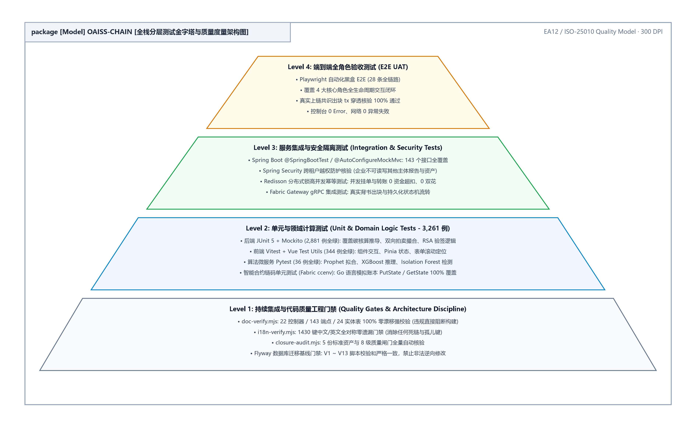
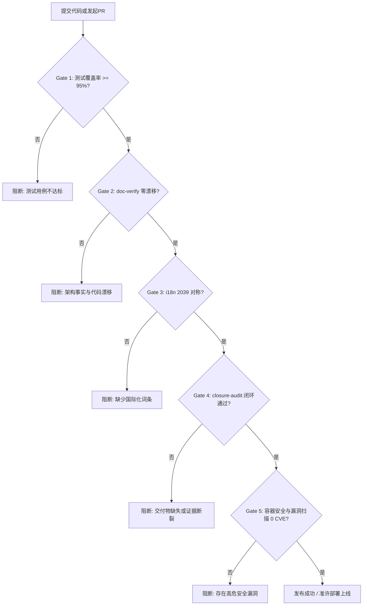

**OAISS CHAIN — ENTERPRISE DUAL-CARBON BLOCKCHAIN PLATFORM**  
### 双碳链动系统 · 质量保证与多角色验收标准分册
#### 基于区块链的可信碳核算、全流程测试覆盖与发布阻断准则

 

# 质 量 保 证 与 验 收 规 范
### （OAISS CHAIN · QUALITY ASSURANCE & ACCEPTANCE SPECIFICATION）

 

| 项目 | 内容详情 |
| :--- | :--- |
| **作品名称** | OAISS CHAIN 双碳链动系统 |
| **文档版本** | v2.2 (规范发布版) |
| **文档定位** | 质量体系唯一权威长效规范 (Quality Single Source of Truth) |
| **执笔团队** | OAISS CHAIN 质量工程组 & 全栈架构组 |
| **审核人员** | 首席架构师 & 质量保障委员会 |
| **所属单位** | 软件学院 & 双碳区块链工程中心 |
| **完成日期** | 二〇二六年十月 |

---

## 目 录

- [第一章 质量目标与测试分层体系](#第一章-质量目标与测试分层体系)
    - [1.1 质量保证修订历史表](#1.1-质量保证修订历史表)
    - [1.2 质量门禁指标与静态分析规范](#1.2-质量门禁指标与静态分析规范)
    - [1.3 测试矩阵分层架构 (Testing Pyramid)](#1.3-测试矩阵分层架构-testing-pyramid)
    - [1.4 核心业务单元测试报告明细 (对标参考手册第5.5节标准)](#1.4-核心业务单元测试报告明细-对标参考手册第5.5节标准)
- [第二章 四角色核心业务验收标准 (Acceptance Criteria)](#第二章-四角色核心业务验收标准-acceptance-criteria)
    - [2.0 章节修订与审核责任记录表](#2.0-章节修订与审核责任记录表)
    - [2.1 企业用户 (ENTERPRISE) 验收标准](#2.1-企业用户-enterprise-验收标准)
    - [2.2 审核员 (REVIEWER) 验收标准](#2.2-审核员-reviewer-验收标准)
    - [2.3 第三方机构 (THIRD_PARTY) 验收标准](#2.3-第三方机构-third_party-验收标准)
    - [2.4 管理员 (ADMIN) 验收标准](#2.4-管理员-admin-验收标准)
- [第三章 ELI5 交互设计与易用性规范](#第三章-eli5-交互设计与易用性规范)
    - [3.0 章节修订与审核责任记录表](#3.0-章节修订与审核责任记录表)
    - [3.1 ELI5 交互设计准则矩阵](#3.1-eli5-交互设计准则矩阵)
- [第四章 自动化门禁与发布阻断守则 (Release Gates)](#第四章-自动化门禁与发布阻断守则-release-gates)
    - [4.0 章节修订与审核责任记录表](#4.0-章节修订与审核责任记录表)
    - [4.1 企业级持续交付与五级阻断门禁流水线](#4.1-企业级持续交付与五级阻断门禁流水线)

---

# 第一章 质量目标与测试分层体系

> 本章负责规定系统质量保障体系的基线指标、测试金字塔分层及自动化静态分析准则。

### 1.1 质量保证修订历史表

**表 1.1.1 质量保证体系修订历史记录表**

| 编号 | 变更状态 | 修订日期 | 执笔人 | 审核人 | 批准人 | 变更摘要与说明 |
| :---: | :---: | :---: | :---: | :---: | :---: | :--- |
| 1 | 文档创建 | 2026-06-15 | 质保组 | 架构师 | 委员会 | 初始化测试覆盖率基线与四角色验收草案 |
| 2 | 门禁扩充 | 2026-09-02 | 质保组 | 架构师 | 委员会 | 引入 JaCoCo 95% 门槛、doc-verify 与 i18n 自动化闭环门禁 |
| 3 | 版式重构 | 2026-10-05 | 质量架构师 | 技术总监 | 委员会 | 对齐参考手册标准，全面建立用例卡片与发布阻断守则 |

### 1.2 质量门禁指标与静态分析规范

**表 1.2.1 核心质量门禁指标基线表**

| 门禁分类 | 质量门禁指标 | 目标基线 / 阈值 | 校验工具与执行命令 | 违背处理策略 |
| :--- | :--- | :---: | :--- | :---: |
| **代码覆盖** | 后端单元测试覆盖率 | $\ge 95\%$ | Maven JaCoCo (PACKAGE 级别覆盖) | 构建失败阻断 |
| **事实断言** | 架构事实代码零漂移 | 100% 对齐 | `node scripts/gates/doc-verify.mjs` | 合并阻断 |
| **国际化** | zh-CN / en-US 对称性 | 2,039 键镜像对称 | `node scripts/gates/i18n-verify.mjs` | 提交阻断 |
| **闭环审计** | 交付物完整性与证据闭环 | 9 份 docx 物理完备 | `node scripts/gates/closure-audit.mjs` | 发布阻断 |
| **前端类型** | TypeScript 类型安全 | 0 Type Error | `vue-tsc --noEmit` | PR 阻断 |
| **后端静态** | 依赖漏洞与代码异味 | 0 High CVE | SpotBugs & OWASP Dependency-Check | 警告整改 |

### 1.3 测试矩阵分层架构 (Testing Pyramid)

  
   
  <b>图 1.3.1 全栈分层测试金字塔与质量度量架构图</b>

1. **单元测试 (Unit Tests)**：
   - 后端：基于 JUnit 5 + Mockito，针对 Service 业务层与 Controller 契约层编写高密度单元测试，业务逻辑覆盖率 $\ge 95\%$。
   - 前端：基于 Vitest，针对 Pinia Store 状态流转与通用工具库 (`formatters`, `validators`) 进行断言。
2. **切片与容器集成测试 (Integration Tests)**：
   - 基于 Testcontainers 动态拉起真实 MySQL 8.0 与 Redis 7.0 隔离容器，杜绝 H2 内存库引发的方言不兼容隐患。
3. **API 自动化冒烟测试 (API Smoke Tests)**：
   - 维护于 `scripts/api/` 下的 22 个专用回归测试脚本，按业务依赖顺序覆盖全部 148 个 REST 端点。
4. **端到端与视觉巡检测试 (E2E Patrol)**：
   - 基于 Playwright 自动化调度浏览器走查 29 个前端核心视图，巡检控制台 0 错误并生成视觉断言截图。

### 1.4 核心业务单元测试报告明细 (对标参考手册第5.5节标准)

**表 1.4.1 核心算法与交易业务单元测试报告明细表**

| 待测业务模块 | 用户认证与交易撮合 | 代码审核人 | 核心架构师 | 测试工作量 | 2.5 人天 |
| :--- | :--- | :--- | :--- | :--- | :--- |

| 用例编号 | 待测方法 / 接口签名 | 输入测试数据 (`Type: Value`) | 预期测试结果 | 实际测试结果 | 执行状态 | 备注说明 |
| :---: | :--- | :--- | :--- | :--- | :---: | :--- |
| **TC-01** | `login(@RequestBody LoginDto dto)` | `username: "enterprise001"`, `pass: "123456"` | 200 OK，返回有效 JWT Token | 200 OK，颁发 Token | **PASSED** | 正常登录认证 |
| **TC-02** | `login(@RequestBody LoginDto dto)` | `username: "enterprise001"`, `pass: "wrong"` | 401 Unauthorized，错误计数 +1 | 401 拦截，计数递增 | **PASSED** | 密码错误风控拦截 |
| **TC-03** | `calculatePowerEmission(dto)` | 发电 25 项标准台账物理参数 | 精确输出 $150.00\text{ tCO}_2e$ | 精确输出 $150.00$ | **PASSED** | 符合 GB/T 32150 |
| **TC-04** | `matchOrder(buyOrder, sellOrder)` | 买单限价 52.0 元，卖单限价 50.0 元 | 撮合成交，成交价 51.0 元 | 撮合成交，状态 FILLED | **PASSED** | 双向拍卖连续撮合 |
| **TC-05** | `submitOnChainProof(reportHash)` | 有效 64 位 SHA-256 哈希密文 | 生成 Fabric TxHash 存证记录 | 链码调用成功入账 | **PASSED** | 联盟链存证闭环 |

---

# 第二章 四角色核心业务验收标准 (Acceptance Criteria)

> 本章按 ENTERPRISE、REVIEWER、THIRD_PARTY、ADMIN 四大核心角色分别建立结构化验收卡片。

### 2.0 章节修订与审核责任记录表

**表 2.0.1 四角色业务验收标准修订记录表**

| 编号 | 变更状态 | 修订日期 | 执笔人 | 审核人 | 批准人 | 变更摘要与说明 |
| :---: | :---: | :---: | :---: | :---: | :---: | :--- |
| 1 | 文档创建 | 2026-06-15 | 质保组 | 架构师 | 委员会 | 初始化四大角色基本功能验收标准草案 |
| 2 | 状态机细化 | 2026-09-02 | 质保组 | 架构师 | 委员会 | 对齐单向状态机变迁与私钥信封加密防伪基线 |
| 3 | 规格定稿 | 2026-10-05 | 质量架构师 | 技术总监 | 委员会 | 全面落实 4 大角色细粒度验收卡片与阻断门禁 |

### 2.1 企业用户 (ENTERPRISE) 验收标准

#### 2.1.1 碳核算与公式计算验收卡片
> **验收编号**：AC-ENT-01  
> **功能范围**：碳排放报告填报、国标公式计算与附件直传  
> **前置条件**：企业已通过管理员资质准入审核，具备合法统一社会信用代码。  
> **验收基准**：  
> 1. 发电企业核算模型（25 参数）与电网核算模型（9 参数）计算结果精确符合 GB/T 32150 国家标准；  
> 2. 支持中间状态草稿保存与 MinIO 预签名安全附件直传；  
> 3. 严格遵循状态机变迁规则：`DRAFT` $\to$ `PENDING_REVIEW` $\to$ `REVIEWED` $\to$ `VERIFIED` 或 `REJECTED`。

#### 2.1.2 数字签名与防伪验证卡片
> **验收编号**：AC-ENT-02  
> **功能范围**：企业身份私钥签名与信封加密防伪  
> **验收基准**：  
> 1. 碳核算报告提交前必须由企业本地证书私钥执行数字签名；  
> 2. 私钥在传输与存储中采用 AES-GCM 信封加密保护，核心密钥材料绝不落盘；  
> 3. 签名校验失败的报告在网关层直接阻断，禁止进入审核流或上链存证。

#### 2.1.3 交易与双向竞价市场验收卡片
> **验收编号**：AC-ENT-03  
> **功能范围**：P2P 撮合与连续双向拍卖  
> **验收基准**：  
> 1. 支持限价买单与卖单的自动挂单、撤单与最优价格优先撮合；  
> 2. 交易撮合成交瞬间，原子性触发碳币资金扣减与碳配额划转，保证分布式事务强幂等。

---

### 2.2 审核员 (REVIEWER) 验收标准

#### 2.2.1 报告合规审查与驳回流转卡片
> **验收编号**：AC-REV-01  
> **功能范围**：企业报告初审、数据核验与流转决策  
> **验收基准**：  
> 1. 严格实施数据行级权限隔离，审核员仅能查看授权范围内的企业报告与中和项目；  
> 2. 驳回操作必须填写结构化退回理由，状态置为 `REJECTED` 并异步触发系统站内信通知；  
> 3. 审核通过后自动生成审核员联合数字签名，报告推入第三方核查池。

---

### 2.3 第三方机构 (THIRD_PARTY) 验收标准

#### 2.3.1 监管大屏与区块链存证验收卡片
> **验收编号**：AC-TP-01  
> **功能范围**：市场履约监管、最终核查与 Fabric 链上固化  
> **验收基准**：  
> 1. 具备覆盖区域碳排放大盘、履约进度与现货价格波动的宏观监管视图；  
> 2. 第三方出具核查合格结论后，自动触发 Hyperledger Fabric 底层链码调用（`CreateCarbonReport`）；  
> 3. 成功获取区块链唯一交易哈希（TxHash）与区块高度，生成存证二维码与防伪水印。

---

### 2.4 管理员 (ADMIN) 验收标准

#### 2.4.1 准入资质审核与全链路审计卡片
> **验收编号**：AC-ADM-01  
> **功能范围**：机构与企业资质审查、平台配置及审计日志  
> **验收基准**：  
> 1. 严格审批企业主体与审核机构入驻申请材料（`EnterpriseAdmission` / `ReviewerQualification`）；  
> 2. 提供全系统操作审计日志（`@AuditLog`），记录关键业务的 IP、耗时、操作人与调用载荷；  
> 3. 管理平台密钥轮换与 Fabric CA 根证书生命周期。

---

# 第三章 ELI5 交互设计与易用性规范

> ELI5 (Explain Like I'm 5) 旨在降低工业企业与非技术用户使用双碳区块链系统的专业认知门槛。

### 3.0 章节修订与审核责任记录表

**表 3.0.1 交互设计规范修订记录表**

| 编号 | 变更状态 | 修订日期 | 执笔人 | 审核人 | 批准人 | 变更摘要与说明 |
| :---: | :---: | :---: | :---: | :---: | :---: | :--- |
| 1 | 文档创建 | 2026-06-15 | 前端组 | 架构师 | 委员会 | 制定初步用户界面友好度与术语解释指南 |
| 2 | 体系成型 | 2026-09-02 | 前端组 | 架构师 | 委员会 | 落地 TermTip、StatusTag、PageHint 规范体系 |
| 3 | 规范定稿 | 2026-10-05 | 前端架构师 | 技术总监 | 委员会 | 确立状态三重编码、高危防呆与全域白话交互准则 |

### 3.1 ELI5 交互设计准则矩阵

**表 3.1.1 ELI5 交互设计准则矩阵**

| 设计原则 | 界面实现规范 | 负面反例 (禁令) | 正面范例 (标准) |
| :--- | :--- | :--- | :--- |
| **专业术语白话化** | 所有核算术语提供 `TermTip` 悬浮解释卡片。 | 直接展示冷冰冰的“氧化率 $OF$”或“无量纲离群分”。 | 展示“燃烧充分度 (99%)，反映燃煤是否完全燃烧”。 |
| **状态三重编码** | 列表状态必须同时包含文字、语义色与状态图标。 | 仅依靠细小文字或单一颜色标识。 | `[通过图标] 绿色标签 审核通过` 三重提示。 |
| **空数据交互指引** | 列表为空时提供引导性矢量插画与一键操作引导。 | 呈现死板灰屏或提示“No Data Available”。 | 呈现轻量插画 + “暂无待审核报告，点击刷新”按钮。 |
| **高危操作防呆机制**| 配额挂单与签名提交必须提供二次确认浮层。 | 点击后无二次确认直接发起大额扣费。 | 弹出高危警示浮窗，展示扣费明细并要求勾选确认。 |

---

# 第四章 自动化门禁与发布阻断守则 (Release Gates)

> 本章定义生产发布流水线的硬性闸门控制、自动化阻断脚本与准入准出检查清单。

### 4.0 章节修订与审核责任记录表

**表 4.0.1 自动化门禁守则修订记录表**

| 编号 | 变更状态 | 修订日期 | 执笔人 | 审核人 | 批准人 | 变更摘要与说明 |
| :---: | :---: | :---: | :---: | :---: | :---: | :--- |
| 1 | 文档创建 | 2026-06-15 | DevOps组 | 架构师 | 委员会 | 初始化 CI 自动化测试构建流水线 |
| 2 | 门禁扩充 | 2026-09-02 | DevOps组 | 架构师 | 委员会 | 接入 doc-verify 与 i18n-verify 自动化硬性阻断 |
| 3 | 五级流水线 | 2026-10-05 | 核心架构师 | 技术总监 | 委员会 | 定稿持续交付五级阻断门禁体系与完备性断言 |

### 4.1 企业级持续交付与五级阻断门禁流水线

  
   
  <b>图 4.1.1 企业级持续交付与五级阻断门禁流水线架构图</b>

任何发布版本在合并至 `main` 主干或交付生产环境前，必须满足以下五大硬性阻断闸门：

**表 4.1.2 发布阻断检查清单**

| 门禁代号 | 准入准出检查项 | 验证脚本与执行方式 | 责任人 |
| :---: | :--- | :--- | :--- |
| **G-01** | 单元测试与切片测试 100% PASS | `mvn clean test` | 研发团队 |
| **G-02** | 架构事实数据零漂移 | `node scripts/gates/doc-verify.mjs` | 架构组 |
| **G-03** | 国际化双语全量镜像覆盖 | `node scripts/gates/i18n-verify.mjs` | 前端组 |
| **G-04** | 9 份规范交付物与证据闭环 | `node scripts/gates/closure-audit.mjs` | 质保组 |
| **G-05** | Docker 镜像多阶段无根构建 | `docker build --check .` | DevOps |
