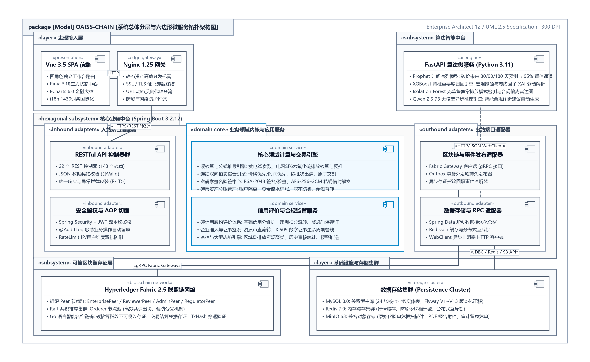

<div align="center">

**OAISS CHAIN — ENTERPRISE DUAL-CARBON BLOCKCHAIN PLATFORM**  
### 双碳链动系统 · 企业级技术活文档体系分册
#### 基于区块链的可信碳核算、双向拍卖撮合与量化风控系统

<br>

# 系统部署与运维手册
### （OAISS CHAIN · SYSTEM DEPLOYMENT & OPERATION MANUAL）

<br>

| 项目 | 内容详情 |
| :--- | :--- |
| **作品名称** | OAISS CHAIN 双碳链动系统 |
| **分册名称** | 系统部署与运维手册 |
| **文档版本** | v2.2 (规范发布版) |
| **定位分类** | 全栈架构与开发规范指南 |
| **主要作者 / 研发团队** | OAISS CHAIN 联合研发团队 |
| **指导老师 / 架构组** | 系统架构委员会与区块链实验室 |
| **所属单位** | 软件学院 & 双碳区块链工程中心 |
| **完成日期** | 二〇二六年十月 |

</div>

---


## 目 录

- [第一部分 生产就绪检查与安全配置规范](#第一部分-生产就绪检查与安全配置规范)
- [第二部分 系统安装与多环境部署手册 (Staging / Production)](#第二部分-系统安装与多环境部署手册-staging-/-production)
  - [1. 适用范围](#1.-适用范围)
  - [2. 发布前提](#2.-发布前提)
  - [3. 部署前检查](#3.-部署前检查)
    - [3.1 校验环境模板结构](#3.1-校验环境模板结构)
    - [3.2 安全展开 compose 配置](#3.2-安全展开-compose-配置)
    - [3.3 数据库备份](#3.3-数据库备份)
  - [4. Staging 部署](#4.-staging-部署)
  - [5. Production 部署](#5.-production-部署)
  - [6. 部署后验证](#6.-部署后验证)
  - [1. backend 健康状态为 `UP`](#1.-backend-健康状态为-`up`)
  - [2. frontend `/health` 返回 `ok`](#2.-frontend-`/health`-返回-`ok`)
  - [3. ML `/health` 正常](#3.-ml-`/health`-正常)
  - [4. 目标环境的非 demo 账号可登录](#4.-目标环境的非-demo-账号可登录)
  - [5. production 不暴露 Swagger](#5.-production-不暴露-swagger)
  - [6. 监控看板与告警可达](#6.-监控看板与告警可达)
  - [7. 如启用 Fabric，区块链状态接口行为正确](#7.-如启用-fabric，区块链状态接口行为正确)
    - [6.1 GitHub Actions 远程发布](#6.1-github-actions-远程发布)
  - [1. `.github/workflows/release-images.yml`](#1.-`.github/workflows/release-images.yml`)
  - [2. `.github/workflows/deploy-release.yml`](#2.-`.github/workflows/deploy-release.yml`)
  - [7. Canary 与观察窗口](#7.-canary-与观察窗口)
  - [1. 错误率](#1.-错误率)
  - [2. p95 / p99 延迟](#2.-p95-/-p99-延迟)
  - [3. 登录成功率](#3.-登录成功率)
  - [4. 报告提交流程成功率](#4.-报告提交流程成功率)
  - [5. ML 推理成功率](#5.-ml-推理成功率)
  - [8. 回滚](#8.-回滚)
  - [1. 切换到上一版稳定镜像（或指定旧镜像 tag）](#1.-切换到上一版稳定镜像或指定旧镜像-tag)
  - [2. 使用同一套包装脚本重新执行 `up -d`](#2.-使用同一套包装脚本重新执行-`up--d`)
  - [3. 重新检查健康状态](#3.-重新检查健康状态)
  - [4. 若数据库迁移已执行，采用前向修复迁移，禁止回写历史迁移](#4.-若数据库迁移已执行，采用前向修复迁移，禁止回写历史迁移)
  - [9. 运维注意事项](#9.-运维注意事项)
- [第三部分 生产运维手册与日常巡检规程](#第三部分-生产运维手册与日常巡检规程)
  - [1. Check Grafana dashboard for spike pattern](#1.-check-grafana-dashboard-for-spike-pattern)
  - [2. Identify slow endpoints in "Slow Endpoints Top 10" panel](#2.-identify-slow-endpoints-in-"slow-endpoints-top-10"-panel)
  - [3. Check for N+1 queries in logs](#3.-check-for-n+1-queries-in-logs)
  - [1. Check JVM memory in Grafana "JVM Memory" panel](#1.-check-jvm-memory-in-grafana-"jvm-memory"-panel)
  - [2. Look for memory leaks in heap dump](#2.-look-for-memory-leaks-in-heap-dump)
  - [2. Look for long-running queries in MySQL slow query log](#2.-look-for-long-running-queries-in-mysql-slow-query-log)
  - [3. Increase pool size in application.yml if needed](#3.-increase-pool-size-in-application.yml-if-needed)
  - [4. Check for connection leaks (transactions not closed)](#4.-check-for-connection-leaks-transactions-not-closed)
  - [3. Rate limiting will degrade gracefully (allows requests)](#3.-rate-limiting-will-degrade-gracefully-allows-requests)
  - [4. Cache warming will retry on next startup](#4.-cache-warming-will-retry-on-next-startup)
  - [1. Circuit breaker opens after 50% failure rate](#1.-circuit-breaker-opens-after-50%-failure-rate)
  - [2. AI predictions will return cached/default values](#2.-ai-predictions-will-return-cached/default-values)
  - [3. Check ML service logs for model loading errors](#3.-check-ml-service-logs-for-model-loading-errors)
  - [4. Restart ML service: docker-compose restart ml-service](#4.-restart-ml-service:-docker-compose-restart-ml-service)
  - [2. Renew via cert-manager (K8s) or manually](#2.-renew-via-cert-manager-k8s-or-manually)
  - [3. Update Ingress TLS secret](#3.-update-ingress-tls-secret)
- [第四部分 系统稳定性接手与主排障轴指南](#第四部分-系统稳定性接手与主排障轴指南)
  - [1. 前端登录页或业务页发起请求](#1.-前端登录页或业务页发起请求)
  - [5. Controller 上的 `@PreAuthorize` 做角色控制](#5.-controller-上的-`@preauthorize`-做角色控制)
  - [6. Service 处理业务逻辑、AOP 横切和扩展集成](#6.-service-处理业务逻辑、aop-横切和扩展集成)
  - [7. Repository 落库或查询](#7.-repository-落库或查询)
  - [8. 统一以 `ApiResponse<T>` 返回](#8.-统一以-`apiresponse<t>`-返回)
  - [1. 企业创建草稿报告](#1.-企业创建草稿报告)
  - [2. 企业提交报告](#2.-企业提交报告)
  - [3. 审核员审核通过或驳回](#3.-审核员审核通过或驳回)
  - [4. 管理员认证](#4.-管理员认证)
  - [5. 认证后的附加副作用触发，例如信用分变更或链上提交](#5.-认证后的附加副作用触发，例如信用分变更或链上提交)
  - [1. `bash ./scripts/health-check.sh`](#1.-`bash-./scripts/health-check.sh`)
  - [2. `bash ./scripts/login-test.sh`](#2.-`bash-./scripts/login-test.sh`)
  - [3. `bash ./scripts/carbon-report-test.sh`](#3.-`bash-./scripts/carbon-report-test.sh`)
- [第五部分 数据库性能调优与索引优化指南](#第五部分-数据库性能调优与索引优化指南)
- [第六部分 远程 Staging 演练与回滚应急预案](#第六部分-远程-staging-演练与回滚应急预案)
  - [1. 上传 `docker-compose.release.yml`](#1.-上传-`docker-compose.release.yml`)
  - [2. 上传 `scripts/prod-compose.sh`](#2.-上传-`scripts/prod-compose.sh`)
  - [3. 上传完整环境文件](#3.-上传完整环境文件)
  - [4. 校验远程主机存在 `docker` 与 `docker compose`](#4.-校验远程主机存在-`docker`-与-`docker-compose`)
  - [5. 执行 `docker compose config`](#5.-执行-`docker-compose-config`)
  - [6. 执行 `pull`](#6.-执行-`pull`)
  - [7. 执行 `up -d`](#7.-执行-`up--d`)
  - [8. 检查前后端健康状态](#8.-检查前后端健康状态)
  - [9. 若失败，自动抓取远程 `ps/logs` 并尝试回滚到上一份](#9.-若失败，自动抓取远程-`ps/logs`-并尝试回滚到上一份)
  - [1. 前端 `/health` 返回 `ok`](#1.-前端-`/health`-返回-`ok`)
  - [2. 后端 actuator health 返回 `UP`](#2.-后端-actuator-health-返回-`up`)
  - [3. ML `/health` 能通过私有网络访问](#3.-ml-`/health`-能通过私有网络访问)
  - [4. 使用非演示 staging 账号登录成功](#4.-使用非演示-staging-账号登录成功)
  - [6. 至少一个依赖 ML 的工作流返回成功响应](#6.-至少一个依赖-ml-的工作流返回成功响应)
  - [7. 若启用了 Fabric，区块链状态类接口返回正常](#7.-若启用了-fabric，区块链状态类接口返回正常)
  - [8. 检查远程 `runtime-logs` 目录中已有新日志写入](#8.-检查远程-`runtime-logs`-目录中已有新日志写入)
  - [1. 复用已保存环境文件中的旧镜像地址](#1.-复用已保存环境文件中的旧镜像地址)
- [第七部分 主机硬件预检与首次部署清单](#第七部分-主机硬件预检与首次部署清单)
  - [1. 主机基础信息](#1.-主机基础信息)
  - [2. Docker 运行时](#2.-docker-运行时)
  - [3. 文件系统与部署目录](#3.-文件系统与部署目录)
  - [4. 网络与 DNS](#4.-网络与-dns)
  - [5. 出站连通性](#5.-出站连通性)
  - [6. 入站暴露面](#6.-入站暴露面)
  - [7. TLS 与公网路由](#7.-tls-与公网路由)
  - [8. 镜像仓库访问](#8.-镜像仓库访问)
  - [9. 外部依赖](#9.-外部依赖)
  - [10. 可观测性](#10.-可观测性)
  - [11. 备份与回滚准备](#11.-备份与回滚准备)
  - [12. 退出标准](#12.-退出标准)
- [第八部分 生产与 Staging 环境密钥配置模板](#第八部分-生产与-staging-环境密钥配置模板)
  - [1. 最小必填密钥集](#1.-最小必填密钥集)
    - [1.1 可选镜像仓库密钥](#1.1-可选镜像仓库密钥)
  - [2. `DEPLOY_ENV_FILE` 内建议包含的环境变量](#2.-`deploy_env_file`-内建议包含的环境变量)
    - [2.1 发布镜像地址](#2.1-发布镜像地址)
    - [2.2 运行环境 Profile](#2.2-运行环境-profile)
    - [2.3 数据库 / 缓存 / 对象存储](#2.3-数据库-/-缓存-/-对象存储)
    - [2.4 认证与加密](#2.4-认证与加密)
    - [2.5 ML 服务联动](#2.5-ml-服务联动)
    - [2.6 公网访问来源](#2.6-公网访问来源)
    - [2.7 Fabric 配置](#2.7-fabric-配置)
  - [3. 各值通常来源于哪里](#3.-各值通常来源于哪里)
  - [4. 安全发布顺序建议](#4.-安全发布顺序建议)
  - [1. 先填写 `staging` Environment secrets](#1.-先填写-`staging`-environment-secrets)
  - [2. 运行 `release-images.yml` 发布镜像](#2.-运行-`release-images.yml`-发布镜像)
  - [3. 使用 `deploy-release.yml` 部署到 `staging`](#3.-使用-`deploy-release.yml`-部署到-`staging`)
  - [4. 校验健康状态，并跑通至少一条真实 staging 业务链路](#4.-校验健康状态，并跑通至少一条真实-staging-业务链路)
  - [5. 使用镜像覆盖参数做一次回滚演练](#5.-使用镜像覆盖参数做一次回滚演练)
  - [6. 完成以上步骤后，再填写 `production` Environment secrets](#6.-完成以上步骤后，再填写-`production`-environment-secrets)
  - [5. 保存前快速核对](#5.-保存前快速核对)
  - [6. 相关文档](#6.-相关文档)
- [第九部分 上线闸门检查与发布验收清单](#第九部分-上线闸门检查与发布验收清单)
  - [1. 闸门总览](#1.-闸门总览)
  - [2. 状态定义](#2.-状态定义)
  - [3. 当前实际结论](#3.-当前实际结论)
  - [4. 下一步必做顺序](#4.-下一步必做顺序)
  - [1. 创建 GitHub Environment `staging`](#1.-创建-github-environment-`staging`)
  - [3. 使用 `.github/workflows/release-images.yml` 发布 release 镜像](#3.-使用-`.github/workflows/release-images.yml`-发布-release-镜像)
  - [4. 使用 `.github/workflows/deploy-release.yml` 部署到远程 staging](#4.-使用-`.github/workflows/deploy-release.yml`-部署到远程-staging)
  - [5. 执行 staging 业务验证与回滚演练](#5.-执行-staging-业务验证与回滚演练)
  - [6. 创建或更新 GitHub Environment `production`](#6.-创建或更新-github-environment-`production`)
  - [8. 执行生产部署](#8.-执行生产部署)
  - [9. 完成生产观察窗口](#9.-完成生产观察窗口)
  - [5. 主要参考文档](#5.-主要参考文档)

---

### 双碳链动系统 (OAISS CHAIN) —— 系统部署与运维手册

# 第一部分 生产就绪检查与安全配置规范

> **契约导言**：本章定义 Spring Boot REST API 端点契约、统一响应信封、全局错误码体系及 ML 微服务接口。
> **端点总数以 `DEV-GUIDE.md §11` 为准**（由 `doc-verify.mjs` 断言），此处不再重复硬编码数字，避免每次新增端点都要同步多份文档。
**表 1.1.1 章节修订与审核责任记录表**

| 编号 | 变更状态 | 修订日期 | 执笔人 | 审核人 | 批准人 | 变更摘要与说明 |
| :---: | :---: | :---: | :---: | :---: | :---: | :--- |
| 1 | 文档创建 | 2026-06-15 | 核心研发 | 架构师 | 技术委员会 | 初始化基础业务规格与实体设计 |
| 2 | 架构升级 | 2026-09-02 | 架构组 | 技术委员会 | 技术委员会 | 全量同步生产基线与代码零漂移事实 |
| 3 | 版式重塑 | 2026-10-05 | 全栈架构组 | 技术总监 | 技术委员会 | 对齐参考手册规范，建立多级大纲与标准用例卡片 |

---

### OAISS CHAIN 生产就绪说明

本文用于记录 OAISS CHAIN 从开发环境（Dev）走向生产环境（Prod）的约束与完成标准。

### 当前基线说明

- 当前运行时角色基线为：`ENTERPRISE / REVIEWER / THIRD_PARTY / ADMIN`。
- 旧版需求文档里出现的 `authenticator` 属于历史命名，不应作为当前可登录角色。
- 开发机启用 Fabric 时推荐使用 `local,fabric`；远程 staging / production 发布必须使用 `staging,fabric` 或 `prod,fabric`。

### 环境 Profile 说明

**表 2.1.1 数据规范对照表**

| Profile | 用途 | 数据策略 |
| :--- | :---: | :--- |
| `local` | 开发者本机（本地或 Docker 依赖） | 仅本地数据 |
| `dev` | 共享开发/联调用环境 | 可销毁测试数据 |
| `staging` | 生产等价验证环境 | 允许 staging 种子数据 |
| `prod` | 正式生产运行环境 | 禁止 demo/测试数据 |

`docker` 视为本地容器 profile。远程 staging / production 发布必须使用 `SPRING_PROFILES_ACTIVE=staging,fabric` 或 `prod,fabric`，避免回退到非 Fabric 链路。

### 生产配置规则

- 生产环境必须使用 `application-prod.yml`。
- 生产依赖配置中禁止 `localhost` 回退值。
- 生产 MySQL 必须使用启用 TLS 的 `DB_URL`。
- 保持 `spring.jpa.hibernate.ddl-auto=validate`。
- 保持 Flyway `validate-on-migrate=true` 且 `repair-on-migrate=false`。
- 生产环境禁用 Swagger/OpenAPI。
- `CORS_ALLOWED_ORIGINS` 仅允许真实前端域名。
- 生产必须配置非占位符的 `ML_SERVICE_SECRET`，并保证 backend 与 ML 服务一致。
- 已填充的敏感信息必须放在仓库外或密钥管理系统中。

### 种子数据策略

Flyway 迁移文件一旦在共享环境执行，不得直接修改历史迁移内容。

生产环境种子数据规则：

- 允许：建表/结构数据、字典/权限目录等系统启动必需数据。
- 禁止：demo 用户、测试企业、示例碳报告、示例交易、示例证书、QA 临时记录。
- 仅用于 staging 的数据应放在生产 Flyway 路径之外，例如 `db/seed/staging`。
生产上线前应审计 `V2__seed_data.sql`，将每一行标记为 `reference` 或 `staging-demo`。

所有 `staging-demo` 数据应通过“前向修复迁移”或“仅 staging 的种子脚本”移出生产路径。

后端也已在 `prod` / `staging` 启动时执行校验：如果存在 `enterprise001`、`enterprise002`、`enterprise003`、`reviewer001`、`thirdparty001` 这类 demo 用户，启动将失败。

### 验证命令

当前已在本地完成的重点探针：

- 后端生产安全/配置闸门：
`SecurityStartupValidatorTest`、`CorsAllowedOriginsConfigTest`、`ProductionDataPolicyValidatorTest`、`MlServiceConfigTest`

- ML 共享密钥闸门：
`python -m unittest oaiss-chain-ml-service.tests.test_security`

- 本地 Fabric 路径健康验证：
`BlockchainProfileTest`、`FabricGatewayConfigTest`、`FabricCAServiceTest`、`FabricProfileIntegrationTest`

后端安全重点验证：

cd oaiss-chain-backend
mvn test -Dtest=SecurityStartupValidatorTest,AuthControllerTest

后端全量验证：

cd oaiss-chain-backend
mvn test
mvn verify

前端验证：

cd oaiss-chain-frontend
npm ci
npm run test
npm run build
npm run test:e2e

ML 服务健康检查：

cd oaiss-chain-ml-service
python -m uvicorn app.main:app --host 127.0.0.1 --port 8001
curl -f http://127.0.0.1:8001/health

ML 共享密钥验证：

```bash
curl -i -X POST http://127.0.0.1:8001/predict/market/trend \
  -H "Content-Type: application/json" \
  -H "X-ML-Service-Secret: $ML_SERVICE_SECRET" \
  -d '{"dates":["2025-01-01","2025-01-02"],"prices":[50,51],"volumes":[100,110],"horizon_days":2}'
```

链码验证：

cd oaiss-chain-chaincode
go test ./...

### 生产发布检查清单

- `prod,fabric` profile 已使用强密钥与真实生产域名配置。
- 在生产等价的 staging 数据副本上，Flyway 迁移校验通过。
- 数据库备份与恢复流程已实测可用。
- 公共认证入口已启用限流。
- backend->ML 调用要求共享密钥，ML 预测接口对错误/缺失 `X-ML-Service-Secret` 请求应拒绝。
- 生产环境 Swagger/OpenAPI 已禁用。
- HTTPS 已在反向代理或负载均衡层启用。
- MySQL、Redis、MinIO 控制台、Prometheus、Grafana、Fabric 节点未直接暴露公网。
- backend、frontend、ML、DB、Redis、MinIO、Fabric 的健康检查均通过。
- Prometheus/Grafana 看板与 Alertmanager 通知已验证。
- Canary 观察具备明确的错误率、延迟、业务成功率回滚阈值。
相关文档：

- `docs/archive/deployment/production-observation-window.md`
- `docs/archive/deployment/remote-host-preflight-checklist.md`
- `docs/运维部署/上线闸门.md`

### Docker Compose 生产部署

生产 compose 文件默认只编排应用服务：

- `frontend`：公网 HTTP 入口与 `/api/v1` 反向代理
- `backend`：私有 Docker 网络中的 Spring Boot API
- `ml-service`：私有 Docker 网络中的 FastAPI ML 服务
若远程主机禁止“现场源码构建”，请使用 `docker-compose.release.yml`。

该文件是 image-only 模式，要求 `BACKEND_IMAGE`、`FRONTEND_IMAGE`、`ML_SERVICE_IMAGE` 指向已发布镜像。

MySQL、Redis、对象存储应为托管服务或私有基础设施端点，并通过 `.env` 注入。生产环境不要暴露数据库、Redis 或 MinIO 控制台端口。

如果采用此 compose 一体化部署，建议设置 `ML_SERVICE_URL=http://ml-service:8001`，便于 backend 解析内部服务名。

示例部署：

```bash
cp .env.prod.example /secure/path/oaiss-chain.env
# 填写 /secure/path/oaiss-chain.env 的真实值
COMPOSE_DISABLE_ENV_FILE=1 docker compose --env-file /secure/path/oaiss-chain.env -f docker-compose.prod.yml pull
COMPOSE_DISABLE_ENV_FILE=1 docker compose --env-file /secure/path/oaiss-chain.env -f docker-compose.prod.yml up -d --build
COMPOSE_DISABLE_ENV_FILE=1 docker compose --env-file /secure/path/oaiss-chain.env -f docker-compose.prod.yml ps
```

远程 image-only 示例：

```bash
./scripts/prod-compose.sh --env-file /secure/path/oaiss-chain.env --compose-file docker-compose.release.yml pull
./scripts/prod-compose.sh --env-file /secure/path/oaiss-chain.env --compose-file docker-compose.release.yml up -d
./scripts/prod-compose.sh --env-file /secure/path/oaiss-chain.env --compose-file docker-compose.release.yml ps
```

注意：如果仓库根目录存在本地 `.env`，Docker Compose 会隐式读取，可能覆盖你本来期望从生产 env 文件读取的值。生产执行时请显式设置 `COMPOSE_DISABLE_ENV_FILE=1`。

Windows（已有本地变量污染时）建议使用包装脚本：

```powershell
powershell -ExecutionPolicy Bypass -File .\scripts\prod-compose.ps1 -EnvFile C:\secure\oaiss-chain.env -ComposeArgs pull
powershell -ExecutionPolicy Bypass -File .\scripts\prod-compose.ps1 -EnvFile C:\secure\oaiss-chain.env -ComposeArgs up,-d,--build
powershell -ExecutionPolicy Bypass -File .\scripts\prod-compose.ps1 -EnvFile C:\secure\oaiss-chain.env -ComposeArgs ps
```

Linux/macOS 同理：

./scripts/prod-compose.sh --env-file /secure/path/oaiss-chain.env pull
./scripts/prod-compose.sh --env-file /secure/path/oaiss-chain.env up -d --build
./scripts/prod-compose.sh --env-file /secure/path/oaiss-chain.env ps

如果你在 Windows 的 WSL 中执行 `prod-compose.sh`，请确保 Docker Desktop 已开启该发行版的 WSL 集成，否则脚本会在 compose 启动前因 `docker` 不可用而失败。

仓库提供了静态模板校验脚本：

node scripts/validate-prod-env.mjs

该校验用于保证模板完整性并防止生产配置回退到 `localhost`。

由于 `.env.prod.example` 需要可安全入库，占位密钥会以 warning（而非 error）方式提示。

对真实发布环境文件，应使用严格模式：

node scripts/validate-prod-env.mjs --require-real-secrets /secure/path/oaiss-chain.env

严格模式会拒绝占位符镜像、关键业务密钥，以及按启用状态必须存在的运维 / Fabric 密钥。

CI/CD 目前分两层：

- `.github/workflows/release-images.yml`：构建并发布 backend/frontend/ml-service 镜像到 GHCR
- `.github/workflows/deploy-release.yml`：上传 `docker-compose.release.yml` 与 compose 包装脚本到远程主机，并执行 image-only 发布
健康检查：

```bash
curl -f http://127.0.0.1/health
curl -f http://127.0.0.1/api/v1/actuator/health
```

如果 TLS 终止在此 compose 之外，请在 LB 或 Caddy/Nginx 侧确保转发 `X-Forwarded-Proto` 与 `X-Forwarded-For`。

### 回滚策略

- 应用回滚基于“上一版本镜像 tag”。
- 数据库回滚遵循前向修复原则：禁止改历史迁移，需新增修复迁移。
- 生产迁移前必须先做数据库备份。
- 回滚时应保留上一版 env 文件与镜像 tag。
回滚示例：

export IMAGE_TAG=<previous-known-good-sha>
COMPOSE_DISABLE_ENV_FILE=1 docker compose --env-file /secure/path/oaiss-chain.env -f docker-compose.prod.yml up -d
curl -f http://127.0.0.1/api/v1/actuator/health

迁移前备份示例：

mysqldump --single-transaction --routines --triggers \
  -h "$DB_HOST" -u "$DB_USERNAME" -p"$DB_PASSWORD" "$DB_NAME" \
  > "backups/oaiss-chain-$(date +%Y%m%d-%H%M%S).sql"

若迁移已在生产执行，禁止直接改原迁移文件；应新增前向修复迁移并重新发布应用镜像。

分阶段上线流程请参见 `docs/运维部署/部署手册.md`。

本地 `local,fabric` 最终验收快照请参见 `docs/运维部署/验收清单.md`。

# 第二部分 系统安装与多环境部署手册

<div align="center">
  
  <br>
  <b>图 2.1.1 容器化集群部署与网络隔离拓扑架构图</b>
</div>


<div align="center">
  
  <br>
  <b>图 2.1.1 系统总体分层与微服务拓扑架构图</b>
</div>
 (Staging / Production)

> **契约导言**：本章定义 Spring Boot REST API 端点契约、统一响应信封、全局错误码体系及 ML 微服务接口。
> **端点总数以 `DEV-GUIDE.md §11` 为准**（由 `doc-verify.mjs` 断言），此处不再重复硬编码数字，避免每次新增端点都要同步多份文档。
**表 2.1.1 章节修订与审核责任记录表**

| 编号 | 变更状态 | 修订日期 | 执笔人 | 审核人 | 批准人 | 变更摘要与说明 |
| :---: | :---: | :---: | :---: | :---: | :---: | :--- |
| 1 | 文档创建 | 2026-06-15 | 核心研发 | 架构师 | 技术委员会 | 初始化基础业务规格与实体设计 |
| 2 | 架构升级 | 2026-09-02 | 架构组 | 技术委员会 | 技术委员会 | 全量同步生产基线与代码零漂移事实 |
| 3 | 版式重塑 | 2026-10-05 | 全栈架构组 | 技术总监 | 技术委员会 | 对齐参考手册规范，建立多级大纲与标准用例卡片 |

---

### OAISS CHAIN 部署运行手册

本文描述 OAISS CHAIN 在 `staging` 与 `prod` 环境的推荐发布流程。


### 1.3 生产环境软硬件技术规格与防火墙策略 (对标参考手册第8章标准)

**表 1.3.1 服务器软硬件最低配置与推荐基准表**

| 部署节点分类 | 物理/虚拟硬件组件 | 最低配置要求 | 生产推荐配置 | 运行支撑角色 |
| :--- | :--- | :--- | :--- | :--- |
| **应用与网关服务器** | 处理器 (CPU) | 8 核 16 线程 (2.4GHz+) | 16 核 32 线程 (3.0GHz+) | Spring Boot 核心后端与 Nginx 反向代理 |
| | 运行内存 (RAM) | 16 GB DDR4 | 32 GB DDR4/DDR5 ECC | JVM 堆内存与高并发请求缓冲 |
| | 系统磁盘存储 | 100 GB NVMe SSD | 500 GB 企业级 NVMe | 容器镜像与运行日志存储 |
| **数据库与缓存节点** | 处理器与内存 | 8 核 / 16 GB RAM | 16 核 / 64 GB RAM | MySQL 8.0 关系库与 Redis 7.0 缓存 |
| | 数据持久化存储 | 200 GB RAID-10 SSD | 1 TB NVMe SSD (IOPS > 50K) | 账本快照与高频交易事务存储 |
| **区块链与AI算力节点** | 处理器与内存 | 8 核 / 16 GB RAM | 16 核 / 32 GB RAM + RTX 3060 | Fabric Peer/Orderer 节点与 Python ML 推理 |

**表 1.3.2 生产网络防火墙访问控制与端口准入策略表**

| 服务组件 | 监听端口 | 协议类型 | 访问控制策略 (ACL) | 业务功能说明 |
| :--- | :---: | :---: | :--- | :--- |
| **Nginx Web Gateway** | `80` / `443` | TCP / HTTPS | 全网开放 (0.0.0.0/0) | 外部用户访问门户与 SSL 终端卸载 |
| **Spring Boot 后端** | `8080` | TCP / HTTP | 仅限 Nginx 代理内网互联 | 核心 REST API 业务逻辑与微服务调度 |
| **FastAPI ML 服务** | `8001` | TCP / HTTP | 仅限后端应用网络隔离访问 | 算法推演、离群检测与大模型集成 |
| **MySQL Database** | `3306` | TCP / MySQL | 仅限内网应用服务器访问 | 核心业务关系型数据存储 |
| **Redis Cache** | `6379` | TCP / RESP | 仅限内网受信客户端连接 | 分布式锁、Token 会话与实时价格缓存 |
| **MinIO 对象存储** | `9000` / `9001` | TCP / HTTP | 9000 开放 (预签名) / 9001 限内网 | 报告材料、化验凭证与存证附件对象池 |
| **Fabric Orderer** | `7050` | TCP / gRPC | 仅限联盟链组织 Peer 节点互通 | Raft 共识排序广播通道 |
| **Fabric Org1/Org2 Peer** | `7051` / `9051`| TCP / gRPC | 仅限链上网关与背书节点互联 | 账本同步与智能合约背书执行端口 |

## 1. 适用范围

- `staging`：生产等价验证，允许受控种子数据
- `prod`：正式生产环境，禁止 demo/测试数据
运行 profile：

- `staging,fabric`
- `prod,fabric`

## 2. 发布前提

任意部署前需确认：

1. CI 已通过：

- 生产 env 模板校验
- 生产 compose dry-run 校验
- release 镜像构建/发布 workflow
- 后端安全与配置契约测试
- ML 共享密钥测试
- 前端 smoke / E2E 检查
2. 已准备仓库外的完整 env 文件：

- staging 示例：`C:\secure\oaiss-chain-staging.env`
- production 示例：`C:\secure\oaiss-chain-prod.env`
- 仓库模板：`.env.staging.example`、`.env.prod.example`
3. 必要发布值已准备：

- `BACKEND_IMAGE`
- `FRONTEND_IMAGE`
- `ML_SERVICE_IMAGE`
- `DB_PASSWORD`
- `REDIS_PASSWORD`
- `JWT_SECRET`
- `RSA_KEK`
- `MINIO_ACCESS_KEY`
- `MINIO_SECRET_KEY`
- `ML_SERVICE_SECRET`
- 如 `REQUIRE_OPS_SECRETS=true`：`GRAFANA_ADMIN_PASSWORD`
- 如配置 `ALERT_SMTP_HOST`：`ALERT_SMTP_PASSWORD`
- 如配置 `ALERT_WEBHOOK_URL`：`ALERT_WEBHOOK_SECRET`
- 如 `FABRIC_ENABLED=true`：`FABRIC_COUCHDB_PASSWORD`
- 如 `FABRIC_CA_ENABLED=true`：`FABRIC_CA_ADMIN_PASSWORD`
4. 基础设施端点可达：

- MySQL
- Redis
- 对象存储（MinIO 兼容）
- 可选 Fabric peer / CA
5. 数据库备份方案已确认。

6. 远程主机已初始化目录结构：

- `runtime-logs/backend`
- `runtime-logs/frontend`
- `runtime-logs/ml-service`
- `secrets/fabric`
- 可通过 `scripts/bootstrap-remote-release-host.sh` 创建

## 3. 部署前检查

### 3.1 校验环境模板结构

node scripts/validate-prod-env.mjs

该命令用于保证模板完整性，并防止生产配置回退到 localhost。

如需对真实发布 env 做硬性检查，使用：

node scripts/validate-prod-env.mjs --require-real-secrets /secure/path/oaiss-chain-prod.env

严格模式会拒绝占位符镜像、关键业务密钥，以及按功能启用情况需要提供的运维 / Fabric 密钥。

### 3.2 安全展开 compose 配置

Windows PowerShell：

powershell -ExecutionPolicy Bypass -File .\scripts\prod-compose.ps1 -EnvFile C:\secure\oaiss-chain-prod.env -ComposeArgs config

Linux/macOS：

./scripts/prod-compose.sh --env-file /secure/path/oaiss-chain-prod.env config

应检查：

- release 部署时 `SPRING_PROFILES_ACTIVE` 应使用 `staging,fabric` / `prod,fabric`
- backend 依赖是否不存在 localhost
- frontend 绑定端口是否符合预期
如果远程主机必须使用预构建镜像（禁止现场 build），请同样校验 `docker-compose.release.yml`：

./scripts/prod-compose.sh --env-file /secure/path/oaiss-chain-prod.env --compose-file docker-compose.release.yml config

### 3.3 数据库备份

mysqldump --single-transaction --routines --triggers \
  -h "$DB_HOST" -u "$DB_USERNAME" -p"$DB_PASSWORD" "$DB_NAME" \
  > "backups/oaiss-chain-$(date +%Y%m%d-%H%M%S).sql"

## 4. Staging 部署

Windows PowerShell：

powershell -ExecutionPolicy Bypass -File .\scripts\prod-compose.ps1 -EnvFile C:\secure\oaiss-chain-staging.env -ComposeArgs pull
powershell -ExecutionPolicy Bypass -File .\scripts\prod-compose.ps1 -EnvFile C:\secure\oaiss-chain-staging.env -ComposeArgs up,-d,--build
powershell -ExecutionPolicy Bypass -File .\scripts\prod-compose.ps1 -EnvFile C:\secure\oaiss-chain-staging.env -ComposeArgs ps

Linux/macOS：

./scripts/prod-compose.sh --env-file /secure/path/oaiss-chain-staging.env pull
./scripts/prod-compose.sh --env-file /secure/path/oaiss-chain-staging.env up -d --build
./scripts/prod-compose.sh --env-file /secure/path/oaiss-chain-staging.env ps

推荐 staging profile：

- `SPRING_PROFILES_ACTIVE=staging,fabric`

## 5. Production 部署

Production 部署必须在远程 staging 演练通过后进行，且演练中至少完成一次回滚 drill。

Windows PowerShell：

powershell -ExecutionPolicy Bypass -File .\scripts\prod-compose.ps1 -EnvFile C:\secure\oaiss-chain-prod.env -ComposeArgs pull
powershell -ExecutionPolicy Bypass -File .\scripts\prod-compose.ps1 -EnvFile C:\secure\oaiss-chain-prod.env -ComposeArgs up,-d,--build
powershell -ExecutionPolicy Bypass -File .\scripts\prod-compose.ps1 -EnvFile C:\secure\oaiss-chain-prod.env -ComposeArgs ps

Linux/macOS：

./scripts/prod-compose.sh --env-file /secure/path/oaiss-chain-prod.env pull
./scripts/prod-compose.sh --env-file /secure/path/oaiss-chain-prod.env up -d --build
./scripts/prod-compose.sh --env-file /secure/path/oaiss-chain-prod.env ps

image-only 方式：

./scripts/prod-compose.sh --env-file /secure/path/oaiss-chain-prod.env --compose-file docker-compose.release.yml pull
./scripts/prod-compose.sh --env-file /secure/path/oaiss-chain-prod.env --compose-file docker-compose.release.yml up -d
./scripts/prod-compose.sh --env-file /secure/path/oaiss-chain-prod.env --compose-file docker-compose.release.yml ps

推荐 production profile：

- `SPRING_PROFILES_ACTIVE=prod,fabric`

## 6. 部署后验证

staging 或 production 发布后都应执行：

```bash
curl -f http://127.0.0.1/health
curl -f http://127.0.0.1/api/v1/actuator/health
```

应用层检查项：

## 1. backend 健康状态为 `UP`

## 2. frontend `/health` 返回 `ok`

## 3. ML `/health` 正常

## 4. 目标环境的非 demo 账号可登录

## 5. production 不暴露 Swagger

## 6. 监控看板与告警可达

## 7. 如启用 Fabric，区块链状态接口行为正确

### 6.1 GitHub Actions 远程发布

仓库包含两个发布 workflow：

## 1. `.github/workflows/release-images.yml`

- 发布 backend/frontend/ml-service 镜像到 GHCR

## 2. `.github/workflows/deploy-release.yml`

- 通过 SSH 将 `docker-compose.release.yml` 部署到远程主机
- 支持可选镜像覆盖参数（用于推进新版本或回滚旧版本）
- 部署前备份远端 env/compose/helper-script 文件
- 失败时抓取远程 `ps` / `logs`
- 健康检查失败后自动尝试回滚到上一份备份
`deploy-release.yml` 推荐配置的 GitHub Environment secrets：

- `DEPLOY_HOST`
- `DEPLOY_PORT`
- `DEPLOY_USER`
- `DEPLOY_SSH_KEY`
- `DEPLOY_TARGET_DIR`
- `DEPLOY_ENV_FILE`
- `FRONTEND_HEALTHCHECK_URL`
- `BACKEND_HEALTHCHECK_URL`
相关文档：

- `docs/archive/deployment/github-actions-deploy-secrets.md`
- `docs/archive/deployment/github-environment-secrets-template.md`
- `docs/archive/deployment/staging-github-secrets-fillout.md`
- `docs/archive/deployment/production-github-secrets-fillout.md`
- `docs/archive/deployment/remote-staging-rehearsal.md`
- `docs/archive/deployment/production-observation-window.md`
- `docs/archive/deployment/remote-host-preflight-checklist.md`
- `docs/运维部署/上线闸门.md`

## 7. Canary 与观察窗口

production 发布后重点观察：

## 1. 错误率

## 2. p95 / p99 延迟

## 3. 登录成功率

## 4. 报告提交流程成功率

## 5. ML 推理成功率

观察窗口期间请保留上一版本镜像 tag 与 env 文件，便于快速回滚。

如果使用 `deploy-release.yml`，工作流会同步保留上一份远端

`oaiss-chain.env`、`docker-compose.release.yml` 与

`scripts/prod-compose.sh` 备份。

## 8. 回滚

触发回滚时：

## 1. 切换到上一版稳定镜像（或指定旧镜像 tag）

## 2. 使用同一套包装脚本重新执行 `up -d`

## 3. 重新检查健康状态

## 4. 若数据库迁移已执行，采用前向修复迁移，禁止回写历史迁移

示例：

export IMAGE_TAG=<previous-known-good-sha>
./scripts/prod-compose.sh --env-file /secure/path/oaiss-chain-prod.env up -d
curl -f http://127.0.0.1/api/v1/actuator/health

## 9. 运维注意事项

- 不要复用本地 `.env` 到 staging/production
- 不要在已注入本地开发变量的 shell 里直接执行原始 `docker compose -f docker-compose.prod.yml ...`
- 优先使用包装脚本，避免进程级环境变量污染

# 第三部分 生产运维手册与日常巡检规程

> **契约导言**：本章定义 Spring Boot REST API 端点契约、统一响应信封、全局错误码体系及 ML 微服务接口。
> **端点总数以 `DEV-GUIDE.md §11` 为准**（由 `doc-verify.mjs` 断言），此处不再重复硬编码数字，避免每次新增端点都要同步多份文档。
**表 3.1.1 章节修订与审核责任记录表**

| 编号 | 变更状态 | 修订日期 | 执笔人 | 审核人 | 批准人 | 变更摘要与说明 |
| :---: | :---: | :---: | :---: | :---: | :---: | :--- |
| 1 | 文档创建 | 2026-06-15 | 核心研发 | 架构师 | 技术委员会 | 初始化基础业务规格与实体设计 |
| 2 | 架构升级 | 2026-09-02 | 架构组 | 技术委员会 | 技术委员会 | 全量同步生产基线与代码零漂移事实 |
| 3 | 版式重塑 | 2026-10-05 | 全栈架构组 | 技术总监 | 技术委员会 | 对齐参考手册规范，建立多级大纲与标准用例卡片 |

---

### OAISS CHAIN Production Operations Runbook

### Quick Reference

**表 4.1.1 数据规范对照表**

| Service | Port | Health Endpoint | Log Location |
| :--- | :---: | :--- | :--- |
| Backend | 8080 | /api/v1/actuator/health | /app/logs/ |
| Frontend | 80 | /health | /var/log/nginx/ |
| ML Service | 8001 | /health | /app/logs/ |
| MySQL | 3306 | mysqladmin ping | - |
| Redis | 6379 | redis-cli ping | - |
| MinIO | 9000 | /minio/health/live | - |
| Prometheus | 9090 | /-/healthy | - |
| Grafana | 3000 | /api/health | - |
| Zipkin | 9411 | /health | - |

### Common Operations

### Check System Health

`ash

Backend health (includes DB, Redis, MinIO, ML service checks)

```bash
curl -s http://localhost:8080/api/v1/actuator/health | jq .
```

### Frontend health

```bash
curl -s http://localhost:80/health
```

### ML service health

```bash
curl -s http://localhost:8001/health
```

### All services via Docker

docker-compose ps

`

### View Logs

`ash

### Backend logs

docker-compose logs -f backend --tail=100

### Frontend logs

docker-compose logs -f frontend --tail=100

### ML service logs

docker-compose logs -f ml-service --tail=100

### Filter by log level

docker-compose logs backend 2>&1 | grep ERROR

`

### Database Operations

`ash

### Connect to MySQL

docker-compose exec mysql mysql -u root -p oaiss_chain

### Check Flyway migrations

```bash
curl -s http://localhost:8080/api/v1/actuator/flyway | jq .
```

### Backup database

docker-compose exec mysql mysqldump -u root -p oaiss_chain > backup_20260624.sql

### Restore database

cat backup_20260624.sql | docker-compose exec -T mysql mysql -u root -p oaiss_chain

`

### Cache Operations

`ash

### Check Redis status

docker-compose exec redis redis-cli info stats

### View cache keys

docker-compose exec redis redis-cli keys "oaiss:*"

### Clear specific cache

docker-compose exec redis redis-cli del "oaiss::marketOverview"

### Clear all caches

docker-compose exec redis redis-cli flushdb

`

### Scaling Operations

`ash

### Scale backend pods (K8s)

kubectl scale deployment/oaiss-chain-backend --replicas=3 -n oaiss-chain

### Check HPA status

kubectl get hpa -n oaiss-chain

### View pod resource usage

kubectl top pods -n oaiss-chain

`

### Incident Response

### High CPU Usage

## 1. Check Grafana dashboard for spike pattern

## 2. Identify slow endpoints in "Slow Endpoints Top 10" panel

## 3. Check for N+1 queries in logs

4. Scale backend if needed: kubectl scale deployment/backend --replicas=4

### High Memory Usage

## 1. Check JVM memory in Grafana "JVM Memory" panel

## 2. Look for memory leaks in heap dump

3. Restart backend pod: kubectl rollout restart deployment/backend

### Database Connection Pool Exhausted

1. Check HikariCP metrics in Grafana "DB Connection Pool" panel

## 2. Look for long-running queries in MySQL slow query log

## 3. Increase pool size in application.yml if needed

## 4. Check for connection leaks (transactions not closed)

### Redis Connection Issues

1. Check Redis health:

edis-cli ping

2. Check Redis memory:

edis-cli info memory

## 3. Rate limiting will degrade gracefully (allows requests)

## 4. Cache warming will retry on next startup

### ML Service Unavailable

## 1. Circuit breaker opens after 50% failure rate

## 2. AI predictions will return cached/default values

## 3. Check ML service logs for model loading errors

## 4. Restart ML service: docker-compose restart ml-service

### SSL/TLS Certificate Expiry

1. Check cert expiry: echo | openssl s_client -connect domain:443 2>/dev/null | openssl x509 -noout -dates

## 2. Renew via cert-manager (K8s) or manually

## 3. Update Ingress TLS secret

### Performance Tuning

### Backend JVM Tuning

`ash

### For 4GB RAM container

JAVA_OPTS="-Xms2g -Xmx2g -XX:+UseG1GC -XX:MaxGCPauseMillis=200"

### For 8GB RAM container

JAVA_OPTS="-Xms4g -Xmx4g -XX:+UseG1GC -XX:MaxGCPauseMillis=200"

`

### MySQL Tuning

See: docs/运维部署/数据库调优指南.md

### Monitoring Alerts (Grafana)

Configure alerts for:

- API error rate > 5% for 5 minutes
- API P95 latency > 2 seconds for 5 minutes
- CPU usage > 80% for 10 minutes
- Memory usage > 90% for 5 minutes
- DB connection pool > 80% for 5 minutes
- Disk usage > 85%

### Backup Strategy

### Database

- Full backup: Daily at 02:00 (cron)
- Retention: 30 days
- Location: S3-compatible storage or local NAS

### Files (MinIO)

- Continuous replication to secondary bucket
- Retention: 90 days

### Configuration

- Git version controlled (docker-compose, k8s manifests, .env templates)
- Secrets managed via K8s Secrets or Docker secrets

# 第四部分 系统稳定性接手与主排障轴指南

> **契约导言**：本章定义 Spring Boot REST API 端点契约、统一响应信封、全局错误码体系及 ML 微服务接口。
> **端点总数以 `DEV-GUIDE.md §11` 为准**（由 `doc-verify.mjs` 断言），此处不再重复硬编码数字，避免每次新增端点都要同步多份文档。
**表 4.1.1 章节修订与审核责任记录表**

| 编号 | 变更状态 | 修订日期 | 执笔人 | 审核人 | 批准人 | 变更摘要与说明 |
| :---: | :---: | :---: | :---: | :---: | :---: | :--- |
| 1 | 文档创建 | 2026-06-15 | 核心研发 | 架构师 | 技术委员会 | 初始化基础业务规格与实体设计 |
| 2 | 架构升级 | 2026-09-02 | 架构组 | 技术委员会 | 技术委员会 | 全量同步生产基线与代码零漂移事实 |
| 3 | 版式重塑 | 2026-10-05 | 全栈架构组 | 技术总监 | 技术委员会 | 对齐参考手册规范，建立多级大纲与标准用例卡片 |

---

### OAISS CHAIN 稳定性优先接手手册

### 目标

这份手册面向第一次正式接手 OAISS CHAIN 的开发者，目标不是先讲完整历史，而是先建立三件事：

1. 这套系统现在是否可启动、可登录、可走通核心业务闭环。

2. 出问题时应该沿哪条主链路排查，而不是在零散页面或脚本之间来回跳。

3. ML、Fabric、发布守卫这些扩展或交付能力，怎样在不误判主系统状态的前提下被验证。

### 系统分层

### 核心必跑层

- `oaiss-chain-frontend/`：Vue 3 + TypeScript 前端
- `oaiss-chain-backend/`：Spring Boot 3.2.5 后端
- `docker-compose.infra.yml`：MySQL、Redis、MinIO、ML 基础设施
- `scripts/health-check.sh`：本地环境和种子数据的统一健康检查

### 扩展能力层

- `oaiss-chain-ml-service/`：预测与推理服务，后端通过 `MlServiceClient` 调用
- `oaiss-chain-chaincode/`：Hyperledger Fabric 链码
- `oaiss-chain-backend/src/main/java/com/oaiss/chain/service/BlockchainServicePort.java`：区块链接入抽象
- `oaiss-chain-backend/src/main/java/com/oaiss/chain/service/FabricBlockchainService.java`：Fabric 实现

### 交付保障层

- `.github/workflows/e2e-tests.yml`：CI 验证和守卫
- `.github/workflows/release-images.yml`：镜像发布
- `.github/workflows/deploy-release.yml`：远程部署
- `scripts/validate-prod-env.mjs`：生产和 staging 环境模板校验
- `scripts/closure-audit.mjs`：仓库闭环审计

### 主排障轴

默认沿下面这条主链路理解系统：

## 1. 前端登录页或业务页发起请求

2. `oaiss-chain-frontend/src/api/request.ts` 注入 JWT、处理刷新令牌、做分页转换
3. `oaiss-chain-backend/.../security/JwtAuthenticationFilter.java` 校验 token 并写入安全上下文
4. `oaiss-chain-backend/.../config/SecurityConfig.java` 处理公开端点、鉴权、CORS 和安全头

## 5. Controller 上的 `@PreAuthorize` 做角色控制

## 6. Service 处理业务逻辑、AOP 横切和扩展集成

## 7. Repository 落库或查询

## 8. 统一以 `ApiResponse<T>` 返回

优先盯住三个文件：

- `oaiss-chain-frontend/src/api/request.ts`
- `oaiss-chain-backend/src/main/java/com/oaiss/chain/config/SecurityConfig.java`
- `scripts/health-check.sh`

### 代表性业务流

把“碳报告生命周期”当作默认代表流：

## 1. 企业创建草稿报告

## 2. 企业提交报告

## 3. 审核员审核通过或驳回

## 4. 管理员认证

## 5. 认证后的附加副作用触发，例如信用分变更或链上提交

对应现成脚本：

- `scripts/carbon-report-test.sh`
这条业务流覆盖了：

- 登录与权限
- 角色切换
- Controller -> Service -> Repository 主链路
- 数据隔离
- 可选的附加副作用

### 推荐接手顺序

### 第一轮：确认最短闭环

按顺序执行：

## 1. `bash ./scripts/health-check.sh`

## 2. `bash ./scripts/login-test.sh`

## 3. `bash ./scripts/carbon-report-test.sh`

如果在 Windows PowerShell 中执行，可以直接用：

powershell -ExecutionPolicy Bypass -File .\scripts\stability-baseline.ps1

### 第二轮：验证扩展能力不会拖垮主链路

- ML 服务健康检查：`curl http://localhost:8001/health`
- 区块链浏览能力：`bash ./scripts/blockchain-test.sh`
注意：

- `scripts/login-test.sh` 和 `scripts/blockchain-test.sh` 不要并行跑。
- 登录脚本会做登出和 token 黑名单验证；区块链脚本会复用登录 token，并行执行可能造成假阴性。

### 第三轮：验证交付守卫

- `node ./scripts/validate-prod-env.mjs`
- `node ./scripts/validate-prod-env.mjs .env.staging.example`
- `node ./scripts/closure-audit.mjs`
如需串行执行以上步骤，可使用：

bash ./scripts/stability-baseline.sh --with-ml-health --with-delivery-guards

### Profile 使用规则

避免混用下面几组 profile：

**表 5.1.1 数据规范对照表**

| Profile | 用途 |
| :--- | :--- |
| `local` | 本地开发，默认不开启 Fabric |
| `local,fabric` | 本地开发并启用 Fabric |
| `docker` | CI 或 Compose 场景下的后端运行 |
| `staging,fabric` | 远程 staging 发布 |
| `prod,fabric` | 远程 production 发布 |

如果只是判断“核心系统是否可用”，优先用 `local`。

只有在明确验证区块链链路时，才切到 `local,fabric`。

### 出问题先看哪里

**表 5.2.2 数据规范对照表**

| 症状 | 优先检查 |
| :--- | :--- |
| 后端登录不可用 | `AuthController`、`AuthService`、`SecurityConfig`、`JwtAuthenticationFilter` |
| 前端已登录但接口 401/403 | `request.ts`、`utils/auth.ts`、后端 `@PreAuthorize`、`SecurityConfig` |
| 企业页面分页异常 | 前端分页转换、后端 `page/size` 入参 |
| 业务接口成功但页面无数据 | 对应 `api/*.ts`、视图层数据映射、响应结构 |
| ML 相关页面超时 | `MlServiceClient` 降级逻辑、ML `/health` |
| Fabric 页面异常 | 当前 profile、Fabric 密钥路径、`FabricBlockchainService` |
| 发布配置疑似回退到本地值 | `validate-prod-env.mjs`、`docker-compose.release.yml`、部署工作流 |

### 建议命令

### 只做最短闭环验证

bash ./scripts/stability-baseline.sh

### 加上 ML 和区块链验证

bash ./scripts/stability-baseline.sh --with-ml-health --with-blockchain

### 加上后后端/前端回归与交付守卫

bash ./scripts/stability-baseline.sh \
  --with-backend-tests \
  --with-frontend-tests \
  --with-frontend-build \
  --with-delivery-guards

### 默认接手原则

- 先判断系统是否可信，再讨论是否扩展。
- 先走主链路，再看边角模块。
- 先复用已有 smoke、CI 和守卫脚本，不平行造第二套标准。
- 改造时优先补测试薄弱点和交付守卫，不先改公共协议。

# 第五部分 数据库性能调优与索引优化指南

> **设计导言**：本章定义系统 24 张核心业务实体表的物理建模规范、字段类型约束、枚举定义及 ER 逻辑拓扑。
**表 5.1.1 章节修订与审核责任记录表**

| 编号 | 变更状态 | 修订日期 | 执笔人 | 审核人 | 批准人 | 变更摘要与说明 |
| :---: | :---: | :---: | :---: | :---: | :---: | :--- |
| 1 | 文档创建 | 2026-06-15 | 核心研发 | 架构师 | 技术委员会 | 初始化基础业务规格与实体设计 |
| 2 | 架构升级 | 2026-09-02 | 架构组 | 技术委员会 | 技术委员会 | 全量同步生产基线与代码零漂移事实 |
| 3 | 版式重塑 | 2026-10-05 | 全栈架构组 | 技术总监 | 技术委员会 | 对齐参考手册规范，建立多级大纲与标准用例卡片 |

---

### OAISS CHAIN Database Tuning Guide

### MySQL 8.0 Configuration

### Connection Pool (HikariCP)

Configured in pplication.yml:

`yaml

spring.datasource.hikari:

minimum-idle: 5

maximum-pool-size: 20

idle-timeout: 30000

pool-name: OaissChainPool

max-lifetime: 1800000

connection-timeout: 30000

`

- Tuning recommendations by deployment size:**

**表 6.1.1 数据规范对照表**

| Environment | min-idle | max-pool-size | Notes |
| :--- | :---: | :--- | :--- |
| Development | 2 | 5 | Single user |
| Staging | 3 | 10 | Light load testing |
| Production (Small) | 5 | 20 | Current default |
| Production (Large) | 10 | 40 | High concurrency |

### MySQL Server Variables

Add to MySQL config (my.cnf or my.ini):

`ini

[mysqld]

### InnoDB Buffer Pool - set to 70% of available RAM

innodb_buffer_pool_size = 1G

### Log file size - 25% of buffer pool

innodb_log_file_size = 256M

### Flush log at commit (1=ACID, 2=performance)

innodb_flush_log_at_trx_commit = 1

### Thread concurrency

innodb_thread_concurrency = 0

### Query cache (disabled in MySQL 8.0+ by default)

### Use Redis caching instead

### Slow query log

slow_query_log = 1

slow_query_log_file = /var/log/mysql/slow.log

long_query_time = 1

### Max connections

max_connections = 200

### Table open cache

table_open_cache = 2000

### Sort buffer

sort_buffer_size = 4M

### Join buffer

join_buffer_size = 4M

`

### Composite Indexes (12 total)

### carbon_report table

1. idx_carbon_report_enterprise_id_status_is_deleted — Enterprise report filtering
2. idx_carbon_report_reviewer_id_is_deleted — Reviewer report filtering
3. idx_carbon_report_status_is_deleted_submit_time — Status-based queries with ordering

### auction_order table

4. idx_auction_order_direction_status_is_deleted_price — Buy/sell order book queries
5. idx_auction_order_user_id_direction_status_is_deleted — User's own orders

### transaction table

6. idx_transaction_seller_id_status_is_deleted — Seller trade history
7. idx_transaction_buyer_id_status_is_deleted — Buyer trade history

### notification table

8. idx_notification_user_id_is_deleted_created_at — User notifications with time ordering

### carbon_coin_transaction table

9. idx_carbon_coin_transaction_user_id_is_deleted_created_at — Carbon coin history

### credit_event table

10. idx_credit_event_enterprise_id_event_type_is_deleted — Credit score events

### operation_log table

11. idx_operation_log_user_id_created_at_is_deleted — Audit log queries

### FK indexes (V6)

12. All foreign key columns indexed (V6__add_fk_indexes.sql)

### Query Optimization Patterns

### N+1 Prevention

- TradeService.resolveUserNames() — Batch resolves user names for trade lists
- CarbonNeutralProjectService — Batch resolves enterprise/reviewer/user names
- DoubleAuctionService — Batch resolves user names for auction results

### Read-Only Transactions

12 methods annotated with @Transactional(readOnly = true):

- All get*,
ind*, list*, search*, count* operations

- Reduces MySQL lock contention for read queries

### Cache Strategy

**表 6.2.2 数据规范对照表**

| Cache Name | TTL | Key Pattern | Eviction |
| :--- | :---: | :--- | :--- |
| enterpriseInfo | 30min | userId / enterpriseId | On update |
| marketOverview | 5min | 'overview' | Time-based |
| scoreRanking | 10min | page-size | Time-based |
| emissionRanking | 1h | year | Time-based |

### Flyway Migrations

All schema changes are versioned via Flyway:

- V1: Initial schema (11 tables)
- V2: Seed data (test users + sample data)
- V4: Enterprise admission table
- V5: Optimistic locking (version column)
- V6: Foreign key indexes
- V7: RSA private key encryption
- V8: Legacy authenticator cleanup
- V9: Notification table
- V10: Certificate table
- V11: Composite indexes

# 第六部分 远程 Staging 演练与回滚应急预案

> **契约导言**：本章定义 Spring Boot REST API 端点契约、统一响应信封、全局错误码体系及 ML 微服务接口。
> **端点总数以 `DEV-GUIDE.md §11` 为准**（由 `doc-verify.mjs` 断言），此处不再重复硬编码数字，避免每次新增端点都要同步多份文档。
**表 6.1.1 章节修订与审核责任记录表**

| 编号 | 变更状态 | 修订日期 | 执笔人 | 审核人 | 批准人 | 变更摘要与说明 |
| :---: | :---: | :---: | :---: | :---: | :---: | :--- |
| 1 | 文档创建 | 2026-06-15 | 核心研发 | 架构师 | 技术委员会 | 初始化基础业务规格与实体设计 |
| 2 | 架构升级 | 2026-09-02 | 架构组 | 技术委员会 | 技术委员会 | 全量同步生产基线与代码零漂移事实 |
| 3 | 版式重塑 | 2026-10-05 | 全栈架构组 | 技术总监 | 技术委员会 | 对齐参考手册规范，建立多级大纲与标准用例卡片 |

---

### 远程 Staging 演练手册

本文档是 OAISS CHAIN 首次基于已发布镜像、使用 `docker-compose.release.yml` 进行远程 `staging` 发布的操作手册。

### 目标

证明 OAISS CHAIN 可以在远程主机上部署运行，而无需在该主机上基于仓库源码现场构建，同时使用真实基础设施端点与适合 staging 的真实数据。

### 前置条件

1. GitHub Actions 工作流已经存在：

- `.github/workflows/release-images.yml`
- `.github/workflows/deploy-release.yml`
2. GitHub Environment `staging` 已按下列文档完成密钥配置：

- `docs/archive/deployment/github-actions-deploy-secrets.md`
- 如果 GHCR 包是私有的，还需补齐镜像仓库登录密钥
3. 远程主机已具备以下条件：

- Docker Engine / Docker Compose
- 可出站访问 GHCR
- 可出站访问 MySQL、Redis、对象存储，以及可选的 Fabric 端点
4. 已基于以下模板准备好完整环境文件：

- `.env.staging.example`
5. 主机层准备状态已按以下清单核查：

- `docs/archive/deployment/remote-host-preflight-checklist.md`
6. 远程主机已执行初始化脚本：

- `scripts/bootstrap-remote-release-host.sh --target-dir /opt/oaiss-chain-staging --deploy-user deploy`
7. 真实 Fabric 文件已放入：

- `/opt/oaiss-chain-staging/secrets/fabric`

### 步骤 1：本地校验模板

node scripts/validate-prod-env.mjs .env.staging.example
./scripts/prod-compose.sh --env-file .env.staging.example --compose-file docker-compose.release.yml config

Windows PowerShell：

node scripts/validate-prod-env.mjs .env.staging.example
powershell -ExecutionPolicy Bypass -File .\scripts\prod-compose.ps1 -EnvFile .env.staging.example -ComposeFile docker-compose.release.yml -ComposeArgs config

### 步骤 2：发布 release 镜像

从 GitHub Actions 运行 `release-images.yml`。

建议输入：

- `image_tag`：候选发布标签或 commit SHA
- `push_latest`：staging 演练时建议设为 `false`
记录发布后的镜像地址：

- backend
- frontend
- ml-service

### 步骤 3：更新 staging 环境文件内容

在填写完成的 staging 环境文件中设置以下值：

- `BACKEND_IMAGE`
- `FRONTEND_IMAGE`
- `ML_SERVICE_IMAGE`
这三个值都应指向步骤 2 中实际发布成功的镜像。

并确认以下值已经填写正确：

- `SPRING_PROFILES_ACTIVE=staging,fabric`
- `FABRIC_ENABLED=true`
- `BACKEND_LOG_DIR=./runtime-logs/backend`
- `FRONTEND_LOG_DIR=./runtime-logs/frontend`
- `ML_LOG_DIR=./runtime-logs/ml-service`
- `FABRIC_SECRETS_DIR=./secrets/fabric`
- `FABRIC_SECRETS_MOUNT_PATH=/run/secrets/fabric`
- `FABRIC_PEER_TLS_CERT_PATH=/run/secrets/fabric/peer-tls-ca.crt`
- `FABRIC_CERT_PATH=/run/secrets/fabric/user-cert.pem`
- `FABRIC_KEY_PATH=/run/secrets/fabric/user-key.pem`

### 步骤 4：部署到远程 staging

运行 `deploy-release.yml`，并设置：

- `environment=staging`
可选项：

- 如果你想在不改动已保存环境文件的前提下部署一次性候选版本，可传入：
- `backend_image`
- `frontend_image`
- `ml_service_image`
该工作流会执行以下动作：

## 1. 上传 `docker-compose.release.yml`

## 2. 上传 `scripts/prod-compose.sh`

## 3. 上传完整环境文件

## 4. 校验远程主机存在 `docker` 与 `docker compose`

## 5. 执行 `docker compose config`

## 6. 执行 `pull`

## 7. 执行 `up -d`

## 8. 检查前后端健康状态

## 9. 若失败，自动抓取远程 `ps/logs` 并尝试回滚到上一份

env/compose/helper-script 备份

### 步骤 5：部署后检查

最少需要完成以下检查：

## 1. 前端 `/health` 返回 `ok`

## 2. 后端 actuator health 返回 `UP`

## 3. ML `/health` 能通过私有网络访问

## 4. 使用非演示 staging 账号登录成功

5. 企业侧核心路径可基于 staging 数据跑通：

- 上传或提交碳报表
- 列出报表
- 打开报表详情

## 6. 至少一个依赖 ML 的工作流返回成功响应

## 7. 若启用了 Fabric，区块链状态类接口返回正常

## 8. 检查远程 `runtime-logs` 目录中已有新日志写入

### 步骤 6：观察窗口

至少覆盖一个业务周期，重点观察：

- 认证 / 登录成功率
- 报表提交成功率
- 后端 5xx 比例
- 前端可用性
- ML 推理错误率
- Redis / 数据库连接错误

### 步骤 7：回滚演练

在宣告 staging 就绪前，必须先证明回滚路径可用，并至少演练一次。

再次运行 `deploy-release.yml`，可选两种方式：

## 1. 复用已保存环境文件中的旧镜像地址

2. 使用工作流输入：

- `backend_image`
- `frontend_image`
- `ml_service_image`
回滚通过标准：

- 旧镜像能够成功启动
- 前后端健康检查重新通过
- 回滚后登录与至少一条核心业务流程仍能成功

### 退出标准

只有满足以下条件，远程 staging 演练才算完成：

- release 镜像已成功发布
- 基于远程镜像的纯拉取部署成功
- 部署后健康检查通过
- 至少一条真实 staging 业务流验证通过
- 至少一次回滚演练通过
建议在完成后立即复制并填写：

- `docs/证据归档/外部执行证据模板.md`

# 第七部分 主机硬件预检与首次部署清单

> **契约导言**：本章定义 Spring Boot REST API 端点契约、统一响应信封、全局错误码体系及 ML 微服务接口。
> **端点总数以 `DEV-GUIDE.md §11` 为准**（由 `doc-verify.mjs` 断言），此处不再重复硬编码数字，避免每次新增端点都要同步多份文档。
**表 7.1.1 章节修订与审核责任记录表**

| 编号 | 变更状态 | 修订日期 | 执笔人 | 审核人 | 批准人 | 变更摘要与说明 |
| :---: | :---: | :---: | :---: | :---: | :---: | :--- |
| 1 | 文档创建 | 2026-06-15 | 核心研发 | 架构师 | 技术委员会 | 初始化基础业务规格与实体设计 |
| 2 | 架构升级 | 2026-09-02 | 架构组 | 技术委员会 | 技术委员会 | 全量同步生产基线与代码零漂移事实 |
| 3 | 版式重塑 | 2026-10-05 | 全栈架构组 | 技术总监 | 技术委员会 | 对齐参考手册规范，建立多级大纲与标准用例卡片 |

---

### 远程主机部署前检查清单

本清单适用于将通过 `docker-compose.release.yml` 运行 OAISS CHAIN 的目标主机。

请在首次远程 `staging` 发布前使用一次，并在首次 `production` 发布前再次使用。

## 1. 主机基础信息

- [ ] 当前主机是目标部署机器，而不是开发者工作站
- [ ] 主机名与环境标识正确
- [ ] 系统时间与时区正确
- [ ] 已启用 NTP / 时间同步
- [ ] 操作系统包状态健康，足以支撑 Docker 正常运行
建议命令：

hostname
timedatectl status
date

## 2. Docker 运行时

- [ ] 已安装 Docker Engine
- [ ] `docker compose` 可用
- [ ] 部署用户可执行 Docker 命令
- [ ] Docker 根文件系统剩余空间足够同时容纳至少一个旧版本和一个新版本
建议命令：

```bash
docker --version
docker compose version
docker info
docker system df
df -h
```

## 3. 文件系统与部署目录

- [ ] 部署目录已存在，或具备创建条件
- [ ] 部署用户拥有部署目录，或对其有写权限
- [ ] 有足够空间存放环境文件、compose 文件、日志与镜像层
- [ ] 如果启用 Fabric，所需挂载的密钥或证书路径已存在
建议命令：

mkdir -p /opt/oaiss-chain-staging
ls -ld /opt/oaiss-chain-staging
df -h /opt

首次准备主机时，建议直接运行：

sudo ./scripts/bootstrap-remote-release-host.sh --target-dir /opt/oaiss-chain-staging --deploy-user deploy

生产环境可改为：

sudo ./scripts/bootstrap-remote-release-host.sh --target-dir /opt/oaiss-chain-prod --deploy-user deploy

## 4. 网络与 DNS

- [ ] 主机可以解析镜像仓库域名
- [ ] 主机可以解析 MySQL 域名
- [ ] 主机可以解析 Redis 域名
- [ ] 主机可以解析对象存储域名
- [ ] 主机可以解析可选的 Fabric peer / CA 域名
建议命令：

getent hosts ghcr.io
getent hosts mysql.example.internal
getent hosts redis.example.internal
getent hosts object-storage.example.internal

## 5. 出站连通性

- [ ] 主机可以访问镜像仓库
- [ ] 主机可以访问数据库端点
- [ ] 主机可以访问 Redis 端点
- [ ] 主机可以访问对象存储端点
- [ ] 主机可以访问可选的 Fabric 端点
建议命令：

```bash
curl -I https://ghcr.io
nc -vz mysql.example.internal 3306
nc -vz redis.example.internal 6379
curl -I https://object-storage.example.internal
```

## 6. 入站暴露面

- [ ] 只有预期的公网端口对外开放
- [ ] 后端私有端口未被公网暴露，除非这是明确设计
- [ ] MySQL、Redis、对象存储管理端，以及可选 Fabric 节点未对公网暴露
- [ ] 防火墙或安全组规则与架构设计一致
建议命令：

ss -tulpn
sudo ufw status

## 7. TLS 与公网路由

- [ ] 公网 DNS 已指向正确主机或负载均衡器
- [ ] TLS 证书对外部域名有效
- [ ] 反向代理或负载均衡器正确传递 `X-Forwarded-Proto` 与 `X-Forwarded-For`
- [ ] 前端 `/health` 与后端 `/api/v1/actuator/health` 已按公网路径设计可访问
建议命令：

```bash
curl -I https://app.example.com/health
curl -I https://app.example.com/api/v1/actuator/health
openssl s_client -connect app.example.com:443 -servername app.example.com </dev/null
```

## 8. 镜像仓库访问

- [ ] 若镜像为私有仓库，远程主机可以执行 `docker login`
- [ ] 镜像仓库令牌有效
- [ ] 主机可以拉取目标发布标签
建议命令：

```bash
docker login ghcr.io
docker pull ghcr.io/`<owner>`/oaiss-chain-backend:<release-tag>
docker pull ghcr.io/`<owner>`/oaiss-chain-frontend:<release-tag>
docker pull ghcr.io/`<owner>`/oaiss-chain-ml-service:<release-tag>
```

## 9. 外部依赖

- [ ] MySQL 凭证有效
- [ ] Redis 凭证有效
- [ ] 对象存储凭证有效
- [ ] JWT / RSA / ML 共享密钥已准备妥当
- [ ] 如启用 Fabric，配置路径上的证书与私钥文件已存在
建议命令：

mysql -h mysql.example.internal -u oaiss_app -p
redis-cli -h redis.example.internal -a '<password>' ping

## 10. 可观测性

- [ ] 已知日志查看路径
- [ ] `runtime-logs/backend`、`runtime-logs/frontend`、`runtime-logs/ml-service` 已存在
- [ ] 已明确容器重启行为
- [ ] 指标面板 / 仪表盘可访问
- [ ] 告警投递链路已验证
建议命令：

```bash
docker compose --env-file /opt/oaiss-chain-prod/oaiss-chain.env -f /opt/oaiss-chain-prod/docker-compose.release.yml logs --tail=100
docker compose --env-file /opt/oaiss-chain-prod/oaiss-chain.env -f /opt/oaiss-chain-prod/docker-compose.release.yml ps
```

## 11. 备份与回滚准备

- [ ] 数据库备份命令已实际演练过
- [ ] 旧镜像标签已记录
- [ ] 回滚操作人员知道如何使用镜像覆盖参数重新执行 `deploy-release.yml`
- [ ] 知道工作流失败时会自动恢复上一个 `oaiss-chain.env`、`docker-compose.release.yml` 与 `scripts/prod-compose.sh`
- [ ] 观察窗口责任人已明确

## 12. 退出标准

只有满足以下条件，主机才可视为部署准备完成：

- 所有必需的主机层检查通过
- 镜像仓库访问能力已验证
- 外部依赖连通性已验证
- 公网路由与 TLS 配置正确
- 在真正开始部署前，备份与回滚路径都已明确

# 第八部分 生产与 Staging 环境密钥配置模板

> **契约导言**：本章定义 Spring Boot REST API 端点契约、统一响应信封、全局错误码体系及 ML 微服务接口。
> **端点总数以 `DEV-GUIDE.md §11` 为准**（由 `doc-verify.mjs` 断言），此处不再重复硬编码数字，避免每次新增端点都要同步多份文档。
**表 8.1.1 章节修订与审核责任记录表**

| 编号 | 变更状态 | 修订日期 | 执笔人 | 审核人 | 批准人 | 变更摘要与说明 |
| :---: | :---: | :---: | :---: | :---: | :---: | :--- |
| 1 | 文档创建 | 2026-06-15 | 核心研发 | 架构师 | 技术委员会 | 初始化基础业务规格与实体设计 |
| 2 | 架构升级 | 2026-09-02 | 架构组 | 技术委员会 | 技术委员会 | 全量同步生产基线与代码零漂移事实 |
| 3 | 版式重塑 | 2026-10-05 | 全栈架构组 | 技术总监 | 技术委员会 | 对齐参考手册规范，建立多级大纲与标准用例卡片 |

---

### GitHub Environment Secrets 填写模板

本文档是以下工作流所用 GitHub Environment 的填写指引：

- `.github/workflows/release-images.yml`
- `.github/workflows/deploy-release.yml`
建议分别创建以下两个 GitHub Environment：

- `staging`
- `production`

## 1. 最小必填密钥集

以下密钥是 `deploy-release.yml` 的必需项。

**表 9.1.1 数据规范对照表**

| 密钥 | 应填写内容 | `staging` 示例 | `production` 示例 |
| :--- | :---: | :--- | :--- |
| `DEPLOY_HOST` | 远程主机或跳板机地址 | `staging-app-01.example.com` | `prod-app-01.example.com` |
| `DEPLOY_PORT` | SSH 端口 | `22` | `22` |
| `DEPLOY_USER` | 远程部署用户 | `deploy` | `deploy` |
| `DEPLOY_SSH_KEY` | GitHub Actions 使用的 OpenSSH 私钥 | staging 主机部署私钥 | production 主机部署私钥 |
| `DEPLOY_TARGET_DIR` | 远端用于保存 compose 文件与环境文件的目录 | `/opt/oaiss-chain-staging` | `/opt/oaiss-chain-prod` |
| `DEPLOY_ENV_FILE` | 部署时上传的完整环境文件内容 | 由 `.env.staging.example` 填充后得到 | 由 `.env.prod.example` 填充后得到 |
| `FRONTEND_HEALTHCHECK_URL` | 部署完成后前端健康检查地址 | `https://staging.example.com/health` | `https://app.example.com/health` |
| `BACKEND_HEALTHCHECK_URL` | 部署完成后后端健康检查地址 | `https://staging.example.com/api/v1/actuator/health` | `https://app.example.com/api/v1/actuator/health` |

### 1.1 可选镜像仓库密钥

当发布镜像存放在私有仓库，且远端主机在 `docker pull` 前必须登录时，需要增加以下密钥。

**表 9.2.2 数据规范对照表**

| 密钥 | 应填写内容 | `staging` 示例 | `production` 示例 |
| :--- | :---: | :--- | :--- |
| `REGISTRY_HOST` | `docker login` 使用的镜像仓库域名 | `ghcr.io` | `ghcr.io` |
| `REGISTRY_USERNAME` | 镜像仓库用户名 | `oaiss-staging-bot` | `oaiss-prod-bot` |
| `REGISTRY_PASSWORD` | 镜像仓库令牌或密码 | staging 拉取专用 GHCR token | production 拉取专用 GHCR token |

## 2. `DEPLOY_ENV_FILE` 内建议包含的环境变量

`DEPLOY_ENV_FILE` 应是完整环境文件，不应只写少量变量。

### 2.1 发布镜像地址

这些值应指向已发布的 GHCR 镜像。

BACKEND_IMAGE=ghcr.io/`<owner>`/oaiss-chain-backend:<release-tag>
FRONTEND_IMAGE=ghcr.io/`<owner>`/oaiss-chain-frontend:<release-tag>
ML_SERVICE_IMAGE=ghcr.io/`<owner>`/oaiss-chain-ml-service:<release-tag>

### 2.2 运行环境 Profile

SPRING_PROFILES_ACTIVE=staging,fabric

生产环境应使用：

SPRING_PROFILES_ACTIVE=prod,fabric

### 2.3 数据库 / 缓存 / 对象存储

DB_URL=jdbc:mysql://mysql-staging.example.internal:3306/oaiss_chain?useSSL=true&requireSSL=true&serverTimezone=Asia/Shanghai&characterEncoding=UTF-8
DB_USERNAME=oaiss_app_staging
DB_PASSWORD=<真实密码>

REDIS_HOST=redis-staging.example.internal
REDIS_PORT=6379
REDIS_DATABASE=0
REDIS_PASSWORD=<真实密码>

MINIO_ENDPOINT=https://object-storage-staging.example.internal
MINIO_ACCESS_KEY=<真实 access key>
MINIO_SECRET_KEY=<真实 secret key>
MINIO_BUCKET=oaiss-chain-staging

生产环境必须指向专属的生产主机、生产库与生产桶，不可与 staging 共用。

### 2.4 认证与加密

JWT_SECRET=<真实随机密钥>
RSA_KEK=<base64 32-byte key>

生产环境不得复用 staging 的 JWT 或 RSA 密钥。

### 2.5 ML 服务联动

ML_LOG_LEVEL=INFO
ML_SERVICE_URL=http://ml-service:8001
ML_SERVICE_SECRET=<后端与 ML 服务共享的密钥>

如果后端和 ML 服务运行在同一个 release compose 网络中，`ML_SERVICE_URL=http://ml-service:8001` 通常无需修改。

### 2.6 公网访问来源

CORS_ALLOWED_ORIGINS=https://staging.example.com

生产环境只应允许真实前端域名，例如：

CORS_ALLOWED_ORIGINS=https://app.example.com

### 2.7 Fabric 配置

远程 `staging` / `production` 发布应启用真实区块链集成：

FABRIC_ENABLED=true
FABRIC_MSP_ID=Org1MSP
FABRIC_CHANNEL_NAME=mychannel
FABRIC_CHAINCODE_NAME=carbon-chaincode
FABRIC_PEER_ENDPOINT=peer0.org1.example.internal:7051
FABRIC_TLS_ENABLED=true
FABRIC_PEER_TLS_CERT_PATH=/run/secrets/fabric/peer-tls-ca.crt
FABRIC_CERT_PATH=/run/secrets/fabric/user-cert.pem
FABRIC_KEY_PATH=/run/secrets/fabric/user-key.pem
FABRIC_CA_ENABLED=false

同时声明远程挂载目录与运行日志目录：

BACKEND_LOG_DIR=./runtime-logs/backend
FRONTEND_LOG_DIR=./runtime-logs/frontend
ML_LOG_DIR=./runtime-logs/ml-service
FABRIC_SECRETS_DIR=./secrets/fabric
FABRIC_SECRETS_MOUNT_PATH=/run/secrets/fabric

若 `FABRIC_CA_ENABLED=true`，还应提供真实 `FABRIC_CA_ADMIN_PASSWORD`。

若 `FABRIC_ENABLED=true`，还应提供真实 `FABRIC_COUCHDB_PASSWORD`。

## 3. 各值通常来源于哪里

**表 9.3.3 技术栈依赖与运行环境配置表**

| 密钥或环境变量 | 常见来源 |
| :--- | :--- |
| `DEPLOY_HOST`、`DEPLOY_PORT`、`DEPLOY_USER`、`DEPLOY_TARGET_DIR` | 运维资产清单 / 云主机初始化配置 |
| `DEPLOY_SSH_KEY` | 运维生成的独立部署私钥 |
| `REGISTRY_HOST`、`REGISTRY_USERNAME`、`REGISTRY_PASSWORD` | 镜像仓库管理员或 CI 机器人账号 |
| `DB_URL`、`DB_USERNAME`、`DB_PASSWORD` | 托管 MySQL 或私有数据库服务 |
| `REDIS_HOST`、`REDIS_PASSWORD` | 托管 Redis 或私有 Redis 服务 |
| `MINIO_*` | MinIO 或兼容 S3 的对象存储凭证 |
| `JWT_SECRET` | 安全负责人或平台负责人生成 |
| `RSA_KEK` | 安全负责人或平台负责人生成 |
| `ML_SERVICE_SECRET` | 生成一次后由后端与 ML 服务共享 |
| `FRONTEND_HEALTHCHECK_URL`、`BACKEND_HEALTHCHECK_URL` | 公网入口 / 反向代理域名 |
| `FABRIC_*` | Fabric 运维负责人或区块链环境管理员 |

## 4. 安全发布顺序建议

推荐顺序如下：

## 1. 先填写 `staging` Environment secrets

## 2. 运行 `release-images.yml` 发布镜像

## 3. 使用 `deploy-release.yml` 部署到 `staging`

## 4. 校验健康状态，并跑通至少一条真实 staging 业务链路

## 5. 使用镜像覆盖参数做一次回滚演练

## 6. 完成以上步骤后，再填写 `production` Environment secrets

## 5. 保存前快速核对

- 主机地址没有指向 `localhost`
- staging 与 production 使用不同主机和不同凭证
- staging 与 production 的 JWT / RSA / ML 共享密钥彼此独立
- `DEPLOY_ENV_FILE` 已包含镜像地址
- `DEPLOY_ENV_FILE` 已包含日志目录与 Fabric secrets 目录
- `DEPLOY_ENV_FILE` 已使用 `SPRING_PROFILES_ACTIVE=staging,fabric` 或 `prod,fabric`
- 若镜像为私有仓库，已配置镜像登录密钥
- 健康检查地址与真实入口路径一致
- 目标环境中已存在非演示账号
- 首次上机前已执行远程目录初始化脚本

## 6. 相关文档

- `docs/archive/deployment/github-actions-deploy-secrets.md`
- `docs/archive/deployment/staging-github-secrets-fillout.md`
- `docs/archive/deployment/production-github-secrets-fillout.md`
- `docs/archive/deployment/remote-staging-rehearsal.md`
- `docs/archive/deployment/remote-host-preflight-checklist.md`
- `docs/运维部署/部署手册.md`
- `.env.staging.example`
- `.env.prod.example`

# 第九部分 上线闸门检查与发布验收清单

> **契约导言**：本章定义 Spring Boot REST API 端点契约、统一响应信封、全局错误码体系及 ML 微服务接口。
> **端点总数以 `DEV-GUIDE.md §11` 为准**（由 `doc-verify.mjs` 断言），此处不再重复硬编码数字，避免每次新增端点都要同步多份文档。
**表 9.1.1 章节修订与审核责任记录表**

| 编号 | 变更状态 | 修订日期 | 执笔人 | 审核人 | 批准人 | 变更摘要与说明 |
| :---: | :---: | :---: | :---: | :---: | :---: | :--- |
| 1 | 文档创建 | 2026-06-15 | 核心研发 | 架构师 | 技术委员会 | 初始化基础业务规格与实体设计 |
| 2 | 架构升级 | 2026-09-02 | 架构组 | 技术委员会 | 技术委员会 | 全量同步生产基线与代码零漂移事实 |
| 3 | 版式重塑 | 2026-10-05 | 全栈架构组 | 技术总监 | 技术委员会 | 对齐参考手册规范，建立多级大纲与标准用例卡片 |

---

### 上线闸门矩阵

本矩阵用于汇总 OAISS CHAIN 当前的生产就绪状态。

它将工作拆分为两类：

- 仓库侧已完成的就绪建设
- 环境侧尚需真实执行的上线工作

## 1. 闸门总览

**表 10.1.1 状态机流转与错误码对照表**

| 闸门 | 范围 | 当前状态 | 证据 / 文档 |
| :--- | :---: | :--- | :--- |
| 生产 profile 加固 | repo | 已完成 | `application-prod.yml`、`SecurityStartupValidator`、`docs/运维部署/生产就绪.md` |
| 生产环境模板 | repo | 已完成 | `.env.prod.example`、`.env.staging.example` |
| 纯镜像远程 compose 部署 | repo | 已完成 | `docker-compose.release.yml` |
| Compose 包装脚本 | repo | 已完成 | `scripts/prod-compose.sh`、`scripts/prod-compose.ps1` |
| 模板校验脚本 | repo | 已完成 | `scripts/validate-prod-env.mjs` |
| CI 生产配置检查 | repo | 已完成 | `.github/workflows/e2e-tests.yml` |
| 严格发布前 secrets 守门 | repo | 已完成 | `scripts/validate-prod-env.mjs`、`.github/workflows/deploy-release.yml`、`.github/workflows/e2e-tests.yml` |
| 远程发布主机初始化 smoke | repo | 已完成 | `scripts/bootstrap-remote-release-host.sh`、`.github/workflows/e2e-tests.yml` |
| 仓库侧闭环统一审计入口 | repo | 已完成 | `scripts/closure-audit.mjs`、`docs/archive/`(归档 acceptance 清单) |
| Release 镜像发布工作流 | repo | 已完成 | `.github/workflows/release-images.yml` |
| 远程部署工作流 | repo | 已完成 | `.github/workflows/deploy-release.yml` |
| 部署密钥校验 | repo | 已完成 | `.github/workflows/deploy-release.yml` |
| 可选仓库登录路径 | repo | 已完成 | `.github/workflows/deploy-release.yml` |
| Staging 演练手册 | repo | 已完成 | `docs/archive/deployment/remote-staging-rehearsal.md` |
| Staging 首次上线操作单 | repo | 已完成 | `docs/archive/deployment/remote-staging-first-deploy-checklist.md` |
| Staging GitHub 密钥填写单 | repo | 已完成 | `docs/archive/deployment/staging-github-secrets-fillout.md` |
| Production GitHub 密钥填写单 | repo | 已完成 | `docs/archive/deployment/production-github-secrets-fillout.md` |
| 远程主机预检清单 | repo | 已完成 | `docs/archive/deployment/remote-host-preflight-checklist.md` |
| 观察窗口 / 回滚阈值 | repo | 已完成 | `docs/archive/deployment/production-observation-window.md` |
| `local,fabric` 验证基线 | local execution | 已完成 | `docs/运维部署/验收清单.md` |
| GHCR 镜像实际发布 | external execution | 待执行 | 运行 `release-images.yml` |
| GitHub staging secrets 已配置 | external execution | 待执行 | 完成 GitHub Environment 设置 |
| GitHub production secrets 已配置 | external execution | 待执行 | 完成 GitHub Environment 设置 |
| 远程 staging 部署已执行 | external execution | 待执行 | 运行 `deploy-release.yml` 并设置 `environment=staging` |
| 远程 staging 业务验证已执行 | external execution | 待执行 | 按 `docs/archive/deployment/remote-staging-rehearsal.md` 执行 |
| 远程 staging 回滚演练已执行 | external execution | 待执行 | 按 `docs/archive/deployment/remote-staging-rehearsal.md` 执行 |
| 生产部署已执行 | external execution | 待执行 | 运行 `deploy-release.yml` 并设置 `environment=production` |
| 生产观察窗口已完成 | external execution | 待执行 | 按 `docs/archive/deployment/production-observation-window.md` 执行 |

## 2. 状态定义

### 已完成

表示仓库中已经具备完成该闸门所需的代码、工作流、脚本或文档。

### 待执行

表示剩余工作依赖真实环境访问、真实密钥、真实远程主机或真实已发布镜像，因此无法仅靠仓库内改动完成。

## 3. 当前实际结论

当前状态更准确地说是：

- 仓库侧发布工程能力：已完整建成并可重复复核
- 环境侧真实发布与签收：尚未实际执行完毕
因此，OAISS CHAIN 目前应被视为：

- 已具备进入远程分阶段发布准备的条件**
- 尚未被证明为完整完成正式上线**

## 4. 下一步必做顺序

## 1. 创建 GitHub Environment `staging`

2. 按 `docs/archive/deployment/staging-github-secrets-fillout.md` 填写密钥

## 3. 使用 `.github/workflows/release-images.yml` 发布 release 镜像

## 4. 使用 `.github/workflows/deploy-release.yml` 部署到远程 staging

## 5. 执行 staging 业务验证与回滚演练

## 6. 创建或更新 GitHub Environment `production`

7. 按 `docs/archive/deployment/production-github-secrets-fillout.md` 填写密钥

## 8. 执行生产部署

## 9. 完成生产观察窗口

## 5. 主要参考文档

- `docs/运维部署/生产就绪.md`
- `docs/运维部署/部署手册.md`
- `docs/archive/deployment/remote-staging-rehearsal.md`
- `docs/archive/deployment/remote-staging-first-deploy-checklist.md`
- `docs/archive/deployment/production-observation-window.md`
- `docs/archive/deployment/remote-host-preflight-checklist.md`
- `docs/证据归档/外部执行证据模板.md`
- `docs/证据归档/README.md`
- `docs/archive/full-spectrum/closure-verification-2026-05-31.md`
- `docs/archive/`(归档 acceptance 清单)