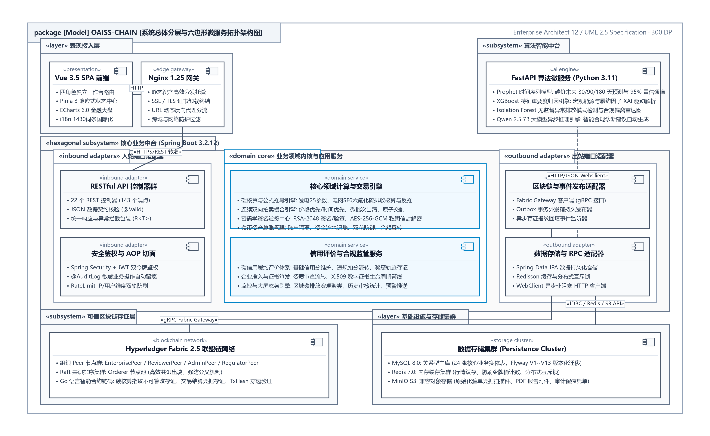
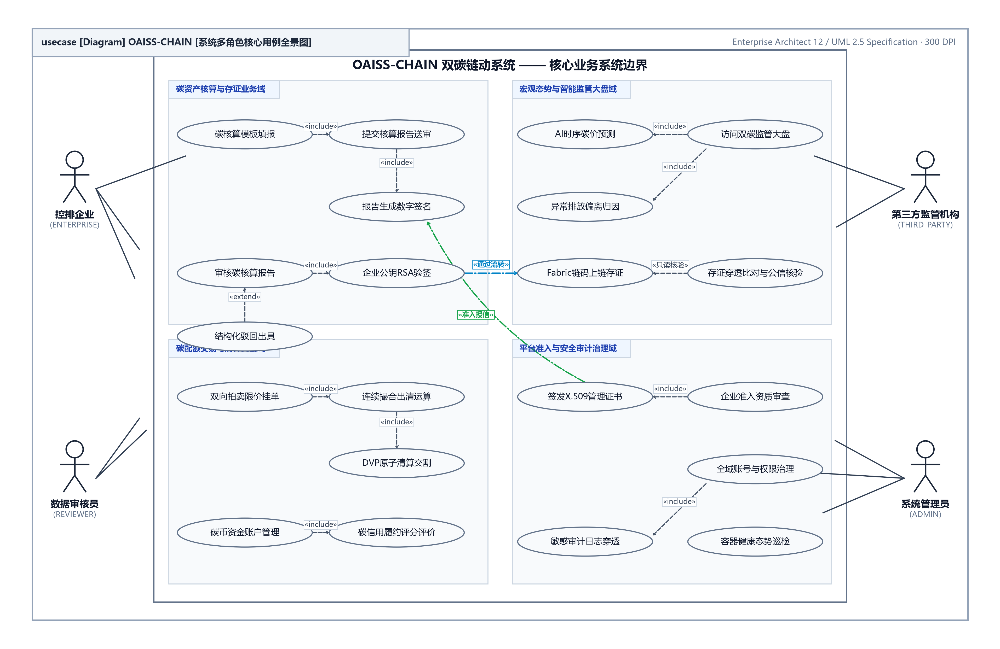
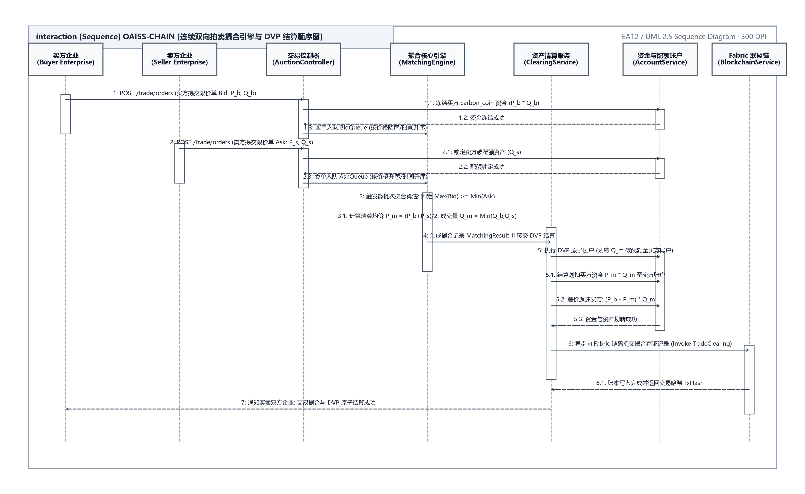
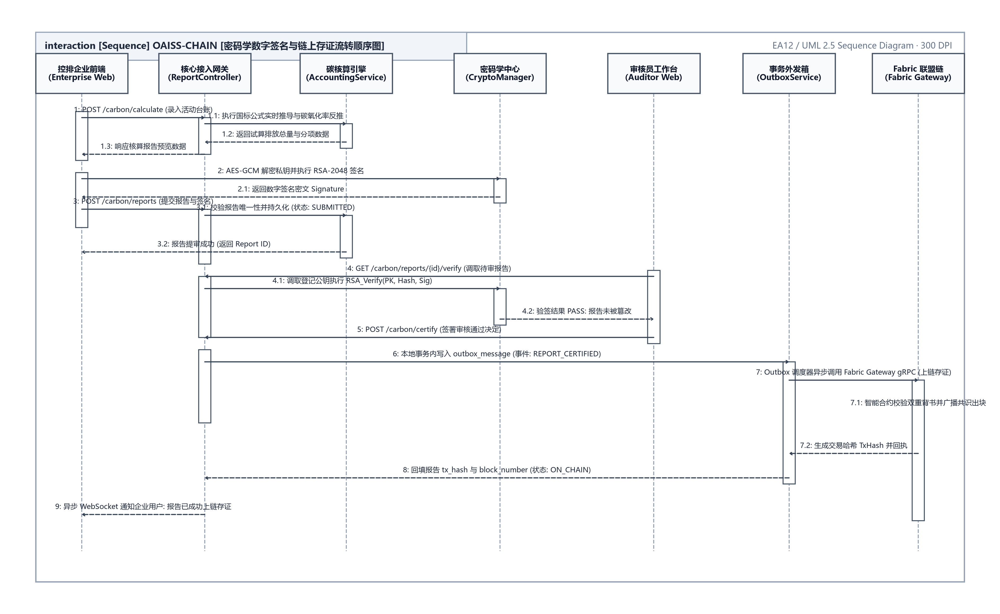
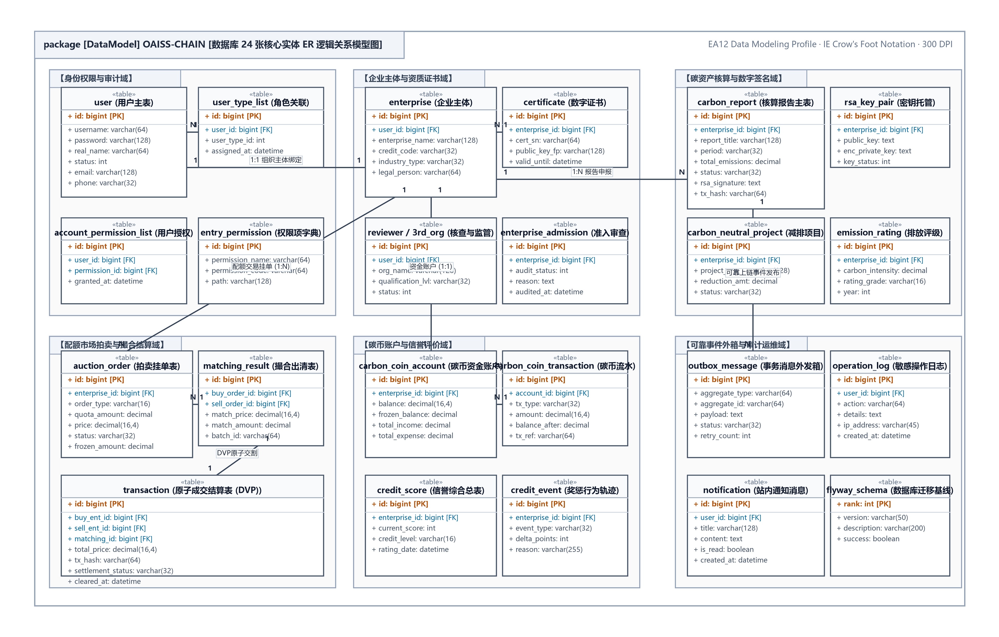
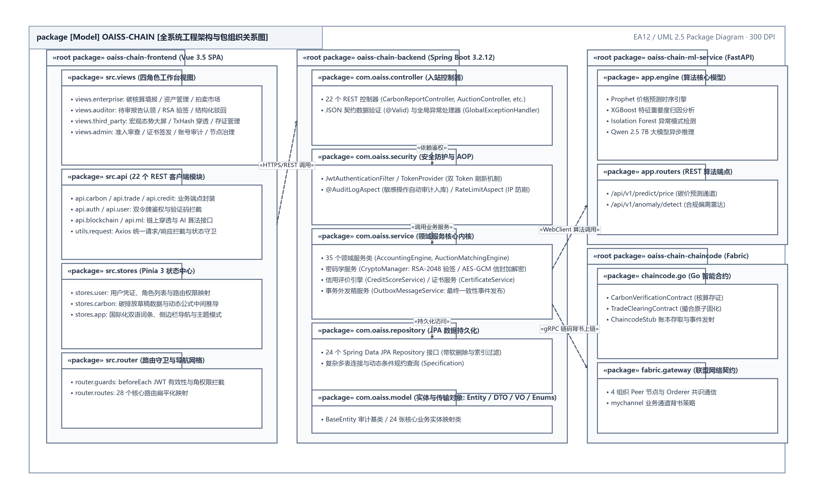

<div align="center">

**OAISS CHAIN — ENTERPRISE DUAL-CARBON BLOCKCHAIN PLATFORM**  
### 双碳链动系统 · 企业级技术活文档体系分册
#### 基于区块链的可信碳核算、双向拍卖撮合与量化风控系统

<br>

# 系统设计与架构规格书
### （OAISS CHAIN · SYSTEM DESIGN & ARCHITECTURE SPECIFICATION）

<br>

| 项目 | 内容详情 |
| :--- | :--- |
| **作品名称** | OAISS CHAIN 双碳链动系统 |
| **分册名称** | 系统设计与架构规格书 |
| **文档版本** | v2.2 (规范发布版) |
| **定位分类** | 全栈架构与开发规范指南 |
| **主要作者 / 研发团队** | OAISS CHAIN 联合研发团队 |
| **指导老师 / 架构组** | 系统架构委员会与区块链实验室 |
| **所属单位** | 软件学院 & 双碳区块链工程中心 |
| **完成日期** | 二〇二六年十月 |

</div>

---


## 目 录

- [第一部分 产品功能说明与业务规格](#第一部分-产品功能说明与业务规格)
  - [1. 系统概述](#1.-系统概述)
    - [1.1 项目定位](#1.1-项目定位)
    - [1.2 核心能力](#1.2-核心能力)
    - [1.3 业务参与者](#1.3-业务参与者)
  - [2. 技术架构](#2.-技术架构)
    - [2.1 技术栈](#2.1-技术栈)
    - [2.2 系统架构图](#2.2-系统架构图)
  - [3. 用户角色与权限](#3.-用户角色与权限)
    - [3.1 角色定义](#3.1-角色定义)
    - [3.2 Fabric节点映射](#3.2-fabric节点映射)
    - [3.2 权限矩阵](#3.2-权限矩阵)
  - [4. 业务模块详细说明](#4.-业务模块详细说明)
    - [4.1 用户认证模块](#4.1-用户认证模块)
    - [4.2 碳核算模块](#4.2-碳核算模块)
    - [4.3 数据审核模块](#4.3-数据审核模块)
    - [4.4 碳交易模块](#4.4-碳交易模块)
    - [4.5 双向拍卖模块](#4.5-双向拍卖模块)
    - [4.6 碳币交易模块](#4.6-碳币交易模块)
    - [4.7 信誉评分模块](#4.7-信誉评分模块)
    - [4.8 数字签名模块](#4.8-数字签名模块)
    - [4.9 碳中和项目模块](#4.9-碳中和项目模块)
    - [4.10 碳排放评级模块](#4.10-碳排放评级模块)
    - [4.11 AI智能模块](#4.11-ai智能模块)
    - [4.12 区块链模块](#4.12-区块链模块)
    - [4.13 搜索查询模块](#4.13-搜索查询模块)
    - [4.14 第三方监管模块](#4.14-第三方监管模块)
    - [4.15 管理后台模块](#4.15-管理后台模块)
    - [4.16 用户中心模块](#4.16-用户中心模块)
  - [5. 核心业务流程](#5.-核心业务流程)
    - [5.1 碳核算完整流程](#5.1-碳核算完整流程)
    - [5.2 碳交易完整流程](#5.2-碳交易完整流程)
    - [5.3 碳中和项目完整流程](#5.3-碳中和项目完整流程)
    - [5.4 信誉评分联动流程](#5.4-信誉评分联动流程)
  - [6. 数据库设计](#6.-数据库设计)
    - [6.1 数据库概览](#6.1-数据库概览)
    - [6.2 核心表结构](#6.2-核心表结构)
    - [6.3 实体关系图](#6.3-实体关系图)
  - [7. 前端页面说明](#7.-前端页面说明)
    - [7.1 页面路由结构](#7.1-页面路由结构)
    - [7.2 侧边栏菜单结构](#7.2-侧边栏菜单结构)
    - [7.3 前端API模块映射](#7.3-前端api模块映射)
  - [8. API接口总览](#8.-api接口总览)
    - [8.1 接口统计](#8.1-接口统计)
    - [8.2 统一响应格式](#8.2-统一响应格式)
    - [8.3 认证方式](#8.3-认证方式)
  - [9. 需求分级](#9.-需求分级)
- [第二部分 系统总体架构与技术选型](#第二部分-系统总体架构与技术选型)
  - [1. User sends credentials to POST /auth/login](#1.-user-sends-credentials-to-post-/auth/login)
  - [2. Backend validates against DB (BCrypt password hash)](#2.-backend-validates-against-db-bcrypt-password-hash)
  - [3. Returns JWT access token (1h) + refresh token (7d)](#3.-returns-jwt-access-token-1h-+-refresh-token-7d)
  - [4. Frontend stores in sessionStorage (not cookies)](#4.-frontend-stores-in-sessionstorage-not-cookies)
  - [5. Every API request includes Authorization: Bearer `<token>`](#5.-every-api-request-includes-authorization:-bearer-`<token>`)
  - [6. JwtAuthenticationFilter validates token on each request](#6.-jwtauthenticationfilter-validates-token-on-each-request)
  - [1. Content-Security-Policy (CSP)](#1.-content-security-policy-csp)
  - [2. Strict-Transport-Security (HSTS, 1 year)](#2.-strict-transport-security-hsts,-1-year)
  - [3. X-Content-Type-Options (nosniff)](#3.-x-content-type-options-nosniff)
  - [4. X-Frame-Options (DENY)](#4.-x-frame-options-deny)
  - [5. X-XSS-Protection (mode=block)](#5.-x-xss-protection-mode=block)
  - [6. Referrer-Policy (strict-origin-when-cross-origin)](#6.-referrer-policy-strict-origin-when-cross-origin)
  - [8. X-API-Version (1)](#8.-x-api-version-1)
  - [1. Enterprise creates report → Status: DRAFT (0)](#1.-enterprise-creates-report-→-status:-draft-0)
  - [2. Enterprise submits → Status: SUBMITTED (1)](#2.-enterprise-submits-→-status:-submitted-1)
  - [3. Reviewer reviews → Status 仍为 SUBMITTED (1)，不写 UNDER_REVIEW (2)](#3.-reviewer-reviews-→-status-仍为-submitted-1不写-under_review-2)
  - [2. **P2P Phase**: Direct enterprise-to-enterprise trading](#2.-**p2p-phase**:-direct-enterprise-to-enterprise-trading)
  - [4. **Credit Impact**: Trade affects enterprise credit score](#4.-**credit-impact**:-trade-affects-enterprise-credit-score)
  - [1. Historical carbon reports aggregated (max 12 periods)](#1.-historical-carbon-reports-aggregated-max-12-periods)
  - [2. Sent to ML service (Prophet time series model)](#2.-sent-to-ml-service-prophet-time-series-model)
  - [3. Returns predictions with confidence bands](#3.-returns-predictions-with-confidence-bands)
  - [4. Displayed in MarketPrediction view with dataZoom](#4.-displayed-in-marketprediction-view-with-datazoom)
- [第三部分 数据库设计与实体模型字典](#第三部分-数据库设计与实体模型字典)
  - [1. 技术栈与配置](#1.-技术栈与配置)
  - [2. 表总览](#2.-表总览)
  - [3. 公共字段（BaseEntity）](#3.-公共字段baseentity)
  - [4. 表结构详细设计](#4.-表结构详细设计)
    - [4.1 `user` — 用户表](#4.1-`user`-—-用户表)
    - [4.2 `user_type_list` — 用户类型表](#4.2-`user_type_list`-—-用户类型表)
    - [4.3 `enterprise` — 企业表](#4.3-`enterprise`-—-企业表)
    - [4.4 `reviewer` — 审核员表](#4.4-`reviewer`-—-审核员表)
    - [4.5 `reviewer_qualification` — 审核员资质表](#4.5-`reviewer_qualification`-—-审核员资质表)
    - [4.6 `third_party_org` — 第三方机构表](#4.6-`third_party_org`-—-第三方机构表)
    - [4.7 `authenticator` — 管理员签发信息表（历史命名，已退场）](#4.7-`authenticator`-—-管理员签发信息表历史命名，已退场)
    - [4.8 `carbon_report` — 碳报告表](#4.8-`carbon_report`-—-碳报告表)
    - [4.9 `transaction` — 交易记录表](#4.9-`transaction`-—-交易记录表)
    - [4.10 `account_permission_list` — 账户权限定义表](#4.10-`account_permission_list`-—-账户权限定义表)
    - [4.11 `entry_permission` — API权限表](#4.11-`entry_permission`-—-api权限表)
    - [4.12 `auction_order` — 拍卖订单表](#4.12-`auction_order`-—-拍卖订单表)
    - [4.13 `matching_result` — 撮合结果表](#4.13-`matching_result`-—-撮合结果表)
    - [4.14 `rsa_key_pair` — RSA密钥对表](#4.14-`rsa_key_pair`-—-rsa密钥对表)
    - [4.15 `credit_score` — 信誉评分表](#4.15-`credit_score`-—-信誉评分表)
    - [4.16 `credit_event` — 信誉事件表](#4.16-`credit_event`-—-信誉事件表)
    - [4.17 `carbon_coin_account` — 碳币账户表](#4.17-`carbon_coin_account`-—-碳币账户表)
    - [4.18 `carbon_coin_transaction` — 碳币交易记录表](#4.18-`carbon_coin_transaction`-—-碳币交易记录表)
    - [4.19 `emission_rating` — 排放评级表](#4.19-`emission_rating`-—-排放评级表)
    - [4.20 `carbon_neutral_project` — 碳中和项目表](#4.20-`carbon_neutral_project`-—-碳中和项目表)
    - [4.21 `operation_log` — 操作日志表](#4.21-`operation_log`-—-操作日志表)
    - [4.22 `notification` — 站内通知表](#4.22-`notification`-—-站内通知表)
    - [4.23 `certificate` — 数字证书表](#4.23-`certificate`-—-数字证书表)
  - [5. 枚举值定义](#5.-枚举值定义)
    - [5.1 `UserTypeEnum` — 用户类型](#5.1-`usertypeenum`-—-用户类型)
    - [5.2 `ReportStatusEnum` — 碳报告状态](#5.2-`reportstatusenum`-—-碳报告状态)
    - [5.3 `TradeTypeEnum` — 交易类型](#5.3-`tradetypeenum`-—-交易类型)
    - [5.4 `TradeStatusEnum` — 交易状态](#5.4-`tradestatusenum`-—-交易状态)
    - [5.5 `AuctionOrderStatusEnum` — 拍卖订单状态](#5.5-`auctionorderstatusenum`-—-拍卖订单状态)
    - [5.6 `MatchingStatusEnum` — 撮合结果状态](#5.6-`matchingstatusenum`-—-撮合结果状态)
    - [5.7 `CreditLevelEnum` — 信誉等级](#5.7-`creditlevelenum`-—-信誉等级)
    - [5.8 `CreditEventTypeEnum` — 信誉事件类型](#5.8-`crediteventtypeenum`-—-信誉事件类型)
    - [5.9 `QualificationStatusEnum` — 审核员资质状态](#5.9-`qualificationstatusenum`-—-审核员资质状态)
  - [6. 表间关系图](#6.-表间关系图)
  - [7. 索引设计](#7.-索引设计)
  - [8. API 与 Controller 映射](#8.-api-与-controller-映射)
  - [9. Entity ↔ Repository ↔ Controller 对齐矩阵](#9.-entity-↔-repository-↔-controller-对齐矩阵)
  - [10. 验证结论](#10.-验证结论)
- [第四部分 快速环境搭建与开发者上手](#第四部分-快速环境搭建与开发者上手)
- [第五部分 代码库全景与架构导航](#第五部分-代码库全景与架构导航)

---

### 双碳链动系统 (OAISS CHAIN) —— 系统设计与架构规格书

# 第一部分 产品功能说明与业务规格

> **契约导言**：本章定义 148 个 Spring Boot REST API 端点契约、统一响应信封、全局错误码体系及 ML 微服务接口。
**表 1.1.1 章节修订与审核责任记录表**

| 编号 | 变更状态 | 修订日期 | 执笔人 | 审核人 | 批准人 | 变更摘要与说明 |
| :---: | :---: | :---: | :---: | :---: | :---: | :--- |
| 1 | 文档创建 | 2026-06-15 | 核心研发 | 架构师 | 技术委员会 | 初始化基础业务规格与实体设计 |
| 2 | 架构升级 | 2026-09-02 | 架构组 | 技术委员会 | 技术委员会 | 全量同步生产基线与代码零漂移事实 |
| 3 | 版式重塑 | 2026-10-05 | 全栈架构组 | 技术总监 | 技术委员会 | 对齐参考手册规范，建立多级大纲与标准用例卡片 |

---

### OAISS Chain 双碳链动系统 — 产品说明书

> **注意 (Note)**：版本：1.0.0 | 日期：2026-05-02

- 
- 4.1 用户认证模块
- 4.2 碳核算模块
- 4.3 数据审核模块
- 4.4 碳交易模块
- 4.5 双向拍卖模块
- 4.6 碳币交易模块
- 4.7 信誉评分模块
- 4.8 数字签名模块
- 4.9 碳中和项目模块
- 4.10 碳排放评级模块
- 4.11 AI智能模块
- 4.12 区块链模块
- 4.13 搜索查询模块
- 4.14 第三方监管模块
- 4.15 管理后台模块
- 4.16 用户中心模块
- 

## 1. 系统概述

### 1.1 项目定位

OAISS Chain（双碳链动系统）是一个基于区块链技术的企业碳资产管理平台，面向碳排放核算、碳配额交易、碳中和项目管理等核心业务场景。系统通过 Hyperledger Fabric 区块链确保碳数据的不可篡改性和可追溯性，为碳市场参与者提供可信的数字化基础设施。

### 1.2 核心能力

**表 2.1.1 数据规范对照表**

| 能力领域 | 说明 |
| :--- | :--- |
| 碳核算管理 | 企业碳排放报告的创建、提交、审核全流程管理；基于官方碳核算指南的发电企业和电网企业碳核算模型 |
| 数据审核 | 审核员对核算结果及佐证材料进行人工审核，RSA数字签名验证数据完整性，审核通过后上链存证 |
| 碳配额交易 | 支持双向拍卖撮合和P2P点对点交易双阶段交易模式 |
| 碳币交易市场 | 碳币作为数字货币的发行和流通，碳额度与碳币之间的兑换交易体系，市场价格反映供求关系 |
| 信誉评分体系 | 基于交易行为和合规情况的企业信誉评估，信誉分影响拍卖撮合优先权和交易权限 |
| 数字签名 | RSA密钥对管理，碳报告签名验签，数据加密传输 |
| 碳中和项目 | 碳汇、CCUS、可再生能源等项目全生命周期管理，碳中和激励机制 |
| 碳排放评级 | 基于排放数据的企业碳排放数字评分制度评定与行业排名，评级结果给予奖励或惩罚 |
| 区块链存证 | 关键碳数据上链存证，确保不可篡改，基于Fabric交易模型 |
| AI智能模块 | 市场智能预测（交易情况预测、走势分析）和企业境况智能推断（企业环保性评估、违规超额排放检测） |

### 1.3 业务参与者

系统涉及五类核心参与者：

┌─────────────┐    ┌─────────────┐    ┌─────────────┐
│   企业用户   │    │   审核员     │    │  第三方监管   │
│ (ENTERPRISE) │    │ (REVIEWER)  │    │(THIRD_PARTY)  │
└──────┬──────┘    └──────┬──────┘    └──────┬──────┘
       │                  │                  │
       └──────────┬───────┴──────────────────┘
                  │
          ┌───────┴───────┐
          │  OAISS Chain  │
          │    平台系统    │
          └───────┬───────┘
                  │
       ┌──────────┴──────────┐
       │                     │
┌──────┴──────┐      ┌──────┴──────┐
│   管理员     │      │ 第三方监管   │
│  (ADMIN)    │      │(THIRD_PARTY)│
└─────────────┘      └─────────────┘

- 

## 2. 技术架构

<div align="center">
  
  <br>
  <b>图 2.1.1 系统总体分层与六边形微服务拓扑架构图</b>
</div>


### 2.1 技术栈

**表 2.2.2 技术栈依赖与运行环境配置表**

| 层级 | 技术选型 | 版本 |
| :--- | :---: | :--- |
| **后端框架** | Spring Boot | 3.2.5 |
| **ORM** | Spring Data JPA + Hibernate | 6.x |
| **数据库** | MySQL | 8.x |
| **缓存** | Redis | 7.x |
| **认证** | Spring Security + JWT (jjwt) | 0.12.5 |
| **文件存储** | MinIO | — |
| **数据库迁移** | Flyway | — |
| **区块链** | Hyperledger Fabric | — |
| **前端框架** | Vue 3 + Vite | — |
| **UI组件库** | Element Plus | — |
| **状态管理** | Pinia | — |
| **HTTP客户端** | Axios | — |

### 2.2 系统架构图

┌─────────────────────────────────────────────────────────────┐
│                        前端 (Vue 3)                          │
│  ┌──────┐ ┌──────┐ ┌──────┐ ┌──────┐ ┌──────┐              │
│  │ 企业 │ │审核员│ │认证  │ │管理  │ │第三方│              │
│  │ 端   │ │ 端   │ │机构端│ │ 端   │ │监管端│              │
│  └──┬───┘ └──┬───┘ └──┬───┘ └──┬───┘ └──┬───┘              │
│     └────────┴────────┴────────┴────────┘                    │
│                    Axios HTTP                                 │
└─────────────────────────┬───────────────────────────────────┘
                          │
┌─────────────────────────┴───────────────────────────────────┐
│                   后端 (Spring Boot)                          │
│  ┌─────────────────────────────────────────────────────┐    │
│  │  Spring Security + JWT Filter (认证 & 授权)          │    │
│  └─────────────────────────┬───────────────────────────┘    │
│                            │                                 │
│  ┌─────────┐ ┌──────────┐ ┌──────────┐ ┌──────────┐        │
│  │16个      │ │ Service  │ │ JPA      │ │ Security │        │
│  │Controller│→│ Layer    │ │ Repository│ │ Module   │        │
│  └─────────┘ └──────────┘ └──────────┘ └──────────┘        │
└─────────┬──────────┬──────────┬──────────────────────────────┘
          │          │          │
    ┌─────┴───┐ ┌────┴────┐ ┌──┴──────────┐
    │  MySQL  │ │  Redis  │ │ Hyperledger │
    │  8.x   │ │  7.x   │ │   Fabric    │
    └─────────┘ └─────────┘ └─────────────┘

- 

## 3. 用户角色与权限

<div align="center">
  
  <br>
  <b>图 3.1.1 四角色业务协同与权限流转全景关系图</b>
</div>


### 3.1 角色定义

**表 2.3.3 四角色访问控制与权限矩阵表**

| 角色代码 | userType | 角色名称 | 描述 |
| :--- | :---: | :--- | :--- |
| ENTERPRISE | 1 | 企业用户 | 碳排放主体，进行碳核算报告提交、碳交易、碳中和项目管理 |
| REVIEWER | 2 | 审核员 | 审核碳排放报告和碳中和项目，管理信誉评分 |
| ADMIN | 4 | 管理员 | 系统管理，用户管理，执行撮合，碳币充值，信誉评估，签发准入证书和审核员资格证；**不代行报告上链**（仅保留兜底补救） |
| THIRD_PARTY | 3 | 第三方监管 | 监管碳报告和交易数据，查看统计信息，定期核查；**穿透式只读，不参与上链审批，无业务写权限** |

### 3.2 Fabric节点映射

基于Hyperledger Fabric区块链平台，系统将用户角色映射到不同的节点类型：

**表 2.4.4 数据库实体字段与约束字典表**

| 用户类型 | 节点类型 | 描述 |
| :--- | :---: | :--- |
| 企业用户 | 客户端 | 与背书节点进行交互，提交交易请求 |
| 数据审核员 | 背书节点 | 验证交易和数据的合法性，确保交易符合业务规则和法律法规 |
| 管理员 | 排序节点/提交对等节点 | 负责网络的管理和维护，包括添加、移除节点、更新智能合约、配置网络参数 |
| 第三方监管机构 | 特殊参与者角色 | 拥有访问特定交易信息的权限，确保交易的合法性和透明性 |

### 3.2 权限矩阵

**表 2.5.5 数据规范对照表**

> ⚠️ **2026-10-21 重制说明**：本表此前把「执行撮合 / 碳币充值 / 签发准入证书 / 签发审核员资格证 /
> 用户管理 / 添加奖励分」误判给**第三方监管**，与 §3.1 角色表及 `docs/raw` 原始需求完全相反，
> 且「监管数据查询」一行全为「—」（把该角色唯一本职留空）。
> 现按 §3.1 角色表 + 原始需求 + 代码 `@PreAuthorize` 实测三方对齐后重制。

| 功能模块 | 企业用户 | 审核员 | 管理员 | 第三方监管 |
| :--- | :---: | :--- | :--- | :--- |
| 创建碳报告 | √ | — | — | — |
| 提交碳报告送审 | √ | — | — | — |
| 审核碳报告（通过/驳回） | — | √ | — | — |
| **审核通过即自动上链** | — | √ | — | — |
| 上链失败补救（幂等重试） | — | √ | √（兜底） | — |
| 查看碳报告列表 | 仅本企业 | √ | √ | √ |
| 创建P2P交易 | √ | — | — | — |
| 双向拍卖挂单 | √ | — | — | — |
| 执行撮合 | — | — | √ | — |
| 碳币充值 | — | — | √ | — |
| 扣除信誉分 | — | √ | √ | — |
| 添加奖励分 | — | — | √ | — |
| 生成密钥对（本人） | √ | √ | — | √ |
| 签名碳报告 | √ | — | — | — |
| 验证签名 | — | √ | — | √ |
| 创建碳中和项目 | √ | — | — | — |
| 审核碳中和项目 | — | √ | — | — |
| 核证碳中和项目 | — | √ | √ | — |
| 用户管理 | — | — | √ | — |
| 区块链状态查询 | √ | — | √ | √ |
| 监管数据查询（穿透式只读） | — | — | √ | √ |
| 碳排放评级 | √ | √ | √ | — |
| AI市场智能预测 | √ | — | √ | — |
| AI企业境况推断 | — | — | √ | √ |
| AI碳排放预测（企业自身） | √ | — | √ | — |
| 签发准入证书 | — | — | √ | — |
| 签发审核员资格证 | — | — | √ | — |
| 下市处罚（谎报瞒报） | — | — | √ | √ |
| **监管写操作（上链/撮合/发证）** | — | — | — | **—（禁止）** |

> **同步门禁**：本表由 `node scripts/role-matrix-verify.mjs` 断言「第三方监管无业务写权限」，
> 改代码后必跑，防止再次漂移。

> **2026-10-29 两处对齐代码的修正**：
> 1. 「生成密钥对（本人）」原标 **管理员 √**，但 `DigitalSignatureController` 的
>    `/keypair/generate`、`/keypair`（GET/DELETE）三个端点均为
>    `@PreAuthorize("hasAnyRole('ENTERPRISE', 'REVIEWER', 'THIRD_PARTY')")`
>    （`DigitalSignatureController.java:74/113/143`），**不含 ADMIN**，故本行管理员改为「—」。
> 2. 「AI市场智能预测」原标 **第三方监管 √**，但 `MarketPredictionController` 的
>    `/ai/market/trend`、`/price`、`/supply-demand` 三个端点均为
>    `@PreAuthorize("hasAnyRole('ENTERPRISE', 'ADMIN')")`
>    （`MarketPredictionController.java:51/73/95`），**不含 THIRD_PARTY**，故本行第三方改为「—」。
>
> 说明：这两条属于 `role-matrix-verify.mjs` 当前**未覆盖**的断言盲区，改矩阵时需人工对照 `@PreAuthorize`。

> **关于「执行撮合」**：上表「管理员 √」指的是**手动补触发**权限（`POST /auction/match`）。
> 平台的实际出清主路径是 `AuctionMatchingScheduler` 每 30 秒的**系统自动撮合**，无用户主体参与，
> 管理员不开控制台也不会影响市场正常出清。

- 

## 4. 业务模块详细说明

### 4.1 用户认证模块

- API前缀**: `/api/v1/auth`
#### 4.1.1 功能描述

管理用户登录、注册、验证码、Token刷新和登出等认证流程。采用JWT双Token机制（AccessToken + RefreshToken），AccessToken有效期较短用于接口认证，RefreshToken有效期较长用于刷新会话。

#### 4.1.2 接口列表

**表 2.6.6 REST API 接口规范与参数契约表**

| 方法 | 路径 | 说明 | 权限 |
| :--- | :---: | :--- | :--- |
| POST | `/auth/login` | 用户登录（用户名+密码+验证码） | 公开 |
| POST | `/auth/register` | 用户注册 | 公开 |
| POST | `/auth/captcha` | 获取图形验证码（有效期5分钟） | 公开 |
| POST | `/auth/refresh` | 刷新访问令牌（需Refresh-Token头） | 公开 |
| GET | `/auth/check-ip` | 检查当前IP是否在白名单中 | 公开 |
| GET | `/auth/me` | 获取当前用户信息 | 已登录 |
| POST | `/auth/logout` | 用户登出，清除Token缓存 | 已登录 |
| PUT | `/auth/password` | 修改密码（需验证原密码） | 已登录 |

#### 4.1.3 登录流程

用户 → 输入账号密码 → 获取图形验证码 → 填写验证码 → 提交登录
  │
  ├→ 验证码校验 → 失败 → 返回错误码 1005
  ├→ IP白名单检查 → 不在白名单 → 返回错误码 1003
  ├→ 用户名密码校验 → 错误 → 返回错误码 401
  └→ 生成JWT → 返回 AccessToken + RefreshToken + 用户信息

#### 4.1.4 安全机制

- 密码使用BCrypt加密存储
- 密码字段使用 `@JsonProperty(access = WRITE_ONLY)` 确保不序列化到响应
- 支持IP白名单访问控制
- 图形验证码防暴力破解
- JWT Token支持过期自动失效
- 

### 4.2 碳核算模块

- API前缀**: `/api/v1/carbon`
#### 4.2.1 功能描述

企业碳排放报告的全生命周期管理，包括创建、提交、审核、查询和删除。支持季度报告和年度报告两种类型，核算结果包含范围1（直接排放）、范围2（间接排放）、范围3（其他间接排放）三类排放数据。

#### 碳核算模型

系统基于官方碳核算指南构建了两种行业的碳核算模型：

- 1. 发电企业碳核算模型**
基于《中国发电企业温室气体排放核算方法与报告指南（试行）》，排放总量计算公式：

E = Σ(FCi × NCVi/年 × 10⁻⁶) × (CCi × OFi × 44/12) + Σ(ΣBk,m × 90%) × (EFk,t × 100%) + (AD电 × EF电)

原始数据输入项（25项）包括：化石燃料消耗量(FCi)、各类燃料低位热值(NCV)、含碳量(CC)、碳氧化率(OF)、脱硫剂消耗量(Bk,m)、脱硫过程排放因子(EFk,t)、净购入电量(AD电)、区域电网排放因子(EF电)等。

- 2. 电网企业碳核算模型**
基于《中国电网企业温室气体排放核算方法与报告指南（试行）》，排放总量计算公式：

E = (Σ(REC容量,i - REC回收,i) + Σ(REP容量,j - REP回收,j)) × GWPSF₆ × 10⁻³ + (EL上网 + EL输入 - EL输出 - EL售电) × EF电网

原始数据输入项（9项）包括：退役/修理设备SF6容量与回收量、各类电量数据、电网排放因子等。

#### 4.2.2 接口列表

**表 2.7.7 REST API 接口规范与参数契约表**

| 方法 | 路径 | 说明 | 权限 |
| :--- | :---: | :--- | :--- |
| POST | `/carbon/reports` | 创建碳报告（草稿状态） | ENTERPRISE |
| POST | `/carbon/reports/{reportId}/submit` | 提交碳报告至审核 | ENTERPRISE |
| GET | `/carbon/reports/{reportId}` | 获取报告详情 | 已登录 |
| GET | `/carbon/reports` | 查询报告列表（分页） | ADMIN/REVIEWER/THIRD_PARTY |
| GET | `/carbon/my-reports` | 查询我的报告 | ENTERPRISE |
| DELETE | `/carbon/reports/{reportId}` | 删除草稿报告 | ENTERPRISE |
| POST | `/carbon/review` | 审核碳报告（通过/驳回） | REVIEWER |

#### 4.2.3 报告状态流转

草稿(0) → 已提交(1) → 审核中(2) → 审核通过(3) → 已上链(5)
                  ↓
              审核拒绝(4)

> ⚠️ **事实说明（2026-10-29 源码核对）**：上图 `审核中(2) UNDER_REVIEW` 是**枚举预留值**，
> `CarbonService.reviewReport()` 从不写入该状态——审核时直接从 `SUBMITTED(1)` 落到
> `APPROVED(3)`（随后自动上链则置 `ON_CHAIN(5)`）或 `REJECTED(4)`
> （`oaiss-chain-backend/src/main/java/com/oaiss/chain/service/CarbonService.java:166-178`；
> 生产代码中该常量仅在 `ReportStatusEnum.java:16` 定义及 `isReviewable()` 判定处出现，
> 前端 `src/types/enums.ts:14` 只是同值镜像常量）。
> 不要以为存在「审核员开始审核」的中间态。

- 草稿(0)**: 企业创建报告后的初始状态，可编辑、可删除
- 已提交(1)**: 企业提交后进入此状态
- 审核中(2)**: 枚举预留，当前流程不落库（见上方事实说明）
- 审核通过(3)**: 审核通过，可进行区块链存证
- 审核拒绝(4)**: 审核驳回，企业可修改后重新提交
- 已上链(5)**: 碳数据已写入区块链，不可篡改
#### 4.2.4 碳报告数据结构

**表 2.8.8 数据库实体字段与约束字典表**

| 字段 | 类型 | 说明 |
| :--- | :---: | :--- |
| reportNo | String | 报告编号（唯一） |
| enterpriseId | Long | 提交企业ID |
| accountingPeriod | String | 核算周期（如 2024-Q1） |
| title | String | 报告标题 |
| reportType | Integer | 报告类型（1-季度, 2-年度） |
| emissionData | JSON | 碳排放源数据 |
| totalEmission | BigDecimal | 总排放量（吨CO2当量） |
| scope1Emission | BigDecimal | 直接排放（范围1） |
| scope2Emission | BigDecimal | 间接排放（范围2） |
| scope3Emission | BigDecimal | 其他间接排放（范围3） |
| calculationMethod | String | 核算方法 |
| signatureData | TEXT | RSA数字签名 |
| blockchainTxHash | String | 区块链交易哈希 |
| attachments | JSON | 附件URL列表 |

- 

### 4.3 数据审核模块

- API前缀**: `/api/v1/carbon`
#### 4.3.1 功能描述

数据审核员收到经企业用户数字签名后的核算结果，进行RSA解密，验证核算结果来源是否为该企业以及核算结果是否被篡改。验证通过后，数据审核员为该企业提供碳排放报告，并将企业碳报告进行铸造和上链，以确保其可溯源和不可篡改。该模块利用AI与人工审核相结合的模式进行碳核算结果和原始材料的审核。

> **上链时机（方案 A · 2026-10-21）**：审核员点击审核通过后，**系统后台自动完成上链**（无需第二道人工核准），
> 依据 `docs/raw` 原始需求「当数据审核员点击提交碳排放报告后，系统后台自动将该报告进行上链」。
> 若上链因链端异常失败，报告保持"审核通过"状态，由 `POST /carbon/certify`（REVIEWER|ADMIN）幂等补救重试，审核结论不会丢失。

#### 4.3.2 审核流程

企业用户提交碳报告（含RSA数字签名）
  │
  └→ 审核员接收报告
       │
       ├→ RSA解密验证签名 → 确认数据来源真实
       ├→ 验证核算结果是否被篡改
       ├→ 人工审核原始数据和佐证材料
       │
       ├→ 审核通过 → 生成碳排放报告 → 上链存储
       └→ 审核拒绝 → 驳回并说明原因

#### 4.3.3 审核相关接口

审核功能已集成在碳核算模块中（详见4.2节接口列表中的审核接口），核心审核操作包括：

- 审核碳报告（通过/驳回）
- 验证数字签名
- 上链存证
- 

### 4.4 碳交易模块

- API前缀**: `/api/v1/trade`
#### 4.4.1 功能描述

碳配额交易管理，支持P2P点对点交易和拍卖交易两种模式。交易完成后碳配额在买卖双方之间转移，交易记录可上链存证。

#### 4.4.2 接口列表

**表 2.9.9 REST API 接口规范与参数契约表**

| 方法 | 路径 | 说明 | 权限 |
| :--- | :---: | :--- | :--- |
| POST | `/trade/p2p` | 创建P2P交易 | ENTERPRISE |
| POST | `/trade/auction` | 创建拍卖挂单 | ENTERPRISE |
| POST | `/trade/{tradeId}/confirm` | 确认交易 | ENTERPRISE/ADMIN |
| POST | `/trade/{tradeId}/cancel` | 取消交易 | ENTERPRISE |
| GET | `/trade/{tradeId}` | 获取交易详情 | 已登录 |
| GET | `/trade/list` | 查询交易列表 | ADMIN/REVIEWER/THIRD_PARTY |
| GET | `/trade/my-trades` | 查询我的交易 | ENTERPRISE |

#### 4.4.3 交易状态流转

待处理(0) → 处理中(1) → 已完成(2)
     ↓
  已取消(3)
     ↓
  失败(4)

#### 4.4.4 P2P交易流程

卖方企业 → 创建P2P交易（指定买方、数量、价格）
  │
  ├→ 系统检查卖方可交易碳配额是否充足
  ├→ 冻结卖方对应碳配额
  └→ 生成交易记录（状态：待处理）
       │
       ├→ 买方确认交易 → 碳配额转移 → 交易完成
       └→ 卖方取消交易 → 解冻碳配额 → 交易取消

#### 4.4.5 交易数据结构

**表 2.10.10 数据库实体字段与约束字典表**

| 字段 | 类型 | 说明 |
| :--- | :---: | :--- |
| tradeNo | String | 交易编号（唯一） |
| tradeType | Integer | 交易类型（1-拍卖, 2-P2P, 3-配额分配） |
| sellerId | Long | 卖方用户ID |
| buyerId | Long | 买方用户ID |
| quantity | BigDecimal | 交易碳配额数量（吨CO2当量） |
| unitPrice | BigDecimal | 单价（元/吨） |
| totalAmount | BigDecimal | 总金额（元） |
| status | Integer | 交易状态 |
| blockchainTxHash | String | 区块链交易哈希 |

- 

### 4.5 双向拍卖模块

<div align="center">
  
  <br>
  <b>图 4.5.1 连续双向拍卖撮合引擎与 DVP 结算流转关系图</b>
</div>


- API前缀**: `/api/v1/auction`
#### 4.5.1 功能描述

碳配额双向拍卖市场，采用"价格优先、时间优先"的撮合算法。企业可以提交买入挂单或卖出挂单，系统自动撮合匹配，生成撮合结果。

**撮合驱动机制**：撮合引擎实现的是批量集合竞价（每轮把全市场买盘按价格降序、卖盘按价格升序双指针扫一遍），必须有外部时钟驱动。因此系统内置 `AuctionMatchingScheduler`，**每 30 秒自动出清一轮**，企业挂单后无需任何人工操作即会成交。`POST /auction/match` 是管理员的「立即出清」补偿入口，与定时任务共享同一把 Redis 分布式锁（`auction:matching`），二者并发时后到者快速失败，不会重复结算。

#### 4.5.2 接口列表

**表 2.11.11 REST API 接口规范与参数契约表**

| 方法 | 路径 | 说明 | 权限 |
| :--- | :---: | :--- | :--- |
| POST | `/auction/buy` | 提交买入挂单 | ENTERPRISE |
| POST | `/auction/sell` | 提交卖出挂单 | ENTERPRISE |
| POST | `/auction/match` | 手动立即撮合（自动撮合的补偿入口） | ADMIN |
| GET | `/auction/matching-status` | 查询自动撮合运行态与盘口待撮合规模 | ADMIN |
| GET | `/auction/all-results` | 查询全平台撮合成交明细 | ADMIN |
| GET | `/auction/orders` | 查询挂单列表（分页） | 已登录 |
| GET | `/auction/my-orders` | 查询我的挂单 | 已登录 |
| GET | `/auction/results` | 查询撮合结果（仅本人相关） | 已登录 |

#### 4.5.3 撮合流程

企业A(买入) ──┐                    ┌── 企业C(卖出)
企业B(买入) ──┼→ 挂单池 → 撮合算法 ──┼→ 匹配结果
企业D(卖出) ──┘                    └── 企业E(买入)

撮合规则：
1. 价格优先：买入价 ≥ 卖出价时可撮合
2. 时间优先：同价格挂单按提交时间排序
3. 成交价：取买卖双方挂单价的中间价

#### 4.5.4 挂单状态

**表 2.12.12 状态机流转与错误码对照表**

| 状态码 | 说明 |
| :--- | :--- |
| 0 | 待匹配 |
| 1 | 部分匹配 |
| 2 | 完全匹配 |
| 3 | 已取消 |

#### 4.5.5 撮合结果状态

**表 2.13.13 状态机流转与错误码对照表**

| 状态码 | 说明 |
| :--- | :--- |
| 0 | 待结算 |
| 1 | 已结算 |
| 2 | 失败 |

> ⚠️ **事实说明（2026-10-29 源码核对）**：上表 `2 = 失败 (MatchingStatusEnum.FAILED)` 仅为枚举预留，
> 生产代码**从未写入**该值。撮合落库只有两种状态：新建为 `PENDING_SETTLEMENT(0)`
> （`DoubleAuctionService.java:284`），结算成功后置 `SETTLED(1)`（`DoubleAuctionService.java:303`）。
> 撮合异常走事务回滚/异常抛出，不留「失败」状态的撮合记录。

- 

### 4.6 碳币交易模块

- API前缀**: `/api/v1/carbon-coin`
#### 4.6.1 功能描述

碳币是系统内部的数字货币交易媒介，可作为碳排放权的价值代表和交易媒介。企业可以用人民币充值碳币，用碳币购买碳配额，或出售碳配额获得碳币。碳币转账功能已移除（2026-10-31），碳币流转仅经充值与市场结算。碳币的市场价格反映碳排放权的供求关系和市场状况，从而引导碳交易的行为和方向。碳币的发行和流通可作为激励减排行为的一种方式，通过设立碳排放目标和配额及发放碳币奖励达成目标，促使更多主体采取减排措施。碳币交易记录通过区块链实现信息的透明和流通监管，确保安全性和可信度，防止双重支付和篡改记录。

#### 4.6.2 接口列表

**表 2.14.14 REST API 接口规范与参数契约表**

| 方法 | 路径 | 说明 | 权限 |
| :--- | :---: | :--- | :--- |
| GET | `/carbon-coin/account` | 获取碳币账户信息 | 已登录 |
| POST | `/carbon-coin/recharge` | 充值碳币 | ADMIN |
| GET | `/carbon-coin/transactions` | 查询交易流水 | 已登录 |

#### 4.6.3 交易类型

**表 2.15.15 数据库实体字段与约束字典表**

| 类型码 | 说明 |
| :--- | :--- |
| 1 | 充值（人民币 → 碳币） |
| 2 | 购买配额（碳币 → 碳配额） |
| 3 | 出售配额（碳配额 → 碳币） |
| 4 | 历史转账遗留值（功能已下线） |

#### 4.6.4 碳币账户数据结构

**表 2.16.16 数据库实体字段与约束字典表**

| 字段 | 类型 | 说明 |
| :--- | :---: | :--- |
| userId | Long | 关联用户ID |
| balance | BigDecimal | 碳币余额 |
| totalRecharged | BigDecimal | 累计充值 |
| totalSpent | BigDecimal | 累计消费 |
| status | Integer | 账户状态（0-禁用, 1-启用） |

- 

### 4.7 信誉评分模块

- API前缀**: `/api/v1/credit`
#### 4.7.1 功能描述

基于企业交易行为、合规情况、碳报告质量等维度综合评估企业信誉。信誉分影响企业交易权限：低于阈值被限制交易，严重不足被冻结账户。信誉分排名靠前的企业在双向拍卖撮合阶段享有更大的撮合优先权，政府会对信誉分排名靠前的企业颁发证书及提供奖励。

#### 4.7.2 接口列表

**表 2.17.17 REST API 接口规范与参数契约表**

| 方法 | 路径 | 说明 | 权限 |
| :--- | :---: | :--- | :--- |
| GET | `/credit/my-score` | 获取当前用户信誉分 | ENTERPRISE |
| GET | `/credit/history` | 获取信誉变动历史 | ENTERPRISE |
| GET | `/credit/ranking` | 信誉排名列表 | 已登录 |
| GET | `/credit/{enterpriseId}` | 查询企业信誉分 | 已登录 |
| GET | `/credit/{enterpriseId}/history` | 查询信誉事件历史 | 已登录 |
| POST | `/credit/deduct` | 扣除信誉分 | ADMIN/REVIEWER |
| POST | `/credit/bonus` | 添加奖励分 | ADMIN |
| POST | `/credit/evaluate/{enterpriseId}` | 重新评估信誉等级 | ADMIN |
| GET | `/credit/restricted` | 查询被限制交易的企业 | ADMIN |
| GET | `/credit/frozen` | 查询被冻结的企业 | ADMIN |
| GET | `/credit/check-permission/{enterpriseId}` | 检查交易权限 | 已登录 |

#### 4.7.3 信誉等级体系

**表 2.18.18 数据规范对照表**

| 等级 | 分数范围 | 说明 | 影响 |
| :--- | :---: | :--- | :--- |
| EXCELLENT | 80-100 | 优秀 | 正常交易 |
| GOOD | 60-79 | 良好 | 正常交易 |
| WARNING | 40-59 | 预警 | 限制部分交易 |
| DANGER | 20-39 | 危险 | 限制交易 |
| FROZEN | 0-19 | 冻结 | 冻结账户 |

#### 4.7.4 信誉分变动规则

- 扣分场景**: 碳报告审核拒绝、交易违规、数据造假、提供非真实可靠的原始排放数据等
- 加分场景**: 准时提交报告、交易诚信、参与碳中和项目、碳汇行为（植树造林等）等
- 自动评估**: 管理员可手动触发重新评估，系统根据当前分值自动计算等级
- 低于下限处理**: 信誉分低于下限阈值时，管理员将该用户踢出碳交易系统，一定时间后方可重新交易
- 拍卖优先权**: 信誉分排名靠前的企业在双向拍卖撮合阶段享有更大的撮合优先权
- 政府激励**: 政府对信誉分排名靠前的企业颁发证书及提供小奖品奖励
- 

### 4.8 数字签名模块

<div align="center">
  
  <br>
  <b>图 4.8.1 密码学 RSA 数字签名与 AES-GCM 信封加密防伪流转图</b>
</div>


- API前缀**: `/api/v1/signature`
#### 4.8.1 功能描述

基于RSA非对称加密的数字签名系统，用于碳报告数据签名验签和敏感数据加密传输。支持密钥对生成、签名、验签、加密、解密五类操作。

#### 4.8.2 接口列表

**表 2.19.19 REST API 接口规范与参数契约表**

| 方法 | 路径 | 说明 | 权限 |
| :--- | :---: | :--- | :--- |
| POST | `/signature/keypair/generate` | 生成RSA密钥对 | ENTERPRISE/REVIEWER/THIRD_PARTY |
| GET | `/signature/keypair` | 获取当前用户密钥对信息 | ENTERPRISE/REVIEWER/THIRD_PARTY |
| DELETE | `/signature/keypair` | 撤销密钥对 | ENTERPRISE/REVIEWER/THIRD_PARTY |
| POST | `/signature/sign` | 对碳报告数据签名 | ENTERPRISE |
| POST | `/signature/verify` | 验证碳报告签名 | REVIEWER/THIRD_PARTY/ADMIN |
| POST | `/signature/encrypt` | 为审核员加密数据 | ENTERPRISE |
| POST | `/signature/decrypt` | 解密数据 | REVIEWER/ENTERPRISE |

#### 4.8.3 签名流程

企业用户 → 生成RSA密钥对 → 用私钥对碳报告数据签名
  │
  └→ 签名数据随碳报告一起存储
       │
       └→ 审核员/第三方 → 用企业公钥验证签名 → 确认数据完整性

#### 4.8.4 加密传输流程

企业用户 → 用审核员公钥加密敏感数据 → 发送加密数据
  │
  └→ 审核员 → 用自己私钥解密数据 → 查看原始数据

#### 4.8.5 密钥对数据结构

**表 2.20.20 数据库实体字段与约束字典表**

| 字段 | 类型 | 说明 |
| :--- | :---: | :--- |
| userId | Long | 用户ID |
| publicKey | TEXT | 公钥（Base64编码） |
| privateKey | TEXT | 私钥（Base64编码，API不返回） |
| keyStatus | Integer | 状态（1-有效, 0-已失效, 2-已过期） |
| expiresAt | DateTime | 过期时间 |
| keyVersion | Integer | 密钥版本号 |
| keyUsage | Integer | 用途（1-签名验签, 2-加密解密, 3-通用） |

- 

### 4.9 碳中和项目模块

- API前缀**: `/api/v1/carbon-neutral`
#### 4.9.1 功能描述

碳中和项目全生命周期管理，支持碳汇、CCUS（碳捕集利用与封存）、可再生能源、节能改造等类型项目。项目经历创建、审核、实施、核证、认证、监测六个阶段。系统设有碳中和激励机制：个人或企业可进行碳中和行为（如植树造林等），提供相应佐证材料，管理员根据证明发放信誉分或小奖品作为奖励。同时在碳交易市场上推出优惠政策，对持有碳中和证书的企业提供折扣或补贴，降低参与门槛，促进市场活跃度。

#### 4.9.2 接口列表

**表 2.21.21 REST API 接口规范与参数契约表**

| 方法 | 路径 | 说明 | 权限 |
| :--- | :---: | :--- | :--- |
| POST | `/carbon-neutral` | 创建项目 | 已登录 |
| PUT | `/carbon-neutral/{id}` | 更新项目 | 已登录 |
| GET | `/carbon-neutral/{id}` | 获取项目详情 | 已登录 |
| GET | `/carbon-neutral/search` | 搜索项目 | 已登录 |
| GET | `/carbon-neutral/my` | 我的项目 | 已登录 |
| POST | `/carbon-neutral/{id}/submit` | 提交审核 | 已登录 |
| POST | `/carbon-neutral/{id}/review` | 审核项目 | ADMIN/REVIEWER |
| POST | `/carbon-neutral/{id}/start` | 启动实施 | 已登录 |
| POST | `/carbon-neutral/{id}/submit-verification` | 申请核证 | 已登录 |
| POST | `/carbon-neutral/verify` | 核证项目 | VERIFIER/ADMIN |
| POST | `/carbon-neutral/{id}/use-credits` | 使用碳信用 | 已登录 |
| PUT | `/carbon-neutral/{id}/monitoring` | 更新监测数据 | 已登录 |
| POST | `/carbon-neutral/{id}/apply-certification` | 申请认证 | 已登录 |
| POST | `/carbon-neutral/{id}/certify` | 完成认证 | CERTIFIER/ADMIN |
| POST | `/carbon-neutral/{id}/terminate` | 终止项目 | 已登录 |
| GET | `/carbon-neutral/pending-verification` | 待核证项目 | VERIFIER/ADMIN |

#### 4.9.3 项目生命周期

创建申请(筹备) → 提交审核 → 审核通过 → 启动实施 → 申请核证 → 核证完成 → 申请认证 → 认证完成 → 持续监测
     ↓              ↓                                                      ↓
  可编辑/删除     审核拒绝                                               认证拒绝
                    ↓                                                      ↓
                 修改后重提                                             修改后重申请

#### 4.9.4 项目类型

**表 2.22.22 数据库实体字段与约束字典表**

| 类型码 | 说明 |
| :--- | :--- |
| 1 | 碳汇（林业碳汇、海洋碳汇等） |
| 2 | CCUS（碳捕集利用与封存） |
| 3 | 可再生能源（风电、光伏等） |
| 4 | 节能改造 |
| 5 | 其他 |

#### 4.9.5 项目状态

**表 2.23.23 状态机流转与错误码对照表**

| 状态码 | 说明 |
| :--- | :--- |
| 0 | 筹备 |
| 1 | 待审核 |
| 2 | 审核通过 |
| 3 | 实施中 |
| 4 | 已完成 |
| 5 | 已终止 |
| 6 | 审核拒绝 |

- 

### 4.10 碳排放评级模块

- API前缀**: `/api/v1/emission`
#### 4.10.1 功能描述

基于企业年度碳排放数据进行数字评分制度评定，提供行业排名和AI碳排放趋势预测功能。评级结果影响企业的碳市场准入和交易限额，根据评级结果给予奖励或惩罚，从而激励企业采取减排措施。碳排放评级可提高碳交易市场的透明度和公平性，增强市场参与者对企业的信任和可信度，为政府和企业提供科学依据。

#### 4.10.2 接口列表

**表 2.24.24 REST API 接口规范与参数契约表**

| 方法 | 路径 | 说明 | 权限 |
| :--- | :---: | :--- | :--- |
| GET | `/emission/ratings/{enterpriseId}` | 企业评级历史 | 已登录 |
| POST | `/emission/ratings` | 生成评级 | 已登录 |
| GET | `/emission/rankings/{year}` | 行业排名 | 已登录 |
| POST | `/emission/predict` | AI碳排放预测 | 已登录 |

#### 4.10.3 评级等级

**表 2.25.25 数据规范对照表**

| 等级 | 说明 | 标准 |
| :--- | :---: | :--- |
| A | 优秀 | 碳排放强度低，减排效果显著 |
| B | 良好 | 碳排放强度中等，有减排措施 |
| C | 一般 | 碳排放强度较高，需改进 |
| D | 较差 | 碳排放强度高，需重点整改 |
| E | 极差 | 碳排放严重超标 |

#### 4.10.4 评级数据结构

**表 2.26.26 数据库实体字段与约束字典表**

| 字段 | 类型 | 说明 |
| :--- | :---: | :--- |
| enterpriseId | Long | 企业ID |
| ratingYear | String | 评级年度 |
| totalEmission | BigDecimal | 碳排放总量（吨CO2当量） |
| emissionIntensity | BigDecimal | 碳排放强度（吨CO2/万元产值） |
| ratingLevel | String | 评级等级（A/B/C/D/E） |
| ratingScore | Integer | 评级分数（0-100） |
| percentileRank | Integer | 同行业排名百分位 |
| reductionRatio | BigDecimal | 减排比例（较上一年） |

- 

### 4.11 AI智能模块

- API前缀**: `/api/v1/emission`（预测接口）及 `/api/v1/third-party`（监管预测）
#### 4.11.1 功能描述

AI智能模块包含两大核心功能：市场智能预测和企业境况智能推断。该模块基于近期数据进行预测分析，辅助管理员及第三方审查机构进行市场监控和宏观调控，保证碳交易市场有序开展。对企业的AI碳排放预测和建议均以可视化图表呈现，增强用户体验感。

#### 4.11.2 市场智能预测

该功能基于近期数据进行未来一定时间内的市场交易情况预测，包括挂牌量、挂牌价、成交量、成交价数据及走势、新注册用户数量等信息，辅助管理员及第三方审查机构进行市场监控和宏观调控，保证碳交易市场有序开展。

- 输入：过去一周市场信息（交易量、交易价、挂牌量、挂牌价等）
- 输出：预测结果，以图表与表格相结合的形式进行展示
- 权限：管理员、第三方监管
#### 4.11.3 企业境况智能推断

该功能基于某企业账户历史活动情况和所在省份、行业等客观信息，智能推断该企业发展状况及生产的环保性，评估是否违规、超额排放。

- 输入：企业账户历史信息（交易量、交易价、挂牌量、挂牌价等）
- 输出：预测结果，以图表与表格相结合的形式进行展示
- 权限：管理员、第三方监管
#### 4.11.4 企业自身碳排放预测

基于企业历史碳排放信息，AI分析并预测企业未来几月内的碳排放量，同时给出原始数据排放建议。

- 输入：企业历史碳排放数据
- 输出：预测排放趋势图和建议
- 权限：企业用户、审核员、管理员
- 

### 4.12 区块链模块

- API前缀**: `/api/v1/blockchain`
#### 4.12.1 功能描述

基于Hyperledger Fabric的区块链存证模块，提供区块链网络状态查询、区块信息查询、链上交易记录查询等功能。关键碳数据（碳报告、交易记录）上链后不可篡改。

#### 4.12.2 接口列表

**表 2.27.27 REST API 接口规范与参数契约表**

| 方法 | 路径 | 说明 | 权限 |
| :--- | :---: | :--- | :--- |
| GET | `/blockchain/status` | 检查区块链连接状态 | ADMIN |
| GET | `/blockchain/block/{blockNumber}` | 查询区块信息 | ADMIN/THIRD_PARTY |
| GET | `/blockchain/transaction/{txHash}` | 查询链上交易 | 已登录 |
| GET | `/blockchain/transactions` | 链上交易列表 | 已登录 |
| GET | `/blockchain/blocks/latest` | 最新区块列表 | 已登录 |

#### 4.12.3 上链数据类型

- 碳排放报告的核心数据摘要
- 碳交易记录的关键字段
- 碳中和项目的认证信息
- 信誉评分变动记录
- 

### 4.13 搜索查询模块

- API前缀**: `/api/v1/search`
#### 4.13.1 功能描述

提供碳报告搜索、交易记录搜索和市场宏观数据统计功能。支持关键字模糊匹配和多条件筛选。

#### 4.13.2 接口列表

**表 2.28.28 REST API 接口规范与参数契约表**

| 方法 | 路径 | 说明 | 权限 |
| :--- | :---: | :--- | :--- |
| GET | `/search/reports` | 搜索碳报告 | 已登录 |
| GET | `/search/trades` | 搜索交易记录 | 已登录 |
| GET | `/search/market-overview` | 市场概览 | 已登录 |

#### 4.13.3 市场概览数据

- 碳交易总量
- 平均碳价
- 活跃企业数
- 交易笔数
- 碳排放趋势
- 

### 4.14 第三方监管模块

- API前缀**: `/api/v1/third-party`
#### 4.14.1 功能描述

第三方监管机构专用模块，提供监管视角的碳报告查询、监管统计和机构信息管理功能。

#### 4.14.2 接口列表

**表 2.29.29 REST API 接口规范与参数契约表**

| 方法 | 路径 | 说明 | 权限 |
| :--- | :---: | :--- | :--- |
| GET | `/third-party/org-info` | 获取当前机构信息 | THIRD_PARTY |
| GET | `/third-party/carbon-reports` | 查询碳报告（监管视角） | THIRD_PARTY |
| GET | `/third-party/statistics` | 获取监管统计数据 | THIRD_PARTY |
| PUT | `/third-party/contact` | 更新机构联系方式 | THIRD_PARTY |

#### 4.14.3 监管统计数据

- 审核报告总数
- 通过率
- 活跃企业数
- 交易笔数
- 

### 4.15 管理后台模块

- API前缀**: `/api/v1/admin`
#### 4.15.1 功能描述

管理员后台管理模块，包括用户管理、仪表板数据、系统统计、签发准入证书、签发审核员资格证、信誉分管理等功能。管理员同时担任Fabric区块链的排序节点和提交对等节点，负责网络的管理和维护。

#### 4.15.2 接口列表

**表 2.30.30 REST API 接口规范与参数契约表**

| 方法 | 路径 | 说明 | 权限 |
| :--- | :---: | :--- | :--- |
| GET | `/admin/users` | 查询用户列表（分页） | ADMIN |
| PUT | `/admin/users/{userId}/status` | 更新用户状态（启用/禁用） | ADMIN |
| GET | `/admin/dashboard` | 获取仪表板数据 | ADMIN |
| GET | `/admin/statistics` | 获取系统统计数据 | ADMIN |

#### 4.15.3 仪表板数据

- 总用户数
- 活跃用户数
- 各类型用户数量
- 注册趋势
- 

### 4.16 用户中心模块

- API前缀**: `/api/v1/user`
#### 4.16.1 功能描述

用户个人资料管理，包括查看和更新个人信息、修改密码、检查用户名和邮箱可用性。

#### 4.16.2 接口列表

**表 2.31.31 REST API 接口规范与参数契约表**

| 方法 | 路径 | 说明 | 权限 |
| :--- | :---: | :--- | :--- |
| GET | `/user/profile` | 获取当前用户信息 | 已登录 |
| GET | `/user/{userId}` | 根据ID获取用户信息 | 已登录 |
| PUT | `/user/profile` | 更新用户资料 | 已登录 |
| PUT | `/user/password` | 修改密码 | 已登录 |
| GET | `/user/check-username` | 检查用户名是否可用 | 公开 |
| GET | `/user/check-email` | 检查邮箱是否可用 | 公开 |

- 

## 5. 核心业务流程

### 5.1 碳核算完整流程

┌─────────────────────────────────────────────────────────────────┐
│                        碳核算完整流程                             │
├─────────────────────────────────────────────────────────────────┤
│                                                                  │
│  企业用户                    审核员                 区块链        │
│    │                          │                     │           │
│    ├─ 创建碳报告(草稿) ──→    │                     │           │
│    ├─ 填写排放数据      ──→   │                     │           │
│    ├─ 数字签名          ──→   │                     │           │
│    ├─ 提交审核          ──→   │                     │           │
│    │                          ├─ 接收报告           │           │
│    │                          ├─ 审核排放数据       │           │
│    │                          ├─ 验证数字签名       │           │
│    │                          │                     │           │
│    │                          ├─ 审核通过 ────────→ │           │
│    │                          │                     ├─ 数据上链  │
│    │                          │                     │           │
│    │←─────────────────────────┤                     │           │
│    │  通知审核结果             │                     │           │
│    │                          │                     │           │
└────┴──────────────────────────┴─────────────────────┴───────────┘

### 5.2 碳交易完整流程

┌─────────────────────────────────────────────────────────────────┐
│                        碳交易完整流程                             │
├─────────────────────────────────────────────────────────────────┤
│                                                                  │
│  卖方企业                    系统                  买方企业      │
│    │                          │                     │           │
│    ├─ 创建P2P交易/挂单  ──→  │                     │           │
│    │                          ├─ 检查配额充足       │           │
│    │                          ├─ 冻结卖方配额       │           │
│    │                          │                     │           │
│    │                          ├─ 撮合匹配(拍卖) ──→ │           │
│    │                          │  或 通知买方(P2P)   │           │
│    │                          │                     │           │
│    │                          │←── 买方确认 ────────┤           │
│    │                          │                     │           │
│    │                          ├─ 碳配额转移         │           │
│    │                          ├─ 碳币结算           │           │
│    │                          ├─ 更新信誉分         │           │
│    │                          ├─ 交易记录上链       │           │
│    │                          │                     │           │
│    │←─────────────────────────┤←────────────────────┤           │
│    │  通知交易完成             │  通知交易完成       │           │
│    │                          │                     │           │
└────┴──────────────────────────┴─────────────────────┴───────────┘

### 5.3 碳中和项目完整流程

┌─────────────────────────────────────────────────────────────────────────┐
│                       碳中和项目完整流程                                  │
├─────────────────────────────────────────────────────────────────────────┤
│                                                                          │
│  企业用户        管理员/审核员      第三方核证/监管                      │
│    │                │                │               │                   │
│    ├─ 创建项目 ──→ │                │               │                   │
│    ├─ 提交审核 ──→ │                │               │                   │
│    │                ├─ 审核项目      │               │                   │
│    │←── 审核通过 ──┤                │               │                   │
│    ├─ 启动实施      │                │               │                   │
│    │   ...实施中... │                │               │                   │
│    ├─ 申请核证 ──────────────────→ │               │                   │
│    │                │                ├─ 核证减排量   │                   │
│    │                │                ├─ 签发碳信用   │                   │
│    │←───────────────────────────────┤               │                   │
│    ├─ 申请认证 ────────────────────────────────────→│                   │
│    │                │                │               ├─ 认证审核         │
│    │←───────────────────────────────────────────────┤                   │
│    ├─ 更新监测数据  │                │               │                   │
│    ├─ 使用碳信用    │                │               │                   │
│    │                │                │               │                   │
└────┴────────────────┴────────────────┴───────────────┴───────────────────┘

### 5.4 信誉评分联动流程

┌─────────────────────────────────────────────────────────────────┐
│                       信誉评分联动流程                            │
├─────────────────────────────────────────────────────────────────┤
│                                                                  │
│  触发事件                          系统响应                       │
│    │                                │                            │
│    ├─ 碳报告审核拒绝 ──→           ├─ 扣除信誉分                 │
│    ├─ 交易违规       ──→           ├─ 扣除信誉分                 │
│    ├─ 数据造假       ──→           ├─ 扣除信誉分                 │
│    │                                │                            │
│    │                                ├─ 重新评估信誉等级           │
│    │                                │                            │
│    │                                ├─ 分数 < 40 → 限制交易      │
│    │                                ├─ 分数 < 20 → 冻结账户      │
│    │                                │                            │
│    ├─ 准时提交报告   ──→           ├─ 增加信誉分                 │
│    ├─ 交易诚信       ──→           ├─ 增加信誉分                 │
│    │                                │                            │
└────┴────────────────────────────────┴────────────────────────────┘

- 

## 6. 数据库设计

<div align="center">
  
  <br>
  <b>图 6.1.1 数据库 24 张核心业务实体 ER 逻辑关系图</b>
</div>


### 6.1 数据库概览

系统共包含 **24张业务表**（含 1 张已退场历史表 `authenticator`），按模块分布如下：

**表 2.32.32 数据规范对照表**

| 模块 | 表名 | 说明 |
| :--- | :---: | :--- |
| **用户认证** | user | 用户表 |
|  | enterprise | 企业信息表 |
|  | reviewer | 审核员信息表 |
|  | reviewer_qualification | 审核员资质表 |
|  | authenticator | 管理员签发信息表（历史命名，已由 V8 迁移从活动数据库退场） |
|  | third_party_org | 第三方监管机构表 |
|  | account_permission_list | 账户权限表 |
|  | entry_permission | 权限条目表 |
|  | user_type_list | 用户类型表 |
| **碳核算** | carbon_report | 碳报告表 |
| **碳交易** | transaction | 交易记录表 |
|  | auction_order | 拍卖挂单表 |
|  | matching_result | 撮合结果表 |
| **碳币** | carbon_coin_account | 碳币账户表 |
|  | carbon_coin_transaction | 碳币交易流水表 |
| **信誉评分** | credit_score | 信誉评分表 |
|  | credit_event | 信誉事件表 |
| **数字签名** | rsa_key_pair | RSA密钥对表 |
| **碳排放评级** | emission_rating | 碳排放评级表 |
| **碳中和** | carbon_neutral_project | 碳中和项目表 |
| **操作日志** | operation_log | 操作日志表 |
| **用户认证** | enterprise_admission | 企业准入证书表 |
| **站内通知** | notification | 站内通知表 |
| **数字签名** | certificate | 数字证书表 |

### 6.2 核心表结构

#### user 表（用户表）

**表 2.33.33 数据库实体字段与约束字典表**

| 字段 | 类型 | 约束 | 说明 |
| :--- | :---: | :--- | :--- |
| id | BIGINT | PK, AUTO_INCREMENT | 主键 |
| username | VARCHAR(50) | UNIQUE, NOT NULL | 用户名 |
| password | VARCHAR(255) | NOT NULL | 密码（BCrypt） |
| phone | VARCHAR(20) | UNIQUE | 手机号 |
| email | VARCHAR(100) | — | 邮箱 |
| real_name | VARCHAR(50) | — | 真实姓名 |
| user_type | INT | NOT NULL | 用户类型（1-5） |
| status | INT | NOT NULL, DEFAULT 1 | 状态（0-禁用, 1-启用） |
| allowed_ips | TEXT | — | IP白名单（JSON） |
| last_login_at | DATETIME | — | 最后登录时间 |
| last_login_ip | VARCHAR(50) | — | 最后登录IP |
| avatar | VARCHAR(500) | — | 头像URL |
| created_at | DATETIME | NOT NULL | 创建时间 |
| updated_at | DATETIME | NOT NULL | 更新时间 |
| is_deleted | BOOLEAN | NOT NULL | 逻辑删除标记 |

#### enterprise 表（企业信息表）

**表 2.34.34 数据库实体字段与约束字典表**

| 字段 | 类型 | 约束 | 说明 |
| :--- | :---: | :--- | :--- |
| id | BIGINT | PK | 主键 |
| user_id | BIGINT | UNIQUE, NOT NULL | 关联用户ID |
| enterprise_name | VARCHAR(200) | NOT NULL | 企业名称 |
| credit_code | VARCHAR(18) | UNIQUE, NOT NULL | 统一社会信用代码 |
| address | VARCHAR(500) | — | 企业地址 |
| contact_person | VARCHAR(50) | — | 联系人 |
| contact_phone | VARCHAR(20) | — | 联系电话 |
| industry | VARCHAR(100) | — | 所属行业 |
| scale | VARCHAR(50) | — | 企业规模 |
| carbon_quota | DECIMAL(15,4) | NOT NULL, DEFAULT 0 | 碳配额余额 |
| carbon_used | DECIMAL(15,4) | NOT NULL, DEFAULT 0 | 已使用碳配额 |
| carbon_tradable | DECIMAL(15,4) | NOT NULL, DEFAULT 0 | 可交易碳配额 |
| license_url | VARCHAR(500) | — | 营业执照URL |
| cert_status | INT | NOT NULL, DEFAULT 0 | 认证状态（0-3） |

#### carbon_report 表（碳报告表）

**表 2.35.35 数据库实体字段与约束字典表**

| 字段 | 类型 | 约束 | 说明 |
| :--- | :---: | :--- | :--- |
| id | BIGINT | PK | 主键 |
| report_no | VARCHAR(50) | UNIQUE, NOT NULL | 报告编号 |
| enterprise_id | BIGINT | NOT NULL | 企业ID |
| submitter_id | BIGINT | NOT NULL | 提交用户ID |
| accounting_period | VARCHAR(20) | NOT NULL | 核算周期 |
| title | VARCHAR(200) | NOT NULL | 报告标题 |
| report_type | INT | NOT NULL | 类型（1-季度, 2-年度） |
| emission_data | TEXT | NOT NULL | 排放数据（JSON） |
| total_emission | DECIMAL(15,4) | — | 总排放量 |
| scope1_emission | DECIMAL(15,4) | — | 范围1排放 |
| scope2_emission | DECIMAL(15,4) | — | 范围2排放 |
| scope3_emission | DECIMAL(15,4) | — | 范围3排放 |
| calculation_method | VARCHAR(100) | — | 核算方法 |
| status | INT | NOT NULL, DEFAULT 0 | 状态（0-5） |
| reviewer_id | BIGINT | — | 审核员ID |
| review_comment | TEXT | — | 审核意见 |
| reviewed_at | DATETIME | — | 审核时间 |
| signature_data | TEXT | — | RSA签名 |
| blockchain_tx_hash | VARCHAR(255) | — | 区块链交易哈希 |
| on_chain_at | DATETIME | — | 上链时间 |
| attachments | TEXT | — | 附件URL（JSON） |

#### transaction 表（交易记录表）

**表 2.36.36 数据库实体字段与约束字典表**

| 字段 | 类型 | 约束 | 说明 |
| :--- | :---: | :--- | :--- |
| id | BIGINT | PK | 主键 |
| trade_no | VARCHAR(50) | UNIQUE, NOT NULL | 交易编号 |
| trade_type | INT | NOT NULL | 类型（1-拍卖, 2-P2P, 3-配额分配） |
| seller_id | BIGINT | NOT NULL | 卖方ID |
| buyer_id | BIGINT | NOT NULL | 买方ID |
| quantity | DECIMAL(15,4) | NOT NULL | 交易数量（吨） |
| unit_price | DECIMAL(15,2) | NOT NULL | 单价（元/吨） |
| total_amount | DECIMAL(15,2) | NOT NULL | 总金额（元） |
| report_id | BIGINT | — | 关联碳报告ID |
| status | INT | NOT NULL, DEFAULT 0 | 状态（0-4） |
| remark | TEXT | — | 备注 |
| blockchain_tx_hash | VARCHAR(255) | — | 区块链交易哈希 |
| completed_at | DATETIME | — | 完成时间 |

### 6.3 实体关系图

user ──1:1──→ enterprise
user ──1:1──→ reviewer
user ──1:1──→ authenticator (legacy admin issuer table)
user ──1:1──→ third_party_org
user ──1:1──→ carbon_coin_account
user ──1:1──→ rsa_key_pair

enterprise ──1:N──→ carbon_report
enterprise ──1:1──→ credit_score
enterprise ──1:N──→ credit_event
enterprise ──1:N──→ emission_rating
enterprise ──1:N──→ carbon_neutral_project

carbon_report ──1:N──→ transaction
transaction ──1:1──→ matching_result

auction_order ──N:1──→ user
matching_result ──N:1──→ auction_order (buy_order)
matching_result ──N:1──→ auction_order (sell_order)

carbon_coin_account ──1:N──→ carbon_coin_transaction

- 

## 7. 前端页面说明

<div align="center">
  
  <br>
  <b>图 7.1.1 前端工程化多层架构与安全管控设计图</b>
</div>


### 7.1 页面路由结构

**表 2.37.37 四角色访问控制与权限矩阵表**

| 路由 | 页面文件 | 角色 | 说明 |
| :--- | :---: | :--- | :--- |
| `/official-home` | OfficialHome.vue | 公开 | 官网首页 |
| `/login` | Login.vue | 公开 | 登录页 |
| `/enterprise/carbon/upload` | CarbonUpload.vue | ENTERPRISE | 碳核算-上传审核 |
| `/enterprise/orders/manage` | OrdersManage.vue | ENTERPRISE | P2P订单管理 |
| `/enterprise/trading/market` | TradingMarket.vue | ENTERPRISE | 双向拍卖市场 |
| `/enterprise/trading/p2p` | TradingP2P.vue | ENTERPRISE | P2P交易 |
| `/enterprise/company/dashboard` | CompanyDashboard.vue | ENTERPRISE | 数据可视化 |
| `/enterprise/credit/score` | CreditScore.vue | ENTERPRISE | 信誉评分 |
| `/enterprise/carbon-coin/account` | CarbonCoin.vue | ENTERPRISE | 碳币账户 |
| `/enterprise/blockchain/browser` | Blockchain.vue | ENTERPRISE | 区块链浏览器 |
| `/enterprise/carbon-neutral/projects` | CarbonNeutral.vue | ENTERPRISE | 碳中和项目列表 |
| `/enterprise/carbon-neutral/projects/:id` | CarbonNeutralDetail.vue | ENTERPRISE | 项目详情 |
| `/enterprise/emission/data` | EmissionData.vue | ENTERPRISE | 排放数据 |
| `/enterprise/user/profile` | UserProfile.vue | ENTERPRISE | 个人中心 |
| `/auditor/audit/list` | AuditList.vue | REVIEWER | 碳排放数据审核 |
| `/auditor/verify/list` | VerifyList.vue | REVIEWER / ADMIN | 上链补救（唯一入口，管理员为兜底） |
| `/third-party/monitor` | Monitor.vue | THIRD_PARTY | 监管面板 |
| `/admin/system/users` | SystemUsers.vue | ADMIN | 用户管理 |
| `/admin/system/carbon` | SystemCarbon.vue | ADMIN | 碳核算管理 |
| `/admin/system/config` | SystemConfig.vue | ADMIN | 系统配置 |
| `/admin/data/statistics` | DataStatistics.vue | ADMIN | 统计数据 |

### 7.2 侧边栏菜单结构

#### 企业用户菜单

碳核算
  └─ 上传审核
P2P订单管理
碳交易
  ├─ 双向拍卖
  └─ P2P交易
本公司信息
信誉评分
碳币账户
区块链
  └─ 区块链浏览器
碳中和
  └─ 碳中和项目
个人中心

#### 管理员菜单

系统管理
  ├─ 用户管理
  ├─ 碳核算管理
  └─ 系统配置
碳交易管理
  └─ 统计数据

### 7.3 前端API模块映射

**表 2.38.38 REST API 接口规范与参数契约表**

| API模块文件 | 对应后端Controller | 说明 |
| :--- | :---: | :--- |
| api/auth.js | AuthController | 认证相关 |
| api/user.js | UserController | 用户中心 |
| api/carbon.js | CarbonController | 碳核算 |
| api/trade.js | TradeController | 碳交易 |
| api/auction.js | DoubleAuctionController | 双向拍卖 |
| api/carbonCoin.js | CarbonCoinController | 碳币交易 |
| api/credit.js | CreditScoreController | 信誉评分 |
| api/signature.js | DigitalSignatureController | 数字签名 |
| api/carbonNeutral.js | CarbonNeutralProjectController | 碳中和项目 |
| api/blockchain.js | BlockchainController | 区块链 |
| api/emission.js | EmissionController | 碳排放评级 |
| api/search.js | SearchController | 搜索查询 |
| api/thirdParty.js | ThirdPartyController | 第三方监管 |
| api/admin.js | AdminController | 管理后台 |
| api/file.js | FileController | 文件管理 |
| api/captcha.js | CaptchaController | 验证码 |
| api/request.js | — | Axios实例配置 |

- 

## 8. API接口总览

### 8.1 接口统计

**表 2.39.39 数据规范对照表**

| 模块 | Controller | 接口数 |
| :--- | :---: | :--- |
| 认证管理 | AuthController | 8 |
| 用户中心 | UserController | 8 |
| 企业管理 | EnterpriseController | 5 |
| 审核员管理 | ReviewerController | 5 |
| 碳核算管理 | CarbonController | 12 |
| 碳交易管理 | TradeController | 7 |
| 信誉评分管理 | CreditScoreController | 11 |
| 数字签名 | DigitalSignatureController | 7 |
| 管理后台 | AdminController | 12 |
| 区块链管理 | BlockchainController | 5 |
| 碳币交易管理 | CarbonCoinController | 4 |
| 双向拍卖管理 | DoubleAuctionController | 8 |
| 碳中和项目管理 | CarbonNeutralProjectController | 17 |
| 碳排放评级管理 | EmissionController | 5 |
| 搜索查询管理 | SearchController | 3 |
| 第三方监管管理 | ThirdPartyController | 4 |
| 文件管理 | FileController | 11 |
| 验证码 | CaptchaController | 4 |
| 站内通知 | NotificationController | 4 |
| AI市场预测 | MarketPredictionController | 3 |
| AI企业推断 | EnterpriseInferenceController | 1 |
| AI 智囊代理 | CopilotController | 3 |
| 前端性能监控 | WebVitalsController | 1 |
| **合计** | **23个Controller** | **148个接口** |

### 8.2 统一响应格式

所有API接口统一返回以下格式：

```json
{
  "code": 200,
  "message": "操作成功",
  "data": { ... }
}
```

错误码定义：

**表 2.40.40 数据规范对照表**

| 错误码 | 说明 |
| :--- | :--- |
| 200 | 成功 |
| 400 | 请求参数错误 |
| 401 | 未登录或Token过期 |
| 403 | 无权限 |
| 404 | 资源不存在 |
| 1001 | 用户名已存在 |
| 1002 | 邮箱已被注册 |
| 1003 | IP不在白名单中 |
| 1005 | 验证码错误或已过期 |
| 5001 | 密钥生成失败 |
| 5002 | 密钥对不存在 |
| 5003 | 密钥已失效或过期 |
| 5004 | 签名失败 |
| 5006 | 验签过程出错 |
| 5007 | 加密失败 |
| 5008 | 解密失败 |

### 8.3 认证方式

所有需要认证的接口使用 Bearer Token 方式：

Authorization: Bearer <JWT AccessToken>

Token刷新使用自定义Header：

Refresh-Token: <JWT RefreshToken>

- 

## 9. 需求分级

基于项目需求分析文档，系统各功能模块按优先级分为A、B、C三级：

**表 2.41.41 数据规范对照表**

| 需求ID | 需求名称 | 分级 | 说明 |
| :--- | :---: | :--- | :--- |
| 3.1.1 | 智能核算 | A | 核心功能，基于碳核算模型进行企业碳排放量核算 |
| 3.1.2 | 数据审核 | B | 审核员对核算结果进行人工审核和RSA验签 |
| 3.2.1 | 双向拍卖阶段 | A | 核心功能，碳交易第一阶段智能撮合 |
| 3.2.2 | P2P交易阶段 | C | 辅助功能，双向拍卖未出清后的补充交易方式 |
| 3.3.1 | 用户账户历史 | A | 核心功能，交易记录和碳排放历史查询 |
| 3.3.2 | 市场信息查询 | B | 市场宏观数据和统计信息查询 |
| 3.4.1 | 用户管理 | A | 核心功能，管理员对系统用户的管理 |
| 3.5.1 | 用户登录 | A | 核心功能，用户身份验证 |
| 3.6.1 | 市场智能预测 | A | 核心功能，AI预测市场交易走势 |
| 3.6.2 | 企业境况智能推断 | A | 核心功能，AI推断企业环保性和违规检测 |

- 
> **注意 (Note)**：本文档基于代码库和原始需求文档（01-项目需求分析、02-项目概要介绍、03-项目详细方案、04-碳核算模型介绍文档、05-项目测试文档）综合生成，涵盖 OAISS Chain 系统全部 23 个后端控制器、148 个API接口、24 张数据库表、20 个前端页面的完整业务说明。

# 第二部分 系统总体架构与技术选型

<div align="center">
  
  <br>
  <b>图 10.1.1 容器化集群部署与网络隔离拓扑架构图</b>
</div>


> **架构导言**：本章阐明系统的业务协同模型、微服务六边形拓扑及核心基础设施通信约束。
**表 2.1.1 章节修订与审核责任记录表**

| 编号 | 变更状态 | 修订日期 | 执笔人 | 审核人 | 批准人 | 变更摘要与说明 |
| :---: | :---: | :---: | :---: | :---: | :---: | :--- |
| 1 | 文档创建 | 2026-06-15 | 核心研发 | 架构师 | 技术委员会 | 初始化基础业务规格与实体设计 |
| 2 | 架构升级 | 2026-09-02 | 架构组 | 技术委员会 | 技术委员会 | 全量同步生产基线与代码零漂移事实 |
| 3 | 版式重塑 | 2026-10-05 | 全栈架构组 | 技术总监 | 技术委员会 | 对齐参考手册规范，建立多级大纲与标准用例卡片 |

---

### OAISS CHAIN System Architecture

### High-Level Architecture

`

+------------------+

**表 3.1.1 数据规范对照表**

| Nginx Ingress |
| :--- |
| (TLS + CORS) |

+--------+---------+

+--------------+--------------+

+--------v--------+          +--------v--------+

**表 3.2.2 REST API 接口规范与参数契约表**

| Vue 3 Frontend |  | Spring Boot API |
| :--- | :---: | :--- |
| (Port 80/5173) | REST | (Port 8080) |
| Element Plus    +---------> | JWT Auth |  |
| ECharts 6 |  | Swagger/OpenAPI |
| Pinia 3 |  | Micrometer |

+------------------+          +--------+---------+

+-----------------+-----------------+

+-------v-------+ +-------v-------+ +------v--------+

**表 3.3.3 数据规范对照表**

| MySQL 8.0 |  | Redis 7 |  | MinIO |
| :--- | :---: | :--- | :--- | :--- |
| (Port 3306) |  | (Port 6379) |  | (Port 9000) |
| 11 tables |  | Cache + Lock |  | File Storage |
| 12 indexes |  | Rate Limit |  | S3-compatible |

+---------------+ +---------------+ +---------------+

+-------v-------+

**表 3.4.4 数据规范对照表**

| Hyperledger |
| :--- |
| Fabric 2.5 |
| (Go Chaincode) |

+---------------+

`

### Service Communication

### Frontend → Backend

- Protocol: REST over HTTPS (JWT Bearer token)
- Base URL: /api/v1
- Timeout: 15s (configurable)
- Retry: 2 attempts with exponential backoff
- Response format: ApiResponse`<T>` with { code, message, data, meta }

### Backend → ML Service

- Protocol: REST over internal network
- Base URL: http://ml-service:8001
- Authentication: Shared secret (ML_SERVICE_SECRET)
- Circuit Breaker: Resilience4j (50% failure threshold, 30s open state)
- Timeout: 28s (circuit breaker) / 30s (HTTP read)

### Backend → Blockchain

- Protocol: Fabric Gateway SDK (gRPC)
- Profile:
abric (disabled by default)

- Chaincode: carbon-chaincode (Go)

### Backend → Storage

- Protocol: MinIO S3-compatible API
- Bucket: oaiss-chain
- Max file size: 100MB
- Presigned URL expiry: 30min

### Security Architecture

### Authentication Flow

## 1. User sends credentials to POST /auth/login

## 2. Backend validates against DB (BCrypt password hash)

## 3. Returns JWT access token (1h) + refresh token (7d)

## 4. Frontend stores in sessionStorage (not cookies)

## 5. Every API request includes Authorization: Bearer `<token>`

## 6. JwtAuthenticationFilter validates token on each request

### Authorization

- Role-based: ENTERPRISE, REVIEWER, THIRD_PARTY, ADMIN
- Method-level: @PreAuthorize("hasRole('ADMIN')") on controllers
- Data isolation: @DataIsolation annotation prevents cross-enterprise data access

### Security Headers (8 total)

## 1. Content-Security-Policy (CSP)

## 2. Strict-Transport-Security (HSTS, 1 year)

## 3. X-Content-Type-Options (nosniff)

## 4. X-Frame-Options (DENY)

## 5. X-XSS-Protection (mode=block)

## 6. Referrer-Policy (strict-origin-when-cross-origin)

7. Permissions-Policy (camera/microphone/geolocation/payment denied)

## 8. X-API-Version (1)

### Rate Limiting

- Per-role: ADMIN=200, REVIEWER=80, ENTERPRISE=60, THIRD_PARTY=40, ANONYMOUS=10 per 60s
- Per-endpoint: @RateLimit annotation on 10 sensitive endpoints
- Storage: Redis (Lua script for atomic INCR+EXPIRE)
- Headers: X-RateLimit-Role/Limit/Remaining/Reset

### Data Flow

### Carbon Report Lifecycle

## 1. Enterprise creates report → Status: DRAFT (0)

## 2. Enterprise submits → Status: SUBMITTED (1)

3. Reviewer reviews → Status 仍为 SUBMITTED (1)，**不写 UNDER_REVIEW (2)**（该值仅为枚举预留，见 §4.2.3 事实说明）
4. Reviewer approves → Status: APPROVED (3) | Rejects → REJECTED (4)
5. Admin certifies → Status: ON_CHAIN (5) + Blockchain attestation

### Trading Flow

1. **Double Auction Phase**: Buy/sell orders matched by price-time priority

## 2. **P2P Phase**: Direct enterprise-to-enterprise trading

3. **Settlement**: Transaction recorded + blockchain attestation

## 4. **Credit Impact**: Trade affects enterprise credit score

### AI Prediction Flow

## 1. Historical carbon reports aggregated (max 12 periods)

## 2. Sent to ML service (Prophet time series model)

## 3. Returns predictions with confidence bands

## 4. Displayed in MarketPrediction view with dataZoom

### Monitoring Stack

### Prometheus (Port 9090)

- Scrape interval: 10s
- Target: /api/v1/actuator/prometheus
- Retention: 30 days

### Grafana (Port 3000)

- 16 panels: Business (6) + System Health (8) + Endpoint Details (2)
- Auto-refresh: 30s
- Default dashboard: oaiss-chain-overview

### Zipkin (Port 9411)

- Distributed tracing via Micrometer Brave
- Sampling rate: 100% (configurable)
- Export endpoint: http://zipkin:9411/api/v2/spans

### Deployment

### Docker Compose (Development)

- docker-compose.yml — Full stack (backend + frontend + infra)
- docker-compose.infra.yml — Infrastructure only (MySQL + Redis + MinIO)
- docker-compose.prod.yml — Production app containers

### Kubernetes (Production)

- 13 manifests in k8s/ directory
- HPA: Backend 2-5 pods, Frontend 2-3 pods
- PDB: minAvailable: 1
- Ingress: Nginx with TLS + CORS + rate limiting

# 第三部分 数据库设计与实体模型字典

> **规范导言**：本章详细推导发电企业与电网企业基于 GB/T 32150 国家标准的碳核算数学模型与状态机流转控制。
**表 3.1.1 章节修订与审核责任记录表**

| 编号 | 变更状态 | 修订日期 | 执笔人 | 审核人 | 批准人 | 变更摘要与说明 |
| :---: | :---: | :---: | :---: | :---: | :---: | :--- |
| 1 | 文档创建 | 2026-06-15 | 核心研发 | 架构师 | 技术委员会 | 初始化基础业务规格与实体设计 |
| 2 | 架构升级 | 2026-09-02 | 架构组 | 技术委员会 | 技术委员会 | 全量同步生产基线与代码零漂移事实 |
| 3 | 版式重塑 | 2026-10-05 | 全栈架构组 | 技术总监 | 技术委员会 | 对齐参考手册规范，建立多级大纲与标准用例卡片 |

---

### OAISS Chain 数据库设计文档

> **注意 (Note)**：版本: 1.2 | 更新日期: 2026-09-02 | 数据库: MySQL 8.0+ | Schema: `oaiss_chain`

>

> **注意 (Note)**：本文档基于代码库中的 **24个 JPA Entity 类**、**V1__init_schema.sql ~ V11__add_composite_indexes.sql** 和 **9个枚举类** 交叉验证生成，确保数据库结构与后端代码 1:1 对齐。

- 
- 

## 1. 技术栈与配置

**表 4.1.1 数据规范对照表**

| 项目 | 值 |
| :--- | :--- |
| 数据库 | MySQL 8.0+ |
| Schema名 | `oaiss_chain` |
| ORM | Spring Data JPA (Hibernate) |
| 迁移工具 | Flyway |
| 连接池 | HikariCP (max=20, min=5) |
| 字符集 | utf8mb4 / utf8mb4_unicode_ci |
| DDL策略 | `ddl-auto: update` (Flyway优先) |
| 配置文件 | `application.yml` |

- 

## 2. 表总览

共 **24 张表**（含 1 张已退场历史表 `authenticator`），按业务域分为 6 组：

**表 4.2.2 数据规范对照表**

| # | 表名 | 中文名 | 业务域 | Entity类 | Repository |
| :--- | :---: | :--- | :--- | :--- | :--- |
| 1 | `user` | 用户表 | 用户管理 | `User` | `UserRepository` |
| 2 | `user_type_list` | 用户类型表 | 用户管理 | `UserTypeList` | `UserTypeListRepository` |
| 3 | `enterprise` | 企业表 | 用户管理 | `Enterprise` | `EnterpriseRepository` |
| 4 | `enterprise_admission` | 企业准入证书表 | 用户管理 | `EnterpriseAdmission` | `EnterpriseAdmissionRepository` |
| 5 | `reviewer` | 审核员表 | 用户管理 | `Reviewer` | `ReviewerRepository` |
| 6 | `reviewer_qualification` | 审核员资质表 | 用户管理 | `ReviewerQualification` | `ReviewerQualificationRepository` |
| 7 | `third_party_org` | 第三方机构表 | 用户管理 | `ThirdPartyOrg` | `ThirdPartyOrgRepository` |
| 8 | `authenticator` | 管理员签发信息表（历史命名，已退场） | 用户管理 | - | - |
| 9 | `carbon_report` | 碳报告表 | 碳管理 | `CarbonReport` | `CarbonReportRepository` |
| 10 | `transaction` | 交易记录表 | 碳交易 | `Transaction` | `TransactionRepository` |
| 11 | `account_permission_list` | 账户权限定义表 | 权限管理 | `AccountPermissionList` | `AccountPermissionListRepository` |
| 12 | `entry_permission` | API权限表 | 权限管理 | `EntryPermission` | `EntryPermissionRepository` |
| 13 | `auction_order` | 拍卖订单表 | 碳交易 | `AuctionOrder` | `AuctionOrderRepository` |
| 14 | `matching_result` | 撮合结果表 | 碳交易 | `MatchingResult` | `MatchingResultRepository` |
| 15 | `rsa_key_pair` | RSA密钥对表 | 数字签名 | `RsaKeyPair` | `RsaKeyPairRepository` |
| 16 | `credit_score` | 信誉评分表 | 信誉系统 | `CreditScore` | `CreditScoreRepository` |
| 17 | `credit_event` | 信誉事件表 | 信誉系统 | `CreditEvent` | `CreditEventRepository` |
| 18 | `carbon_coin_account` | 碳币账户表 | 碳币系统 | `CarbonCoinAccount` | `CarbonCoinAccountRepository` |
| 19 | `carbon_coin_transaction` | 碳币交易记录表 | 碳币系统 | `CarbonCoinTransaction` | `CarbonCoinTransactionRepository` |
| 20 | `emission_rating` | 排放评级表 | 碳管理 | `EmissionRating` | `EmissionRatingRepository` |
| 21 | `carbon_neutral_project` | 碳中和项目表 | 碳管理 | `CarbonNeutralProject` | `CarbonNeutralProjectRepository` |
| 22 | `operation_log` | 操作日志表 | 系统管理 | `OperationLog` | `OperationLogRepository` |
| 23 | `notification` | 站内通知表 | 系统管理 | `Notification` | `NotificationRepository` |
| 24 | `certificate` | 数字证书表 | 数字签名 | `Certificate` | `CertificateRepository` |

- 

## 3. 公共字段（BaseEntity）

所有 24 张表均继承自 `BaseEntity`（`@MappedSuperclass`），包含以下 4 个公共字段：

**表 4.3.3 数据库实体字段与约束字典表**

| 字段名 | 类型 | 约束 | 说明 |
| :--- | :---: | :--- | :--- |
| `id` | BIGINT | PK, AUTO_INCREMENT | 主键 |
| `created_at` | DATETIME | NOT NULL | 创建时间（`@CreatedDate`，不可更新） |
| `updated_at` | DATETIME | NOT NULL | 更新时间（`@LastModifiedDate`） |
| `is_deleted` | TINYINT(1) | NOT NULL, DEFAULT 0 | 逻辑删除标记（0=未删除，1=已删除） |

- 

## 4. 表结构详细设计

### 4.1 `user` — 用户表

> **注意 (Note)**：**Entity**: `User.java` | **Repository**: `UserRepository` | **Controller**: `AuthController`, `UserController`

**表 4.4.4 数据库实体字段与约束字典表**

| 字段名 | 类型 | 可否为空 | 默认值 | 唯一 | 说明 |
| :--- | :---: | :--- | :--- | :--- | :--- |
| `id` | BIGINT | 否 | AUTO_INCREMENT | PK | 主键 |
| `created_at` | DATETIME | 否 | - | - | 创建时间 |
| `updated_at` | DATETIME | 否 | - | - | 更新时间 |
| `is_deleted` | TINYINT(1) | 否 | 0 | - | 逻辑删除 |
| `username` | VARCHAR(50) | 否 | - | UK | 用户名（登录账号） |
| `password` | VARCHAR(255) | 否 | - | - | 密码（BCrypt加密） |
| `phone` | VARCHAR(20) | 是 | - | UK | 手机号 |
| `email` | VARCHAR(100) | 是 | - | - | 邮箱 |
| `real_name` | VARCHAR(50) | 是 | - | - | 真实姓名 |
| `user_type` | INT | 否 | - | - | 用户类型（见枚举 `UserTypeEnum`） |
| `status` | INT | 否 | 1 | - | 账号状态（0=禁用，1=启用） |
| `allowed_ips` | TEXT | 是 | - | - | 允许登录的IP（JSON数组） |
| `last_login_time` | DATETIME | 是 | - | - | 最后登录时间 |
| `last_login_ip` | VARCHAR(50) | 是 | - | - | 最后登录IP |
| `avatar` | VARCHAR(500) | 是 | - | - | 用户头像URL |

- 唯一索引**: `uk_user_username(username)`, `uk_user_phone(phone)`
- 

### 4.2 `user_type_list` — 用户类型表

> **注意 (Note)**：**Entity**: `UserTypeList.java` | **Repository**: `UserTypeListRepository`

**表 4.5.5 数据库实体字段与约束字典表**

| 字段名 | 类型 | 可否为空 | 默认值 | 唯一 | 说明 |
| :--- | :---: | :--- | :--- | :--- | :--- |
| `id` | BIGINT | 否 | AUTO_INCREMENT | PK | 主键 |
| `created_at` | DATETIME | 否 | - | - | 创建时间 |
| `updated_at` | DATETIME | 否 | - | - | 更新时间 |
| `is_deleted` | TINYINT(1) | 否 | 0 | - | 逻辑删除 |
| `type_code` | VARCHAR(50) | 否 | - | UK | 类型编码（ENTERPRISE/REVIEWER/THIRD_PARTY/ADMIN） |
| `type_name` | VARCHAR(50) | 否 | - | - | 类型名称 |
| `description` | VARCHAR(200) | 是 | - | - | 类型描述 |
| `default_role` | VARCHAR(50) | 是 | - | - | 默认Spring Security角色 |

- 唯一索引**: `uk_user_type_list_type_code(type_code)`
- 

### 4.3 `enterprise` — 企业表

> **注意 (Note)**：**Entity**: `Enterprise.java` | **Repository**: `EnterpriseRepository`

**表 4.6.6 数据库实体字段与约束字典表**

| 字段名 | 类型 | 可否为空 | 默认值 | 唯一 | 说明 |
| :--- | :---: | :--- | :--- | :--- | :--- |
| `id` | BIGINT | 否 | AUTO_INCREMENT | PK | 主键 |
| `created_at` | DATETIME | 否 | - | - | 创建时间 |
| `updated_at` | DATETIME | 否 | - | - | 更新时间 |
| `is_deleted` | TINYINT(1) | 否 | 0 | - | 逻辑删除 |
| `user_id` | BIGINT | 否 | - | UK | 关联用户ID（→ user.id） |
| `enterprise_name` | VARCHAR(200) | 否 | - | - | 企业名称 |
| `credit_code` | VARCHAR(18) | 否 | - | UK | 统一社会信用代码 |
| `address` | VARCHAR(500) | 是 | - | - | 企业地址 |
| `contact_person` | VARCHAR(50) | 是 | - | - | 联系人 |
| `contact_phone` | VARCHAR(20) | 是 | - | - | 联系电话 |
| `industry` | VARCHAR(100) | 是 | - | - | 所属行业 |
| `scale` | VARCHAR(50) | 是 | - | - | 企业规模 |
| `carbon_quota` | DECIMAL(15,4) | 否 | 0 | - | 碳配额余额（吨CO2当量） |
| `carbon_used` | DECIMAL(15,4) | 否 | 0 | - | 已使用碳配额 |
| `carbon_tradable` | DECIMAL(15,4) | 否 | 0 | - | 可交易碳配额 |
| `license_url` | VARCHAR(500) | 是 | - | - | 企业营业执照URL |
| `cert_status` | INT | 否 | 0 | - | 认证状态（0=未认证, 1=认证中, 2=已认证, 3=认证失败） |

- 唯一索引**: `uk_enterprise_user_id(user_id)`, `uk_enterprise_credit_code(credit_code)`
- 

### 4.4 `reviewer` — 审核员表

> **注意 (Note)**：**Entity**: `Reviewer.java` | **Repository**: `ReviewerRepository`

**表 4.7.7 数据库实体字段与约束字典表**

| 字段名 | 类型 | 可否为空 | 默认值 | 唯一 | 说明 |
| :--- | :---: | :--- | :--- | :--- | :--- |
| `id` | BIGINT | 否 | AUTO_INCREMENT | PK | 主键 |
| `created_at` | DATETIME | 否 | - | - | 创建时间 |
| `updated_at` | DATETIME | 否 | - | - | 更新时间 |
| `is_deleted` | TINYINT(1) | 否 | 0 | - | 逻辑删除 |
| `user_id` | BIGINT | 否 | - | UK | 关联用户ID（→ user.id） |
| `qualification_no` | VARCHAR(50) | 否 | - | UK | 审核员资质编号 |
| `level` | INT | 否 | 1 | - | 审核员级别（1=初级, 2=中级, 3=高级） |
| `organization` | VARCHAR(200) | 是 | - | - | 所属机构 |
| `reviewable_industries` | TEXT | 是 | - | - | 可审核行业（JSON数组） |
| `completed_reviews` | INT | 否 | 0 | - | 已完成审核数 |
| `status` | INT | 否 | 1 | - | 状态（0=禁用, 1=启用） |

- 唯一索引**: `uk_reviewer_user_id(user_id)`, `uk_reviewer_qualification_no(qualification_no)`
- 

### 4.5 `reviewer_qualification` — 审核员资质表

> **注意 (Note)**：**Entity**: `ReviewerQualification.java` | **Repository**: `ReviewerQualificationRepository`

**表 4.8.8 数据库实体字段与约束字典表**

| 字段名 | 类型 | 可否为空 | 默认值 | 唯一 | 说明 |
| :--- | :---: | :--- | :--- | :--- | :--- |
| `id` | BIGINT | 否 | AUTO_INCREMENT | PK | 主键 |
| `created_at` | DATETIME | 否 | - | - | 创建时间 |
| `updated_at` | DATETIME | 否 | - | - | 更新时间 |
| `is_deleted` | TINYINT(1) | 否 | 0 | - | 逻辑删除 |
| `reviewer_id` | BIGINT | 否 | - | - | 审核员ID（→ reviewer.id） |
| `qualification_type` | VARCHAR(100) | 否 | - | - | 资质类型 |
| `certificate_no` | VARCHAR(50) | 否 | - | - | 资质编号 |
| `issuing_authority` | VARCHAR(200) | 是 | - | - | 发证机构 |
| `issued_date` | DATE | 是 | - | - | 获得日期 |
| `expiry_date` | DATE | 是 | - | - | 有效期至 |
| `status` | INT | 否 | 1 | - | 资质状态（0=无效, 1=有效） |

- 

### 4.6 `third_party_org` — 第三方机构表

> **注意 (Note)**：**Entity**: `ThirdPartyOrg.java` | **Repository**: `ThirdPartyOrgRepository` | **Controller**: `ThirdPartyController`

**表 4.9.9 数据库实体字段与约束字典表**

| 字段名 | 类型 | 可否为空 | 默认值 | 唯一 | 说明 |
| :--- | :---: | :--- | :--- | :--- | :--- |
| `id` | BIGINT | 否 | AUTO_INCREMENT | PK | 主键 |
| `created_at` | DATETIME | 否 | - | - | 创建时间 |
| `updated_at` | DATETIME | 否 | - | - | 更新时间 |
| `is_deleted` | TINYINT(1) | 否 | 0 | - | 逻辑删除 |
| `user_id` | BIGINT | 否 | - | UK | 关联用户ID（→ user.id） |
| `org_name` | VARCHAR(200) | 否 | - | - | 机构名称 |
| `org_code` | VARCHAR(50) | 否 | - | UK | 机构编码 |
| `org_type` | INT | 否 | - | - | 机构类型（1=政府部门, 2=行业协会, 3=认证机构, 4=研究机构） |
| `supervision_scope` | TEXT | 是 | - | - | 监管范围（JSON数组） |
| `contact_person` | VARCHAR(50) | 是 | - | - | 联系人 |
| `contact_phone` | VARCHAR(20) | 是 | - | - | 联系电话 |
| `address` | VARCHAR(500) | 是 | - | - | 机构地址 |
| `access_level` | INT | 否 | 1 | - | 数据访问权限（1=基础, 2=详细, 3=完整） |
| `status` | INT | 否 | 1 | - | 状态（0=禁用, 1=启用） |

- 唯一索引**: `uk_third_party_org_user_id(user_id)`, `uk_third_party_org_org_code(org_code)`
- 

### 4.7 `authenticator` — 管理员签发信息表（历史命名，已退场）

> **注意 (Note)**：**状态说明**: 原始需求文档中 `authenticator` 字段/表的中文语义是“管理员/签发管理员”，并非当前系统中的独立登录角色。当前运行时角色基线为 `ENTERPRISE / REVIEWER / THIRD_PARTY / ADMIN`；对应 Java Entity/Repository 已删除，该历史表也已由 Flyway `V8__drop_legacy_authenticator.sql` 从当前活动数据库中退场。此处仅保留历史结构说明，解释旧迁移来源与旧数据库命名。

**表 4.10.10 数据库实体字段与约束字典表**

| 字段名 | 类型 | 可否为空 | 默认值 | 唯一 | 说明 |
| :--- | :---: | :--- | :--- | :--- | :--- |
| `id` | BIGINT | 否 | AUTO_INCREMENT | PK | 主键 |
| `created_at` | DATETIME | 否 | - | - | 创建时间 |
| `updated_at` | DATETIME | 否 | - | - | 更新时间 |
| `is_deleted` | TINYINT(1) | 否 | 0 | - | 逻辑删除 |
| `user_id` | BIGINT | 否 | - | UK | 关联用户ID（→ user.id） |
| `org_name` | VARCHAR(200) | 否 | - | - | 机构名称 |
| `org_code` | VARCHAR(50) | 否 | - | UK | 机构编码 |
| `address` | VARCHAR(500) | 是 | - | - | 机构地址 |
| `contact_person` | VARCHAR(50) | 是 | - | - | 联系人 |
| `contact_phone` | VARCHAR(20) | 是 | - | - | 联系电话 |
| `cert_scope` | TEXT | 是 | - | - | 认证范围（JSON数组） |
| `status` | INT | 否 | 1 | - | 状态（0=禁用, 1=启用） |

- 唯一索引**: `uk_authenticator_user_id(user_id)`, `uk_authenticator_org_code(org_code)`
- 

### 4.8 `carbon_report` — 碳报告表

> **注意 (Note)**：**Entity**: `CarbonReport.java` | **Repository**: `CarbonReportRepository` | **Controller**: `CarbonController`

**表 4.11.11 数据库实体字段与约束字典表**

| 字段名 | 类型 | 可否为空 | 默认值 | 唯一 | 说明 |
| :--- | :---: | :--- | :--- | :--- | :--- |
| `id` | BIGINT | 否 | AUTO_INCREMENT | PK | 主键 |
| `created_at` | DATETIME | 否 | - | - | 创建时间 |
| `updated_at` | DATETIME | 否 | - | - | 更新时间 |
| `is_deleted` | TINYINT(1) | 否 | 0 | - | 逻辑删除 |
| `report_no` | VARCHAR(50) | 否 | - | UK | 报告编号 |
| `enterprise_id` | BIGINT | 否 | - | - | 提交企业ID（→ enterprise.id） |
| `submitter_id` | BIGINT | 否 | - | - | 提交用户ID（→ user.id） |
| `accounting_period` | VARCHAR(20) | 否 | - | - | 核算周期（如 2024-Q1, 2024） |
| `title` | VARCHAR(200) | 否 | - | - | 报告标题 |
| `report_type` | INT | 否 | - | - | 报告类型（1=季度, 2=年度） |
| `emission_data` | TEXT | 否 | - | - | 碳排放数据（JSON） |
| `total_emission` | DECIMAL(15,4) | 是 | - | - | 总排放量（吨CO2当量） |
| `scope1_emission` | DECIMAL(15,4) | 是 | - | - | 直接排放（范围1） |
| `scope2_emission` | DECIMAL(15,4) | 是 | - | - | 间接排放（范围2） |
| `scope3_emission` | DECIMAL(15,4) | 是 | - | - | 其他间接排放（范围3） |
| `calculation_method` | VARCHAR(100) | 是 | - | - | 核算方法 |
| `status` | INT | 否 | 0 | - | 状态（见枚举 `ReportStatusEnum`） |
| `reviewer_id` | BIGINT | 是 | - | - | 审核员ID（→ reviewer.id） |
| `review_comment` | TEXT | 是 | - | - | 审核意见 |
| `reviewed_at` | DATETIME | 是 | - | - | 审核时间 |
| `signature_data` | TEXT | 是 | - | - | RSA签名数据 |
| `blockchain_tx_hash` | VARCHAR(255) | 是 | - | - | 区块链交易哈希 |
| `on_chain_at` | DATETIME | 是 | - | - | 上链时间 |
| `attachments` | TEXT | 是 | - | - | 附件URL（JSON数组） |

- 唯一索引**: `uk_carbon_report_report_no(report_no)`
- 

### 4.9 `transaction` — 交易记录表

> **注意 (Note)**：**Entity**: `Transaction.java` | **Repository**: `TransactionRepository` | **Controller**: `TradeController`

**表 4.12.12 数据库实体字段与约束字典表**

| 字段名 | 类型 | 可否为空 | 默认值 | 唯一 | 说明 |
| :--- | :---: | :--- | :--- | :--- | :--- |
| `id` | BIGINT | 否 | AUTO_INCREMENT | PK | 主键 |
| `created_at` | DATETIME | 否 | - | - | 创建时间 |
| `updated_at` | DATETIME | 否 | - | - | 更新时间 |
| `is_deleted` | TINYINT(1) | 否 | 0 | - | 逻辑删除 |
| `trade_no` | VARCHAR(50) | 否 | - | UK | 交易编号 |
| `trade_type` | INT | 否 | - | - | 交易类型（见枚举 `TradeTypeEnum`） |
| `seller_id` | BIGINT | 否 | - | - | 卖方用户ID（→ user.id） |
| `buyer_id` | BIGINT | 否 | - | - | 买方用户ID（→ user.id） |
| `quantity` | DECIMAL(15,4) | 否 | - | - | 碳配额数量（吨CO2当量） |
| `unit_price` | DECIMAL(15,2) | 否 | - | - | 单价（元/吨） |
| `total_amount` | DECIMAL(15,2) | 否 | - | - | 总金额（元） |
| `report_id` | BIGINT | 是 | - | - | 关联碳报告ID（→ carbon_report.id） |
| `status` | INT | 否 | 0 | - | 状态（见枚举 `TradeStatusEnum`） |
| `remark` | TEXT | 是 | - | - | 交易备注 |
| `blockchain_tx_hash` | VARCHAR(255) | 是 | - | - | 区块链交易哈希 |
| `completed_at` | DATETIME | 是 | - | - | 完成时间 |

- 唯一索引**: `uk_transaction_trade_no(trade_no)`
- 

### 4.10 `account_permission_list` — 账户权限定义表

> **注意 (Note)**：**Entity**: `AccountPermissionList.java` | **Repository**: `AccountPermissionListRepository`

**表 4.13.13 数据库实体字段与约束字典表**

| 字段名 | 类型 | 可否为空 | 默认值 | 唯一 | 说明 |
| :--- | :---: | :--- | :--- | :--- | :--- |
| `id` | BIGINT | 否 | AUTO_INCREMENT | PK | 主键 |
| `created_at` | DATETIME | 否 | - | - | 创建时间 |
| `updated_at` | DATETIME | 否 | - | - | 更新时间 |
| `is_deleted` | TINYINT(1) | 否 | 0 | - | 逻辑删除 |
| `permission_name` | VARCHAR(100) | 否 | - | - | 权限名称 |
| `permission_code` | VARCHAR(100) | 否 | - | UK | 权限代码 |
| `description` | VARCHAR(500) | 是 | - | - | 权限描述 |
| `module` | VARCHAR(50) | 是 | - | - | 所属模块 |
| `sort_order` | INT | 是 | 0 | - | 排序号 |

- 唯一索引**: `uk_account_permission_list_permission_code(permission_code)`
- 

### 4.11 `entry_permission` — API权限表

> **注意 (Note)**：**Entity**: `EntryPermission.java` | **Repository**: `EntryPermissionRepository`

**表 4.14.14 数据库实体字段与约束字典表**

| 字段名 | 类型 | 可否为空 | 默认值 | 唯一 | 说明 |
| :--- | :---: | :--- | :--- | :--- | :--- |
| `id` | BIGINT | 否 | AUTO_INCREMENT | PK | 主键 |
| `created_at` | DATETIME | 否 | - | - | 创建时间 |
| `updated_at` | DATETIME | 否 | - | - | 更新时间 |
| `is_deleted` | TINYINT(1) | 否 | 0 | - | 逻辑删除 |
| `user_type` | INT | 否 | - | - | 角色类型（关联用户类型） |
| `api_path` | VARCHAR(255) | 否 | - | - | API路径（支持通配符 `**`） |
| `http_method` | VARCHAR(10) | 否 | - | - | HTTP方法（GET/POST/PUT/DELETE） |
| `is_allowed` | TINYINT(1) | 否 | 1 | - | 是否允许（0=拒绝, 1=允许） |

- 

### 4.12 `auction_order` — 拍卖订单表

> **注意 (Note)**：**Entity**: `AuctionOrder.java` | **Repository**: `AuctionOrderRepository` | **Controller**: `DoubleAuctionController`

**表 4.15.15 数据库实体字段与约束字典表**

| 字段名 | 类型 | 可否为空 | 默认值 | 唯一 | 说明 |
| :--- | :---: | :--- | :--- | :--- | :--- |
| `id` | BIGINT | 否 | AUTO_INCREMENT | PK | 主键 |
| `created_at` | DATETIME | 否 | - | - | 创建时间 |
| `updated_at` | DATETIME | 否 | - | - | 更新时间 |
| `is_deleted` | TINYINT(1) | 否 | 0 | - | 逻辑删除 |
| `order_no` | VARCHAR(50) | 否 | - | UK | 挂单编号 |
| `user_id` | BIGINT | 否 | - | - | 下单用户ID（→ user.id） |
| `direction` | INT | 否 | - | - | 方向（1=买入, 2=卖出） |
| `quantity` | DECIMAL(15,4) | 否 | - | - | 碳配额数量（吨CO2当量） |
| `price` | DECIMAL(15,2) | 否 | - | - | 期望单价（元/吨） |
| `matched_quantity` | DECIMAL(15,4) | 是 | 0 | - | 已匹配数量 |
| `status` | INT | 否 | 0 | - | 状态（见枚举 `AuctionOrderStatusEnum`） |
| `settlement_price` | DECIMAL(15,2) | 是 | - | - | 成交价格（撮合后） |
| `matched_at` | DATETIME | 是 | - | - | 匹配时间 |

- 唯一索引**: `uk_auction_order_order_no(order_no)`
- 

### 4.13 `matching_result` — 撮合结果表

> **注意 (Note)**：**Entity**: `MatchingResult.java` | **Repository**: `MatchingResultRepository`

**表 4.16.16 数据库实体字段与约束字典表**

| 字段名 | 类型 | 可否为空 | 默认值 | 唯一 | 说明 |
| :--- | :---: | :--- | :--- | :--- | :--- |
| `id` | BIGINT | 否 | AUTO_INCREMENT | PK | 主键 |
| `created_at` | DATETIME | 否 | - | - | 创建时间 |
| `updated_at` | DATETIME | 否 | - | - | 更新时间 |
| `is_deleted` | TINYINT(1) | 否 | 0 | - | 逻辑删除 |
| `match_no` | VARCHAR(50) | 否 | - | UK | 撮合编号 |
| `buy_order_id` | BIGINT | 否 | - | - | 买单ID（→ auction_order.id） |
| `sell_order_id` | BIGINT | 否 | - | - | 卖单ID（→ auction_order.id） |
| `buyer_id` | BIGINT | 否 | - | - | 买方用户ID（→ user.id） |
| `seller_id` | BIGINT | 否 | - | - | 卖方用户ID（→ user.id） |
| `matched_quantity` | DECIMAL(15,4) | 否 | - | - | 匹配数量（吨CO2当量） |
| `settlement_price` | DECIMAL(15,2) | 否 | - | - | 成交单价（元/吨） |
| `total_amount` | DECIMAL(15,2) | 否 | - | - | 成交总金额（元） |
| `status` | INT | 否 | 0 | - | 状态（见枚举 `MatchingStatusEnum`） |
| `transaction_id` | BIGINT | 是 | - | - | 关联交易记录ID（→ transaction.id） |
| `settled_at` | DATETIME | 是 | - | - | 结算时间 |

- 唯一索引**: `uk_matching_result_match_no(match_no)`
- 

### 4.14 `rsa_key_pair` — RSA密钥对表

> **注意 (Note)**：**Entity**: `RsaKeyPair.java` | **Repository**: `RsaKeyPairRepository` | **Controller**: `DigitalSignatureController`

**表 4.17.17 数据库实体字段与约束字典表**

| 字段名 | 类型 | 可否为空 | 默认值 | 唯一 | 说明 |
| :--- | :---: | :--- | :--- | :--- | :--- |
| `id` | BIGINT | 否 | AUTO_INCREMENT | PK | 主键 |
| `created_at` | DATETIME | 否 | - | - | 创建时间 |
| `updated_at` | DATETIME | 否 | - | - | 更新时间 |
| `is_deleted` | TINYINT(1) | 否 | 0 | - | 逻辑删除 |
| `user_id` | BIGINT | 否 | - | - | 用户ID（→ user.id） |
| `public_key` | TEXT | 否 | - | - | 公钥（Base64编码） |
| `private_key` | TEXT | 否 | - | - | 私钥（Base64编码，**敏感字段**） |
| `key_status` | INT | 否 | 1 | - | 密钥状态（0=已失效, 1=有效, 2=已过期） |
| `expires_at` | DATETIME | 是 | - | - | 过期时间（null=永不过期） |
| `key_version` | INT | 是 | 1 | - | 密钥版本号（用于轮换） |
| `key_usage` | INT | 否 | 3 | - | 密钥用途（1=签名验签, 2=加密解密, 3=通用） |
| `remark` | VARCHAR(500) | 是 | - | - | 备注信息 |

- 

### 4.15 `credit_score` — 信誉评分表

> **注意 (Note)**：**Entity**: `CreditScore.java` | **Repository**: `CreditScoreRepository` | **Controller**: `CreditScoreController`

**表 4.18.18 数据库实体字段与约束字典表**

| 字段名 | 类型 | 可否为空 | 默认值 | 唯一 | 说明 |
| :--- | :---: | :--- | :--- | :--- | :--- |
| `id` | BIGINT | 否 | AUTO_INCREMENT | PK | 主键 |
| `created_at` | DATETIME | 否 | - | - | 创建时间 |
| `updated_at` | DATETIME | 否 | - | - | 更新时间 |
| `is_deleted` | TINYINT(1) | 否 | 0 | - | 逻辑删除 |
| `enterprise_id` | BIGINT | 否 | - | UK | 企业ID（→ enterprise.id） |
| `score` | INT | 否 | 100 | - | 当前信誉分（0-100） |
| `level` | VARCHAR(20) | 是 | EXCELLENT | - | 信誉等级（见枚举 `CreditLevelEnum`） |
| `trade_restricted` | TINYINT(1) | 否 | 0 | - | 是否限制交易 |
| `account_frozen` | TINYINT(1) | 否 | 0 | - | 是否冻结账户 |
| `last_evaluated_at` | DATETIME | 是 | - | - | 最近评估时间 |

- 唯一索引**: `uk_credit_score_enterprise_id(enterprise_id)`
- 

### 4.16 `credit_event` — 信誉事件表

> **注意 (Note)**：**Entity**: `CreditEvent.java` | **Repository**: `CreditEventRepository`

**表 4.19.19 数据库实体字段与约束字典表**

| 字段名 | 类型 | 可否为空 | 默认值 | 唯一 | 说明 |
| :--- | :---: | :--- | :--- | :--- | :--- |
| `id` | BIGINT | 否 | AUTO_INCREMENT | PK | 主键 |
| `created_at` | DATETIME | 否 | - | - | 创建时间 |
| `updated_at` | DATETIME | 否 | - | - | 更新时间 |
| `is_deleted` | TINYINT(1) | 否 | 0 | - | 逻辑删除 |
| `enterprise_id` | BIGINT | 否 | - | - | 企业ID（→ enterprise.id） |
| `event_type` | INT | 否 | - | - | 事件类型（见枚举 `CreditEventTypeEnum`） |
| `event_description` | TEXT | 是 | - | - | 事件描述 |
| `points_changed` | INT | 否 | - | - | 分数变动（正=奖励，负=扣分） |
| `score_before` | INT | 否 | - | - | 变动前分数 |
| `score_after` | INT | 否 | - | - | 变动后分数 |
| `related_report_id` | BIGINT | 是 | - | - | 关联碳报告ID（→ carbon_report.id） |
| `related_trade_id` | BIGINT | 是 | - | - | 关联交易ID（→ transaction.id） |
| `triggered_by` | BIGINT | 是 | - | - | 触发者用户ID（→ user.id） |
| `triggered_at` | DATETIME | 否 | - | - | 触发时间 |

- 

### 4.17 `carbon_coin_account` — 碳币账户表

> **注意 (Note)**：**Entity**: `CarbonCoinAccount.java` | **Repository**: `CarbonCoinAccountRepository` | **Controller**: `CarbonCoinController`

**表 4.20.20 数据库实体字段与约束字典表**

| 字段名 | 类型 | 可否为空 | 默认值 | 唯一 | 说明 |
| :--- | :---: | :--- | :--- | :--- | :--- |
| `id` | BIGINT | 否 | AUTO_INCREMENT | PK | 主键 |
| `created_at` | DATETIME | 否 | - | - | 创建时间 |
| `updated_at` | DATETIME | 否 | - | - | 更新时间 |
| `is_deleted` | TINYINT(1) | 否 | 0 | - | 逻辑删除 |
| `user_id` | BIGINT | 否 | - | UK | 关联用户ID（→ user.id） |
| `balance` | DECIMAL(15,2) | 否 | 0 | - | 碳币余额 |
| `total_recharged` | DECIMAL(15,2) | 是 | 0 | - | 累计充值碳币 |
| `total_spent` | DECIMAL(15,2) | 是 | 0 | - | 累计消费碳币 |
| `status` | INT | 否 | 1 | - | 账户状态（0=禁用, 1=启用） |

- 唯一索引**: `uk_carbon_coin_account_user_id(user_id)`
- 

### 4.18 `carbon_coin_transaction` — 碳币交易记录表

> **注意 (Note)**：**Entity**: `CarbonCoinTransaction.java` | **Repository**: `CarbonCoinTransactionRepository`

**表 4.21.21 数据库实体字段与约束字典表**

| 字段名 | 类型 | 可否为空 | 默认值 | 唯一 | 说明 |
| :--- | :---: | :--- | :--- | :--- | :--- |
| `id` | BIGINT | 否 | AUTO_INCREMENT | PK | 主键 |
| `created_at` | DATETIME | 否 | - | - | 创建时间 |
| `updated_at` | DATETIME | 否 | - | - | 更新时间 |
| `is_deleted` | TINYINT(1) | 否 | 0 | - | 逻辑删除 |
| `tx_no` | VARCHAR(50) | 否 | - | UK | 交易编号 |
| `user_id` | BIGINT | 否 | - | - | 用户ID（→ user.id） |
| `tx_type` | INT | 否 | - | - | 交易类型（1=充值, 2=购买配额, 3=出售配额, 4=历史转账遗留值） |
| `amount` | DECIMAL(15,2) | 否 | - | - | 交易金额（碳币数量） |
| `balance_before` | DECIMAL(15,2) | 否 | - | - | 交易前余额 |
| `balance_after` | DECIMAL(15,2) | 否 | - | - | 交易后余额 |
| `related_quota` | DECIMAL(15,4) | 是 | - | - | 关联碳配额数量 |
| `related_trade_id` | BIGINT | 是 | - | - | 关联交易ID（→ transaction.id） |
| `counterpart_id` | BIGINT | 是 | - | - | 对方用户ID（历史转账遗留） |
| `remark` | VARCHAR(500) | 是 | - | - | 备注 |

- 唯一索引**: `uk_carbon_coin_transaction_tx_no(tx_no)`
- 

### 4.19 `emission_rating` — 排放评级表

> **注意 (Note)**：**Entity**: `EmissionRating.java` | **Repository**: `EmissionRatingRepository` | **Controller**: `EmissionController`

**表 4.22.22 数据库实体字段与约束字典表**

| 字段名 | 类型 | 可否为空 | 默认值 | 唯一 | 说明 |
| :--- | :---: | :--- | :--- | :--- | :--- |
| `id` | BIGINT | 否 | AUTO_INCREMENT | PK | 主键 |
| `created_at` | DATETIME | 否 | - | - | 创建时间 |
| `updated_at` | DATETIME | 否 | - | - | 更新时间 |
| `is_deleted` | TINYINT(1) | 否 | 0 | - | 逻辑删除 |
| `enterprise_id` | BIGINT | 否 | - | - | 企业ID（→ enterprise.id） |
| `rating_year` | VARCHAR(4) | 否 | - | - | 评级年度 |
| `total_emission` | DECIMAL(15,4) | 否 | - | - | 碳排放总量（吨CO2当量） |
| `emission_intensity` | DECIMAL(15,4) | 是 | - | - | 碳排放强度（吨CO2/万元产值） |
| `rating_level` | VARCHAR(1) | 否 | - | - | 评级等级（A/B/C/D/E，A最优） |
| `rating_score` | INT | 否 | - | - | 评级分数（0-100） |
| `percentile_rank` | INT | 是 | - | - | 同行业排名百分位（0-100，越小越好） |
| `reduction_ratio` | DECIMAL(5,2) | 是 | - | - | 减排比例（较上一年%） |
| `rated_by` | BIGINT | 是 | - | - | 评级机构/审核员ID（→ user.id） |
| `remark` | VARCHAR(1000) | 是 | - | - | 评级说明 |

- 

### 4.20 `carbon_neutral_project` — 碳中和项目表

> **注意 (Note)**：**Entity**: `CarbonNeutralProject.java` | **Repository**: `CarbonNeutralProjectRepository` | **Controller**: `CarbonNeutralProjectController`

**表 4.23.23 数据库实体字段与约束字典表**

| 字段名 | 类型 | 可否为空 | 默认值 | 唯一 | 说明 |
| :--- | :---: | :--- | :--- | :--- | :--- |
| `id` | BIGINT | 否 | AUTO_INCREMENT | PK | 主键 |
| `created_at` | DATETIME | 否 | - | - | 创建时间 |
| `updated_at` | DATETIME | 否 | - | - | 更新时间 |
| `is_deleted` | TINYINT(1) | 否 | 0 | - | 逻辑删除 |
| `project_no` | VARCHAR(50) | 否 | - | UK | 项目编号 |
| `project_name` | VARCHAR(200) | 否 | - | - | 项目名称 |
| `project_type` | INT | 否 | - | - | 项目类型（1=碳汇, 2=CCUS, 3=可再生能源, 4=节能改造, 5=其他） |
| `owner_id` | BIGINT | 否 | - | - | 项目业主ID（→ enterprise.id） |
| `description` | VARCHAR(2000) | 是 | - | - | 项目描述 |
| `location` | VARCHAR(200) | 是 | - | - | 项目地点 |
| `expected_reduction` | DECIMAL(15,4) | 是 | - | - | 预计减排量（吨CO2当量/年） |
| `actual_reduction` | DECIMAL(15,4) | 是 | - | - | 实际减排量（吨CO2当量） |
| `investment_amount` | DECIMAL(15,2) | 是 | - | - | 项目投资金额（元） |
| `start_date` | DATE | 是 | - | - | 开始日期 |
| `end_date` | DATE | 是 | - | - | 结束日期 |
| `status` | INT | 否 | 0 | - | 项目状态（0=筹备, 1=进行中, 2=已完成, 3=已终止） |
| `cert_status` | INT | 否 | 0 | - | 认证状态（0=未认证, 1=认证中, 2=已认证） |
| `cert_org` | VARCHAR(200) | 是 | - | - | 认证机构 |
| `cert_date` | DATE | 是 | - | - | 认证日期 |
| `cert_no` | VARCHAR(100) | 是 | - | - | 认证编号 |
| `methodology` | VARCHAR(200) | 是 | - | - | 方法学 |
| `accounting_period` | INT | 是 | - | - | 核算周期（年） |
| `issued_credits` | DECIMAL(15,4) | 是 | 0 | - | 已签发碳信用量（吨CO2当量） |
| `used_credits` | DECIMAL(15,4) | 是 | 0 | - | 已使用碳信用量（吨CO2当量） |
| `application_data` | TEXT | 是 | - | - | 项目申请资料（JSON） |
| `verification_report` | TEXT | 是 | - | - | 核算报告（JSON） |
| `attachments` | TEXT | 是 | - | - | 附件文件列表（JSON） |
| `review_comment` | VARCHAR(1000) | 是 | - | - | 审核意见 |
| `reviewer_id` | BIGINT | 是 | - | - | 审核人ID（→ user.id） |
| `reviewed_at` | DATETIME | 是 | - | - | 审核时间 |
| `monitoring_data` | TEXT | 是 | - | - | 监测数据（JSON） |
| `last_monitoring_date` | DATE | 是 | - | - | 上次监测日期 |
| `verifier_id` | BIGINT | 是 | - | - | 第三方核证机构ID（→ user.id） |
| `verification_status` | INT | 是 | 0 | - | 核证状态（0=未核证, 1=核证中, 2=已核证, 3=核证失败） |

- 唯一索引**: `uk_carbon_neutral_project_project_no(project_no)`
- 

### 4.21 `operation_log` — 操作日志表

> **注意 (Note)**：**Entity**: `OperationLog.java` | **Repository**: `OperationLogRepository`

**表 4.24.24 数据库实体字段与约束字典表**

| 字段名 | 类型 | 可否为空 | 默认值 | 唯一 | 说明 |
| :--- | :---: | :--- | :--- | :--- | :--- |
| `id` | BIGINT | 否 | AUTO_INCREMENT | PK | 主键 |
| `created_at` | DATETIME | 否 | - | - | 创建时间 |
| `updated_at` | DATETIME | 否 | - | - | 更新时间 |
| `is_deleted` | TINYINT(1) | 否 | 0 | - | 逻辑删除 |
| `user_id` | BIGINT | 否 | - | - | 操作用户ID（→ user.id） |
| `username` | VARCHAR(50) | 是 | - | - | 用户名（冗余） |
| `user_type` | INT | 否 | - | - | 用户类型 |
| `module` | VARCHAR(50) | 否 | - | - | 操作模块 |
| `action` | VARCHAR(50) | 否 | - | - | 操作类型 |
| `description` | VARCHAR(500) | 是 | - | - | 操作描述 |
| `http_method` | VARCHAR(10) | 是 | - | - | 请求方法 |
| `request_url` | VARCHAR(255) | 是 | - | - | 请求路径 |
| `request_ip` | VARCHAR(50) | 是 | - | - | 请求IP |
| `request_params` | TEXT | 是 | - | - | 请求参数（JSON） |
| `response_result` | TEXT | 是 | - | - | 响应结果（JSON） |
| `status` | INT | 否 | - | - | 操作状态（1=成功, 2=失败） |
| `error_msg` | VARCHAR(1000) | 是 | - | - | 错误消息 |
| `execution_time` | BIGINT | 是 | - | - | 执行时间（毫秒） |
| `user_agent` | VARCHAR(500) | 是 | - | - | 浏览器信息 |

- 索引**: `idx_operation_log_user_id(user_id)`, `idx_operation_log_created_at(created_at)`, `idx_operation_log_module(module)`
- 

### 4.22 `notification` — 站内通知表

> **注意 (Note)**：**Entity**: `Notification.java` | **Repository**: `NotificationRepository` | **Controller**: `NotificationController`

>

> **注意 (Note)**：由 Flyway `V9__add_notification_table.sql` 引入，用于 P2P 交易通知、审核结果通知等站内消息。

**表 4.25.25 数据库实体字段与约束字典表**

| 字段名 | 类型 | 可否为空 | 默认值 | 唯一 | 说明 |
| :--- | :---: | :--- | :--- | :--- | :--- |
| `id` | BIGINT | 否 | AUTO_INCREMENT | PK | 主键 |
| `created_at` | DATETIME | 否 | - | - | 创建时间 |
| `updated_at` | DATETIME | 否 | - | - | 更新时间 |
| `is_deleted` | TINYINT(1) | 否 | 0 | - | 逻辑删除 |
| `user_id` | BIGINT | 否 | - | - | 接收用户ID（→ user.id） |
| `title` | VARCHAR(200) | 否 | - | - | 通知标题 |
| `content` | TEXT | 是 | - | - | 通知内容 |
| `notification_type` | VARCHAR(50) | 否 | - | - | 通知类型（TRADE/CARBON/CERT/SYSTEM） |
| `related_entity_id` | BIGINT | 是 | - | - | 关联业务ID |
| `related_entity_type` | VARCHAR(50) | 是 | - | - | 关联业务类型 |
| `is_read` | TINYINT(1) | 否 | 0 | - | 是否已读 |

- 索引**: `idx_notif_user_read(user_id, is_read, created_at)`, `idx_notif_type(notification_type)`, `idx_notif_entity(related_entity_id, related_entity_type)`
- 

### 4.23 `certificate` — 数字证书表

> **注意 (Note)**：**Entity**: `Certificate.java` | **Repository**: `CertificateRepository` | **Controller**: `DigitalSignatureController`

>

> **注意 (Note)**：由 Flyway `V10__add_certificate_table.sql` 引入，用于 CA 数字证书体系的应用层证书管理。

**表 4.26.26 数据库实体字段与约束字典表**

| 字段名 | 类型 | 可否为空 | 默认值 | 唯一 | 说明 |
| :--- | :---: | :--- | :--- | :--- | :--- |
| `id` | BIGINT | 否 | AUTO_INCREMENT | PK | 主键 |
| `created_at` | DATETIME | 否 | - | - | 创建时间 |
| `updated_at` | DATETIME | 否 | - | - | 更新时间 |
| `is_deleted` | TINYINT(1) | 否 | 0 | - | 逻辑删除 |
| `serial_number` | VARCHAR(64) | 否 | - | 是 | 证书序列号 |
| `subject_dn` | VARCHAR(500) | 否 | - | - | 使用者 DN |
| `issuer_dn` | VARCHAR(500) | 否 | - | - | 颁发者 DN |
| `certificate_pem` | TEXT | 否 | - | - | X.509 PEM 格式证书 |
| `user_id` | BIGINT | 否 | - | - | 关联用户ID（→ user.id） |
| `certificate_type` | VARCHAR(20) | 否 | - | - | 类型（ROOT/ENTERPRISE/REVIEWER） |
| `status` | INT | 否 | 1 | - | 1=有效 2=已吊销 3=已过期 |
| `not_before` | DATETIME | 否 | - | - | 生效时间 |
| `not_after` | DATETIME | 否 | - | - | 过期时间 |
| `revoked_at` | DATETIME | 是 | - | - | 吊销时间 |
| `revoke_reason` | VARCHAR(200) | 是 | - | - | 吊销原因 |

- 索引**: `idx_cert_user(user_id)`, `idx_cert_serial(serial_number)`, `idx_cert_status(status)`
- 

## 5. 枚举值定义

### 5.1 `UserTypeEnum` — 用户类型

**表 4.27.27 状态机流转与错误码对照表**

| Code | 名称 | 说明 |
| :--- | :---: | :--- |
| 1 | ENTERPRISE | 企业用户 |
| 2 | REVIEWER | 审核员 |
| 3 | THIRD_PARTY | 第三方监管 |
| 4 | ADMIN | 系统管理员 |

> **注意 (Note)**：注：当前运行时用户类型基线为 `ENTERPRISE / REVIEWER / THIRD_PARTY / ADMIN`。历史文档中的 `AUTHENTICATOR`/`authenticator` 仅表示旧命名下的“管理员签发者”，不再作为有效登录角色。

### 5.2 `ReportStatusEnum` — 碳报告状态

**表 4.28.28 状态机流转与错误码对照表**

| Code | 名称 | 说明 |
| :--- | :---: | :--- |
| 0 | DRAFT | 草稿 |
| 1 | SUBMITTED | 已提交 |
| 2 | UNDER_REVIEW | 审核中（枚举预留，`CarbonService` 从不写入；见 §4.2.3 事实说明） |
| 3 | APPROVED | 审核通过 |
| 4 | REJECTED | 审核拒绝 |
| 5 | ON_CHAIN | 已上链 |

### 5.3 `TradeTypeEnum` — 交易类型

**表 4.29.29 状态机流转与错误码对照表**

| Code | 名称 | 说明 |
| :--- | :---: | :--- |
| 1 | AUCTION | 拍卖交易 |
| 2 | P2P | P2P交易 |
| 3 | ALLOCATION | 配额分配 |

### 5.4 `TradeStatusEnum` — 交易状态

**表 4.30.30 状态机流转与错误码对照表**

| Code | 名称 | 说明 |
| :--- | :---: | :--- |
| 0 | PENDING | 待处理 |
| 1 | PROCESSING | 处理中 |
| 2 | COMPLETED | 已完成 |
| 3 | CANCELLED | 已取消 |
| 4 | FAILED | 失败（枚举预留，生产代码从不写入；交易只有 PENDING→PROCESSING→COMPLETED / CANCELLED 两条终态，见 `TradeService.java:189/221/267`；仅单测 `TradeServiceTest.java:816` 构造过该值） |

### 5.5 `AuctionOrderStatusEnum` — 拍卖订单状态

**表 4.31.31 状态机流转与错误码对照表**

| Code | 名称 | 说明 |
| :--- | :---: | :--- |
| 0 | PENDING | 待匹配 |
| 1 | PARTIALLY_MATCHED | 部分匹配 |
| 2 | FULLY_MATCHED | 完全匹配 |
| 3 | CANCELLED | 已取消 |

### 5.6 `MatchingStatusEnum` — 撮合结果状态

**表 4.32.32 状态机流转与错误码对照表**

| Code | 名称 | 说明 |
| :--- | :---: | :--- |
| 0 | PENDING_SETTLEMENT | 待结算 |
| 1 | SETTLED | 已结算 |
| 2 | FAILED | 失败（枚举预留，生产代码从不写入；撮合记录只落 0→1 两态，见 `DoubleAuctionService.java:284` 与 `:303`） |

### 5.7 `CreditLevelEnum` — 信誉等级

**表 4.33.33 状态机流转与错误码对照表**

| Code | 分数范围 | 说明 |
| :--- | :---: | :--- |
| EXCELLENT | 80-100 | 优秀 |
| GOOD | 60-79 | 良好 |
| WARNING | 40-59 | 警告 |
| DANGER | 20-39 | 危险 |
| FROZEN | 0-19 | 冻结 |

### 5.8 `CreditEventTypeEnum` — 信誉事件类型

**表 4.34.34 状态机流转与错误码对照表**

| Code | 名称 | 默认分值 |
| :--- | :---: | :--- |
| 1 | DATA_FALSIFICATION 数据造假 | -20 |
| 2 | LATE_SUBMISSION 迟交报告 | -5 |
| 3 | MINOR_VIOLATION 轻微违规 | -10 |
| 4 | MAJOR_VIOLATION 严重违规 | -30 |
| 5 | BONUS_GOOD_BEHAVIOR 良好行为奖励 | +5 |

### 5.9 `QualificationStatusEnum` — 审核员资质状态

**表 4.35.35 状态机流转与错误码对照表**

| Code | 名称 |
| :--- | :--- |
| 1 | ACTIVE 有效 |
| 2 | REVOKED 已吊销 |

- 

## 6. 表间关系图

user_type_list
    │ (逻辑关联: user.user_type ↔ user_type_list.type_code)
    ▼
┌──────── user (核心用户表) ────────┐
│                                    │
│  1:1 ──→ enterprise               │
│  1:1 ──→ reviewer                 │
│  1:1 ──→ third_party_org          │
│  1:1 ──→ authenticator (legacy admin issuer table) │
│  1:1 ──→ carbon_coin_account      │
│  1:N ──→ rsa_key_pair             │
│  1:N ──→ auction_order            │
│  1:N ──→ carbon_coin_transaction  │
│  1:N ──→ operation_log            │
│                                    │
└────────────────────────────────────┘

enterprise
    │ 1:N ──→ carbon_report (via enterprise_id)
    │ 1:1 ──→ credit_score (via enterprise_id)
    │ 1:N ──→ credit_event (via enterprise_id)
    │ 1:N ──→ emission_rating (via enterprise_id)
    │ 1:N ──→ carbon_neutral_project (via owner_id)

reviewer
    │ 1:N ──→ reviewer_qualification (via reviewer_id)

carbon_report
    │ 1:N ──→ transaction (via report_id)
    │ N:1 ──→ reviewer (via reviewer_id)

auction_order
    │ 1:N ──→ matching_result (via buy_order_id)
    │ 1:N ──→ matching_result (via sell_order_id)

matching_result
    │ 1:1 ──→ transaction (via transaction_id)

carbon_coin_account
    │ 1:N ──→ carbon_coin_transaction (via user_id)

credit_event
    │ N:1 ──→ carbon_report (via related_report_id)
    │ N:1 ──→ transaction (via related_trade_id)

account_permission_list ── 功能权限定义（独立字典表）
entry_permission ── API入口权限（关联 user_type）

- 关系类型统计**:
- 1:1 关系: 7 个（其中 `user ↔ authenticator` 仅为旧命名下“管理员签发信息表”的历史遗留关系说明，当前活动数据库已由 V8 迁移移除该表）
- 1:N 关系: 14 个
- 逻辑关联（无FK约束）: 3 个（user.user_type ↔ user_type_list, account_permission_list, entry_permission）
> **注意 (Note)**：**注意**: 当前 SQL DDL 中未定义物理外键约束（FOREIGN KEY），表间关系通过 Java 代码逻辑维护。

- 

## 7. 索引设计

### 唯一索引（UK）

**表 4.36.36 数据规范对照表**

| 表 | 索引名 | 列 | 用途 |
| :--- | :---: | :--- | :--- |
| user | uk_user_username | username | 用户名唯一 |
| user | uk_user_phone | phone | 手机号唯一 |
| user_type_list | uk_user_type_list_type_code | type_code | 类型编码唯一 |
| enterprise | uk_enterprise_user_id | user_id | 一个用户只有一个企业 |
| enterprise | uk_enterprise_credit_code | credit_code | 信用代码唯一 |
| reviewer | uk_reviewer_user_id | user_id | 一个用户只有一个审核员 |
| reviewer | uk_reviewer_qualification_no | qualification_no | 资质编号唯一 |
| third_party_org | uk_third_party_org_user_id | user_id | 一个用户只有一个机构 |
| third_party_org | uk_third_party_org_org_code | org_code | 机构编码唯一 |
| authenticator | uk_authenticator_user_id | user_id | 历史遗留唯一约束 |
| authenticator | uk_authenticator_org_code | org_code | 历史遗留唯一约束 |
| carbon_report | uk_carbon_report_report_no | report_no | 报告编号唯一 |
| transaction | uk_transaction_trade_no | trade_no | 交易编号唯一 |
| account_permission_list | uk_account_permission_list_permission_code | permission_code | 权限代码唯一 |
| auction_order | uk_auction_order_order_no | order_no | 挂单编号唯一 |
| matching_result | uk_matching_result_match_no | match_no | 撮合编号唯一 |
| credit_score | uk_credit_score_enterprise_id | enterprise_id | 一个企业只有一个评分 |
| carbon_coin_account | uk_carbon_coin_account_user_id | user_id | 一个用户只有一个碳币账户 |
| carbon_coin_transaction | uk_carbon_coin_transaction_tx_no | tx_no | 交易编号唯一 |
| carbon_neutral_project | uk_carbon_neutral_project_project_no | project_no | 项目编号唯一 |

### 普通索引（IDX）

**表 4.37.37 数据规范对照表**

| 表 | 索引名 | 列 | 用途 |
| :--- | :---: | :--- | :--- |
| operation_log | idx_operation_log_user_id | user_id | 按用户查询日志 |
| operation_log | idx_operation_log_created_at | created_at | 按时间查询日志 |
| operation_log | idx_operation_log_module | module | 按模块查询日志 |

> **注意 (Note)**：**建议**: 考虑为 `carbon_report(enterprise_id)`, `carbon_report(status)`, `transaction(seller_id)`, `transaction(buyer_id)`, `auction_order(user_id)`, `credit_event(enterprise_id)` 添加索引以提升查询性能。

- 

## 8. API 与 Controller 映射

所有 API 前缀为 `/api/v1`（`server.servlet.context-path`）。

**表 4.38.38 REST API 接口规范与参数契约表**

| Controller | 路径 | 主要操作表 |
| :--- | :---: | :--- |
| `AuthController` | `/auth` | user |
| `UserController` | `/user` | user, enterprise, reviewer |
| `AdminController` | `/admin` | user, user_type_list, account_permission_list, entry_permission, operation_log |
| `CarbonController` | `/carbon` | carbon_report, enterprise |
| `TradeController` | `/trade` | transaction |
| `DoubleAuctionController` | `/auction` | auction_order, matching_result, transaction |
| `ThirdPartyController` | `/third-party` | third_party_org, carbon_report |
| `DigitalSignatureController` | `/signature` | rsa_key_pair, carbon_report |
| `CreditScoreController` | `/credit` | credit_score, credit_event |
| `CarbonCoinController` | `/carbon-coin` | carbon_coin_account, carbon_coin_transaction |
| `EmissionController` | `/emission` | emission_rating |
| `CarbonNeutralProjectController` | `/carbon-neutral` | carbon_neutral_project |
| `BlockchainController` | `/blockchain` | carbon_report, transaction（只读/上链操作） |
| `SearchController` | `/search` | 跨表搜索（carbon_report, transaction, enterprise） |
| `CaptchaController` | `/captcha` | 无数据库操作（Redis缓存验证码） |
| `FileController` | `/file` | 无数据库操作（MinIO文件存储） |

- 

## 9. Entity ↔ Repository ↔ Controller 对齐矩阵

**表 4.39.39 状态机流转与错误码对照表**

| # | Entity | Repository | 主要Controller | 对齐状态 |
| :--- | :---: | :--- | :--- | :--- |
| 1 | User | UserRepository | AuthController, UserController | OK |
| 2 | UserTypeList | UserTypeListRepository | AdminController | OK |
| 3 | Enterprise | EnterpriseRepository | UserController, CarbonController | OK |
| 4 | Reviewer | ReviewerRepository | UserController | OK |
| 5 | ReviewerQualification | ReviewerQualificationRepository | - (内部调用) | OK |
| 6 | ThirdPartyOrg | ThirdPartyOrgRepository | ThirdPartyController | OK |
| 7 | Authenticator | - | 历史遗留，运行时已移除 | Deprecated |
| 8 | CarbonReport | CarbonReportRepository | CarbonController | OK |
| 9 | Transaction | TransactionRepository | TradeController | OK |
| 10 | AccountPermissionList | AccountPermissionListRepository | AdminController | OK |
| 11 | EntryPermission | EntryPermissionRepository | AdminController | OK |
| 12 | AuctionOrder | AuctionOrderRepository | DoubleAuctionController | OK |
| 13 | MatchingResult | MatchingResultRepository | DoubleAuctionController | OK |
| 14 | RsaKeyPair | RsaKeyPairRepository | DigitalSignatureController | OK |
| 15 | CreditScore | CreditScoreRepository | CreditScoreController | OK |
| 16 | CreditEvent | CreditEventRepository | CreditScoreController | OK |
| 17 | CarbonCoinAccount | CarbonCoinAccountRepository | CarbonCoinController | OK |
| 18 | CarbonCoinTransaction | CarbonCoinTransactionRepository | CarbonCoinController | OK |
| 19 | EmissionRating | EmissionRatingRepository | EmissionController | OK |
| 20 | CarbonNeutralProject | CarbonNeutralProjectRepository | CarbonNeutralProjectController | OK |
| 21 | OperationLog | OperationLogRepository | AdminController (AOP自动记录) | OK |
| 22 | EnterpriseAdmission | EnterpriseAdmissionRepository | AdminController | OK |

- 

## 10. 验证结论

### 对齐验证结果

**表 4.40.40 数据规范对照表**

| 验证项 | 结果 |
| :--- | :--- |
| SQL表数量 | 25张 |
| Entity类数量 | 24个（不含BaseEntity；含 BaseEntity 共 25） |
| Repository数量 | 24个 |
| SQL ↔ Entity 字段对齐 | **100% 一致** |
| SQL ↔ Entity 索引对齐 | **100% 一致** |
| Entity ↔ Repository 对齐 | **100% 一致**（每个Entity均有对应Repository） |
| 枚举类 ↔ 状态字段对齐 | **100% 一致**（8个枚举覆盖所有状态字段） |

### 注意事项

1. **无物理外键**: SQL DDL 未定义 `FOREIGN KEY` 约束，表间关系由 Java 代码逻辑维护
2. **敏感字段**: `user.password`（BCrypt加密）、`rsa_key_pair.private_key` 不应在 API 响应中暴露（`@JsonProperty(access = WRITE_ONLY)`）
3. **JSON字段**: `reviewer.reviewable_industries`、`third_party_org.supervision_scope`、`user.allowed_ips`、`carbon_report.emission_data`、`carbon_report.attachments`、`carbon_neutral_project.application_data` 等使用 TEXT 存储JSON；`authenticator.cert_scope` 仅保留于历史遗留表
4. **逻辑删除**: 所有表支持 `is_deleted` 软删除，但 SQL 中未配置 Hibernate `@Where` 过滤，需在查询时注意
5. **碳币交易类型**: `carbon_coin_transaction.tx_type`（1=充值, 2=购买配额, 3=出售配额, 4=历史转账遗留值）在枚举类中未定义为独立枚举
6. **Seed数据**: 当前种子数据与运行时基线统一为 4 种类型（`ENTERPRISE / REVIEWER / THIRD_PARTY / ADMIN`）；旧环境中的 `authenticator` 遗留表已由 V8 迁移清理

# 第四部分 快速环境搭建与开发者上手

> **契约导言**：本章定义 148 个 Spring Boot REST API 端点契约、统一响应信封、全局错误码体系及 ML 微服务接口。
**表 4.1.1 章节修订与审核责任记录表**

| 编号 | 变更状态 | 修订日期 | 执笔人 | 审核人 | 批准人 | 变更摘要与说明 |
| :---: | :---: | :---: | :---: | :---: | :---: | :--- |
| 1 | 文档创建 | 2026-06-15 | 核心研发 | 架构师 | 技术委员会 | 初始化基础业务规格与实体设计 |
| 2 | 架构升级 | 2026-09-02 | 架构组 | 技术委员会 | 技术委员会 | 全量同步生产基线与代码零漂移事实 |
| 3 | 版式重塑 | 2026-10-05 | 全栈架构组 | 技术总监 | 技术委员会 | 对齐参考手册规范，建立多级大纲与标准用例卡片 |

---

### Developer Quickstart — OAISS CHAIN

> **注意 (Note)**：Get the full stack running locally in 10 minutes. You'll have a working carbon trading platform with four user roles, AI predictions, and mock blockchain.

### What You'll Need

- Java 17** — `java -version` should show 17+
- Node.js 18+** — `node -v` should show 18+
- Python 3.10+** — `python --version` should show 3.10+ (for ML service)
- Maven 3.8+** — `mvn -v` should show 3.8+
- Docker Desktop** (optional) — for MySQL, Redis, MinIO
- Git**

### Step 1: Clone and Configure

```bash
git clone https://github.com/Li3379/oaiss.git
cd oaiss
cp .env.example .env
```

Edit `.env` and set at minimum:

DB_PASSWORD=your_password
REDIS_PASSWORD=your_redis_password
JWT_SECRET=a-very-long-secret-key-at-least-32-characters
MINIO_ACCESS_KEY=minioadmin
MINIO_SECRET_KEY=minioadmin
RSA_KEK=your-rsa-kek-at-least-32-chars

The `SecurityStartupValidator` will tell you if any secret is too weak.

### Step 2: Start All Services

Open three terminals and run one command in each:

- Terminal 1 — Infrastructure:**
docker-compose -f docker-compose.infra.yml up -d

This starts MySQL (3306), Redis (6379), and MinIO (9000/9001).

- Terminal 2 — Backend:**
cd oaiss-chain-backend
mvn spring-boot:run

The backend starts on **port 8080**. Flyway runs migrations automatically on first startup.

- Terminal 3 — Frontend:**
cd oaiss-chain-frontend
npm install
npm run dev

The frontend starts on **port 5173** with a proxy to the backend.

### Step 3: Log In and Explore

Open **http://localhost:5173** in your browser. You'll see the login page with a CAPTCHA.

**表 5.1.1 数据规范对照表**

| Role | Username | Password | Home Page |
| :--- | :---: | :--- | :--- |
| Enterprise | `enterprise1` | `password123` | Carbon Upload |
| Reviewer | `reviewer1` | `password123` | Audit List |
| Third Party | `thirdparty1` | `password123` | Monitor |
| Admin | `admin` | `admin123` | System Users |

After login, the sidebar shows role-specific menu items. Try these workflows:

1. **Carbon Report**: Enterprise → Carbon Upload → Create report → Submit → Switch to Reviewer → Audit List → Approve
2. **Trading**: Enterprise → Trading Market → Submit buy order → Switch to Admin → Match orders
3. **Credit Score**: Enterprise → Credit Score → View score and ranking
You now have a working platform with mock blockchain (no Fabric needed).

### Step 4: Start the ML Service (Optional)

For AI predictions (market trends, emission forecasting, compliance inference):

cd oaiss-chain-ml-service
pip install -r requirements.txt
uvicorn app.main:app --host 0.0.0.0 --port 8001

The ML service starts on **port 8001**. Models are trained on synthetic data at startup.

Verify: `curl http://localhost:8001/health`

Now try: Enterprise → Market Prediction → View trend forecasts.

### Step 5: Full Stack with Fabric (Optional)

To add real blockchain instead of mocks:

```bash
# Start Fabric network overlay
docker-compose -f docker-compose.yml -f docker-compose.fabric.yml up -d

# Enable fabric profile
export SPRING_PROFILES_ACTIVE=fabric
```

See [Blockchain Integration Guide](howto-blockchain-integration.md) for details.

### One-Command Start

```bash
# Windows (without Fabric)
scripts\start-all.bat

# Windows (with Fabric)
scripts\start-all.bat --with-fabric

# macOS/Linux
./scripts/start-all.sh
./scripts/start-all.sh --with-fabric

# Stop everything:
scripts\stop-all.bat   # Windows
./scripts/stop-all.sh  # macOS/Linux
```

### Verify the Stack

```bash
bash scripts/health-check.sh

# Smoke tests:
bash scripts/carbon-report-test.sh    # Carbon report API
```
bash scripts/p2p-trade-test.sh        # P2P trade API
bash scripts/double-auction-test.sh   # Double auction API
bash scripts/aop-test.sh              # AOP annotations
bash scripts/edge-test.sh             # Edge cases

### Troubleshooting

### "JWT secret is too weak"

Your `.env` `JWT_SECRET` is less than 32 characters. Use a longer string.

### "Database connection failed"

Ensure MySQL is running and `DB_PASSWORD` in `.env` matches.

### Frontend shows blank page

Check the browser console. Common causes:

- Backend not running (CORS errors)
- Wrong API base URL (check `VITE_API_BASE_URL` in `.env.development`)

### Port conflict

If 8080/5173/8001 are in use, change the ports:

- Backend: `server.port` in `application.yml`
- Frontend: `vite.config.js` → `server.port`
- ML Service: `uvicorn --port 8002`

### Next Steps

- [Architecture Overview](explanation-architecture-overview.md) — understand the design decisions
- [Frontend Development Guide](howto-frontend-development.md) — add pages and API calls
- [Backend API Reference](reference-backend-api.md) — all REST endpoints
- [ML Service Reference](reference-ml-service.md) — AI prediction endpoints
- [Blockchain Integration Guide](howto-blockchain-integration.md) — Fabric setup

### Related

- [ONBOARDING.md](ONBOARDING.md) — developer takeover guide
- [CLAUDE.md](../CLAUDE.md) — project conventions and structure

# 第五部分 代码库全景与架构导航

> **架构导言**：本章阐明系统的业务协同模型、微服务六边形拓扑及核心基础设施通信约束。
**表 5.1.1 章节修订与审核责任记录表**

| 编号 | 变更状态 | 修订日期 | 执笔人 | 审核人 | 批准人 | 变更摘要与说明 |
| :---: | :---: | :---: | :---: | :---: | :---: | :--- |
| 1 | 文档创建 | 2026-06-15 | 核心研发 | 架构师 | 技术委员会 | 初始化基础业务规格与实体设计 |
| 2 | 架构升级 | 2026-09-02 | 架构组 | 技术委员会 | 技术委员会 | 全量同步生产基线与代码零漂移事实 |
| 3 | 版式重塑 | 2026-10-05 | 全栈架构组 | 技术总监 | 技术委员会 | 对齐参考手册规范，建立多级大纲与标准用例卡片 |

---

OAISS CHAIN — Architectural Onboarding (Codegraph-Verified)

> **注意 (Note)**：Generated by the `codebase-onboarding` skill. This is a **structural map**, not a how-to.

> **注意 (Note)**：For setup tutorials, see `docs/项目概览/快速上手.md`. For the existing takeover guide, see `docs/运维部署/稳定性接手.md`.

>

> **注意 (Note)**：All facts below were verified against the codegraph index (795 files, 14,943 symbols) on 2026-09-02, not assumed from docs.

### Overview

- 双碳链动系统 (Dual-Carbon Chain System)** — a full-stack platform for carbon accounting, carbon trading, AI emission/market prediction, and Hyperledger Fabric blockchain attestation. Four user roles (企业/审核员/第三方监管/管理员) interact through a Vue 3 SPA backed by a Spring Boot monolith, an optional FastAPI ML microservice, and an optional Fabric network.

### Tech Stack (verified from manifests)

**表 6.1.1 数据规范对照表**

| Layer | Technology | Version / Notes |
| :--- | :---: | :--- |
| Backend language | Java | 17 |
| Backend framework | Spring Boot | 3.2.5 (parent POM) |
| Persistence | Spring Data JPA + MySQL | 8 |
| Cache / Lock | Redis (Lettuce) | 7 |
| Object storage | MinIO SDK | 8.5.7 |
| Auth | jjwt | 0.12.5 |
| API docs | springdoc-openapi | 2.5.0 |
| Object mapping | MapStruct + Lombok | 1.5.5 |
| ML client | WebFlux `WebClient` + **Resilience4j** circuit breaker | 2.2.0 |
| Blockchain | Fabric Gateway SDK + gRPC | 1.7.1 / 1.62.2 |
| Crypto | BouncyCastle `bcpkix-jdk18on` | 1.78.1 |
| DB migrations | Flyway | V1–V14 (V3 intentionally skipped) |
| Observability | Micrometer + Prometheus, Logstash JSON encoder | — |
| Frontend language | TypeScript | 6 |
| Frontend framework | Vue | 3.5 |
| Frontend build | Vite | 8 |
| UI kit | Element Plus + icons | 2.13 |
| State | Pinia | 3 |
| Charts | ECharts | 6 |
| i18n | vue-i18n (zh-CN, en-US) | 11 |
| ML service | Python + FastAPI | Prophet / scikit-learn / XGBoost |
| Chaincode | Go + Hyperledger Fabric contract-api | — |
| Frontend testing | Vitest (happy-dom) + Playwright | — |
| Backend testing | JUnit 5, Testcontainers, H2, OkHttp MockWebServer | JaCoCo **95%** gate |
| Static analysis | SpotBugs (Medium), PMD | — |

### Architecture

┌──────────────┐   JWT/HTTP    ┌─────────────────────────────┐  WebClient+CB  ┌──────────────┐
│  Vue 3 SPA   │ ────────────► │    Spring Boot 3 (8080)     │ ─────────────► │ ML FastAPI   │
│  (5173)      │               │  JwtFilter → Controller →    │  /api/v1/ml/*  │ (8001)       │
│  Pinia/EPlus │ ◄──────────── │  Service → JPA → MySQL       │ ◄───────────── │ Prophet/XGB  │
└──────────────┘   ApiResponse │        ↕ Redis, MinIO         │                └──────────────┘
                                │        ↕ FabricGateway (@Profile fabric) │
                                └─────────────┬────────────────┘
                                              │ submitContractTransaction
                                              ▼
                                 ┌──────────────────────────┐
                                 │ Hyperledger Fabric net    │
                                 │ CarbonChaincode (Go)      │
                                 └──────────────────────────┘

- Pattern**: Modulith Spring Boot backend (not microservices) + optional sidecar services (ML, Fabric). The ML and Fabric integrations are **feature-toggled and default-off**, so the core carbon-accounting/trading loop runs without them.

### Key Entry Points (verified)

**表 6.2.2 数据规范对照表**

| Concern | Path |
| :--- | :--- |
| Backend bootstrap | `oaiss-chain-backend/src/main/java/com/oaiss/chain/OaissChainApplication.java` |
| Backend security | `config/SecurityConfig.java`, `security/JwtAuthenticationFilter.java`, `security/JwtTokenProvider.java` |
| Backend routes | `controller/` (23 controllers, base path `/api/v1`) |
| Frontend bootstrap | `oaiss-chain-frontend/src/main.ts` |
| Frontend routing + guards | `oaiss-chain-frontend/src/router/index.ts` (`meta.roles` + `beforeEach`) |
| Frontend HTTP client | `oaiss-chain-frontend/src/api/request.ts` (the pagination/token-refresh interceptor) |
| Frontend state | `oaiss-chain-frontend/src/store/index.ts` (single Pinia store) |
| ML service app | `oaiss-chain-ml-service/app/main.py` (routers: emission, enterprise, market) |
| Chaincode | `oaiss-chain-chaincode/chaincode.go` (`CarbonChaincode`) |
| Infra orchestration | `docker-compose.yml` (+ `.infra`, `.fabric`, `.prod`, `.release` overlays) |

### Directory Map (backend, verified counts)

oaiss-chain-backend/src/main/java/com/oaiss/chain/
├── controller/   23 REST controllers (@PreAuthorize role gates)
├── service/      34 services + service/ml/ (3 ML clients) = 37
├── repository/   Spring Data JPA repositories (24, soft-delete aware)
├── entity/       25 (24 @Entity + BaseEntity @MappedSuperclass)
├── dto/          59 Request/Response records
├── config/       31 (Security, Redis, MinIO, Fabric, ML, Cache, Swagger, Health, Metrics, I18n, JpaAuditing, Async, WebSocket)
├── annotation/   6 (@AuditLog, @RateLimit, @RequirePermission, @DataIsolation, @DistributedLock, @ApiVersion)
├── aop/          6 matching aspects
├── security/     6 (JWT filter/provider/details, entry point, access-denied handler, EnterpriseContextHolder)
├── enums/        9 (ReportStatus, TradeStatus/Type, AuctionOrderStatus, CreditLevel, CreditEventType, QualificationStatus, MatchingStatus, UserType)
├── constant/     ErrorCode, ErrorMessage
├── exception/    7 domain exceptions
└── util/         6 utilities

oaiss-chain-frontend/src/
├── api/         22 axios modules (+ __tests__)  ← 1:1 with backend controllers
├── views/       enterprise/ auditor/ admin/ third-party/ (+ Login, OfficialHome, NotFound)
├── router/      index.ts (role-guarded routes)
├── store/       index.ts (single Pinia appStore: login/logout/role/homePath)
├── layout/      app shell (authenticated)
├── components/  shared
├── config/      menu.ts (ROLE enum, role→menu, role→homePath)
├── i18n/        locales/{zh-CN,en-US}.ts
├── types/       TypeScript models (carbon.ts, api.ts, ...)
└── utils/       auth.ts (token storage/expiry), echarts helpers

Roles & Home Routes (verified from router + config/menu.ts)

**表 6.3.3 数据规范对照表**

| Role | Chinese | Home route |
| :--- | :---: | :--- |
| ENTERPRISE | 企业 | `/enterprise/carbon/upload` |
| REVIEWER | 审核员 | `/auditor/audit/list` |
| THIRD_PARTY | 第三方监管 | `/third-party/monitor` |
| ADMIN | 管理员 | `/admin/system/users` |

Request Lifecycle (traced through codegraph + source)

A typical authenticated write, e.g. `POST /api/v1/carbon/reports`:

1. **Frontend**: Vue component → `api/carbon.ts` → **`request.ts` request interceptor**:
- normalizes `pageNum/pageSize` → `page/size`
- injects `Authorization: Bearer <jwt>`; if token expired, transparently calls `/api/v1/auth/refresh` (queues concurrent requests during refresh)
2. **Backend ingress**: **`JwtAuthenticationFilter.doFilterInternal`** — whitelist check (`/api/v1/auth/login|register|captcha|refresh`, `/actuator/health`), path-normalized match, token-blacklist (Redis `tokenBlacklist` cache) check, populates `SecurityContextHolder` with `JwtUserDetails`.
3. **Authorization**: **`SecurityConfig`** + `@PreAuthorize("hasRole('ENTERPRISE')")` on the controller method.
4. **Controller**: `CarbonController.createReport` — `@Valid @RequestBody`, delegates to `CarbonService`.
5. **Service**: `CarbonService.createReport` (`@Transactional`) — cross-cutting aspects may apply (`@AuditLog`, `@RateLimit`, `@DataIsolation`, `@DistributedLock`, `@RequirePermission`); calls `CreditScoreService`, `EmissionRatingService`, and `BlockchainServicePort` (abstraction over Fabric/Mock).
6. **Persistence**: Spring Data JPA repository → MySQL; `BaseEntity` audit fields (`createdAt`/`updatedAt`) auto-populated, `is_deleted` soft-delete respected via `...AndDeletedFalse`.
7. **Response**: unwrapped to `ApiResponse`<T>`{ code, message, data, meta }`. For lists, backend returns Spring `Page` → **`request.ts` response interceptor** reshapes to `{ items, total, page, size, totalPages }`.
> **注意 (Note)**：Codegraph cannot statically trace across Spring's DI/dynamic dispatch (the trace `CarbonController → CarbonReport` stops at the field-injected service). Use `codegraph_context` with a natural-language task to bridge these gaps.

Cross-Cutting Concerns (annotation ↔ aspect pairing, verified)

**表 6.4.4 数据规范对照表**

| Annotation | Aspect | Purpose |
| :--- | :---: | :--- |
| `@AuditLog` | `AuditLogAspect` | operation logging |
| `@RateLimit` | `RateLimitAspect` | request throttling (Redis) |
| `@RequirePermission` | `PermissionAspect` | fine-grained permission check |
| `@DataIsolation` | `DataIsolationAspect` | tenant/enterprise data scoping |
| `@DistributedLock` | `DistributedLockAspect` | Redis lock (supports SpEL keys) |

### Data Conventions (verified from `BaseEntity`)

- Soft delete**: all entities extend `BaseEntity` (`is_deleted` default `false`); queries use `...AndDeletedFalse`.
- Audit fields**: `createdAt` (`@CreatedDate`, non-updatable), `updatedAt` (`@LastModifiedDate`), via `JpaAuditingConfiguration` + `AuditingEntityListener`.
- Pagination**: frontend `pageNum` (1-based) → backend `page` (0-based Spring Data). *Watch this seam — it's the most common bug source.*
- Schema evolution**: Flyway `db/migration/V1__init_schema.sql` … `V8__drop_legacy_authenticator.sql` (V3 deliberately skipped; do not renumber).

### Conventions

- Java**: PascalCase classes, camelCase methods/fields; Lombok `@Data`/`@Builder`/`@RequiredArgsConstructor`; constructor injection (final fields).
- Frontend**: PascalCase `.vue`, camelCase `.ts`, kebab-case directories (`third-party/`); API modules mirror backend controllers 1:1.
- **Tests**: backend `*Test.java` (Surefire, excludes integration), `*IntegrationTest.java` (Failsafe + Testcontainers); frontend `*.test.ts` colocated in `__tests__/`; E2E Playwright.
- **Git**: Conventional Commits — `feat|fix|docs|test|refactor|chore(scope): description` (verified across recent history).
- **Branch**: work happens on `main`; branch before PRs.

### Common Tasks

```bash
# Infra only (MySQL, Redis, MinIO)
docker compose -f docker-compose.infra.yml up

# Full stack (core services)
docker compose up
# Full stack incl. Fabric overlay
docker compose -f docker-compose.yml -f docker-compose.fabric.yml up

# Backend
cd oaiss-chain-backend && mvn test        # unit (Surefire)
cd oaiss-chain-backend && mvn verify      # integration (Failsafe + Testcontainers), JaCoCo 95% gate
scripts/start-backend.sh | .bat           # dev run

# Frontend
cd oaiss-chain-frontend && npm run dev            # 5173
cd oaiss-chain-frontend && npm run test           # Vitest
cd oaiss-chain-frontend && npm run test:e2e       # Playwright
cd oaiss-chain-frontend && npm run build

# ML service
cd oaiss-chain-ml-service && uvicorn app.main:app --host 0.0.0.0 --port 8001

# Smoke tests (API-level)
bash scripts/carbon-report-test.sh
bash scripts/double-auction-test.sh
bash scripts/stability-baseline.sh
```

### Where to Look

**表 6.5.5 数据规范对照表**

| I want to... | Look at... |
| :--- | :--- |
| Add a REST endpoint | `controller/` → `service/` → `repository/` → `entity/`, add a `dto/` record |
| Add a frontend page | `views/<role>/` → register route in `router/index.ts` (`meta.roles`) → add menu in `config/menu.ts` → add `api/*.ts` module |
| Add a JPA entity | `entity/` (extend `BaseEntity`) → `repository/` → new Flyway `V<n>__*.sql` |
| Add a cross-cutting behavior | `annotation/` (new annotation) → `aop/` (matching `*Aspect`) |
| Change auth behavior | `security/JwtAuthenticationFilter` → `security/JwtTokenProvider` → `config/SecurityConfig` |
| Change pagination behavior | `api/request.ts` (both interceptors) ↔ backend `PageResponse` |
| Toggle Fabric | `fabric.enabled` env + `@Profile("fabric")` (`FabricBlockchainService` vs `MockBlockchainService`) |
| Add ML prediction | `oaiss-chain-ml-service/app/routers/` + `services/` → backend `service/ml/MlServiceClient` (Resilience4j-guarded) |
| Add i18n keys | `i18n/locales/zh-CN.ts` **and** `en-US.ts` |

### Navigating with Codegraph

A codegraph index is expected at `.codegraph/`, but it is **not** committed in this repository — rebuild it locally before using these queries. Useful queries for this repo:

- Trace a feature end-to-end** (bridges DI gaps): `codegraph_context` with a task sentence, e.g. *"trade creation, validation, and matching through DoubleAuctionService"*.
- Impact of changing a service**: `codegraph_impact DoubleAuctionService --depth 2`.
- Callers of a symbol**: `codegraph_callers createReport` to see every controller/action that reaches it.
- Find by partial name**: `codegraph_search "auction"` (kind filter: `route`, `controller`, `method`).
- List routes**: `codegraph_search "" --kind route`（该 `.codegraph/` 索引当前未随仓库提供，查询前需自行重建；端点权威口径见 `DEV-GUIDE.md` §11：**148** 个）。
> **注意 (Note)**：Note: static traces stop at Spring DI / dynamic dispatch. When a trace reports "no direct path," read the symbol body — the next hop is usually a field-injected service or a `BlockchainServicePort` implementation chosen by profile.
